# PRD · PME (Ecossistema Shemá)

> Fonte da verdade do produto. Estado do código em 15/nov/2026 (PME `79958a7` · shema-api dev `11ebbb91`).

Este documento diz **o que o PME faz hoje**. Ele foi escrito a partir do código, não do plano original. Quando o código
mudar uma regra daqui, a mesma mudança atualiza a regra.

## 0. Como ler este documento

- **O que é uma regra.** Cada regra de negócio (`RN-PME-nnn`) é uma garantia que alguém confere na tela ou no servidor. A
  numeração é estável: uma regra retirada deixa o número vago, e uma regra nova ganha o próximo número livre.
- **Os cinco campos.** *Gatilho* é quem faz o quê. *Condição* é quando a regra vale. *Efeito* é o que o sistema faz e o que
  a pessoa vê. *Exceções* são os casos em que não vale. *Origem* é onde a regra mora no código.
- **Origem.** Um caminho que começa em `src/` é deste repositório. Um caminho que começa em `app/` é do `shema-api`, no
  estado do cabeçalho. O número depois dos dois-pontos é a linha naquele estado; se o arquivo mudou, procure pelo nome da
  função. Um caminho com `__tests__` ou `tests/` é o teste que prende a regra.
- **Rótulos da tela.** Vão entre aspas, em português, exatamente como aparecem. O PME tem os mesmos rótulos em inglês; os
  dois catálogos ficam em `src/i18n/locales/`.
- **Papéis.** O texto usa os nomes do glossário (Apêndice A). A chave técnica aparece entre crases só quando ajuda: por
  exemplo, o Administrador da região é `coordinator`.
- **"Só com servidor".** O PME tem um modo de desenvolvimento sem servidor, com dados de exemplo. Este documento descreve o
  comportamento **com o `shema-api`**. Quando uma função não existe no modo sem servidor, a regra diz "só com servidor".
- **[sem implementação].** Marca uma regra que está decidida e que o código ainda não faz.
- **Quem manda.** O servidor decide toda permissão. A tela só reflete: esconder um botão evita um clique que seria
  recusado, e não protege nada.
- **O que não está aqui.** Como programar no repositório está no [`CLAUDE.md`](../CLAUDE.md). O formato dos dados que
  viajam está em [`data-contracts.md`](data-contracts.md). Os fluxos que cruzam o PME e o Formulário de Recursos estão em
  [`integracao-pme-rrf.md`](integracao-pme-rrf.md). A operação está em [`deploy.md`](deploy.md) e
  [`runbook.md`](runbook.md).

## 1. Visão e público

O PME é o console do Ecossistema Shemá. Ele acompanha os projetos de tradução da Bíblia que equipes de campo da
YWAM/JOCUM conduzem em sete regiões do mundo. Não é uma ferramenta genérica de gestão de projetos. Ele existe para manter
quatro respostas em dia sobre cada projeto:

1. **Onde está?** A língua, o lugar, a região, a base e a equipe.
2. **Como avança?** O que já foi traduzido, checado pela comunidade e aprovado pelo mentor.
3. **Como está a equipe?** A saúde emocional, relacional, espiritual e física.
4. **Do que precisa?** Recursos, treinamento, equipamento e oração.

As demais áreas (Ritmo, Oração, ETEN, Formulários, Equipe) são os ciclos que mantêm essas quatro respostas atuais.

**Quem usa, com conta:**

- o **Administrador (da região)**, que coordena uma ou mais regiões;
- o **Operacional de Línguas**, que acompanha a tradução e a saúde das equipes;
- o **Intercessor (papel)**, que leva os pedidos de oração à rede de intercessores;
- o **Admin**, que lê todas as regiões e administra o acesso;
- o **Gestor dos Projetos** e a **Mesa**, que trabalham no Formulário de Recursos e passam pelo PME para chegar lá;
- a **Equipe do projeto**, que são os membros de um projeto.

**Quem usa, sem conta:**

- o **líder do projeto**, que responde o Pulso Mensal pelo link do líder, muitas vezes num telefone e com conexão ruim;
- o **intercessor da rede**, que só encontra o PME no link de saída da rede;
- quem recebeu um **convite** e ainda vai criar a conta.

O PME fala com um único servidor, o `shema-api`, e tem a interface em português e em inglês.

## 2. Papéis e o que cada um pode fazer

### 2.1 Os papéis

Uma conta pode ter vários papéis. A sessão traz todos, em ordem de precedência, e o primeiro é o papel principal
([RN-PME-005](#rn-pme-005)).

| Papel | Chave | Rótulo na tela | De onde vem | O que alcança |
|---|---|---|---|---|
| Administrador (da região) | `coordinator` | "Administrador" | O Admin concede, com uma ou mais regiões | Lê e grava nas suas regiões. Com o Admin, forma a coordenação. |
| Operacional de Línguas | `obtLab` | "Operacional de Línguas" | O Admin concede, com regiões | Lê e grava nas suas regiões. Não lê a verdade de um projeto sensível. |
| Intercessor (papel) | `resourceCircle` | "Intercessor" | O Admin concede, com regiões | Lê tudo nas suas regiões, inclusive projeto sensível. Não grava projeto. |
| Admin | `admin` | "Admin da plataforma" | O Admin concede (nunca por convite) | Lê todas as regiões como coordenação. Grava só o acesso, salvo se também for Administrador de uma região. |
| Gestor dos Projetos | `gestor` | "Gestor dos Projetos" | O Admin concede, no Formulário de Recursos | Entra no PME só para passar ao Formulário. Não lê nenhuma área. |
| Mesa | `mesa` | "Mesa · Círculo de Recursos" | O Admin concede, no Formulário de Recursos | Igual ao Gestor dos Projetos, no PME. |
| Equipe do projeto | `equipe` | "Equipe do projeto" | Não se concede: é ser membro de um projeto | Entra no PME, lê os seus projetos e o elenco deles, e usa o sino. |

O **admin da instalação** não é papel. É uma marca técnica da conta (`is_platform_admin`) que passa por toda guarda do
servidor. A sessão não o nomeia; a tela o reconhece pelo escopo de escrita sem limite.

Origem: `src/constants/roles.ts:24-30` · `src/types/session.ts:4-9` · `app/services/shema/_scope.py:87-148` ·
`app/core/access_control.py:20,60` · `src/utils/access.ts:52-54`

### 2.2 Como o servidor decide

O servidor decide toda permissão, em três camadas.

1. **A porta.** Quase todas as rotas do PME exigem um papel do Shemá (Administrador, Operacional de Línguas, Intercessor ou
   Admin). Quatro leituras aceitam qualquer um dos sete papéis: a sessão, os projetos de que a conta é membro, o elenco de
   um projeto e o sino. Origem: `app/api/shema/__init__.py:98-155` · `app/api/shema/_deps.py:158,176-194`
2. **O papel.** Algumas ações pedem um papel exato, e alguns assuntos têm um conjunto próprio de papéis:

   | Assunto | Quem lê | Quem grava | Origem |
   |---|---|---|---|
   | Saúde da equipe | Administrador, Operacional de Línguas, Intercessor | Administrador, Operacional de Línguas | `app/services/shema/_health_audience.py:81-87` |
   | Registro de reuniões do Ritmo | Administrador, Operacional de Línguas | os mesmos | `app/services/shema/_meeting_log.py:53` |
   | Rede de intercessores | Administrador, Intercessor, Admin | Administrador, Admin (a revisão anual da rede também o Intercessor) | `app/services/shema/_directory.py:136-148` |
   | Acesso (papéis, convites, membros, países sensíveis) | Admin | Admin | `app/api/shema/_deps.py:162` |
   | Pulso de Oração | Intercessor | — | `app/api/shema/prayer.py:62-65` |

3. **A região.** A conta lê as regiões do seu escopo de leitura e grava nas do seu escopo de escrita. O Admin lê todas e,
   sozinho, não grava projeto em nenhuma. Um registro fora do escopo responde "não encontrado", para não dizer que existe.
   Origem: `app/services/shema/_scope.py:163,271,303,659`

Além disso, o servidor entrega cada projeto **já reduzido para quem lê**. Um projeto sensível chega de um jeito à
coordenação e de outro a quem não é ([RN-PME-314](#rn-pme-314)).

### 2.3 Como a tela decide

- A tela lê a sessão uma vez, na entrada: os papéis, o escopo de leitura, o escopo de escrita, o nome e o endereço do
  Formulário de Recursos ([RN-PME-005](#rn-pme-005)).
- Cada botão pergunta a uma função de um único arquivo, `src/utils/access.ts`. Nenhuma tela decide por conta própria.
- Na ficha, o que cada pessoa vê e escreve sai da leitura que o servidor mandou junto com o registro
  (`src/utils/recordAccess.ts`).
- A tela só reflete. Um botão escondido evita um clique que seria recusado; quem protege o dado é o servidor.

### 2.4 Matriz papel × ação

Como ler as tabelas:

- **"Na sua região"** quer dizer dentro do escopo da conta: o de leitura para ler, o de escrita para gravar.
- A coluna **Admin** é a conta que só tem esse papel. O Admin que também é Administrador de uma região age nela como
  Administrador. O mesmo vale para o Intercessor (papel) que também é Administrador.
- **Gestor · Mesa** e **Equipe do projeto** não têm papel do Shemá: o servidor recusa as leituras das áreas.
- O **admin da instalação** passa por toda guarda do servidor e não tem coluna.
- A última coluna cita a regra que prende a linha.

#### Sessão, casca do app, Início e notificações

| Ação | Administrador (da região) | Operacional de Línguas | Intercessor (papel) | Admin | Gestor · Mesa | Equipe do projeto | RN |
|---|---|---|---|---|---|---|---|
| Entrar no PME | sim | sim | sim | sim | sim | sim | [RN-PME-003](#rn-pme-003) |
| Recuperar a senha por e-mail | sim | sim | sim | sim | sim | sim | [RN-PME-017](#rn-pme-017) |
| Ver as seis áreas na navegação | sim | sim | sim | sim | não | sim (o servidor recusa as leituras) | [RN-PME-023](#rn-pme-023), [RN-PME-024](#rn-pme-024), [RN-PME-025](#rn-pme-025) |
| Ver "Receber Atualização", "Exportar", "Recarregar" | sim | sim | sim | sim | não | sim | [RN-PME-022](#rn-pme-022) |
| Ver "Importar" | sim, se escreve em alguma região | não | não | só se também for Administrador | não | não | [RN-PME-022](#rn-pme-022) |
| Ver "Link do líder" | sim, se escreve em alguma região | não | não | só se também for Administrador | não | não | [RN-PME-022](#rn-pme-022) |
| Ver "Novo Projeto" | sim, se escreve em alguma região | sim, se escreve em alguma região | não | só se também for Administrador | não | não | [RN-PME-022](#rn-pme-022) |
| Ver "Acesso" e "Link de solicitação externa" | não | não | não | sim | não | não | [RN-PME-022](#rn-pme-022) |
| Trocar idioma e tema, abrir o sino, "Sair" | sim | sim | sim | sim | sim | sim | [RN-PME-022](#rn-pme-022), [RN-PME-027](#rn-pme-027), [RN-PME-028](#rn-pme-028) |
| Início: ver os indicadores e o globo | sim | sim | sim | sim (todas as regiões) | não (vê "Círculo de Recursos") | não (vê a nota) | [RN-PME-031](#rn-pme-031), [RN-PME-037](#rn-pme-037), [RN-PME-024](#rn-pme-024) |
| Receber "Atualização de campo" | na região | na região | não | não | não | não | [RN-PME-241](#rn-pme-241) |
| Receber "Avaliação de saúde" (crítica) | na região | na região | não | não | não | não | [RN-PME-242](#rn-pme-242) |
| Receber "Necessidade urgente" | na região | na região | não | não | não | não | [RN-PME-243](#rn-pme-243) |
| Receber "Projeto sem notícias" | nas regiões que lê | nas regiões que lê | nas regiões que lê | não | não | não | [RN-PME-244](#rn-pme-244) |
| Receber "Pedido de oração" | não | não | na região | não | não | não | [RN-PME-245](#rn-pme-245) |
| Receber "Pedido para revisar" | na região | não | não | não | não | não | [RN-PME-245](#rn-pme-245) |
| Receber a chegada de um pedido de recurso | não | não | não | sim | Gestor: sim · Mesa: não | não | [RN-PME-246](#rn-pme-246) |
| Receber a decisão da mesa | se iniciou o pedido | se iniciou o pedido | se iniciou o pedido | se iniciou o pedido | se iniciou o pedido | se iniciou o pedido | [RN-PME-246](#rn-pme-246) |
| Abrir a ficha pelo aviso | se alcança o projeto | se alcança o projeto | se alcança o projeto | sim | Gestor: sem link | se é membro do projeto | [RN-PME-248](#rn-pme-248) |
| Marcar avisos como lidos | sim | sim | sim | sim | sim | sim | [RN-PME-249](#rn-pme-249) |
| Salvar preferências de notificação | sim | sim | sim | sim | não | não | [RN-PME-254](#rn-pme-254), [RN-PME-255](#rn-pme-255) |

#### Projetos, Equipe e ETEN

| Ação | Administrador (da região) | Operacional de Línguas | Intercessor (papel) | Admin | Gestor · Mesa | Equipe do projeto | RN |
|---|---|---|---|---|---|---|---|
| Ler a lista de projetos, buscar, filtrar, ordenar | na sua região | na sua região | na sua região | todas as regiões | não | não | [RN-PME-039](#rn-pme-039) |
| Achar projeto sensível pelo local ou pela base | na sua região | não | na sua região | sim | não | não | [RN-PME-041](#rn-pme-041) |
| Ver o grupo "Saúde" e ordenar por "Saúde" | sim | sim | sim | não | não | não | [RN-PME-048](#rn-pme-048), [RN-PME-054](#rn-pme-054) |
| Ver as bolinhas de saúde preenchidas no cartão | sim | sim | sim | não (saem "N/A") | não | não | [RN-PME-058](#rn-pme-058) |
| Ver o grupo "País sensível" e o aviso de recolhidos no globo | sim | não | sim | sim | não | não | [RN-PME-048](#rn-pme-048), [RN-PME-063](#rn-pme-063) |
| Salvar, abrir, renomear e excluir visões; copiar o link | sim | sim | sim | sim | não | não | [RN-PME-051](#rn-pme-051), [RN-PME-064](#rn-pme-064) |
| Ver "Time por região" | na sua região | na sua região | na sua região | todas as regiões | não | não | [RN-PME-053](#rn-pme-053) |
| Abrir a ficha pelo cartão ou pelo medalhão | na sua região | na sua região | na sua região | todas as regiões | não | não | [RN-PME-060](#rn-pme-060), [RN-PME-062](#rn-pme-062) |
| Ler o organograma em `/equipe` | na sua região | na sua região | na sua região | todas as regiões | não | não | [RN-PME-235](#rn-pme-235) |
| Editar os assentos de uma região | na sua região | só leitura | só leitura | só leitura | não | não | [RN-PME-236](#rn-pme-236) |
| Ler quem trocou um assento e quando | na sua região | não | não | não | não | não | [RN-PME-238](#rn-pme-238) |
| Ler o relatório ETEN | na sua região | na sua região | na sua região | todas as regiões | não | não | [RN-PME-220](#rn-pme-220) |
| Gravar crédito ETEN manual (só pela api; sem tela) | na sua região | não | não | não | não | não | [RN-PME-226](#rn-pme-226) |

#### Ficha do projeto

| Ação | Administrador (da região) | Operacional de Línguas | Intercessor (papel) | Admin | Gestor · Mesa | Equipe do projeto | RN |
|---|---|---|---|---|---|---|---|
| Abrir uma ficha (ler) | na sua região | na sua região | na sua região | todas as regiões | não | não | [RN-PME-074](#rn-pme-074), [RN-PME-083](#rn-pme-083) |
| Ver a aba "Saúde da Equipe" | sim | sim | sim | não | — | — | [RN-PME-072](#rn-pme-072) |
| Criar projeto ("Novo Projeto", `/ficha/novo`) | na sua região | na sua região | não | não | não | não | [RN-PME-075](#rn-pme-075), [RN-PME-081](#rn-pme-081), [RN-PME-085](#rn-pme-085) |
| Editar a ficha ("Editar Projeto", "Salvar Projeto") | na sua região | na sua região | não (só leitura) | não (só leitura) | — | — | [RN-PME-074](#rn-pme-074), [RN-PME-084](#rn-pme-084) |
| Editar lugar, coordenadas, marca de país sensível e nome público numa ficha salva | na sua região | não | não | não | — | — | [RN-PME-098](#rn-pme-098), [RN-PME-100](#rn-pme-100) |
| Editar base, contatos e texto livre de um projeto sensível | na sua região | não | não | não | — | — | [RN-PME-094](#rn-pme-094) |
| Gravar a intervenção pastoral | na sua região | na sua região | não | não | — | — | [RN-PME-116](#rn-pme-116) |
| Escrever o pedido de oração e o seu público | na sua região | na sua região (o texto, não em projeto sensível) | não | não | — | — | [RN-PME-117](#rn-pme-117) |
| Registrar e mudar necessidades | na sua região | na sua região | não | não | — | — | [RN-PME-118](#rn-pme-118), [RN-PME-119](#rn-pme-119) |
| Marcar uma necessidade como vista | na sua região | na sua região | não | não | — | — | [RN-PME-120](#rn-pme-120) |
| Ver a imagem de uma foto do servidor, projeto comum | sim | sim | sim | sim | — | — | [RN-PME-125](#rn-pme-125) |
| Ver a imagem de uma foto do servidor, projeto sensível | sim | não | não | sim | — | — | [RN-PME-125](#rn-pme-125) |
| Retirar a autorização de uma foto | na sua região | não | não | não | — | — | [RN-PME-126](#rn-pme-126) |
| Ver "Membros do projeto" e os "Papéis da região" | sim | sim | sim | sim | — | — | [RN-PME-103](#rn-pme-103), [RN-PME-104](#rn-pme-104) |
| Ver o painel "Pedidos de recurso" | sim | sim | sim | sim | — | — | [RN-PME-108](#rn-pme-108) (bloco INT-B) |

#### Formulários e dados do cabeçalho

| Ação | Administrador (da região) | Operacional de Línguas | Intercessor (papel) | Admin | Gestor · Mesa | Equipe do projeto | RN |
|---|---|---|---|---|---|---|---|
| Ver os dois cartões e a situação do Pulso Mensal | sim | sim | sim | sim | não | não (o servidor recusa as leituras) | [RN-PME-129](#rn-pme-129), [RN-PME-130](#rn-pme-130) |
| Ver a situação da Avaliação de Saúde no cartão | sim | sim | sim | não (frase no lugar) | não | não | [RN-PME-131](#rn-pme-131) |
| Ler a lista de Formulários recebidos | na sua região | na sua região | na sua região | todas as regiões | não | não | [RN-PME-136](#rn-pme-136) |
| Abrir um Pulso Mensal pendente | todas as respostas | só as que a ficha não recebe; nenhuma em projeto sensível | só as que a ficha não recebe | só as que a ficha não recebe | não | não | [RN-PME-137](#rn-pme-137), [RN-PME-138](#rn-pme-138) |
| Ver a foto pendente (autorizada pelo líder) | sim | sim, salvo projeto sensível | sim, salvo projeto sensível | sim | não | não | [RN-PME-139](#rn-pme-139) |
| Aplicar um Pulso Mensal na ficha | na região onde grava | não | não | não | não | não | [RN-PME-140](#rn-pme-140)–[RN-PME-143](#rn-pme-143) |
| Responder o Pulso Mensal pelo link do líder | sem conta: qualquer pessoa com o link | — | — | — | — | — | [RN-PME-145](#rn-pme-145)–[RN-PME-154](#rn-pme-154) |
| Abrir e salvar a Avaliação de Saúde | na região onde grava | na região onde grava | não | não | não | não | [RN-PME-155](#rn-pme-155), [RN-PME-161](#rn-pme-161) |
| Escrever pedido de oração na avaliação | sim | sim, salvo projeto sensível | — | — | — | — | [RN-PME-165](#rn-pme-165) |
| "Receber Atualização" (enviar o arquivo) | na região onde grava | não (vê a frase) | não (vê a frase) | não (vê a frase) | não vê o botão | não (vê a frase) | [RN-PME-256](#rn-pme-256)–[RN-PME-261](#rn-pme-261) |
| "Exportar" | sim, o seu escopo | sim, o seu escopo | sim, o seu escopo | sim, todas as regiões | não vê o botão | não (o servidor recusa) | [RN-PME-262](#rn-pme-262)–[RN-PME-265](#rn-pme-265) |
| Linha de locais recolhidos no arquivo exportado | sim | não | não | sim | — | — | [RN-PME-264](#rn-pme-264) |
| "Importar" | sim, onde grava | não | não | só se também gravar em alguma região | não | não | [RN-PME-266](#rn-pme-266)–[RN-PME-269](#rn-pme-269) |
| "Recarregar" | sim | sim | sim | sim | não vê o botão | vê o botão; o servidor recusa a leitura | [RN-PME-270](#rn-pme-270) |
| Gerar, listar e revogar link do líder | na região onde grava | não | não | não | não | não | [RN-PME-271](#rn-pme-271)–[RN-PME-274](#rn-pme-274) |

#### Ritmo, Oração e rede de intercessores

| Ação | Administrador (da região) | Operacional de Línguas | Intercessor (papel) | Admin | Gestor · Mesa | Equipe do projeto | RN |
|---|---|---|---|---|---|---|---|
| Ver os cinco encontros e o bloco do Pulso Mensal | sim, nas suas regiões | sim, nas suas regiões | sim, nas suas regiões | sim, em todas | não | não | [RN-PME-166](#rn-pme-166), [RN-PME-178](#rn-pme-178), [RN-PME-179](#rn-pme-179) |
| Ler o registro das reuniões (estados por região) | nas suas regiões | nas suas regiões | não (aviso de quem é o registro) | não (aviso de quem é o registro) | não | não | [RN-PME-170](#rn-pme-170), [RN-PME-176](#rn-pme-176) |
| "Registrar reunião" e "Desfazer" | na sua região | na sua região | não | não | não | não | [RN-PME-172](#rn-pme-172), [RN-PME-174](#rn-pme-174) |
| Ver o relatório anual | sim, dos projetos que alcança | sim, dos projetos que alcança | sim, dos projetos que alcança | sim, de todos | não | não | [RN-PME-183](#rn-pme-183) |
| Ver o mural de oração | nas suas regiões | nas suas regiões | nas suas regiões | em todas | não | não | [RN-PME-187](#rn-pme-187) |
| "Gerar Pulso de Oração" | não | não | sim, das suas regiões | não | não | não | [RN-PME-195](#rn-pme-195) |
| Ver a aba "Revisão" (fila de revisão de oração) | sim, das suas regiões | não | não | sim, de todas | não | não | [RN-PME-199](#rn-pme-199) |
| Editar o texto e "Liberar para o mural" | na sua região | não | não | em todas | não | não | [RN-PME-200](#rn-pme-200) |
| Receber no sino "Pedido para revisar" | sim, da sua região | não | não | não | não | não | [RN-PME-202](#rn-pme-202) |
| Ver a rede de intercessores (toda a rede) | sim | não | sim | sim | não | não | [RN-PME-204](#rn-pme-204), [RN-PME-207](#rn-pme-207) |
| Revelar um contato ("Ligar", "Mensagem") | sim | não | sim | sim | não | não | [RN-PME-208](#rn-pme-208) |
| Cadastrar, editar e remover da rede | sim | não | não | sim | não | não | [RN-PME-205](#rn-pme-205), [RN-PME-209](#rn-pme-209), [RN-PME-210](#rn-pme-210) |
| Marcar "Revisado" | sim | não | sim | sim | não | não | [RN-PME-212](#rn-pme-212) |
| "Pôr no diretório quem já está na rede" | sim | não | não | sim | não | não | [RN-PME-214](#rn-pme-214) |
| Sair da rede pelo link (`/leave/:token`) | sem conta: quem tem o link | — | — | — | — | — | [RN-PME-217](#rn-pme-217) |

#### Acesso, Formulário de Recursos e dados sensíveis

| Ação | Administrador (da região) | Operacional de Línguas | Intercessor (papel) | Admin | Gestor · Mesa | Equipe do projeto | RN |
|---|---|---|---|---|---|---|---|
| Abrir a tela "Acesso" | não | não | não | sim | não | não | [RN-PME-275](#rn-pme-275) |
| Buscar uma pessoa pelo e-mail | não | não | não | sim | não | não | [RN-PME-276](#rn-pme-276) |
| Conceder e revogar papéis nas duas aplicações | não | não | não | sim (nunca a si mesmo) | não | não | [RN-PME-278](#rn-pme-278)–[RN-PME-285](#rn-pme-285) |
| Editar as regiões de uma pessoa | não | não | não | sim | não | não | [RN-PME-280](#rn-pme-280) |
| Pôr e tirar alguém da equipe de um projeto | não | não | não | sim | não | não | [RN-PME-289](#rn-pme-289) |
| Ler o rol de membros de um projeto | na sua região | na sua região | na sua região | sim | não | nos seus projetos | [RN-PME-289](#rn-pme-289) |
| Enviar e revogar convites | não | não | não | sim | não | não | [RN-PME-291](#rn-pme-291)–[RN-PME-294](#rn-pme-294) |
| Aceitar um convite em "/convite" | quem tem o link e a conta do e-mail convidado, com ou sem papel | idem | idem | idem | idem | idem | [RN-PME-295](#rn-pme-295)–[RN-PME-298](#rn-pme-298) |
| Ler, confirmar e descartar projeto aguardando confirmação | não | não | não | sim | não | não | [RN-PME-299](#rn-pme-299)–[RN-PME-303](#rn-pme-303) |
| Ler e salvar "Países sensíveis" | não | não | não | sim | não | não | [RN-PME-304](#rn-pme-304) |
| Ler o "Histórico" de papéis e regiões | não | não | não | sim | não | não | [RN-PME-305](#rn-pme-305) |
| Ver a entrada "Círculo de Recursos" | não | não | não | sim | sim | não | [RN-PME-307](#rn-pme-307) |
| Ver o painel "Pedidos de recurso" | na sua região | na sua região | na sua região | sim | não (não abre a ficha) | só se também abre a ficha | [RN-PME-308](#rn-pme-308) |
| "Solicitar recurso" / "Continuar" | só se for membro do projeto | só se for membro | só se for membro | sim | não | sim, nos seus projetos (se abre a ficha) | [RN-PME-308](#rn-pme-308) |
| "Link de solicitação externa" | não | não | não | sim | não | não | [RN-PME-310](#rn-pme-310) |

## 3. Áreas do produto

Quinze áreas, na ordem em que uma pessoa as encontra: primeiro entrar, depois a casca do app, depois cada área da
navegação e, por fim, o que só o Admin vê. Os dados sensíveis têm seção própria (5).

## 3.1 Sessão, entrada e senha

Como uma pessoa entra no PME, o que acontece quando a sessão acaba, o que sai do navegador e como se troca uma senha
esquecida. Telas: "Entrar no Shemá" (no lugar de qualquer rota protegida), o diálogo "Sua sessão expirou", `/forgot-password`
e `/reset-password`. Usa toda conta do PME. As três telas de senha e a de entrada só existem com servidor. A página
`/convite` tem área própria (Acesso).

### RN-PME-001 · Sem sessão, toda rota protegida mostra "Entrar no Shemá" e guarda o endereço
- **Gatilho:** alguém abre qualquer endereço do PME sem sessão.
- **Condição:** o endereço não é público (`/convite`, `/forgot-password`, `/reset-password`, `/intake/:token`, `/leave/:token`).
- **Efeito:** a tela "Entrar no Shemá" aparece no lugar do app, com os campos "E-mail" e "Senha", o botão "Entrar" e o link "Esqueci a senha". O endereço da barra não muda, então um link compartilhado abre no destino depois da entrada.
- **Exceções:** nenhuma.
- **Origem:** `src/App.tsx:42-63` · `src/components/layout/SessionGate.tsx:29-31` · `src/components/layout/sessionSurface.ts:5-28` · `src/components/pages/entrar/index.tsx:25-53` · `src/components/layout/__tests__/sessionAddress.test.ts`

### RN-PME-002 · A tela de entrada diz por que recusou, sem sair da tela
- **Gatilho:** a pessoa clica em "Entrar".
- **Condição:** sempre.
- **Efeito:** campo vazio nem chega ao servidor: "Informe o e-mail da sua conta." ou "Informe a senha.". Com os dois preenchidos o botão vira "Entrando…". E-mail ou senha errados (401): "E-mail ou senha não conferem. Verifique os dois e tente de novo.". A recusa fica num alerta fixo abaixo dos campos, não num aviso que some. Falha de rede usa a frase da falha (ver a regra das dez leituras).
- **Exceções:** nenhuma.
- **Origem:** `src/components/pages/entrar/CredentialsForm.tsx:25-47,76-87` · `src/components/pages/entrar/message.ts:6-12` · `app/services/auth/authenticate_user.py:12-13` · `src/components/pages/entrar/__tests__/entrar.test.ts`

### RN-PME-003 · Entra quem tem pelo menos um papel; a sessão se prova em duas chamadas
- **Gatilho:** e-mail e senha aceitos em `POST /api/auth/login`.
- **Condição:** o PME lê em seguida `GET /api/shema/session`. O servidor admite a conta que tem qualquer um dos sete papéis (Administrador, Operacional de Línguas, Intercessor, Admin, Gestor dos Projetos, Mesa, Equipe do projeto).
- **Efeito:** com as duas respostas a pessoa entra. Conta sem nenhum papel (403) ou conta desativada (403 no login) lê: "Sua conta entrou, mas ainda não tem papel no Shemá. Peça ao Admin da plataforma para conceder o papel e a região.". Em qualquer recusa o PME desfaz o login que acabou de fazer e a pessoa continua na tela de entrada.
- **Exceções:** o admin da instalação sem papel concedido passa pela porta do servidor, mas a resposta vem com a lista de papéis vazia e o PME o recusa com a mesma frase.
- **Origem:** `src/contexts/ApiAuthProvider.tsx:44-54` · `src/services/api/endpoints.ts:160-164,198-208,247-252` · `app/api/shema/session.py:25-35` · `app/api/shema/_deps.py:176-188` · `app/services/auth/authenticate_user.py:14-15` · `app/models/shema_session.py:74-77` · `src/components/pages/entrar/__tests__/entrar.test.ts`

### RN-PME-004 · Papel ou região que o PME não conhece recusa a sessão inteira
- **Gatilho:** a resposta de `GET /api/shema/session` chega.
- **Condição:** algum papel fora dos sete, alguma região fora das sete, ou o papel principal diferente do primeiro da lista.
- **Efeito:** a pessoa não entra e lê: "O servidor respondeu um papel ou uma região que este painel não conhece. Este painel está desatualizado em relação à API — avise a coordenação antes de continuar.". O PME nunca encolhe o alcance por conta própria para deixar a pessoa entrar.
- **Exceções:** nenhuma.
- **Origem:** `src/services/api/endpoints.ts:124-157,160-195` · `src/components/pages/entrar/message.ts:7-8` · `app/services/shema/_scope.py:148` · `src/services/api/__tests__/session.test.ts`

### RN-PME-005 · A sessão traz papéis, regiões lidas, regiões escritas, nome e o endereço do Formulário, e é lida uma vez
- **Gatilho:** a entrada (ou a reentrada no diálogo de sessão expirada).
- **Condição:** sempre.
- **Efeito:** a sessão guarda todos os papéis da conta em ordem de precedência (Administrador, Operacional de Línguas, Intercessor, Admin, Gestor dos Projetos, Mesa, Equipe do projeto), as regiões que a conta lê, as regiões onde escreve projeto, o nome e o endereço do Formulário. O nome é o do assento do organograma quando a conta tem uma só região; senão, o nome da própria conta. Toda tela decide o que mostrar a partir disso. Papel concedido ou revogado depois só vale na próxima entrada.
- **Exceções:** o PME só reflete: a recusa de verdade é do servidor, em cada chamada.
- **Origem:** `src/types/session.ts:15-27` · `src/contexts/apiSession.ts:38-49` · `app/services/shema/get_session.py:73-86,121-133` · `app/models/shema_session.py:62-90` · `app/services/shema/_scope.py:148`

### RN-PME-006 · Nenhum token fica no navegador; recarregar a página pede a senha de novo
- **Gatilho:** a pessoa recarrega a página, fecha a aba ou abre o PME em outra aba.
- **Condição:** sempre.
- **Efeito:** os tokens vivem só na memória da aba. Recarregar volta para "Entrar no Shemá". A tela de entrada avisa: "A sessão vive só nesta aba: recarregar a página pede a senha de novo, e nenhum token fica guardado no navegador.".
- **Exceções:** nenhuma.
- **Origem:** `src/services/api/tokens.ts:5,22-49` · `src/components/pages/entrar/index.tsx:51-53` · `src/services/api/__tests__/tokens.test.ts`

### RN-PME-007 · Um 401 renova a sessão uma vez e repete a chamada uma vez
- **Gatilho:** o servidor responde 401 a qualquer chamada do PME.
- **Condição:** a chamada não é de entrada, renovação nem saída, e ainda não foi repetida.
- **Efeito:** o PME pede um acesso novo com o token de renovação e repete a chamada, sem a pessoa perceber. Vários 401 ao mesmo tempo compartilham uma renovação só. Se a renovação falha, a sessão expira (regra seguinte). Pelos padrões do servidor o acesso vale 30 minutos e a renovação, 7 dias.
- **Exceções:** um segundo 401 na chamada repetida é entregue à tela como falha, sem nova tentativa.
- **Origem:** `src/services/api/client.ts:17-25,39-87` · `app/services/auth/read_live_refresh_token.py` · `app/core/config.py:20-21` · `src/services/api/__tests__/client.test.ts`

### RN-PME-008 · Sessão expirada abre um diálogo por cima do trabalho, com duas saídas
- **Gatilho:** a renovação da sessão é recusada.
- **Condição:** a pessoa estava com o app aberto.
- **Efeito:** o diálogo "Sua sessão expirou" abre sobre a tela, que continua montada: "Entre de novo para voltar de onde parou. A tela continua aberta atrás desta janela e nada que você digitou foi descartado.". O endereço não muda. Esc e clique fora não fecham. As saídas são duas: entrar de novo (volta ao ponto em que estava) ou "Sair" (botão do rodapé ou o X).
- **Exceções:** o diálogo não tem o link "Esqueci a senha". As listas que tinham sido lidas do servidor são esvaziadas ao expirar (ver a regra do que sai ao expirar); a tela atrás do diálogo pode ficar sem esses dados até a pessoa navegar ou clicar em "Recarregar".
- **Origem:** `src/services/api/client.ts:79-82` · `src/contexts/apiSession.ts:78-80` · `src/components/layout/SessionGate.tsx:41-52` · `src/components/pages/entrar/SessionExpired.tsx:34-52` · `src/components/pages/entrar/__tests__/entrar.test.ts` · `src/contexts/__tests__/apiSession.test.ts`

### RN-PME-009 · Senha errada no diálogo mantém o diálogo e a sessão de antes
- **Gatilho:** a reentrada no diálogo "Sua sessão expirou" é recusada.
- **Condição:** qualquer recusa (senha errada, rede, conta sem papel).
- **Efeito:** o diálogo continua aberto com a frase da recusa, a tela atrás continua montada com o mesmo papel e as mesmas regiões, e a pessoa pode tentar quantas vezes quiser. Os rascunhos não são tocados.
- **Exceções:** nenhuma.
- **Origem:** `src/contexts/apiSession.ts:51-53,69-77` · `src/services/api/tokens.ts:45-49` · `src/contexts/__tests__/apiSession.test.ts` · `src/stores/__tests__/sessionWipe.test.ts`

### RN-PME-010 · "Sair" encerra a sessão no servidor, esvazia o navegador e volta para o início
- **Gatilho:** a pessoa clica em "Sair" no cabeçalho ou no diálogo de sessão expirada.
- **Condição:** sempre.
- **Efeito:** o token de renovação é revogado no servidor. Saem do navegador o que foi lido para a conta (lista de projetos, Formulários recebidos, organograma, rede de intercessores) e o que ela digitou sem enviar (rascunho da ficha, rascunho da Avaliação de Saúde, rascunho de reunião, filtros e busca, visões salvas). O endereço é trocado por `/` e aparece "Entrar no Shemá", para que a próxima conta não abra a busca da anterior.
- **Exceções:** se a chamada de saída falhar, a sessão local some do mesmo jeito. As páginas anteriores do histórico da aba continuam lá; só fechar a aba apaga.
- **Origem:** `src/contexts/ApiAuthProvider.tsx:56-59` · `src/services/api/endpoints.ts:233-244` · `src/services/api/tokens.ts:58-61` · `src/stores/sessionWipe.ts:37-57,112-129` · `src/components/layout/SessionGate.tsx:21-27` · `app/api/auth.py:101` · `src/stores/__tests__/sessionWipe.test.ts` · `src/components/layout/__tests__/sessionAddress.test.ts`

### RN-PME-011 · Ao expirar, sai só o que foi lido; o que a pessoa digitou fica
- **Gatilho:** a sessão expira.
- **Condição:** sempre.
- **Efeito:** a lista de projetos, os Formulários recebidos, o organograma e a rede de intercessores saem do navegador. Rascunhos, filtros e visões salvas ficam, porque quem volta costuma ser a mesma pessoa.
- **Exceções:** nenhuma.
- **Origem:** `src/stores/sessionWipe.ts:112-118` · `src/stores/__tests__/sessionWipe.test.ts`

### RN-PME-012 · Outra conta no mesmo navegador não herda nada da anterior
- **Gatilho:** uma conta entra.
- **Condição:** o navegador guarda o identificador opaco da última conta que entrou (nunca nome ou e-mail).
- **Efeito:** mesma conta: nada é apagado. Conta diferente: sai tudo, lido e digitado, antes de ela ver qualquer tela. Conta que o navegador não consegue comparar (nada guardado): sai o lido, os rascunhos ficam. Isso cobre o caso de fechar a aba sem clicar em "Sair".
- **Exceções:** nenhuma.
- **Origem:** `src/stores/sessionWipe.ts:65-129` · `src/stores/__tests__/sessionWipe.test.ts`

### RN-PME-013 · O que fica no navegador depois de sair não é dado de ninguém
- **Gatilho:** qualquer fim de sessão.
- **Condição:** sempre.
- **Efeito:** ficam o tema (claro ou escuro), a ordenação, a vista dos cartões e o idioma. O rascunho do link do líder vive na aba de quem responde e sai no envio. Toda chave que o PME grava no navegador ou sai com a sessão ou está nesta lista.
- **Exceções:** nenhuma.
- **Origem:** `src/stores/prefsStore.ts:12,49-53` · `src/contexts/ThemeContext.tsx:19` · `src/stores/__tests__/sessionWipe.test.ts`

### RN-PME-014 · Toda falha de chamada tem uma de dez leituras, e cada leitura tem uma frase
- **Gatilho:** uma chamada ao servidor falha.
- **Condição:** a tela não tem frase própria para o caso.
- **Efeito:** a pessoa lê uma destas frases, conforme a falha:
  - sem conexão: "Sem conexão com o servidor. O que você já salvou está guardado neste navegador; tente de novo quando a rede voltar.";
  - sem resposta em 20 segundos: "O servidor demorou demais para responder. A conexão está lenta, não caiu — espere um instante e tente de novo. Nada foi perdido.";
  - 401: "Sua sessão expirou. Entre de novo para continuar — o que você estava preenchendo continua aqui.";
  - 403: "Sua conta não tem acesso a esta parte do Shemá. Peça ao Admin da plataforma para liberar o papel e a região.";
  - 404: "Este registro não existe mais, ou não está na sua região.";
  - 409: "Alguém salvou este registro antes de você. Recarregue para ver a versão atual e refaça sua alteração.";
  - 400, 422 e outros 4xx: "O servidor recusou os dados enviados. Revise o que você preencheu e tente de novo.";
  - 5xx: "O servidor falhou ao responder (erro {{status}}). Não foi você: tente de novo em alguns minutos e, se continuar, avise a coordenação.";
  - erro do próprio painel antes de a chamada sair: "Algo deu errado no painel antes de a chamada sair. Nada foi enviado ao servidor; recarregue a página e tente de novo.";
  - chamada cancelada: não vira aviso.
- **Exceções:** o navegador dizer que está sem rede vence o estouro de prazo. Na tela de entrada 401 e 403 têm frases próprias (regras de entrada).
- **Origem:** `src/services/api/errors.ts:4-41,72-126,159-161` · `src/services/api/client.ts:15` · `src/services/api/__tests__/errors.test.ts`

### RN-PME-015 · A frase do servidor só vence onde o servidor sabe mais
- **Gatilho:** uma falha traz uma frase do servidor.
- **Condição:** a leitura é dado recusado (400/422), conflito (409) ou não encontrado (404), e a frase veio como texto.
- **Efeito:** a pessoa lê a frase do servidor, como veio (em inglês). Nas outras leituras vale sempre a frase do PME.
- **Exceções:** telas com tradução própria da recusa (por exemplo a ficha e o Acesso) seguem a regra delas.
- **Origem:** `src/services/api/errors.ts:37-41,142-153` · `src/services/api/__tests__/errors.test.ts`

### RN-PME-016 · Leitura em segundo plano que falha avisa uma vez e nunca vira lista vazia
- **Gatilho:** falha a leitura da lista de projetos, dos Formulários recebidos, do organograma, da rede de intercessores ou do registro de reuniões.
- **Condição:** sempre.
- **Efeito:** um aviso com a frase da falha aparece uma vez. A tela fica no estado "não lido" (nunca "0 itens") e oferece "Tentar de novo" onde depende da lista. Duas telas que pedem a mesma leitura ao mesmo tempo fazem uma chamada só.
- **Exceções:** se já havia uma leitura boa, ela continua na tela enquanto a nova não chega.
- **Origem:** `src/stores/hydration.ts:24-48` · `src/services/api/announce.ts:14-17` · `src/components/common/ProjectsUnread.tsx:16-29` · `src/stores/__tests__/hydration.test.ts`

### RN-PME-017 · "Esqueci a senha" responde igual para qualquer e-mail
- **Gatilho:** em `/forgot-password`, a pessoa informa o e-mail e clica em "Enviar link".
- **Condição:** o endereço tem forma de e-mail.
- **Efeito:** o formulário dá lugar ao aviso "Se o e-mail estiver cadastrado, o link já saiu", com o texto "Abra o link que chegou — ele vale por uma hora. […] Esta tela responde igual para qualquer endereço, cadastrado ou não." e o botão "Voltar para entrar". O servidor responde o mesmo 200 para conta existente ou não; só a conta existente recebe o e-mail.
- **Exceções:** campo vazio: "Informe o e-mail da sua conta.". Falha de rede mantém o formulário com a frase da falha.
- **Origem:** `src/components/pages/senha/EsqueciPage.tsx:29-61` · `src/services/api/endpoints.ts:1286-1298` · `app/api/auth.py:174` · `app/services/auth/request_password_reset.py:14-24` · `src/components/pages/senha/__tests__/senha.test.ts`

### RN-PME-018 · O link de redefinição vale uma hora, uma troca, e só o mais recente
- **Gatilho:** o servidor gera um link de redefinição.
- **Condição:** sempre.
- **Efeito:** o link abre `/reset-password?token=…` no PME. Vale 60 minutos e uma única troca. Pedir um link novo invalida os anteriores da mesma conta.
- **Exceções:** nenhuma.
- **Origem:** `app/services/auth/request_password_reset.py:26-55` · `app/services/auth/validate_reset_token.py:18-27` · `app/core/config.py:136`

### RN-PME-019 · Sem link válido não há formulário de senha
- **Gatilho:** alguém abre `/reset-password`.
- **Condição:** o endereço não traz token (ou traz só espaços), ou o servidor recusa o token ao gravar.
- **Efeito:** sem token: "Este endereço não traz um link de redefinição". Token inválido, vencido ou já usado: "Este link não vale mais" ("Ele é inválido, venceu ou já foi usado — cada link vale uma hora e uma troca. Peça um novo."). Nos dois casos a única saída é "Pedir um novo link".
- **Exceções:** falha de rede ao gravar mantém o formulário, com a frase da falha.
- **Origem:** `src/components/pages/senha/RedefinirPage.tsx:35-70` · `src/components/pages/senha/newPassword.ts:31-46` · `app/services/auth/validate_reset_token.py:26-27` · `src/components/pages/senha/__tests__/senha.test.ts`

### RN-PME-020 · A nova senha tem de 8 a 128 caracteres e é digitada duas vezes
- **Gatilho:** a pessoa preenche "Nova senha" e "Repita a nova senha".
- **Condição:** sempre.
- **Efeito:** a tela mostra "Entre 8 e 128 caracteres." e, se as duas diferem, "As duas senhas não conferem.". O botão "Gravar nova senha" só habilita com a senha dentro do limite e as duas iguais. O servidor recusa fora do limite.
- **Exceções:** nenhuma.
- **Origem:** `src/components/pages/senha/newPassword.ts:9-29` · `src/components/pages/senha/RedefinirPage.tsx:85-149` · `app/models/auth.py:81-83`

### RN-PME-021 · Trocar a senha encerra todas as sessões abertas da conta
- **Gatilho:** a nova senha é gravada.
- **Condição:** sempre.
- **Efeito:** a pessoa lê "Senha trocada" ("Entre com a nova senha. As sessões antigas desta conta foram encerradas.") e segue para "Voltar para entrar". O servidor revoga todos os tokens de renovação da conta: cada sessão aberta expira na renovação seguinte (em até 30 minutos, o prazo do acesso).
- **Exceções:** nenhuma.
- **Origem:** `src/components/pages/senha/RedefinirPage.tsx:72-83` · `app/services/auth/reset_password_with_token.py:13-33` · `app/core/config.py:20`

## 3.2 Casca do app

O que envolve todas as áreas depois da entrada: o cabeçalho com os botões globais, a navegação das seis áreas, o idioma, o
tema e o que vê a conta que não tem papel do Shemá. Usa toda conta com sessão. As regras de cada diálogo do cabeçalho
estão na área "Dados do cabeçalho".

### RN-PME-022 · O cabeçalho mostra a cada conta só os botões que ela pode usar
- **Gatilho:** qualquer tela do app abre.
- **Condição:** sempre.
- **Efeito:** todos veem o idioma, "Tema escuro", o sino e "Sair". Quem não é só do Formulário vê também "Receber Atualização", "Exportar" e "Recarregar". Os demais dependem da conta:
  - "Importar": Administrador ou Admin que escreve projeto em alguma região;
  - "Link do líder": Administrador (ou admin da instalação) que escreve projeto em alguma região;
  - "Novo Projeto": quem escreve projeto em alguma região, menos o Intercessor que não coordena;
  - "Acesso" e "Link de solicitação externa": só o Admin, só com servidor.
- **Exceções:** esconder o botão é apresentação; a recusa é do servidor. O Admin sozinho não escreve projeto em região nenhuma, então não vê "Importar", "Link do líder" nem "Novo Projeto".
- **Origem:** `src/components/layout/AppHeader.tsx:67-71,104-176` · `src/utils/access.ts:17-41,75-80,196-203,220-223` · `src/components/layout/__tests__/resourceCircle.test.ts`

### RN-PME-023 · A navegação tem seis áreas; o Início não está nela
- **Gatilho:** qualquer tela do app abre.
- **Condição:** a conta não é só do Formulário.
- **Efeito:** a barra "Áreas" mostra, nesta ordem: "Projetos", "Ritmo", "Oração", "ETEN", "Formulários", "Equipe". A área aberta fica destacada. O Início abre no endereço `/` (é onde a pessoa cai ao entrar depois de um "Sair"); não há link para ele na navegação nem na marca do cabeçalho.
- **Exceções:** nenhuma.
- **Origem:** `src/components/layout/TopNav.tsx:8-15,40-52` · `src/components/layout/AppHeader.tsx:95-102` · `src/App.tsx:66`

### RN-PME-024 · A conta que só tem Gestor dos Projetos ou Mesa não vê nenhuma área do PME
- **Gatilho:** uma conta cujos papéis são só `gestor` e/ou `mesa` entra.
- **Condição:** em qualquer endereço atrás do login.
- **Efeito:** ela vê o cabeçalho (idioma, tema, sino, "Sair"), a entrada "Círculo de Recursos" e, no lugar de qualquer área, a página "Círculo de Recursos" com "Seu acesso é pelo Círculo de Recursos". Não vê as seis áreas, os botões de dados nem "Novo Projeto".
- **Exceções:** sem o endereço do Formulário a navegação some e a página diz: "O endereço do formulário não está configurado nesta instalação — fale com o Admin da plataforma.".
- **Origem:** `src/components/layout/AppShell.tsx:24-28` · `src/components/layout/FormOnlyHome.tsx:15-25` · `src/components/layout/TopNav.tsx:28-30` · `src/components/layout/AppHeader.tsx:130-131,156` · `src/utils/access.ts:304-306` · `src/components/layout/__tests__/resourceCircle.test.ts`

### RN-PME-025 · A conta que só é Equipe do projeto vê as áreas, mas o servidor não as responde
- **Gatilho:** entra uma conta sem papel do Shemá que não é só do Formulário (por exemplo, só membro de um projeto).
- **Condição:** sempre.
- **Efeito:** a casca desenha as seis áreas e os botões "Receber Atualização", "Exportar" e "Recarregar". As leituras dessas áreas são recusadas pelo servidor (403), e a pessoa lê "Sua conta não tem acesso a esta parte do Shemá. […]". O que funciona para ela: o sino, o Início com uma nota (ver Início) e os avisos do Formulário de Recursos.
- **Exceções:** nenhuma.
- **Origem:** `src/components/layout/TopNav.tsx:28` · `src/utils/access.ts:296-306` · `app/api/shema/__init__.py:103` · `app/api/shema/_deps.py:158` · `src/components/pages/inicio/__tests__/shemaOnly.test.ts`

### RN-PME-026 · Endereço desconhecido leva a "Projetos"
- **Gatilho:** a pessoa, com sessão, abre um endereço que não é rota do PME.
- **Condição:** sempre.
- **Efeito:** o endereço é trocado por `/projetos`.
- **Exceções:** `/acesso` só é rota com servidor; sem ele também cai em `/projetos`.
- **Origem:** `src/App.tsx:94-108`

### RN-PME-027 · O idioma é PT ou EN, escolhido no cabeçalho e guardado no navegador
- **Gatilho:** a pessoa clica no botão de idioma (mostra "EN" quando a tela está em português e "PT" quando está em inglês).
- **Condição:** sempre.
- **Efeito:** toda a interface troca de idioma na hora. A escolha fica neste navegador (não na conta) e não sai com "Sair". Sem escolha, o PME abre em português, qualquer que seja o idioma do navegador.
- **Exceções:** as telas sem cabeçalho (entrada, senha) não têm o botão: usam o idioma já guardado.
- **Origem:** `src/components/layout/AppHeader.tsx:104-112` · `src/stores/prefsStore.ts:12,31,35-36,49-53` · `src/i18n/index.ts:12-31`

### RN-PME-028 · O tema escuro é escolha da pessoa e nunca vem do sistema
- **Gatilho:** a pessoa clica no botão da lua ("Tema escuro").
- **Condição:** sempre.
- **Efeito:** o PME alterna entre claro e escuro e guarda a escolha no navegador. Sem escolha guardada abre claro, mesmo com o sistema em modo escuro. A escolha guardada vale desde a primeira pintura da página (sem piscar claro).
- **Exceções:** nenhuma na interface (o botão só oferece claro e escuro).
- **Origem:** `src/components/layout/AppHeader.tsx:113-122` · `src/contexts/ThemeContext.tsx:37-60` · `index.html:9-19` · `src/contexts/__tests__/theme.test.ts` · `src/contexts/__tests__/themeFirstPaint.test.ts`

### RN-PME-029 · O primeiro Tab da página oferece "Pular para o conteúdo"
- **Gatilho:** a pessoa navega por teclado numa tela do app.
- **Condição:** sempre.
- **Efeito:** o primeiro elemento focável é o link "Pular para o conteúdo", que leva o foco ao conteúdo da área, sem passar pelos botões do cabeçalho e pelos links da navegação.
- **Exceções:** nenhuma.
- **Origem:** `src/components/layout/AppShell.tsx:18-23` · `src/components/layout/__tests__/acessibilidade.test.ts`

### RN-PME-030 · No celular o cabeçalho rola com a página
- **Gatilho:** a pessoa rola qualquer tela.
- **Condição:** tela mais estreita que 640 px, ou com até 500 px de altura e menos de 1024 px de largura.
- **Efeito:** o cabeçalho sai junto com a página e nada dele fica preso ao topo. Em telas maiores ele fica preso ao topo.
- **Exceções:** nenhuma.
- **Origem:** `src/components/layout/AppHeader.tsx:88-93` · `src/components/layout/__tests__/headerScroll.test.ts`

## 3.3 Início

A primeira tela, no endereço `/`: a saudação ("Vem ouvir." / "Assim na terra como no céu."), a faixa de seis indicadores e
o globo. Usa quem tem papel do Shemá. Os números e a lista vêm da mesma leitura de projetos que a área Projetos faz, já
com o escopo de regiões da conta.

### RN-PME-031 · A faixa tem seis indicadores, cada um com um significado fixo
- **Gatilho:** o Início abre.
- **Condição:** a conta tem papel do Shemá e a lista foi lida.
- **Efeito:** a faixa mostra, sobre os projetos que a conta alcança:
  - "Línguas": todos os projetos;
  - "Bases": quantas bases diferentes têm pelo menos um projeto;
  - "Em andamento": projetos com status em andamento (não soma os de fase final);
  - "Concluídos": projetos com status concluído;
  - "Urgentes": projetos no atalho "Pedem atenção" (saúde crítica, ou 120 dias ou mais sem atualização de progresso, ou necessidade de urgência alta ainda aberta);
  - "Sem notícias": projetos há 60 dias ou mais sem atualização de progresso (inclui os de 120 ou mais).
  "Urgentes" e "Sem notícias" ficam em destaque só quando o número é maior que zero.
- **Exceções:** nenhuma.
- **Origem:** `src/utils/indicators.ts:48-91,157-172` · `src/components/pages/inicio/IndicatorBand.tsx:41-43` · `app/utils/shema_facets.py:290-309` · `app/utils/shema_derivations.py:98-99,591-609` · `src/components/pages/inicio/__tests__/home.test.ts`

### RN-PME-032 · Clicar num indicador abre Projetos com o filtro dele e só ele
- **Gatilho:** a pessoa clica em "Línguas", "Em andamento", "Concluídos", "Urgentes" ou "Sem notícias".
- **Condição:** sempre.
- **Efeito:** abre `/projetos` com o filtro do indicador: nenhum filtro para "Línguas", status em andamento, status concluído, o atalho "Pedem atenção", ou "Sem notícias 60+ dias". Os filtros e a busca que a pessoa tinha são substituídos. A ordenação e a vista (Atlas ou Diário) dela são mantidas.
- **Exceções:** nenhuma.
- **Origem:** `src/utils/indicators.ts:94-142` · `src/components/pages/inicio/IndicatorBand.tsx:80-83,94-105` · `src/components/pages/inicio/__tests__/home.test.ts` · `src/components/pages/inicio/__tests__/prefsCarry.test.ts`

### RN-PME-033 · "Bases" é um número, não um link
- **Gatilho:** a pessoa vê o indicador "Bases".
- **Condição:** sempre.
- **Efeito:** o número aparece sem clique: a lista de projetos não tem como mostrar "todas as bases".
- **Exceções:** nenhuma.
- **Origem:** `src/utils/indicators.ts:101-102` · `src/components/pages/inicio/IndicatorBand.tsx:85-92` · `src/components/pages/inicio/__tests__/home.test.ts`

### RN-PME-034 · O número do indicador é o mesmo da lista que o clique abre
- **Gatilho:** a lista de projetos é lida.
- **Condição:** com servidor.
- **Efeito:** os seis números são as contagens que o servidor devolve junto com a lista sem filtro, medidas no dia do servidor. São as mesmas contagens que a área Projetos mostra em cada opção de filtro, então o número do Início e o "Mostrando X de N" depois do clique não discordam.
- **Exceções:** outra pessoa pode ter mudado um projeto entre a leitura do Início e o clique.
- **Origem:** `src/stores/projectsStore.ts:96-106` · `src/components/pages/inicio/index.tsx:120,134` · `src/utils/indicators.ts:157-172` · `app/utils/shema_facets.py:405-447`

### RN-PME-035 · Carregando ou falha nunca aparece como 0
- **Gatilho:** o Início abre e a lista ainda não chegou, ou a leitura falhou.
- **Condição:** nenhuma lista lida antes nesta sessão.
- **Efeito:** enquanto carrega, cada indicador mostra "—" (o leitor de tela ouve "Carregando...") e o globo não aparece. Se a leitura falha, a faixa some e aparece a frase da falha com o botão "Tentar de novo". Zero só aparece quando o servidor respondeu zero.
- **Exceções:** nenhuma.
- **Origem:** `src/components/pages/inicio/IndicatorBand.tsx:46-52` · `src/components/pages/inicio/index.tsx:60-68,133` · `src/components/pages/inicio/Hero.tsx:40` · `src/components/common/ProjectsUnread.tsx:16-29` · `src/components/pages/inicio/__tests__/home.test.ts`

### RN-PME-036 · O Início lê a lista de projetos a cada visita
- **Gatilho:** a pessoa abre o Início.
- **Condição:** com servidor.
- **Efeito:** a lista é lida de novo a cada visita, para mostrar o que outras pessoas mudaram. Os números da leitura anterior ficam na tela até a resposta chegar. Depois de uma escrita feita neste PME (salvar ficha, Avaliação de Saúde, importar, confirmar projeto), os indicadores mostram "—" até a nova leitura.
- **Exceções:** uma leitura que já está a caminho serve à visita; não sai uma segunda.
- **Origem:** `src/hooks/useProjectListRead.ts:19-31` · `src/stores/projectsStore.ts:135-164` · `src/components/pages/inicio/index.tsx:125` · `src/stores/__tests__/projectsServed.test.ts`

### RN-PME-037 · Conta sem papel do Shemá vê a saudação e uma nota, sem lista
- **Gatilho:** uma conta que só é Equipe do projeto (com ou sem Gestor dos Projetos/Mesa) abre o Início.
- **Condição:** nenhum dos papéis Administrador, Operacional de Línguas, Intercessor ou Admin.
- **Efeito:** a faixa e o globo não aparecem e a lista nem é pedida ao servidor. No lugar, a nota: "Os avisos que são para você chegam em Notificações, o sino no alto da página. As áreas do PME são de quem tem um papel no Shemá.". Sem alerta de acesso e sem "Tentar de novo".
- **Exceções:** nenhuma.
- **Origem:** `src/components/pages/inicio/index.tsx:91-114` · `src/utils/access.ts:296-298` · `src/components/pages/inicio/__tests__/shemaOnly.test.ts`

### RN-PME-038 · O globo do Início mostra os projetos da conta e abre a ficha
- **Gatilho:** a lista foi lida e tem pelo menos um projeto.
- **Condição:** conta com papel do Shemá.
- **Efeito:** o globo aparece abaixo da saudação com todos os projetos que a conta alcança, sem filtro. Clicar num marcador abre o medalhão do projeto e "Ver projeto →" abre a ficha na aba "Identidade". O leitor de tela ouve "Mapa ilustrativo com N projetos. A lista e os filtros ficam na área Projetos.". O aviso de projetos em país sensível usa a contagem do servidor, a mesma da área Projetos (ver a seção de dados sensíveis).
- **Exceções:** sem projetos no alcance o globo não é desenhado. O comportamento do globo (rotação, agrupamento, posição aproximada) é o da área Projetos.
- **Origem:** `src/components/pages/inicio/index.tsx:69-82,127-129,136` · `src/components/pages/projetos/Atlas/Globe.tsx:47-49,264-277,356` · `src/components/pages/inicio/__tests__/home.test.ts`

## 3.4 Projetos

A lista de todos os projetos que a conta alcança, na rota `/projetos`: busca, atalhos, filtros com contagem, visões salvas,
"Time por região" e duas vistas ("Atlas", com o globo, e "Diário"). Usam a tela o Administrador (da região), o Operacional de
Línguas, o Intercessor (papel) e o Admin. A tela só lê: quem escreve é a ficha.

### RN-PME-039 · A lista vem do servidor já filtrada, contada, ordenada e cortada, só nas regiões que a conta lê
- **Gatilho:** a pessoa abre `/projetos`, muda a busca, um filtro, a ordem ou a vista.
- **Condição:** a conta tem papel no PME (Administrador, Operacional de Línguas, Intercessor (papel) ou Admin).
- **Efeito:** o servidor responde, numa só resposta, os cartões, as contagens de todos os filtros, quantos projetos passaram no filtro e quantos a conta alcança. Entram só projetos das regiões do escopo de leitura; o Admin lê todas. A ordem do cálculo é fixa: escopo, filtro e contagens juntos, ordenação, corte da página. A tela não recalcula nada.
- **Exceções:** conta só com Gestor, Mesa ou Equipe do projeto recebe 403 do servidor (a tela mostra a frase de falha).
- **Origem:** `app/api/shema/projects.py:69` · `app/services/shema/browse_projects.py:278` · `app/api/shema/_deps.py:158` · `src/services/api/projectBrowse.ts:244` · `src/components/pages/projetos/useProjectBrowse.ts:68` · `tests/test_shema/test_projects.py` · `tests/test_shema/test_facets.py:303`

### RN-PME-040 · Enquanto a lista não chega, a tela diz que carrega; se a leitura falha, diz por quê e oferece tentar de novo
- **Gatilho:** a leitura da lista está em curso ou falhou.
- **Condição:** sempre.
- **Efeito:** na primeira leitura aparece "Carregando..."; se ela falha, a frase da falha e o botão "Tentar de novo". Depois da primeira resposta, uma leitura nova mantém a página anterior na tela com "Carregando..." acima dela; se essa falhar, a frase da falha aparece acima da lista com "Tentar de novo". Uma resposta atrasada de um filtro que a pessoa já trocou é descartada.
- **Exceções:** nenhuma.
- **Origem:** `src/components/pages/projetos/ProjetosPage.tsx:181` · `src/components/pages/projetos/ProjetosPage.tsx:227` · `src/components/pages/projetos/useProjectBrowse.ts:94`

### RN-PME-041 · A busca procura no nome da língua, na língua-ponte, na região e, para quem lê o lugar, no local e na base
- **Gatilho:** a pessoa digita no campo "Língua, equipe, parceiro..." (nome para leitor de tela: "Buscar projetos").
- **Condição:** sempre; a busca soma com os filtros e atalhos (todos têm de valer).
- **Efeito:** o servidor compara o texto, sem acento, sem diferença de maiúscula e com os três tipos de apóstrofo igualados, com: o nome da língua como este leitor o lê, a língua-ponte e a região. Entram também o local, o segundo local e a base quando o leitor lê a verdade do projeto: todo projeto não sensível, e o projeto sensível para a coordenação e para o Intercessor (papel). O botão "Limpar busca" esvazia o campo.
- **Exceções:** não procura parceiro, mentor, líder nem notas, embora o texto do campo diga "parceiro". Num projeto sensível lido por quem não lê a verdade, só o nome público da língua, a língua-ponte e a região entram (ver a seção de dados sensíveis).
- **Origem:** `app/services/shema/_redaction.py:188` · `app/services/shema/_redaction.py:207` · `app/utils/shema_facets.py:263` · `app/utils/shema_facets.py:421` · `src/components/pages/projetos/Sidebar/SearchBox.tsx:21`

### RN-PME-042 · "Mostrando X de N" diz quantos passaram no filtro e quantos a conta alcança
- **Gatilho:** qualquer resposta da lista.
- **Condição:** sempre.
- **Efeito:** a barra lateral mostra "Mostrando X de N": X é o total que passou em busca, atalhos e filtros (não o número de cartões já carregados); N é o total de projetos do escopo de leitura. A barra de ferramentas repete "X projetos" e acrescenta "de N" quando os dois diferem. O leitor de tela ouve a frase inteira a cada mudança.
- **Exceções:** nenhuma.
- **Origem:** `src/components/pages/projetos/Sidebar/ResultCount.tsx:19` · `src/components/pages/projetos/Sidebar/ResultCount.tsx:24` · `src/components/pages/projetos/Toolbar/index.tsx:20` · `app/services/shema/browse_projects.py:333` · `tests/test_shema/test_facets.py:303`

### RN-PME-043 · Os quatro atalhos têm definição fixa no servidor
- **Gatilho:** a pessoa liga um atalho: "Pedem atenção", "Em oração", "Celebrar" ou "Recentes".
- **Condição:** sempre.
- **Efeito:** "Pedem atenção" = saúde geral "Crítica", **ou** sem notícias no nível crítico (120 dias ou mais), **ou** uma necessidade de urgência alta ainda aberta ("Aberto" ou "Em curso"). "Em oração" = alguma necessidade marcada para compartilhar em oração. "Celebrar" = status "Concluído" **ou** alguma necessidade com oração respondida. "Recentes" = o campo de última atualização do projeto tem 30 dias ou menos.
- **Exceções:** para quem não lê saúde ([RN-PME-048](#rn-pme-048)), "Pedem atenção" não conta a saúde. "Em oração" não olha o pedido de oração da equipe, só as necessidades. O campo que "Recentes" lê não é o registro de progresso e nenhuma tela o atualiza (ver Divergências, item 13).
- **Origem:** `app/utils/shema_facets.py:290` · `app/utils/shema_facets.py:286` · `app/utils/shema_facets.py:135` · `app/utils/shema_derivations.py:613` · `src/components/pages/projetos/Sidebar/Chips.tsx:52` · `tests/test_shema/test_facets.py:222`

### RN-PME-044 · Os atalhos se combinam, mostram contagem e ficam desabilitados com zero
- **Gatilho:** a pessoa liga ou desliga um atalho.
- **Condição:** sempre.
- **Efeito:** atalhos ligados somam entre si e com a busca e os filtros (o projeto precisa passar em todos). Cada atalho mostra quantos projetos ele traria se fosse ligado agora, com o resto como está. Atalho com contagem 0 e desligado fica desabilitado e apagado.
- **Exceções:** um atalho já ligado continua clicável mesmo com contagem 0, para poder ser desligado.
- **Origem:** `src/components/pages/projetos/Sidebar/Chips.tsx:103` · `src/stores/filtersStore.ts:122` · `app/utils/shema_facets.py:540` · `src/components/pages/projetos/Sidebar/__tests__/chips.test.ts`

### RN-PME-045 · Os filtros: três grupos sempre à vista e doze atrás de "Mais filtros", uma opção por grupo
- **Gatilho:** a pessoa abre um grupo sob o título "Filtros detalhados" e escolhe uma opção.
- **Condição:** sempre.
- **Efeito:** ficam sempre à vista "Status", "Base" e "Saúde". O botão "Mais filtros" (vira "Menos filtros") abre: "País", "Objetivo", "Tipo de Tradução", "ETEN" ("Sim"/"Não"), "País sensível" ("Sensível"/"Aberto"), "Recursos", "% Progresso" ("0–25%", "25–50%", "50–75%", "75–100%"), "Vitalidade", "Necessidades" (categorias), "Necessidades em aberto" ("Com pedido em aberto"/"Sem pedido em aberto"), "Mídia" ("Com fotos/vídeos"/"Sem mídia") e "Atualização" ("Em dia", "Sem notícias 60+ dias", "Crítico 120+ dias"). Cada grupo aceita uma opção por vez; "Todos" tira o filtro do grupo. Grupos diferentes somam. O filtro por região não é um grupo: vem de "Time por região" ([RN-PME-053](#rn-pme-053)).
- **Exceções:** "Saúde" oferece "Boa", "Atenção" e "Crítica"; não há opção para equipe ainda não avaliada. "Mídia" olha se há foto ou vídeo com conteúdo, não a autorização.
- **Origem:** `src/components/pages/projetos/Sidebar/Filters/sections.ts:45` · `src/components/pages/projetos/Sidebar/Filters/sections.ts:51` · `src/components/pages/projetos/Sidebar/Filters/index.tsx:113` · `src/components/pages/projetos/Sidebar/Filters/FilterSection.tsx:76` · `app/utils/shema_facets.py:405` · `app/services/shema/browse_projects.py:105`

### RN-PME-046 · Toda opção mostra a contagem que o clique devolve; opção com zero fica visível e apagada
- **Gatilho:** qualquer resposta da lista.
- **Condição:** sempre.
- **Efeito:** o número ao lado de cada opção é quantos projetos apareceriam se ela fosse escolhida, mantidos a busca, os atalhos e os outros grupos. "Todos" mostra o total do grupo sem o filtro dele. A contagem é de projetos, não de itens (duas necessidades da mesma categoria contam uma vez). Opção com 0 continua na lista, apagada e desabilitada; nunca some. As opções de "Base" e "País" são os valores que existem no escopo da conta; as dos outros grupos são listas fixas. Dentro do grupo, as opções vão da mais cheia para a mais vazia no conjunto sem filtro; os grupos de sim/não, as faixas de progresso e "Vitalidade" têm ordem fixa.
- **Exceções:** a opção ativa continua clicável mesmo com 0. Em "País", um projeto sensível lido por quem não lê a verdade conta sob a chave da região (por exemplo `africa`), impressa como veio (ver "Para a Karina validar", item 6).
- **Origem:** `app/utils/shema_facets.py:540` · `app/utils/shema_facets.py:459` · `app/utils/shema_facets.py:121` · `src/components/pages/projetos/Sidebar/Filters/sections.ts:174` · `src/components/pages/projetos/Sidebar/Filters/sections.ts:246` · `tests/test_shema/test_facets.py:207` · `tests/test_shema/test_facets.py:264`

### RN-PME-047 · As faixas de "% Progresso" incluem as duas pontas; o progresso não é limitado a 100%
- **Gatilho:** a pessoa filtra por "% Progresso", ou o servidor conta as faixas.
- **Condição:** sempre.
- **Efeito:** o progresso é traduzido ÷ total × 100 (0 quando o total é 0). Cada faixa inclui os dois extremos: um projeto com exatamente 50% conta em "25–50%" e em "50–75%".
- **Exceções:** um projeto com mais unidades traduzidas que o total passa de 100% e não entra em nenhuma faixa; o cartão mostra o número como está.
- **Origem:** `app/utils/shema_facets.py:105` · `app/utils/shema_facets.py:312` · `app/utils/shema_derivations.py:459`

### RN-PME-048 · Grupo que o leitor não pode ler não é desenhado, e o filtro correspondente é ignorado
- **Gatilho:** a lista é lida por alguém fora do público de um grupo.
- **Condição:** "Saúde" é de quem lê saúde: Administrador, Operacional de Línguas e Intercessor (papel). "País sensível" é de quem lê a verdade de projeto sensível em alguma região: Administrador, Admin e Intercessor (papel).
- **Efeito:** o servidor não manda as contagens do grupo, ignora o filtro pedido (a lista sai como sairia sem ele) e, no caso da saúde, entrega os campos de saúde vazios e troca a ordem "Saúde" pela padrão. A tela não desenha o grupo, tira o filtro do que está guardado, do endereço e da faixa "Filtros ativos", e não oferece a ordem "Saúde".
- **Exceções:** a marca de projeto sensível continua em cada cartão para todos. O admin da instalação lê saúde no servidor, mas a tela não o reconhece e esconde o grupo.
- **Origem:** `app/services/shema/browse_projects.py:168` · `app/services/shema/browse_projects.py:194` · `app/services/shema/_scope.py:528` · `app/services/shema/_health_audience.py:87` · `src/utils/gatedFacets.ts:26` · `src/utils/gatedFacets.ts:43` · `src/components/pages/projetos/ProjetosPage.tsx:153` · `src/utils/access.ts:237` · `src/components/pages/projetos/__tests__/gatedFacets.test.ts` · `tests/test_shema/test_health_reader.py`

### RN-PME-049 · Um filtro de "Mais filtros" que passa a valer abre o painel e a seção dele
- **Gatilho:** um filtro dos doze grupos de "Mais filtros" ganha valor: pelo endereço, por um indicador do Início, por um filtro guardado ou por uma visão salva.
- **Condição:** o valor do filtro mudou e o grupo é visível para o leitor.
- **Efeito:** "Mais filtros" abre e a seção daquele grupo abre, com a opção marcada. As outras seções ficam como estavam.
- **Exceções:** um valor que não mudou não reabre o que a pessoa fechou.
- **Origem:** `src/components/pages/projetos/Sidebar/Filters/sections.ts:87` · `src/components/pages/projetos/Sidebar/Filters/index.tsx:47` · `src/components/pages/projetos/Sidebar/Filters/__tests__/openSections.test.ts`

### RN-PME-050 · "Filtros ativos" mostra um chip por filtro; "Limpar tudo" zera filtros e busca
- **Gatilho:** existe ao menos um filtro, atalho ou região ativos.
- **Condição:** sempre.
- **Efeito:** a faixa "Filtros ativos" traz um chip por filtro, com o mesmo texto da opção. "ETEN", "País sensível" e "% Progresso" levam o título do grupo na frente (por exemplo "ETEN: Sim"). Cada chip é um botão "Tirar o filtro …" que tira só aquele filtro; o foco vai para o chip que ocupou o lugar ou, se era o último, para o controle seguinte. "Limpar tudo", ao lado de "Mostrando X de N", aparece quando há filtro ou busca e zera os dois.
- **Exceções:** a busca não vira chip. Um grupo que o leitor não lê não vira chip. Um valor que a barra não lista mais (uma base que sumiu) aparece no chip como foi gravado.
- **Origem:** `src/components/pages/projetos/Sidebar/activeChips.ts:29` · `src/components/pages/projetos/Sidebar/ActiveFilters.tsx:107` · `src/components/pages/projetos/Sidebar/ClearAll.tsx:10` · `src/stores/filtersStore.ts:97` · `src/stores/filtersStore.ts:133` · `src/components/pages/projetos/Sidebar/__tests__/activeFilters.test.ts`

### RN-PME-051 · Uma visão salva guarda o critério da tela, por conta, neste navegador
- **Gatilho:** com algum filtro, busca, ordem ou vista fora do padrão, a pessoa clica em "Salvar esta visão" e dá um nome.
- **Condição:** nome não vazio; menos de 12 visões na conta.
- **Efeito:** a visão guarda filtros (inclusive "Base" e "País"), busca, ordem e vista, nunca os projetos. O nome é aparado a 40 caracteres. Aviso: "Visão “{nome}” salva.". A pessoa pode abrir ("Abrir a visão …"), renomear e excluir ("Visão “{nome}” excluída."). As visões ficam no navegador, separadas por conta: outra conta no mesmo navegador não as vê, e outro aparelho não as traz.
- **Exceções:** na 13ª, nada é salvo e a tela diz "Você já tem 12 visões salvas. Exclua uma antes de salvar outra.". Sem nenhuma visão: "Salve combinações de filtros que você usa toda semana.". O que acontece com elas ao sair é da área Sessão.
- **Origem:** `src/stores/savedViewsStore.ts:12` · `src/stores/savedViewsStore.ts:15` · `src/stores/savedViewsStore.ts:35` · `src/components/pages/projetos/SavedViews/index.tsx:74` · `src/components/pages/projetos/SavedViews/index.tsx:92` · `src/components/pages/projetos/SavedViews/__tests__/savedViews.test.ts`

### RN-PME-052 · Visão salva que aponta para algo que sumiu avisa e abre o resto
- **Gatilho:** a pessoa vê ou abre uma visão cujo filtro não tem mais nenhum projeto no escopo dela (uma base que deixou de existir, um atalho que não pega ninguém).
- **Condição:** a opção do filtro tem contagem 0 no conjunto sem filtro da conta.
- **Efeito:** a linha da visão diz "{grupo} não se aplica mais". Ao abrir, a visão entra sem aquele filtro, com todos os outros, e a tela avisa "Aberta sem {grupo}: nenhum projeto usa mais esse valor.". Uma vista antiga "coral" abre no "Diário".
- **Exceções:** nenhuma.
- **Origem:** `src/components/pages/projetos/SavedViews/availability.ts:63` · `src/components/pages/projetos/SavedViews/availability.ts:98` · `src/components/pages/projetos/SavedViews/index.tsx:54` · `src/components/pages/projetos/SavedViews/SavedViewRow.tsx:119` · `src/components/pages/projetos/__tests__/recarregar.test.ts:164`

### RN-PME-053 · "Time por região" mostra os três responsáveis de cada região e filtra a lista pela região
- **Gatilho:** a pessoa olha ou clica num cartão de "Time por região".
- **Condição:** a região está no escopo de leitura da conta e tem ao menos um projeto no conjunto sem filtro.
- **Efeito:** cada cartão traz "Shema {região}", a contagem de projetos da região sob os filtros atuais e os três papéis ("Administrador", "Operacional de Línguas", "Intercessor") com o nome lido do organograma, ou "— a definir". Clicar filtra a lista pela região; clicar de novo tira o filtro. Os cartões vão da região com mais projetos para a com menos.
- **Exceções:** "Europa" aparece mesmo sem projeto, se a conta a alcança. Uma região que os filtros atuais zeraram continua no painel, com 0.
- **Origem:** `src/components/pages/projetos/Sidebar/TeamByRegion.tsx:32` · `src/components/pages/projetos/Sidebar/TeamByRegion.tsx:59` · `src/components/pages/projetos/Sidebar/TeamByRegion.tsx:93` · `src/utils/region.ts:199` · `src/components/pages/projetos/Sidebar/__tests__/teamByRegion.test.ts`

### RN-PME-054 · Cinco ordens, "Prazo" por padrão, vazios sempre no fim
- **Gatilho:** a pessoa escolhe em "Ordenar por".
- **Condição:** sempre; a ordem "Saúde" só é oferecida a quem lê saúde.
- **Efeito:** "Prazo": do mais próximo ao mais distante. "Língua (A-Z)": pelo nome impresso. "Progresso": do maior para o menor. "Equipe": pela base, em ordem alfabética. "Saúde": da equipe mais saudável para a menos (soma das quatro dimensões; não avaliada vale zero). Projeto sem prazo, sem nome ou sem base vai para o fim. Empates seguem o nome impresso. A ordem alfabética ignora acento e maiúscula. A escolha fica guardada no navegador.
- **Exceções:** uma ordem desconhecida, ou "Saúde" pedida por quem não lê saúde, vira "Prazo".
- **Origem:** `app/utils/shema_facets.py:348` · `app/models/shema_projects.py:86` · `app/models/shema_projects.py:408` · `app/services/shema/browse_projects.py:263` · `src/constants/sorting.ts:29` · `src/components/pages/projetos/Toolbar/SortControl.tsx:39` · `src/components/pages/projetos/ProjetosPage.tsx:159`

### RN-PME-055 · Projeto sensível sem nome público entra na ordem pelo nome que a tela imprime, na língua da tela
- **Gatilho:** a lista traz um projeto sensível para quem não lê a verdade, sem nome público da língua cadastrado.
- **Condição:** a tela informa ao servidor a língua em que imprime, no cabeçalho `X-Shema-Language`.
- **Efeito:** a tela imprime "Projeto sensível — {região}" e o servidor ordena o cartão por essas palavras: entre os P em português, entre os S em inglês. Trocar a língua da tela pede a lista de novo.
- **Exceções:** sem o cabeçalho, o servidor ordena como em português. Com nome público cadastrado, o projeto entra pelo nome público. A busca continua achando o cartão pela chave da região, não pelas palavras impressas.
- **Origem:** `app/api/shema/_deps.py:425` · `app/utils/shema_facets.py:336` · `app/utils/shema_printed_names.py:57` · `src/services/api/projectBrowse.ts:250` · `src/components/pages/projetos/ProjetosPage.tsx:135` · `src/utils/region.ts:104` · `tests/test_shema/test_name_order.py`

### RN-PME-056 · A lista aparece de 30 em 30, com "Mostrar mais"
- **Gatilho:** há mais de 30 projetos no resultado.
- **Condição:** sempre.
- **Efeito:** aparecem 30 cartões e o botão "Mostrar mais", que diz quantos vêm a seguir ("+N") e quantos já estão na tela ("mostrados/total"); cada clique soma 30. No "Diário" o servidor entrega só a janela pedida. No "Atlas" o servidor entrega o resultado inteiro, porque o globo desenha todos, e a lista abaixo dele abre 30 por vez. Mudar filtro, busca, ordem ou vista volta para os primeiros 30.
- **Exceções:** nenhuma.
- **Origem:** `src/components/pages/projetos/ProjetosPage.tsx:35` · `src/components/pages/projetos/ProjetosPage.tsx:127` · `src/components/pages/projetos/ProjetosPage.tsx:253` · `src/components/pages/projetos/Atlas/index.tsx:39` · `src/components/pages/projetos/LoadMore.tsx:27` · `app/models/shema_projects.py:399`

### RN-PME-057 · Duas vistas, "Atlas" e "Diário"; a vista antiga "coral" cai no "Diário"
- **Gatilho:** a pessoa alterna entre "Atlas" e "Diário" na barra de ferramentas.
- **Condição:** sempre.
- **Efeito:** "Atlas" (padrão) mostra o globo e, abaixo, uma linha larga por projeto. "Diário" mostra cartões em grade. A escolha fica guardada no navegador e vai no endereço quando não é a padrão. Uma preferência guardada, uma visão salva ou um link com a vista "coral" abre no "Diário", sem perder os filtros.
- **Exceções:** um valor de vista desconhecido abre no "Atlas".
- **Origem:** `src/constants/metaphors.ts:5` · `src/constants/metaphors.ts:13` · `src/constants/metaphors.ts:19` · `src/components/pages/projetos/Toolbar/MetaphorPill.tsx:28` · `src/stores/prefsStore.ts:12` · `src/components/pages/projetos/SavedViews/__tests__/savedViews.test.ts`

### RN-PME-058 · O cartão do Atlas mostra identidade, lugar, progresso em três contagens, saúde e prazo
- **Gatilho:** a lista é desenhada no "Atlas".
- **Condição:** sempre.
- **Efeito:** cada linha traz: o código da língua ("ISO"), o nome da língua, a base, o local, a língua-ponte, até dois tipos de tradução, o primeiro objetivo e a porção; o selo "Sem notícias 60+ dias" ou "Crítico 120+ dias" quando for o caso; "Já traduzido" com traduzido/total e a porcentagem, e, separados, quantos "checado na comunidade" e quantos "aprovado pelo mentor"; três bolinhas de saúde (emocional, relacional, espiritual); e "Prazo" com "Nd restantes" ou "Nd em atraso". As três contagens nunca viram um número só.
- **Exceções:** projeto sensível lido por quem não lê a verdade mostra a região no lugar do local e nenhuma base (ver a seção de dados sensíveis). Para quem não lê saúde, as três bolinhas saem como "N/A" (lidas como "Ainda não conversado"), mesmo que a equipe tenha sido avaliada. A dimensão física não tem bolinha.
- **Origem:** `src/components/pages/projetos/ProjectCardAtlas.tsx:46` · `src/components/pages/projetos/ProjectCardAtlas.tsx:136` · `src/components/pages/projetos/ProjectCardAtlas.tsx:144` · `src/components/pages/projetos/ProjectCardAtlas.tsx:163` · `src/components/pages/projetos/ProjectCardAtlas.tsx:172` · `src/components/pages/projetos/card.ts:112` · `src/components/pages/projetos/__tests__/cards.test.ts`

### RN-PME-059 · O cartão do Diário mostra o mesmo progresso em três contagens, com os anéis
- **Gatilho:** a lista é desenhada no "Diário".
- **Condição:** sempre.
- **Efeito:** cada cartão traz: o marcador de prioridade com símbolo ([RN-PME-069](#rn-pme-069)), o nome da língua, o código e a língua-ponte, o dia e mês da última atualização de progresso, "Equipe / Base", "Mentor", "Localização", "Falantes", um trecho de até 140 caracteres das notas (de saúde, de necessidades ou gerais, a primeira que existir), o primeiro objetivo, "traduzido/total traduzido", "N checado", "N aprovado", as três bolinhas de saúde e três anéis concêntricos com a proporção de cada contagem sobre o total. Os números ficam escritos ao lado dos anéis; a cor nunca é o único sinal.
- **Exceções:** as mesmas do cartão do Atlas ([RN-PME-058](#rn-pme-058)). Sem progresso derivado, os anéis não são desenhados.
- **Origem:** `src/components/pages/projetos/Journal/ProjectCardDiario.tsx:82` · `src/components/pages/projetos/Journal/ProjectCardDiario.tsx:109` · `src/components/pages/projetos/Journal/ProjectCardDiario.tsx:150` · `src/components/pages/projetos/Journal/ProjectCardDiario.tsx:179` · `src/components/pages/projetos/card.ts:19` · `src/components/pages/projetos/card.ts:145` · `src/components/pages/projetos/__tests__/cards.test.ts`

### RN-PME-060 · O cartão inteiro abre a ficha, por clique ou teclado, e diz um resumo ao leitor de tela
- **Gatilho:** a pessoa clica no cartão, ou foca nele e aperta Enter ou Espaço.
- **Condição:** sempre.
- **Efeito:** abre a ficha do projeto na aba "Identidade". O leitor de tela ouve o nome "Abrir o projeto {língua}" e, como descrição, quatro frases iguais nas duas vistas: "Prioridade: …", a saúde de cada uma das três dimensões, "{traduzido} de {total} {unidade} traduzidos" e "Atualizado em {data}" (com ano) ou "Sem atualização registrada". Ao fechar a ficha, o foco volta para o cartão que a abriu.
- **Exceções:** local, base, mentor, prazo e as contagens de checado e aprovado não entram no resumo falado. Se o cartão não está mais na página ao voltar (saiu do filtro, ou está além dos carregados), o foco não é devolvido a um cartão.
- **Origem:** `src/components/pages/projetos/OpenableCard.tsx:39` · `src/components/pages/projetos/card.ts:82` · `src/components/pages/projetos/card.ts:170` · `src/components/pages/projetos/ProjetosPage.tsx:167` · `src/components/pages/projetos/ProjetosPage.tsx:173` · `src/components/pages/projetos/__tests__/axTree.test.ts`

### RN-PME-061 · O globo é uma ilustração; os controles dele ficam fora, com nome e no teclado
- **Gatilho:** a vista "Atlas" tem ao menos um projeto no resultado.
- **Condição:** sempre.
- **Efeito:** o globo desenha um marcador por projeto do resultado e três números: "línguas" (projetos do resultado), "regiões" e "ativos" (status "Em andamento" ou "Fase final"). O desenho fica fora da leitura de tela e não tem nada focável; o leitor de tela ouve "Mapa ilustrativo. A lista abaixo traz os mesmos N projetos." (com mais de 30: "…, 30 por vez; “Mostrar mais” carrega o resto."). Fora do desenho ficam quatro botões: "Rotação automática" (liga e desliga a rotação) e "BR", "AF", "SE", que giram o globo para o Brasil, a África e o Sudeste Asiático. Arrastar com o mouse gira o globo. Todo projeto é alcançável pelo teclado na lista abaixo.
- **Exceções:** com a preferência do sistema por menos movimento, o globo abre parado e os giros são instantâneos. Com a lista vazia, o globo não aparece.
- **Origem:** `src/components/pages/projetos/Atlas/Globe.tsx:264` · `src/components/pages/projetos/Atlas/Globe.tsx:280` · `src/components/pages/projetos/Atlas/Globe.tsx:65` · `src/components/pages/projetos/Atlas/GlobeOverlays.tsx:41` · `src/components/pages/projetos/Atlas/GlobeOverlays.tsx:46` · `src/constants/geo.ts:23` · `src/components/pages/projetos/Atlas/__tests__/illustration.test.ts` · `src/components/pages/projetos/Atlas/__tests__/reducedMotion.test.ts`

### RN-PME-062 · Marcadores a menos de 24 px formam um grupo; o clique espalha o grupo e o segundo clique abre o medalhão
- **Gatilho:** a pessoa clica num marcador do globo.
- **Condição:** marcadores desenhados a menos de 24 px um do outro, em cadeia, são um grupo.
- **Efeito:** em repouso, o grupo diz "N projetos neste ponto — clique para ver cada um". O clique gira o globo até o centro do grupo, para a rotação e afasta os membros a pelo menos 24 px entre si. O clique num marcador sozinho ou já afastado abre o medalhão: código, nome da língua, local, porção, porcentagem traduzida, falantes e "Ver projeto →", que abre a ficha. O "×" fecha o medalhão e mantém o grupo aberto.
- **Exceções:** clicar ou arrastar o fundo, usar "BR"/"AF"/"SE", clicar em outro marcador ou mudar o filtro de modo que um membro saia fecha o grupo. Marcadores do lado oculto do globo não agrupam.
- **Origem:** `src/components/pages/projetos/Atlas/markers.ts:129` · `src/components/pages/projetos/Atlas/markers.ts:73` · `src/components/pages/projetos/Atlas/projection.ts:105` · `src/styles/touch.ts:1` · `src/components/pages/projetos/Atlas/GlobeMarkers.tsx:71` · `src/components/pages/projetos/Atlas/Medallion.tsx:132` · `src/components/pages/projetos/Atlas/__tests__/aglomerado.test.ts`

### RN-PME-063 · Projeto sensível e projeto sem coordenada ficam no centro da região; o aviso de quantos foram recolhidos é só de quem lê a verdade
- **Gatilho:** o globo desenha um projeto sensível ou um projeto sem coordenada (a coordenada 0, 0 vale como sem coordenada).
- **Condição:** sempre, para todo leitor, inclusive a coordenação.
- **Efeito:** o marcador vai para o centro da região do projeto. A dica do marcador diz "País sensível · posição aproximada" no projeto sensível e "Posição aproximada" no projeto sem coordenada. Para quem não lê a verdade, o medalhão do projeto sensível mostra a região no lugar do local e repete "País sensível · posição aproximada". Quem lê a verdade em alguma região (Administrador, Admin, Intercessor (papel)) vê sobre o globo "N projetos em países sensíveis — exibidos na região, sem o local exato"; N conta os projetos sensíveis do resultado filtrado inteiro, não da página.
- **Exceções:** o aviso não aparece para o Operacional de Línguas, nem quando o resultado não tem projeto sensível (nunca aparece "0"). A regra geral do que cada leitor vê está na seção de dados sensíveis.
- **Origem:** `src/utils/region.ts:124` · `src/utils/identity.ts:12` · `src/components/pages/projetos/Atlas/GlobeOverlays.tsx:92` · `src/components/pages/projetos/Atlas/Medallion.tsx:90` · `src/components/pages/projetos/Atlas/GlobeMarkers.tsx:68` · `app/services/shema/browse_projects.py:338` · `app/services/shema/_redaction.py:112` · `app/services/shema/_scope.py:555` · `src/components/pages/projetos/Atlas/__tests__/notice.test.ts`

### RN-PME-064 · O endereço guarda a tela, mas nunca "Base" nem "País"; o link copiado segue a mesma regra
- **Gatilho:** a pessoa muda filtro, busca, ordem ou vista; clica em "Copiar link desta visão"; ou abre um endereço com filtros.
- **Condição:** sempre.
- **Efeito:** o endereço da página acompanha a tela (filtros, atalhos, busca, ordem e vista fora do padrão), sem "Base" e sem "País", que continuam valendo na tela e nas visões salvas. "Copiar link desta visão" copia esse mesmo endereço ("Link copiado."). Ao abrir um link, a tela lê o endereço uma vez: aplica os filtros, a busca, a ordem e a vista do link e mantém a "Base" e o "País" que o leitor já tinha guardados. Filtros e busca ficam guardados no navegador entre visitas.
- **Exceções:** um link antigo que traga "Base" ou "País" ainda é lido. Valor fora das listas é descartado. Um filtro de grupo que o leitor não lê é retirado ([RN-PME-048](#rn-pme-048)). Quem abre o link de um colega com uma "Base" própria guardada vê a lista do colega estreitada pela sua base. Ordem e vista ausentes no link viram "Prazo" e "Atlas". Sem área de transferência: "Não foi possível copiar o link.".
- **Origem:** `src/utils/filterSerialisation.ts:51` · `src/utils/filterSerialisation.ts:59` · `src/utils/filterSerialisation.ts:149` · `src/utils/filterSerialisation.ts:160` · `src/components/pages/projetos/ProjetosPage.tsx:92` · `src/components/pages/projetos/ProjetosPage.tsx:106` · `src/components/pages/projetos/SavedViews/index.tsx:78` · `src/stores/filtersStore.ts:73` · `app/models/shema_projects.py:367`

### RN-PME-065 · A lista vazia diz por quê
- **Gatilho:** nenhum projeto passa.
- **Condição:** depende de haver filtro ou busca.
- **Efeito:** título "Nenhum projeto por aqui.". Com busca: "Nada encontrado para “{termo}”. Ajuste a busca ou limpe os filtros." e o botão "Limpar tudo". Com filtro e sem busca: "Ajuste os filtros ou registre o primeiro projeto." e "Limpar tudo". Sem filtro nem busca: "As regiões que você acompanha ainda não têm nenhum projeto.", sem botão.
- **Exceções:** nenhuma.
- **Origem:** `src/components/pages/projetos/EmptyResults.tsx:25` · `src/components/pages/projetos/EmptyResults.tsx:30` · `src/components/pages/projetos/ProjetosPage.tsx:241` · `src/components/pages/projetos/__tests__/emptyResults.test.ts`

### RN-PME-066 · "Recarregar" lê de novo a lista e as contagens desta tela
- **Gatilho:** a pessoa confirma "Recarregar" no cabeçalho com a tela Projetos aberta, ou o próprio PME grava um projeto (por exemplo, uma importação) com ela aberta.
- **Condição:** sempre.
- **Efeito:** a tela pede de novo ao servidor a página atual e as contagens sem filtro. Cartões, contagens, "Time por região" e a situação das visões salvas ([RN-PME-052](#rn-pme-052)) passam a refletir o que outras pessoas mudaram. Filtros, busca, ordem e vista ficam como estavam.
- **Exceções:** sem "Recarregar", a mudança de outra pessoa só aparece quando a tela pede a lista de novo (ao trocar um filtro ou reabrir a tela). Não há atualização ao vivo.
- **Origem:** `src/components/pages/projetos/useProjectBrowse.ts:79` · `src/stores/projectsStore.ts:119` · `src/stores/projectsStore.ts:151` · `src/components/layout/AppHeader.tsx:79` · `src/components/pages/projetos/__tests__/recarregar.test.ts`

### RN-PME-067 · O status do projeto é o gravado, quando é um dos seis; senão, sai do progresso
- **Gatilho:** o servidor monta um cartão.
- **Condição:** sempre; é o status que o filtro "Status", os atalhos e a prioridade usam.
- **Efeito:** se a ficha gravou "Em andamento", "Pausado", "Planejado", "Concluído", "Cancelado" ou "Sem informação", vale o gravado. Sem status gravado, o servidor deriva do progresso: 0% é "Não iniciado"; exatamente 100% é "Concluído"; 75% ou mais é "Fase final"; o resto é "Em andamento".
- **Exceções:** "Não iniciado" e "Fase final" nunca são gravados, só derivados. Progresso acima de 100% cai em "Fase final".
- **Origem:** `app/utils/shema_derivations.py:472` · `app/utils/shema_derivations.py:76` · `src/constants/status.ts:12` · `src/services/api/projectBrowse.ts:174` · `tests/test_shema/test_parity.py`

### RN-PME-068 · "Sem notícias" conta os dias desde o último registro de progresso: 60 e 120
- **Gatilho:** o servidor monta um cartão, no dia (UTC) da consulta.
- **Condição:** o status não é "Concluído", "Cancelado", "Planejado" nem "Sem informação", e existe um registro de progresso ou uma data de início.
- **Efeito:** contam-se os dias desde o registro de progresso mais novo ou, sem nenhum, desde a data de início. Menos de 60: "Em dia". De 60 a 119: "Sem notícias 60+ dias". 120 ou mais: "Crítico 120+ dias". No filtro "Atualização", "Sem notícias 60+ dias" inclui também os de 120 ou mais; "Em dia" e "Crítico 120+ dias" são exatos.
- **Exceções:** sem registro e sem data de início, o projeto não tem situação de notícias e não entra em nenhuma das três opções. Projeto "Pausado" e "Não iniciado" continuam sendo contados. O dia é o do servidor em UTC: à noite, no Brasil, a linha dos 60 ou 120 dias pode virar um dia antes.
- **Origem:** `app/utils/shema_derivations.py:572` · `app/utils/shema_derivations.py:89` · `app/utils/shema_derivations.py:549` · `app/utils/shema_derivations.py:601` · `app/services/shema/browse_projects.py:135` · `app/api/shema/projects.py:99` · `src/constants/status.ts:40` · `tests/test_shema/test_parity.py`

### RN-PME-069 · A prioridade do cartão sai de status, saúde e notícias, numa ordem fixa
- **Gatilho:** o servidor monta um cartão.
- **Condição:** sempre.
- **Efeito:** vale a primeira que se aplicar: status "Cancelado" → "Cancelado"; "Pausado" → "Pausado"; saúde geral "Crítica" ou notícias no nível crítico → "Precisa de atenção agora"; saúde "Atenção" ou "Sem notícias 60+ dias" → "Merece um olhar"; status "Concluído" → "Concluído"; "Planejado" → "Planejado"; "Sem informação" → "Sem informação"; senão "Em andamento". A saúde geral é a pior das quatro dimensões. A prioridade dá o tom do cartão e o símbolo do marcador (`!`, `~`, `✓`, `+`, `›`, `‖`, `×`, `?`) e é dita ao leitor de tela como "Prioridade: …".
- **Exceções:** para quem não lê saúde, a prioridade é calculada sem a saúde. Um cartão sem dados derivados aparece como "Sem informação".
- **Origem:** `app/utils/shema_derivations.py:649` · `app/utils/shema_derivations.py:521` · `src/constants/status.ts:57` · `src/constants/status.ts:68` · `src/components/pages/projetos/derived.ts:23` · `tests/test_shema/test_parity.py`

## 3.5 Ficha do projeto

A ficha é o cadastro de um projeto, em dez abas, aberta sobre a lista de projetos. Rotas: `/ficha/:recordId` e
`/ficha/:recordId/:tab`; `recordId` é o id do projeto ou `novo`. Abre quem tem papel no Shemá e alcança a região do projeto:
Administrador (da região), Operacional de Línguas, Intercessor (papel) e Admin. Escreve quem grava na região do projeto. O
servidor é o `shema-api` (`GET`, `POST` e `PATCH /api/shema/projects`); a tela só reflete o que ele permite.

**Bloco A · A casca**

### RN-PME-070 · A ficha tem dez abas numeradas, sempre na mesma ordem
- **Gatilho:** alguém abre uma ficha.
- **Condição:** sempre.
- **Efeito:** as abas aparecem numeradas, nesta ordem: 1 "Identidade", 2 "Equipe", 3 "Objetivo", 4 "Recursos Financeiros", 5 "Progresso", 6 "Saúde da Equipe", 7 "Necessidades", 8 "Fotos / Vídeos", 9 "Notas", 10 "Materiais Traduzidos". O topo mostra o nome da língua e, acima dele, "Novo Projeto", "Editar Projeto" ou "Cadastro do projeto".
- **Exceções:** quem não lê saúde vê nove abas (ver [RN-PME-072](#rn-pme-072)).
- **Origem:** `src/constants/recordTabs.ts:1` · `src/constants/recordTabs.ts:18` · `src/components/pages/ficha/TabNav.tsx:41` · `src/components/pages/ficha/RecordHero.tsx:24` · `src/components/pages/ficha/__tests__/record.test.ts`

### RN-PME-071 · A aba aberta faz parte do endereço
- **Gatilho:** a pessoa troca de aba ou abre um endereço de ficha.
- **Condição:** sempre.
- **Efeito:** o endereço é `/ficha/{id}/{aba}`, com a aba em `identidade`, `equipe`, `objetivo`, `recursos`, `progresso`, `saude`, `necessidades`, `midia`, `notas` ou `materiais`. Trocar de aba mantém o modo (`?modo=`). Um endereço sem aba mostra "Identidade"; um endereço com aba desconhecida, ou com uma aba que a pessoa não vê, é trocado pelo de "Identidade".
- **Exceções:** nenhuma.
- **Origem:** `src/App.tsx:68` · `src/components/pages/ficha/index.tsx:85` · `src/components/pages/ficha/index.tsx:96` · `src/constants/recordTabs.ts:45`

### RN-PME-072 · A aba "Saúde da Equipe" só aparece para quem lê saúde
- **Gatilho:** alguém abre uma ficha.
- **Condição:** a conta tem o papel de Administrador (da região), Operacional de Línguas ou Intercessor (papel).
- **Efeito:** a aba aparece. Para as outras contas (o Admin sem outro papel) ela some e a numeração fica consecutiva: "Necessidades" passa a ser a 6 e a última é a 9. O servidor entrega os campos de saúde vazios a quem não lê saúde.
- **Exceções:** o admin da instalação recebe a saúde do servidor, mas a tela só mostra a aba se a conta tiver um dos três papéis.
- **Origem:** `src/constants/recordTabs.ts:53` · `src/components/pages/ficha/index.tsx:81` · `src/utils/access.ts:235` · `app/services/shema/_health_audience.py:87` · `src/components/pages/ficha/__tests__/record.test.ts`

### RN-PME-073 · O modo (ver ou editar) está no endereço, e ficha nova abre sempre em editar
- **Gatilho:** a pessoa abre um endereço de ficha ou clica em "Editar Projeto".
- **Condição:** sempre.
- **Efeito:** `?modo=editar` abre o formulário; qualquer outro valor abre a leitura. A lista de projetos abre a ficha em leitura. "Editar Projeto" troca o modo sem sair da aba e põe o foco no primeiro campo dela. A ficha `novo` abre sempre em editar.
- **Exceções:** quem não pode editar a ficha fica em leitura mesmo com `?modo=editar` ([RN-PME-074](#rn-pme-074)).
- **Origem:** `src/components/pages/ficha/recordMode.ts:15` · `src/components/pages/ficha/index.tsx:84` · `src/components/pages/ficha/index.tsx:124` · `src/components/pages/projetos/ProjetosPage.tsx:173`

### RN-PME-074 · Quem não grava o projeto vê a ficha só para leitura, sem "Editar Projeto"
- **Gatilho:** alguém abre uma ficha salva.
- **Condição:** a conta é o Intercessor (papel) sem coordenar a região, ou a região do projeto está fora do escopo de escrita da conta (caso do Admin que não é Administrador da região).
- **Efeito:** a ficha abre em leitura, o rodapé mostra só "Fechar" e `?modo=editar` é lido como leitura. O servidor recusa o `PATCH` dessas contas com 403.
- **Exceções:** o admin da instalação grava em qualquer região.
- **Origem:** `src/utils/recordAccess.ts:88` · `src/components/pages/ficha/RecordFooter.tsx:40` · `src/components/pages/ficha/recordMode.ts:17` · `app/services/shema/save_project.py:293` · `app/services/shema/save_project.py:313` · `src/components/pages/ficha/__tests__/trustedReadOnly.test.ts` · `src/utils/__tests__/writeRegionScope.test.ts`

### RN-PME-075 · `/ficha/novo` volta à lista para quem não cria projeto
- **Gatilho:** alguém abre `/ficha/novo`, por endereço digitado ou salvo.
- **Condição:** a conta não grava projeto em nenhuma região (Admin sozinho), ou é o Intercessor (papel) sem ser também Administrador (da região) ou Admin.
- **Efeito:** a tela volta para a lista de projetos. Para essas contas o cabeçalho também não mostra "Novo Projeto". O servidor recusa o `POST` com 403.
- **Exceções:** nenhuma.
- **Origem:** `src/components/pages/ficha/recordMode.ts:28` · `src/components/pages/ficha/index.tsx:253` · `src/utils/access.ts:196` · `src/components/layout/AppHeader.tsx:156` · `app/services/shema/save_project.py:701` · `app/services/shema/save_project.py:724`

### RN-PME-076 · O rascunho da ficha é guardado a cada mudança e não se perde
- **Gatilho:** a pessoa muda qualquer campo no modo editar.
- **Condição:** sempre.
- **Efeito:** a mudança vai para o rascunho da ficha, guardado neste navegador por ficha (a ficha nova usa a chave `novo`). O rascunho sobrevive a trocar de aba, fechar a ficha e recarregar a página. No modo editar o rodapé diz "Rascunho guardado neste navegador."; no modo ver a ficha aparece com o rascunho por cima do que está salvo, sem aviso.
- **Exceções:** o rascunho é por ficha e por navegador, não por pessoa: um campo que o leitor atual não pode escrever não é mostrado nem enviado. Se o armazenamento do navegador encher, aparece "O rascunho passou do limite do armazenamento local e pode não sobreviver a um reload — salve o registro ou remova fotos.". O que acontece com o rascunho ao sair e ao expirar a sessão está na área Sessão.
- **Origem:** `src/stores/recordStore.ts:12` · `src/stores/recordStore.ts:168` · `src/components/pages/ficha/useDraft.ts:82` · `src/components/pages/ficha/RecordFooter.tsx:53` · `src/stores/draftStorage.ts:27` · `src/stores/__tests__/draftStorage.test.ts` · `src/components/pages/ficha/__tests__/record.test.ts`

### RN-PME-077 · Descartar o rascunho é um ato explícito
- **Gatilho:** a pessoa clica em "Descartar rascunho".
- **Condição:** modo editar e há mudança no rascunho (o botão só aparece nesse caso).
- **Efeito:** o rascunho daquela ficha é apagado, o aviso do último salvamento some e aparece "Rascunho descartado.". Numa ficha nova, a tela volta para a lista.
- **Exceções:** fechar a ficha não descarta nada. A tela não pede confirmação antes de descartar.
- **Origem:** `src/components/pages/ficha/RecordFooter.tsx:76` · `src/components/pages/ficha/index.tsx:153` · `src/stores/recordStore.ts:186`

### RN-PME-078 · Quatro campos são obrigatórios, e a falta aparece enquanto se preenche
- **Gatilho:** a pessoa edita uma ficha.
- **Condição:** falta "Nome da Língua" ou "Língua Ponte" (aba Identidade), a base (campo "Base / Equipe", aba Equipe) ou o objetivo (campo "Escopo da tradução", aba Objetivo, ao menos uma opção).
- **Efeito:** a aba com falta ganha um ponto ("Há campo obrigatório nesta aba"); o rodapé lista "Falta preencher: …" com "Nome da Língua", "Língua Ponte", "Equipe / Base" e "Objetivo"; o campo, depois de tocado, diz "Obrigatório para salvar o projeto.". "Salvar Projeto" fica indisponível mas continua alcançável pelo teclado, e o leitor de tela ouve a lista do que falta. O servidor exige os mesmos quatro na criação e recusa um `PATCH` que os esvazie.
- **Exceções:** um campo que o leitor não pode escrever nunca conta como falta para ele (a base de um projeto sensível lido pelo Operacional de Línguas). O lugar pode ser o quinto obrigatório ([RN-PME-080](#rn-pme-080)).
- **Origem:** `src/stores/recordStore.ts:18` · `src/stores/recordStore.ts:50` · `src/components/pages/ficha/TabNav.tsx:44` · `src/components/pages/ficha/RecordFooter.tsx:61` · `src/components/pages/ficha/RecordFooter.tsx:88` · `app/models/shema.py:90` · `app/models/shema.py:304` · `app/models/shema.py:332`

### RN-PME-079 · Só "Salvar Projeto" recusa uma ficha incompleta, e leva ao campo que falta
- **Gatilho:** a pessoa aciona "Salvar Projeto" com campo obrigatório vazio.
- **Condição:** modo editar.
- **Efeito:** nada é enviado; aparece "Preencha os campos obrigatórios antes de salvar." e a ficha abre a aba do primeiro campo que falta. Nenhuma aba faz validação própria que impeça digitar ou trocar de aba.
- **Exceções:** nenhuma.
- **Origem:** `src/components/pages/ficha/index.tsx:170` · `src/stores/recordStore.ts:36` · `src/components/pages/ficha/__tests__/record.test.ts`

### RN-PME-080 · Na ficha nova, o lugar é obrigatório para quem não grava na região "América Central"
- **Gatilho:** a pessoa cria um projeto e deixa "País / Região / Localização" em branco (vazio, ou só espaços e vírgulas).
- **Condição:** ficha nova e o escopo de escrita da conta não inclui a região `other`, que a tela chama de "América Central". Um lugar em branco cai nessa região, onde o servidor recusaria a criação.
- **Efeito:** "País / Região / Localização" entra em "Falta preencher", o campo ganha a marca de obrigatório e a aba Identidade ganha o ponto.
- **Exceções:** conta que grava em "América Central" ou o admin da instalação cria projeto sem lugar. Ficha já salva nunca é cobrada pelo lugar.
- **Origem:** `src/utils/access.ts:275` · `src/stores/recordStore.ts:56` · `src/utils/region.ts:67` · `src/components/pages/ficha/tabs/identidade/IdentidadeForm.tsx:196` · `src/components/pages/ficha/__tests__/trustedReadOnly.test.ts`

### RN-PME-081 · A ficha nova avisa quando o lugar fica fora de onde a conta grava
- **Gatilho:** a pessoa digita o lugar de um projeto novo.
- **Condição:** o primeiro país do lugar cai numa região fora do escopo de escrita da conta. País que o sistema não conhece cai em "América Central".
- **Efeito:** o campo e o rodapé dizem "Este local fica em {região}, onde você não cadastra projetos. Você cadastra em: {regiões}." e "Salvar Projeto" fica indisponível. Acionado mesmo assim, aparece "O local fica numa região onde você não cadastra projetos." e a ficha abre a aba Identidade. O servidor recusa a criação fora do escopo com 403.
- **Exceções:** ficha já salva (a recusa, nesse caso, é a da [RN-PME-074](#rn-pme-074)).
- **Origem:** `src/utils/access.ts:287` · `src/components/pages/ficha/outsideWrites.ts:13` · `src/components/pages/ficha/index.tsx:177` · `src/utils/region.ts:58` · `app/services/shema/save_project.py:725` · `src/components/pages/ficha/__tests__/trustedReadOnly.test.ts`

### RN-PME-082 · Fechar a ficha devolve o foco ao cartão que a abriu
- **Gatilho:** a pessoa fecha a ficha ("Fechar", o X, Esc) ou o salvamento é aceito.
- **Condição:** ficha de projeto já salvo.
- **Efeito:** a tela volta para a lista de projetos e o foco vai para o cartão daquele projeto.
- **Exceções:** se o cartão não está na página (filtrado, ou depois de "Mostrar mais"), o foco vai para o início do conteúdo. Ficha nova não tem cartão para onde voltar.
- **Origem:** `src/components/pages/ficha/index.tsx:101` · `src/utils/focus.ts:54` · `src/components/pages/projetos/ProjetosPage.tsx:165` · `src/components/pages/projetos/OpenableCard.tsx:37` · `src/utils/__tests__/focus.test.ts`

### RN-PME-083 · Abrir uma ficha é sempre uma leitura nova do servidor
- **Gatilho:** alguém abre uma ficha salva.
- **Condição:** sempre.
- **Efeito:** a ficha mostra "Abrindo a ficha…" e lê o projeto do servidor, com a versão que o próximo salvamento vai citar. Nada do registro fica guardado no navegador, só o rascunho. Projeto inexistente ou fora das regiões da conta dá a mesma resposta: "Ficha não encontrada" e "Este registro não existe mais, ou não está na sua região.". Outras falhas mostram a frase da falha e "Tentar de novo".
- **Exceções:** nenhuma.
- **Origem:** `src/stores/projectRecordStore.ts:182` · `src/components/pages/ficha/index.tsx:257` · `src/services/api/projectRecord.ts:713` · `app/api/shema/projects.py:261` · `app/api/shema/projects.py:279` · `src/stores/__tests__/recordSave.test.ts`

**Bloco B · Salvar**

### RN-PME-084 · Salvar uma ficha existente envia só os campos que mudaram, citando a versão lida
- **Gatilho:** a pessoa aciona "Salvar Projeto" numa ficha salva.
- **Condição:** nenhum obrigatório falta e algum campo aceito pelo servidor difere do registro lido.
- **Efeito:** sai um único `PATCH`, de todas as abas juntas, só com os campos que mudaram; campo não mexido não viaja. A requisição cita a versão lida (`If-Match`) e o dia local de quem salva. O servidor exige a versão: sem ela responde 422, e com um valor que não é número responde 400.
- **Exceções:** campo que o leitor não pode escrever é retirado antes do envio ([RN-PME-094](#rn-pme-094)).
- **Origem:** `src/stores/recordDiff.ts:54` · `src/stores/projectRecordStore.ts:260` · `src/services/api/projectRecord.ts:748` · `app/api/shema/projects.py:123` · `app/api/shema/projects.py:333` · `app/models/shema.py:121` · `src/stores/__tests__/recordSave.test.ts`

### RN-PME-085 · Criar um projeto é um `POST` com um id gerado uma única vez no navegador
- **Gatilho:** a pessoa aciona "Salvar Projeto" numa ficha nova.
- **Condição:** nenhum obrigatório falta e o lugar está dentro do escopo de escrita.
- **Efeito:** a tela gera um identificador (UUID), guarda-o no rascunho e envia a ficha inteira. O servidor cria o projeto na versão 1, deriva a região do lugar, recusa id que não seja UUID (400), região fora do escopo (403) e id já usado (409). O que sobrou do rascunho (as abas de escrita pendente) passa para a ficha criada.
- **Exceções:** o 409 de uma criação é tratado pela [RN-PME-092](#rn-pme-092).
- **Origem:** `src/components/pages/ficha/index.tsx:186` · `src/components/pages/ficha/index.tsx:343` · `src/services/api/projectRecord.ts:724` · `app/api/shema/projects.py:289` · `app/services/shema/save_project.py:702` · `app/services/shema/save_project.py:741` · `src/stores/__tests__/recordSave.test.ts`

### RN-PME-086 · Salvar sem mudança não chama o servidor e não diz "salvo"
- **Gatilho:** a pessoa aciona "Salvar Projeto" sem ter mudado nenhum campo que o servidor aceita.
- **Condição:** ficha salva.
- **Efeito:** nenhuma requisição sai, a ficha continua aberta e aparece "Nada mudou desde a última vez que você salvou.". Se a pessoa só digitou em abas de escrita pendente, a frase é "Nada foi gravado no servidor. {abas}: o que você digitou fica guardado aqui — esta parte da ficha ainda não é gravada no servidor.". No servidor, um `PATCH` que não muda nada também não sobe a versão.
- **Exceções:** nenhuma.
- **Origem:** `src/stores/projectRecordStore.ts:264` · `src/components/pages/ficha/saveReport.ts:46` · `src/components/pages/ficha/index.tsx:225` · `app/services/shema/save_project.py:570`

### RN-PME-087 · Três abas avisam, antes de qualquer digitação, o que ainda não vai para o servidor
- **Gatilho:** a pessoa abre no modo editar a aba "Saúde da Equipe", "Fotos / Vídeos" ou "Materiais Traduzidos".
- **Condição:** sempre.
- **Efeito:** a aba mostra o quadro "Ainda não vai para o servidor". Em Saúde: as quatro leituras, a data, o avaliador e as notas sobre a saúde. Em Fotos / Vídeos: as fotos e os vídeos anexados aqui. Em Materiais: os materiais anexados aqui. O que a pessoa digitar nesses campos fica só no rascunho deste navegador. O servidor não aceita esses campos no `PATCH` da ficha.
- **Exceções:** na aba Saúde, o pedido de oração, o público e a intervenção pastoral são gravados normalmente. As necessidades viajam no `PATCH` da ficha.
- **Origem:** `src/constants/recordFields.ts:266` · `src/constants/recordFields.ts:111` · `src/components/pages/ficha/PendingWriteNote.tsx:20` · `src/components/pages/ficha/tabs/Saude.tsx:10` · `src/components/pages/ficha/tabs/Midia.tsx:10` · `src/components/pages/ficha/tabs/Materiais.tsx:10` · `app/models/shema.py:114` · `src/components/pages/ficha/__tests__/recordIntegration.test.ts`

### RN-PME-088 · O salvamento aceito diz o que gravou e o que ficou só neste navegador
- **Gatilho:** o servidor aceita o salvamento.
- **Condição:** sempre.
- **Efeito:** aparece "{nome} salvo."; numa ficha existente, também "Salvo em {abas}."; e, se a pessoa digitou em aba de escrita pendente, "{abas}: o que você digitou fica guardado aqui — esta parte da ficha ainda não é gravada no servidor.". A ficha fecha. O rascunho perde só os campos que o servidor gravou. A lista de projetos é lida de novo na próxima tela.
- **Exceções:** numa criação a frase "Salvo em…" não aparece.
- **Origem:** `src/components/pages/ficha/index.tsx:200` · `src/components/pages/ficha/saveReport.ts:15` · `src/stores/recordStore.ts:202` · `src/stores/projectRecordStore.ts:287` · `src/components/pages/ficha/__tests__/recordIntegration.test.ts`

### RN-PME-089 · Num conflito, a ficha relê o registro por baixo do rascunho e não tenta de novo sozinha
- **Gatilho:** o servidor responde 409 a um `PATCH`: alguém salvou a ficha depois da leitura.
- **Condição:** ficha salva.
- **Efeito:** a ficha relê o registro, mantém tudo o que foi digitado e mostra "Alguém salvou esta ficha enquanto você editava", com "Nada do que você digitou foi descartado. A versão do servidor foi recarregada por baixo do que você escreveu.", "Salvo por {nome} em {data}." e "O que mudou lá: {campos}.". Se os dois mexeram no mesmo campo: "Vocês dois mexeram em: {campos}. Confira esses campos antes de salvar de novo."; senão: "Nenhum campo seu bate com os que mudaram — salvar de novo aplica o que você digitou.". Salvar de novo é decisão da pessoa, no botão "Salvar de novo".
- **Exceções:** sem nome no 409: "Salvo por outra pessoa."; sem campos: "A ficha mudou, e o servidor não disse quais campos.". O servidor não nomeia, para um leitor, campo que a leitura dele reduz.
- **Origem:** `src/stores/projectRecordStore.ts:292` · `src/stores/recordDiff.ts:103` · `src/components/pages/ficha/SaveOutcomeNote.tsx:86` · `src/components/pages/ficha/saveReport.ts:72` · `src/services/api/projectRecord.ts:587` · `app/api/shema/projects.py:176` · `app/services/shema/save_project.py:549` · `app/services/shema/save_project.py:574` · `src/stores/__tests__/recordSave.test.ts`

### RN-PME-090 · Uma recusa de validação cai na aba e no campo que o servidor apontou
- **Gatilho:** o servidor responde 422 ou 400 ao salvamento.
- **Condição:** sempre.
- **Efeito:** nada é aplicado e nada do rascunho se perde. A ficha mostra "O servidor recusou este salvamento" e "Nada foi aplicado: a ficha continua como estava, e o que você digitou continua aqui.", lista cada recusa com o rótulo do campo (e "linha {n}" numa tabela) como atalho para a aba, e abre a aba da primeira recusa localizada. A frase de cada recusa é a do servidor, como veio (em inglês). O servidor valida o lote inteiro antes de gravar e nomeia todas as linhas ruins de uma vez.
- **Exceções:** recusa que a tela não consegue localizar aparece como "Recusa sem campo"; sem nenhuma recusa lida: "O servidor recusou os dados enviados. Revise o que você preencheu e tente de novo.".
- **Origem:** `src/services/api/projectRecord.ts:625` · `src/services/api/projectRecord.ts:674` · `src/stores/recordDiff.ts:85` · `src/components/pages/ficha/index.tsx:242` · `src/components/pages/ficha/SaveOutcomeNote.tsx:102` · `app/api/shema/projects.py:222` · `src/stores/__tests__/recordSave.test.ts`

### RN-PME-091 · Falha de rede ou de permissão não custa nada digitado, e o botão é o mesmo
- **Gatilho:** o salvamento não chega (sem conexão, tempo esgotado, erro do servidor) ou o servidor responde 403.
- **Condição:** sempre.
- **Efeito:** a ficha mostra a frase da falha, "Não deu para salvar. O que você digitou continua guardado neste navegador e pode ser enviado de novo." e o botão "Salvar de novo". O rascunho não muda. Só um salvamento aceito tira alguma coisa do rascunho.
- **Exceções:** nenhuma.
- **Origem:** `src/services/api/projectRecord.ts:683` · `src/components/pages/ficha/SaveOutcomeNote.tsx:159` · `src/components/pages/ficha/index.tsx:160` · `src/stores/__tests__/recordSave.test.ts`

### RN-PME-092 · Uma criação cuja resposta se perdeu é reconhecida, e a ficha criada é aberta
- **Gatilho:** a pessoa salva de novo uma ficha nova e o servidor responde 409 ao `POST`.
- **Condição:** o id do rascunho já existe no servidor. Como o id é gerado uma única vez, o 409 quer dizer que o primeiro envio chegou.
- **Efeito:** a tela lê a ficha criada e vai para ela, na aba em que a pessoa estava, com "O primeiro envio já tinha chegado" e "A resposta do servidor se perdeu no caminho, mas a ficha foi criada com o que você enviou — é esta. Salvar de novo não criou outra.". Se o rascunho tem algo que a ficha criada não tem, a ficha abre em editar, lista os campos ("…continua aqui, sem gravar: {campos}") e oferece "Aplicar a diferença", que grava só isso citando a versão da criação; se alguém salvou a ficha nesse meio tempo, o resultado é o conflito da [RN-PME-089](#rn-pme-089). Sem diferença, a ficha abre em leitura.
- **Exceções:** se a ficha criada não pôde ser lida: "A ficha já existe no servidor — o primeiro envio chegou —, mas não deu para abri-la. O que você digitou continua aqui." e "Tentar de novo". Se ela está fora do alcance da conta, a frase diz que a ficha existe numa região que a conta não alcança, sem botão.
- **Origem:** `src/stores/projectRecordStore.ts:134` · `src/stores/projectRecordStore.ts:232` · `src/stores/recordDiff.ts:120` · `src/components/pages/ficha/recordMode.ts:41` · `src/components/pages/ficha/SaveOutcomeNote.tsx:124` · `src/services/api/projectRecord.ts:56` · `src/stores/recordStore.ts:137` · `app/services/shema/save_project.py:741` · `src/stores/__tests__/lostCreate.test.ts`

### RN-PME-093 · Status, saúde geral e "sem notícias" vêm do servidor; a ficha não calcula
- **Gatilho:** a ficha mostra a aba Progresso ou a aba Saúde em leitura.
- **Condição:** ficha salva.
- **Efeito:** a faixa de status do projeto, o aviso de falta de notícias ("Sem atualização recente." ou "Equipe sem contato.", com os dias) e a nota de cuidado da saúde saem do bloco calculado pelo servidor na leitura. O que a tela calcula é só a soma das tabelas na tela ([RN-PME-111](#rn-pme-111)).
- **Exceções:** ficha ainda não salva: "Status, saúde e tempo sem notícias são calculados pelo servidor e aparecem depois do primeiro salvamento.". Status mudado e ainda não salvo aparece ao lado, como "Alterado para {status}, ainda não salvo.".
- **Origem:** `src/components/pages/ficha/tabs/progresso/ProgressoView.tsx:183` · `src/components/pages/ficha/tabs/saude/SaudeView.tsx:47` · `app/models/shema_record.py:661` · `app/api/shema/projects.py:283` · `src/components/pages/ficha/__tests__/serverDerivations.test.ts`

### RN-PME-094 · A ficha tranca e explica o que o leitor não pode ver ou escrever num projeto sensível
- **Gatilho:** alguém que não é da coordenação abre a ficha de um projeto sensível.
- **Condição:** o servidor entregou o registro reduzido para esse leitor.
- **Efeito:** as abas mostram a região no lugar do local, deixam vazios e desabilitados a base, os contatos e o texto livre recolhido, e exibem a nota "Só a coordenação — …" (lugar, base, contatos) ou "Num projeto sensível, …" (texto livre). Um vazio recolhido nunca é mostrado como "sem notas". Campo que o leitor não pode escrever não entra no rascunho mostrado nem no salvamento. O que cada leitor vê e escreve está na seção de dados sensíveis.
- **Exceções:** a descrição de uma necessidade ainda não salva e o local de gravação de uma história nova ficam livres para quem as cria.
- **Origem:** `src/utils/recordAccess.ts:116` · `src/utils/recordAccess.ts:142` · `src/utils/recordAccess.ts:202` · `src/components/pages/ficha/CoordinationOnlyNote.tsx:9` · `src/constants/recordFields.ts:227` · `app/services/shema/save_project.py:406` · `src/components/pages/ficha/__tests__/freeTextWithheldRender.test.ts`

**Bloco C · As dez abas**

**Aba 1 · Identidade**

### RN-PME-095 · O nome da língua é guardado exatamente como digitado
- **Gatilho:** a pessoa preenche "Nome da Língua".
- **Condição:** sempre.
- **Efeito:** o valor não é aparado, não muda de caixa nem é transliterado, na tela e no servidor. A aba guarda também "Código ISO", "Língua Ponte", "Vitalidade" (seis degraus, de "Vital" a "Extinta", ou "Não avaliado"), "País / Região / Localização", "País / Região adicional", "Número de falantes" e "Coordenadas".
- **Exceções:** nenhuma.
- **Origem:** `src/components/pages/ficha/tabs/identidade/IdentidadeForm.tsx:103` · `src/constants/project.ts:65` · `app/models/shema.py:139` · `src/components/pages/ficha/__tests__/identidade.test.ts`

### RN-PME-096 · O código ISO é conferido, nunca recusado
- **Gatilho:** a pessoa preenche "Código ISO".
- **Condição:** o valor não tem exatamente três letras.
- **Efeito:** o campo mostra a dica "O código ISO 639-3 tem três letras. O valor é guardado exatamente como digitado." e o valor é salvo assim mesmo.
- **Exceções:** o campo aceita no máximo 20 caracteres.
- **Origem:** `src/utils/identity.ts:3` · `src/components/pages/ficha/tabs/identidade/IdentidadeForm.tsx:131` · `src/components/pages/ficha/__tests__/identidade.test.ts`

### RN-PME-097 · A coordenada `[0, 0]` quer dizer "sem coordenada"
- **Gatilho:** a ficha mostra ou edita "Coordenadas".
- **Condição:** longitude e latitude são as duas zero, ou estão em branco.
- **Efeito:** o formulário mostra os dois campos vazios e a leitura diz "Sem coordenadas — plotado no centro da região". Os campos aceitam vírgula ou ponto como separador decimal.
- **Exceções:** nenhuma.
- **Origem:** `src/utils/identity.ts:7` · `src/utils/identity.ts:12` · `src/components/pages/ficha/tabs/identidade/IdentidadeView.tsx:107` · `src/components/pages/ficha/__tests__/identidade.test.ts`

### RN-PME-098 · O lugar, as coordenadas, a marca de país sensível e o nome público são da coordenação, em toda ficha salva
- **Gatilho:** alguém edita a aba Identidade de uma ficha salva.
- **Condição:** o leitor não é da coordenação do projeto (caso do Operacional de Línguas).
- **Efeito:** "País / Região / Localização", "País / Região adicional", "Coordenadas" e a caixa de país sensível aparecem desabilitados, com a nota "Só a coordenação — …"; o campo "Nome público da língua" não aparece. O servidor recusa esses campos com 403 para quem não é da coordenação, em qualquer projeto, sensível ou não.
- **Exceções:** na ficha nova quem cria escreve todos os campos.
- **Origem:** `src/utils/recordAccess.ts:95` · `src/constants/recordFields.ts:177` · `src/components/pages/ficha/tabs/identidade/IdentidadeForm.tsx:69` · `src/components/pages/ficha/tabs/identidade/IdentidadeForm.tsx:265` · `app/models/shema_privacy.py:286` · `app/services/shema/_redaction.py:474`

### RN-PME-099 · A aba diz por qual das duas marcas o projeto é sensível
- **Gatilho:** a coordenação (ou o Intercessor (papel), em leitura) abre a aba Identidade.
- **Condição:** o leitor lê a verdade do projeto e a ficha já foi salva.
- **Efeito:** a caixa "País sensível para divulgação da Bíblia" vem com uma de três notas. Pelo país: "Sensível por causa do país: o local salvo nomeia {países}, …" e a caixa fica travada. Por marca própria: "Sensível por marca própria: … A coordenação pode desmarcar.". País na lista e projeto ainda não marcado: a nota diz que a marca liga quando ele for salvo com alguma alteração. Marcada, a caixa abre o quadro "O que muda com isto marcado". O servidor liga a marca em toda criação e todo salvamento cujo lugar nomeia um país da lista, e nunca a desliga sozinho.
- **Exceções:** quem não lê a verdade não vê o motivo. A regra das duas marcas e a lista de países estão na seção de dados sensíveis.
- **Origem:** `src/utils/sensitiveMark.ts:9` · `src/components/pages/ficha/tabs/identidade/SensitiveFlag.tsx:46` · `src/components/pages/ficha/tabs/identidade/SensitiveFlag.tsx:68` · `src/components/pages/ficha/tabs/identidade/IdentidadeView.tsx:35` · `app/services/shema/_redaction.py:431` · `src/components/pages/ficha/__tests__/sensitiveMarkRender.test.ts`

### RN-PME-100 · O "Nome público da língua" é preenchido pela coordenação num projeto sensível
- **Gatilho:** a coordenação edita a Identidade de um projeto marcado como sensível.
- **Condição:** a caixa de país sensível está marcada e o leitor edita o lugar.
- **Efeito:** aparece o campo "Nome público da língua". Na leitura, quem lê a verdade do projeto vê o nome real e, em "Nome público da língua", o valor ou "Não cadastrado — os outros leitores veem "Projeto sensível" com a região". Quem não é da coordenação lê o nome público no lugar do nome e não edita "Nome da Língua".
- **Exceções:** o que cada leitor vê do nome está na seção de dados sensíveis.
- **Origem:** `src/components/pages/ficha/tabs/identidade/IdentidadeForm.tsx:72` · `src/components/pages/ficha/tabs/identidade/IdentidadeForm.tsx:275` · `src/components/pages/ficha/tabs/identidade/IdentidadeView.tsx:69` · `app/models/shema.py:152`

**Aba 2 · Equipe**

### RN-PME-101 · A Base é um conceito só, com um campo na tela
- **Gatilho:** a pessoa preenche "Base / Equipe".
- **Condição:** sempre.
- **Efeito:** o valor vale para os dois campos do registro (equipe e base YWAM/JOCUM), e a dica diz "YWAM e JOCUM são o mesmo nome em duas línguas. O que for escrito aqui vale para os dois campos do registro.". Só um deles viaja no salvamento. O servidor recusa um envio com dois valores diferentes.
- **Exceções:** nenhuma.
- **Origem:** `src/components/pages/ficha/tabs/equipe/EquipeForm.tsx:26` · `src/constants/recordFields.ts:259` · `src/services/api/projectRecord.ts:532` · `app/models/shema.py:266` · `src/components/pages/ficha/__tests__/equipe.test.ts`

### RN-PME-102 · As pessoas do projeto são texto do registro, e as listas só se separam por vírgula ou ponto e vírgula
- **Gatilho:** a pessoa edita a aba Equipe.
- **Condição:** sempre.
- **Efeito:** a aba guarda "Líder da Equipe", "Contato do Líder (email/WhatsApp)", "Mentor", "Contato do Mentor (email/WhatsApp)", "Contato da Equipe", "Organização Parceira", "Tradutores" e "Revisores Técnicos". Tradutores e revisores entram um por vez ou separados por vírgula ou ponto e vírgula; um nome repetido não entra duas vezes. Outros sinais ("&", "/") não separam pessoas.
- **Exceções:** num projeto sensível, a base, os contatos e a organização parceira seguem a [RN-PME-094](#rn-pme-094); para a coordenação a aba lembra que os contatos são dados pessoais.
- **Origem:** `src/components/pages/ficha/tabs/equipe/EquipeForm.tsx:56` · `src/utils/people.ts:1` · `src/utils/people.ts:20` · `src/components/pages/ficha/tabs/equipe/SensitiveContacts.tsx:15`

### RN-PME-103 · Os três assentos da região são lidos do organograma, sem campo para digitar
- **Gatilho:** a ficha mostra a aba Equipe, em leitura ou edição.
- **Condição:** sempre.
- **Efeito:** o quadro "Papéis da região · {região}" mostra quem ocupa "Administrador", "Operacional de Línguas" e "Intercessor" na região do projeto, ou "— a definir", com o atalho "Abrir a área Equipe". A ficha não tem campo para esses nomes. O servidor recusa (422) um envio que tente preenchê-los no projeto.
- **Exceções:** nenhuma.
- **Origem:** `src/components/pages/ficha/tabs/equipe/RegionalRoles.tsx:20` · `src/components/pages/ficha/tabs/equipe/RegionalRoles.tsx:65` · `app/models/shema.py:239` · `src/components/pages/ficha/__tests__/equipe.test.ts`

### RN-PME-104 · "Membros do projeto" aparece na aba Equipe só para leitura
- **Gatilho:** a ficha de um projeto salvo mostra a aba Equipe.
- **Condição:** ficha salva.
- **Efeito:** o quadro "Membros do projeto" lista as contas ligadas ao projeto, cada uma com "desde {data}", ou diz "Nenhuma conta é membro deste projeto ainda.". Não há controle para pôr ou tirar membro aqui: isso é do Admin, na área Acesso.
- **Exceções:** ficha nova não mostra o quadro.
- **Origem:** `src/components/pages/ficha/tabs/Equipe.tsx:12` · `src/components/pages/ficha/tabs/equipe/ProjectMembers.tsx:28` · `src/components/pages/ficha/tabs/equipe/ProjectMembers.tsx:91` · `src/components/pages/ficha/__tests__/equipeMembers.test.ts`

**Aba 3 · Objetivo**

### RN-PME-105 · A aba Objetivo guarda o escopo, o tipo de tradução, as datas e as etapas
- **Gatilho:** a pessoa edita a aba Objetivo.
- **Condição:** sempre.
- **Efeito:** "Escopo da tradução" é de múltipla escolha (NT, AT, Bíblia Completa, Livros Específicos, Capítulos, Histórias, Outro) e exige ao menos uma opção. "Tipo de Tradução" é de múltipla escolha, com nove opções. A aba guarda também "Data de início", "Prazo de entrega", "Etapas do projeto" e "Notas livres".
- **Exceções:** num projeto sensível, as notas seguem a [RN-PME-094](#rn-pme-094).
- **Origem:** `src/components/pages/ficha/tabs/objetivo/ObjetivoForm.tsx:30` · `src/constants/project.ts:53` · `src/constants/project.ts:85` · `src/components/pages/ficha/__tests__/objetivo-recursos.test.ts`

### RN-PME-106 · O prazo de uma etapa é texto livre
- **Gatilho:** a pessoa edita ou lê "Etapas do projeto".
- **Condição:** sempre.
- **Efeito:** cada etapa tem nome, meta e prazo. Um prazo novo entra pelo seletor de data; um prazo já guardado como frase ("2º semestre") continua editável como frase e aparece na leitura como foi escrito. O servidor guarda o prazo da etapa como texto.
- **Exceções:** nenhuma.
- **Origem:** `src/components/pages/ficha/tabs/objetivo/PhasesEditor.tsx:49` · `src/components/pages/ficha/tabs/objetivo/phases.ts:39` · `src/components/pages/ficha/tabs/objetivo/ObjetivoView.tsx:16` · `app/models/shema_record.py:227`

### RN-PME-107 · Um prazo de entrega antes da data de início é recusado pelo servidor, no campo
- **Gatilho:** a pessoa salva um "Prazo de entrega" anterior à "Data de início".
- **Condição:** a comparação é feita no servidor, sobre o registro já somado ao que foi enviado.
- **Efeito:** o servidor responde 400 apontando o campo; a ficha abre a aba Objetivo e mostra a frase do servidor embaixo de "Prazo de entrega". Nada é gravado. Um prazo no passado, sozinho, é aceito.
- **Exceções:** nenhuma.
- **Origem:** `app/services/shema/save_project.py:345` · `app/api/shema/projects.py:222` · `src/components/pages/ficha/tabs/objetivo/ObjetivoForm.tsx:25` · `src/components/pages/ficha/tabs/objetivo/ObjetivoForm.tsx:68` · `src/components/pages/ficha/__tests__/objetivoRender.test.ts`

**Aba 4 · Recursos Financeiros**

### RN-PME-108 · A aba guarda de onde vem o recurso, e mostra o painel "Pedidos de recurso"
- **Gatilho:** a pessoa abre a aba Recursos Financeiros.
- **Condição:** sempre.
- **Efeito:** a aba guarda "Língua na lista do ETEN" ("Sim" ou "Não"), "Recursos Financeiros" (Seed Company, Global Partnerships, OBT TABLE - ETEN, Innovation Lab, Outros) e "Notas livres"; o campo "Detalhes de "Outros"" só aparece com "Outros" marcado. Numa ficha salva, abaixo do formulário aparece o painel "Pedidos de recurso", com o botão "Solicitar recurso" para quem pode (bloco INT-B).
- **Exceções:** o painel só existe com servidor e só em ficha salva.
- **Origem:** `src/components/pages/ficha/tabs/recursos/RecursosForm.tsx:27` · `src/components/pages/ficha/tabs/recursos/RecursosForm.tsx:47` · `src/constants/project.ts:77` · `src/components/pages/ficha/tabs/Recursos.tsx:13`

**Aba 5 · Progresso**

### RN-PME-109 · O "Status do Projeto" tem três opções na ficha
- **Gatilho:** a pessoa edita a aba Progresso.
- **Condição:** sempre.
- **Efeito:** as opções são "Em andamento", "Paralisado / Inativo" e "Em planejamento". Se o status salvo é outro ("Concluído", "Cancelado", "Sem informação"), ele aparece como quarta opção, para poder voltar a ele. Ficha nova começa em "Em andamento".
- **Exceções:** "Concluído" e "Cancelado" não podem ser escolhidos na ficha quando não são o status já salvo.
- **Origem:** `src/components/pages/ficha/tabs/progresso/sections.ts:202` · `src/components/pages/ficha/tabs/progresso/sections.ts:223` · `src/components/pages/ficha/tabs/progresso/StatusRadio.tsx:16` · `src/stores/recordStore.ts:93` · `src/components/pages/ficha/__tests__/progresso.test.ts`

### RN-PME-110 · As tabelas de progresso seguem o escopo, e tabela com linhas nunca some
- **Gatilho:** a pessoa edita a aba Progresso.
- **Condição:** o que foi marcado na aba Objetivo.
- **Efeito:** "Progresso por Livro da Bíblia" aparece com NT, AT, Bíblia Completa, Livros Específicos ou Capítulos; "Progresso por História", com Histórias; "Outras Unidades", com Outro ou com os tipos "Filme Jesus" e "Tradução escrita". Uma tabela que já tem linhas continua visível mesmo que o escopo mude. Sem escopo e sem linhas: "Defina o escopo na aba Objetivo para registrar o progresso por livro, história ou unidade.".
- **Exceções:** nenhuma.
- **Origem:** `src/components/pages/ficha/tabs/progresso/sections.ts:20` · `src/components/pages/ficha/tabs/progresso/sections.ts:49` · `src/components/pages/ficha/tabs/progresso/ProgressoForm.tsx:122` · `src/components/pages/ficha/__tests__/progresso.test.ts`

### RN-PME-111 · Toda gravação soma as tabelas nos totais e acrescenta ao histórico, no dia local de quem salva
- **Gatilho:** um salvamento que muda as tabelas de progresso.
- **Condição:** sempre.
- **Efeito:** o servidor soma as linhas de livros e de outras unidades em "Já traduzido", "Checado na comunidade", "Aprovado pelo mentor" e no total; as tabelas vencem um total digitado. As histórias não entram na soma. Se algum total mudou, o servidor acrescenta um registro ao "Histórico de progresso", com a foto das três tabelas e o dia local de quem salvou. A leitura da aba mostra os totais que o salvamento gravaria. O histórico aparece do mais novo para o mais antigo, com a diferença de cada número.
- **Exceções:** soma de total igual a zero não apaga o total já guardado. Salvamento que não muda nenhum total não cria registro. Projeto criado já com números ganha um registro marcado "(registro inicial)". Um dia local a mais de um dia do dia do servidor é recusado (400).
- **Origem:** `app/services/shema/_progress.py:94` · `app/services/shema/_progress.py:120` · `app/services/shema/save_project.py:593` · `app/api/shema/projects.py:143` · `src/services/api/projectRecord.ts:760` · `src/components/pages/ficha/tabs/progresso/ProgressoView.tsx:181` · `src/components/pages/ficha/tabs/progresso/ProgressoHistory.tsx:77` · `src/components/pages/ficha/__tests__/progresso.test.ts`

### RN-PME-112 · Uma queda nos números é anunciada antes de salvar
- **Gatilho:** a pessoa edita as tabelas e a soma fica abaixo do último total gravado.
- **Condição:** modo editar.
- **Efeito:** a aba mostra "Abaixo do último registro: {campos}. A queda ficará registrada no histórico de progresso.". Depois de salva, a queda aparece no histórico como diferença negativa.
- **Exceções:** nenhuma.
- **Origem:** `src/utils/progress.ts:170` · `src/components/pages/ficha/tabs/progresso/ProgressoForm.tsx:70` · `src/components/pages/ficha/tabs/progresso/ProgressoHistory.tsx:8` · `src/components/pages/ficha/__tests__/progresso.test.ts`

### RN-PME-113 · Um número acima dos capítulos do livro é cortado, com aviso
- **Gatilho:** a pessoa digita, numa linha de livro, mais capítulos do que o livro tem.
- **Condição:** tabela "Progresso por Livro da Bíblia", colunas "Traduzido", "Comunidade" e "Aprovado".
- **Efeito:** o valor vira o máximo do livro e a tabela mostra "O máximo de {livro} é {n}; guardamos {n}.", que fica na tela até a pessoa digitar de novo naquele campo e é anunciado ao leitor de tela. O servidor recusa (422) linha com número acima dos capítulos da própria linha e livro com mais capítulos do que o livro real.
- **Exceções:** nenhuma.
- **Origem:** `src/components/pages/ficha/tabs/progresso/sections.ts:115` · `src/components/pages/ficha/tabs/progresso/sections.ts:134` · `src/components/pages/ficha/tabs/progresso/BookTable.tsx:42` · `app/models/shema_record.py:157` · `app/models/shema_record.py:191` · `src/components/pages/ficha/__tests__/bookCountCapped.test.ts`

**Aba 6 · Saúde da Equipe**

### RN-PME-114 · A aba mostra a última leitura, a nota de cuidado e as "Conversas registradas"
- **Gatilho:** quem lê saúde abre a aba em leitura.
- **Condição:** ficha salva.
- **Efeito:** a aba mostra as quatro dimensões ("Emocional", "Relacional", "Espiritual", "Física") com "Boa", "Atenção", "Crítica" ou "Ainda não conversado"; "Última avaliação" e "Avaliada por"; e uma nota conforme a saúde geral do servidor: equipe nunca ouvida, "Esta equipe sinalizou desgaste. …" ou "Esta equipe pediu socorro. …". "Conversas registradas" lista todas as leituras, a atual incluída, da mais nova para a mais antiga. Sem nenhuma: "Nenhuma conversa registrada ainda. A primeira aparece aqui quando uma Avaliação de Saúde for salva."; com uma só: "Esta é a primeira conversa registrada.".
- **Exceções:** num projeto sensível, as notas e o pedido de oração seguem a [RN-PME-094](#rn-pme-094).
- **Origem:** `src/components/pages/ficha/tabs/saude/SaudeView.tsx:47` · `src/components/pages/ficha/tabs/saude/CareNote.tsx:20` · `src/components/pages/ficha/tabs/saude/AssessmentHistory.tsx:34` · `src/components/pages/ficha/__tests__/saudeRender.test.ts`

### RN-PME-115 · As leituras de saúde só entram pela Avaliação de Saúde
- **Gatilho:** a pessoa edita a aba Saúde da Equipe.
- **Condição:** sempre.
- **Efeito:** o formulário tem as quatro leituras, "Data da última avaliação", "Avaliada por" e "Notas sobre a saúde", mas o salvamento da ficha não os envia: ficam no rascunho deste navegador, como diz o quadro da [RN-PME-087](#rn-pme-087). O servidor não aceita esses campos no `PATCH` do projeto; quem os grava é a Avaliação de Saúde, em Formulários.
- **Exceções:** nenhuma.
- **Origem:** `src/constants/recordFields.ts:269` · `src/components/pages/ficha/tabs/saude/SaudeForm.tsx:54` · `app/models/shema.py:121` · `src/stores/__tests__/recordSave.test.ts`

### RN-PME-116 · A intervenção pastoral é gravada pela ficha, só por quem registra saúde
- **Gatilho:** a pessoa marca "Precisa de intervenção pastoral?" e preenche "Quem fará?".
- **Condição:** a conta é Administrador (da região) ou Operacional de Línguas e grava o projeto.
- **Efeito:** a resposta e o nome são salvos com a ficha. A leitura mostra "Intervenção pastoral · {quando} · {quem}", com o quando no rótulo da Avaliação de Saúde ("Sim, agora", "Sim, em 30 dias"), ou só "Sim". Marcar a caixa na ficha não define o quando. O servidor recusa esses campos (403) a quem não registra saúde.
- **Exceções:** desmarcar e voltar à resposta salva devolve o quando salvo.
- **Origem:** `src/components/pages/ficha/tabs/saude/SaudeForm.tsx:132` · `src/components/pages/ficha/tabs/saude/pastoral.ts:5` · `src/utils/health.ts:96` · `src/components/pages/ficha/tabs/saude/SaudeView.tsx:36` · `src/constants/recordFields.ts:245` · `app/services/shema/_health_audience.py:259`

### RN-PME-117 · O pedido de oração e o seu público são gravados pela ficha, e reescrever o texto mantém o público
- **Gatilho:** a pessoa edita "Pedidos de oração" ou escolhe em "Quem pode ver este pedido".
- **Condição:** a conta é Administrador (da região) ou Operacional de Línguas e grava o projeto.
- **Efeito:** o público é "Só a coordenação" (padrão, quando nada foi escolhido) ou "Rede de oração"; sob "Rede de oração" a aba diz "Depois que um pedido é enviado à rede, ele não pode ser recolhido.". O salvamento envia só o que mudou: um pedido de oração reescrito com "Rede de oração" marcado continua em "Rede de oração". Esvaziar o texto, ou escrever o primeiro texto onde não havia nenhum, devolve o pedido de oração a "Só a coordenação". O servidor recusa (403) o texto e o público a quem não é desses dois papéis.
- **Exceções:** num projeto sensível o texto segue a [RN-PME-094](#rn-pme-094) e passa pela fila de revisão de oração. O que chega ao mural e quem lê "Só a coordenação" estão na seção de consentimento.
- **Origem:** `src/components/pages/ficha/tabs/saude/SaudeForm.tsx:106` · `src/components/pages/ficha/tabs/saude/PrayerConsent.tsx:34` · `app/services/shema/_consent.py:542` · `app/services/shema/_consent.py:440` · `app/services/shema/_consent.py:516` · `app/api/shema/projects.py:365` · `src/stores/__tests__/recordSave.test.ts`

**Aba 7 · Necessidades**

### RN-PME-118 · Cada necessidade tem categoria, urgência, situação e, se houver, valor com moeda
- **Gatilho:** a pessoa usa "+ Adicionar necessidade" ou edita uma linha.
- **Condição:** sempre.
- **Efeito:** a linha tem uma de nove categorias (de "💰 Financeiro" a "📑 Documentação"), "Urgência" ("Baixa", "Média", "Urgente"), "Status" ("Aberto", "Em curso", "Atendido", "Não é mais necessário"), "Descrição", "Valor estimado" (texto), "Valor" e "Moeda" e "Prazo". Uma necessidade nova começa em "💰 Financeiro", "Baixa" e "Aberto". "Valor" e "Moeda" andam juntos: "Um valor precisa de uma moeda." e "Uma moeda precisa de um valor.". Em "Atendido" aparecem "Atendido por" e "Data de atendimento"; em "Não é mais necessário", "Deixou de ser necessário em". A aba guarda também "Observações gerais". As necessidades viajam no salvamento da ficha.
- **Exceções:** o servidor recusa valor negativo ou com mais de duas casas decimais.
- **Origem:** `src/components/pages/ficha/tabs/necessidades/NeedRow.tsx:75` · `src/utils/needs.ts:34` · `src/utils/needs.ts:146` · `src/constants/project.ts:95` · `src/constants/recordFields.ts:169` · `app/models/shema_need.py:192` · `app/services/shema/save_project.py:607` · `src/components/pages/ficha/__tests__/necessidades.test.ts`

### RN-PME-119 · "Ainda em aberto" é "Aberto" ou "Em curso", e necessidade salva nunca é apagada
- **Gatilho:** a ficha mostra ou salva as necessidades.
- **Condição:** sempre.
- **Efeito:** a leitura separa "Em aberto" ("Aberto" e "Em curso") de "Já encerrados" ("Atendido" e "Não é mais necessário"), com a contagem de cada grupo. O botão de remover só existe na linha ainda não salva. Para tirar da lista aberta uma necessidade salva, muda-se a situação para "Não é mais necessário": "Sai da lista aberta e continua no registro, com a data em que deixou de ser necessário.". No servidor, uma necessidade que não vem no envio fica como estava; nenhuma é apagada.
- **Exceções:** nenhuma.
- **Origem:** `src/utils/needs.ts:14` · `src/constants/project.ts:116` · `src/components/pages/ficha/tabs/necessidades/NecessidadesView.tsx:116` · `src/components/pages/ficha/tabs/necessidades/NeedRow.tsx:151` · `app/services/shema/_needs.py:222` · `src/components/pages/ficha/__tests__/necessidades.test.ts`

### RN-PME-120 · Reconhecer uma necessidade é um gesto de quem edita a ficha, e não volta atrás
- **Gatilho:** a pessoa clica em "Marcar como visto" numa necessidade e salva a ficha.
- **Condição:** a necessidade está em "Aberto" e ainda não foi vista. Qualquer conta que edita a ficha pode fazer o gesto: Administrador (da região) ou Operacional de Línguas na sua região.
- **Efeito:** até salvar, a linha diz "Será marcado como visto ao salvar.". No salvamento o servidor grava o dia e a conta, e a linha passa a mostrar "Visto em {data} por {nome}". O primeiro reconhecimento vale para sempre: outro salvamento não muda a data, e nada desfaz. Tirar a necessidade de "Aberto" também a marca como vista, por quem mudou a situação.
- **Exceções:** a tela não envia data nem nome; o servidor é quem carimba.
- **Origem:** `src/components/pages/ficha/tabs/necessidades/NeedRow.tsx:68` · `src/components/pages/ficha/tabs/necessidades/NeedRow.tsx:354` · `src/services/api/projectRecord.ts:401` · `app/services/shema/_needs.py:271` · `app/models/shema_need.py:157` · `app/models/shema_need.py:247`

### RN-PME-121 · Necessidade em aberto e não vista há 30 dias ou mais ganha o selo "dias sem retorno"
- **Gatilho:** a ficha mostra as necessidades.
- **Condição:** a necessidade está em "Aberto" ou "Em curso", não foi vista e foi registrada há 30 dias ou mais.
- **Efeito:** a linha mostra "{n} dias sem retorno" e o título da lista soma "{n} sem retorno há 30 dias ou mais". A conta é feita na tela, a partir da data "Preenchido em". O servidor carimba essa data com o dia do salvamento quando a necessidade chega sem data.
- **Exceções:** necessidade ainda não salva não tem data e não ganha selo.
- **Origem:** `src/utils/needs.ts:103` · `src/utils/needs.ts:127` · `src/components/pages/ficha/tabs/necessidades/NecessidadesView.tsx:80` · `src/components/pages/ficha/tabs/necessidades/NecessidadesForm.tsx:55` · `app/services/shema/_needs.py:323` · `app/services/shema/list_unacknowledged_needs.py:48`

### RN-PME-122 · Cada necessidade pode ser compartilhada em oração e marcada como respondida
- **Gatilho:** a pessoa marca "Compartilhado em rede de oração" ou "Respondido em oração" numa necessidade.
- **Condição:** modo editar.
- **Efeito:** as duas marcas são salvas com a necessidade e aparecem na leitura. Compartilhar uma necessidade é uma autorização da equipe, como o público do pedido de oração: o servidor só a aceita de Administrador (da região) e Operacional de Línguas.
- **Exceções:** o que uma necessidade compartilhada faz no mural de oração está na seção de consentimento.
- **Origem:** `src/components/pages/ficha/tabs/necessidades/NeedRow.tsx:308` · `src/components/pages/ficha/tabs/necessidades/NecessidadesView.tsx:49` · `app/services/shema/_consent.py:459` · `app/services/shema/save_project.py:563`

### RN-PME-123 · Urgência não é saúde, e uma necessidade urgente e aberta gera aviso
- **Gatilho:** a pessoa escolhe a urgência de uma necessidade.
- **Condição:** sempre.
- **Efeito:** a dica do campo diz "Urgência é sobre o pedido, não sobre a saúde da equipe."; a urgência não muda a saúde do projeto. Com "Urgente" e "Aberto", a linha avisa "Necessidade urgente e aberta notifica quem coordena e o Operacional de Línguas desta região."; em projeto sensível, acrescenta que o aviso mostra a região e o valor, nunca a localização exata. No salvamento, o servidor manda uma notificação por salvamento a quem tem esses dois papéis e alcança a região, menos a quem salvou, quando a necessidade passa a ser urgente e em aberto.
- **Exceções:** reenviar uma necessidade que já era urgente e aberta não gera novo aviso.
- **Origem:** `src/components/pages/ficha/tabs/necessidades/NeedRow.tsx:67` · `src/components/pages/ficha/tabs/necessidades/NeedRow.tsx:163` · `app/services/shema/_needs.py:94` · `app/services/shema/_needs.py:349` · `app/services/shema/_needs.py:515` · `src/components/pages/ficha/__tests__/necessidades.test.ts`

**Aba 8 · Fotos / Vídeos**

### RN-PME-124 · Cada foto e cada vídeo tem a sua autorização, e o padrão é não autorizado
- **Gatilho:** a pessoa anexa uma foto ou cola o link de um vídeo e decide em "Autorizo compartilhar".
- **Condição:** modo editar; a caixa só fica disponível quando o item tem conteúdo.
- **Efeito:** sem decisão, o item aparece como "Uso restrito" e "Sem decisão registrada — tratado como uso restrito". Uma decisão registra quem decidiu e o dia, e a leitura mostra "Uso autorizado" ou "Uso restrito" com esses dados. Trocar a imagem ou o link apaga a decisão. A aba tem seis espaços de foto com "Legenda" e uma lista de vídeos por link. Fotos e vídeos anexados aqui ficam só neste navegador ([RN-PME-087](#rn-pme-087)).
- **Exceções:** em projeto sensível a aba avisa que mesmo um item autorizado fica fora de qualquer saída pública; as legendas seguem a [RN-PME-094](#rn-pme-094).
- **Origem:** `src/utils/media.ts:107` · `src/utils/media.ts:72` · `src/utils/media.ts:84` · `src/components/pages/ficha/tabs/midia/controls.tsx:100` · `src/components/pages/ficha/tabs/midia/MidiaForm.tsx:134` · `src/constants/recordFields.ts:283` · `src/components/pages/ficha/__tests__/midia.test.ts`

### RN-PME-125 · A foto que veio do Pulso Mensal é do servidor, e a imagem é pedida na hora de mostrar
- **Gatilho:** a aba mostra uma foto que o servidor guarda.
- **Condição:** a foto está autorizada. Em projeto sensível, só para a coordenação.
- **Efeito:** a tela pede ao servidor um link de 15 minutos para a imagem no momento de mostrá-la, pede outro um minuto antes de vencer e tenta mais uma vez se a imagem falhar. O link não é guardado em lugar nenhum. No modo editar a decisão dessa foto aparece só para leitura, sem caixa. Sem imagem servida, o espaço fica vazio, sem dizer o motivo.
- **Exceções:** foto não autorizada, recusada ou sem decisão não é servida a ninguém (403). Em projeto sensível o Operacional de Línguas e o Intercessor (papel) não recebem a imagem, e a tela nem pede.
- **Origem:** `src/utils/mediaLink.ts:57` · `src/utils/mediaLink.ts:9` · `src/utils/mediaLink.ts:87` · `src/components/pages/ficha/tabs/midia/MidiaForm.tsx:131` · `src/services/api/projectRecord.ts:696` · `app/api/shema/media.py:36` · `app/services/shema/media_download_url.py:173` · `app/services/shema/_media_storage.py:51` · `src/components/pages/ficha/__tests__/mediaPhotoLink.test.ts`

### RN-PME-126 · Só o Administrador da região retira a autorização de uma foto do servidor
- **Gatilho:** a pessoa clica em "Retirar autorização" e confirma em "Retirar".
- **Condição:** a foto é do servidor e está autorizada; a conta lê o projeto como coordenação, tem o papel de Administrador (da região) e grava na região do projeto. O botão aparece só no modo ver.
- **Efeito:** a confirmação avisa "A foto deixa de sair do projeto daqui em diante e some do Pulso que a trouxe. O que já foi enviado não é recolhido.". O servidor grava a recusa com quem e quando e apaga a foto do Pulso Mensal arquivado. A tela diz "Autorização retirada.", relê a ficha, mostra "Uso restrito" e para de pedir a imagem.
- **Exceções:** o Admin que não é Administrador da região não vê o botão. A coordenação só retira; ninguém concede a autorização no lugar da equipe. O admin da instalação também retira.
- **Origem:** `src/utils/mediaLink.ts:103` · `src/utils/access.ts:141` · `src/components/pages/ficha/tabs/midia/WithdrawPhotoAuthorization.tsx:32` · `src/components/pages/ficha/tabs/midia/MidiaView.tsx:88` · `app/api/shema/media.py:53` · `app/services/shema/withdraw_image_authorization.py:41` · `src/components/pages/ficha/__tests__/midia.test.ts`

**Aba 9 · Notas**

### RN-PME-127 · As notas são texto livre, internas, guardadas como digitadas
- **Gatilho:** a pessoa edita "Notas livres" na aba Notas.
- **Condição:** sempre.
- **Efeito:** o texto é salvo com a ficha, sem aparar nem traduzir, em qualquer idioma. A aba diz que as notas são internas e ficam com a coordenação. Sem nota: "Nenhuma nota ainda — este é o espaço livre para o que os números não capturam, em qualquer idioma.".
- **Exceções:** num projeto sensível as notas seguem a [RN-PME-094](#rn-pme-094). As notas nunca entram no arquivo exportado, seja qual for o projeto e quem exporta (`app/services/shema/export_projects.py:149`).
- **Origem:** `src/components/pages/ficha/tabs/notas/NotasForm.tsx:19` · `src/components/pages/ficha/tabs/notas/NotasView.tsx:18` · `src/constants/recordFields.ts:168` · `src/components/pages/ficha/__tests__/notas.test.ts`

**Aba 10 · Materiais Traduzidos**

### RN-PME-128 · Os materiais traduzidos têm tipo, escopo e arquivo ou link, e ficam só neste navegador
- **Gatilho:** a pessoa usa "Adicionar material".
- **Condição:** modo editar.
- **Efeito:** cada material tem um tipo ("Texto traduzido", "Áudio traduzido", "Vídeo traduzido"), um escopo e um arquivo ("Importar arquivo") ou um link. Arquivo que não corresponde ao tipo é recusado com "O arquivo não corresponde ao tipo do material — confira o tipo selecionado". Um áudio importado mostra o formato e a duração lidos do arquivo. A leitura lista cada material com "Abrir / Baixar" ou "Abrir link". Nada disso vai para o servidor ([RN-PME-087](#rn-pme-087)): outra pessoa, ou a mesma pessoa em outro navegador, não vê os materiais.
- **Exceções:** sem material: "Nenhum material traduzido registrado ainda — os áudios e textos já traduzidos entram aqui, cada um com seu tipo e escopo.".
- **Origem:** `src/components/pages/ficha/tabs/materiais/MateriaisForm.tsx:65` · `src/components/pages/ficha/tabs/materiais/MateriaisView.tsx:16` · `src/components/pages/ficha/tabs/materiais/MaterialStatus.tsx:7` · `src/constants/recordFields.ts:286` · `src/components/pages/ficha/__tests__/materiais.test.ts`

## 3.6 Formulários

A área reúne os dois instrumentos que trazem notícias das equipes: o **Pulso Mensal**, respondido pelo líder do projeto sem
conta, e a **Avaliação de Saúde**, preenchida dentro do PME. Rotas: `/formularios` (os dois cartões, quem ainda não reportou
e Formulários recebidos), `/formularios/avaliacao/:projectId` (a Avaliação de Saúde) e a página pública `/intake/:token` (o
Pulso Mensal aberto pelo link do líder). Usam a área o Administrador (da região), o Operacional de Línguas, o Intercessor
(papel) e o Admin; o líder do projeto usa só a página pública.

### RN-PME-129 · Os dois instrumentos nunca se misturam
- **Gatilho:** alguém abre "Formulários".
- **Condição:** a lista de projetos foi lida e há ao menos um projeto.
- **Efeito:** a tela mostra dois cartões para o projeto escolhido em "Escolha o projeto" (o primeiro da lista, por nome, se nada foi escolhido): "Pulso Mensal" ("Mensal · pelo líder de campo", "Arquivo que sai e volta") e "Avaliação de Saúde" ("Trimestral · pelo Facilitador de Projetos", "Dentro do app, sem arquivo"). Só o Pulso Mensal entra em Formulários recebidos; a Avaliação de Saúde não gera arquivo nem linha na caixa.
- **Exceções:** sem projeto, a tela mostra "Nenhum projeto cadastrado ainda. Cadastre um projeto para acompanhar o Pulso dele aqui."; se a lista de projetos não pôde ser lida, mostra a falha com "Tentar de novo".
- **Origem:** `src/constants/forms.ts:11-32` · `src/components/pages/formularios/FormCard.tsx:43-73` · `src/components/pages/formularios/index.tsx:106-110,176-183` · `app/services/shema/read_submission.py:119` · `app/utils/shema_forms.py:172` · `src/components/pages/formularios/__tests__/formsRender.test.ts`

### RN-PME-130 · O que conta como "reportou", para cada instrumento
- **Gatilho:** a tela calcula a situação do projeto escolhido e a lista de quem falta.
- **Condição:** sempre.
- **Efeito:** o **Pulso Mensal** conta como reportado quando um Pulso Mensal do projeto **chegou** dentro do mês civil corrente (vale o dia da chegada, não o mês que o líder declarou); editar a ficha não conta. A **Avaliação de Saúde** conta quando ao menos uma dimensão está avaliada e a data da avaliação cai no trimestre civil corrente. O cartão mostra "Reportou neste período", "Ainda não reportou" ou "Nunca reportou", com "Último em {{date}}" ou "Sem registro" e "O período fecha em {{date}}.".
- **Exceções:** uma data de avaliação sem nenhuma dimensão avaliada não conta como avaliação.
- **Origem:** `src/utils/rhythm.ts:99-129` · `src/utils/cadence.ts:143-151` · `src/utils/forms.ts:28-41,59-85` · `src/utils/health.ts:34-38` · `src/components/pages/formularios/FormCard.tsx:76-96` · `src/utils/__tests__/forms.test.ts`

### RN-PME-131 · A situação da Avaliação de Saúde só aparece para quem lê saúde
- **Gatilho:** alguém abre "Formulários".
- **Condição:** a conta não tem nenhum destes papéis: Administrador (da região), Operacional de Línguas, Intercessor (papel).
- **Efeito:** o cartão "Avaliação de Saúde" não mostra situação, último registro nem fim do período. No lugar, mostra "A saúde da equipe é lida pelo Administrador da região, pelo Operacional de Línguas e pelo Intercessor — por isso a situação da avaliação não aparece para o seu papel.". O servidor entrega a esse leitor todos os campos de saúde vazios.
- **Exceções:** a situação do Pulso Mensal é mostrada a todos.
- **Origem:** `src/utils/forms.ts:50-57` · `src/components/pages/formularios/index.tsx:127-136` · `src/components/pages/formularios/FormCard.tsx:97-105` · `src/utils/access.ts:235-239` · `app/services/shema/_health_audience.py:87,233` · `src/components/pages/formularios/__tests__/healthCardReaders.test.ts`

### RN-PME-132 · O botão "Abrir avaliação no app" só existe para quem pode registrar
- **Gatilho:** alguém vê o cartão "Avaliação de Saúde".
- **Condição:** a conta é Administrador (da região) ou Operacional de Línguas **e** grava na região do projeto escolhido.
- **Efeito:** o cartão mostra o botão "Abrir avaliação no app", que leva a `/formularios/avaliacao/<projeto>`.
- **Exceções:** para os demais o cartão não tem botão.
- **Origem:** `src/components/pages/formularios/index.tsx:194-203` · `src/utils/access.ts:249-266` · `app/api/shema/health_assessments.py:126-140` · `src/utils/__tests__/writeRegionScope.test.ts`

### RN-PME-133 · "Como o pulso volta": o passo a passo do Pulso Mensal
- **Gatilho:** alguém abre "Formulários" com os recebidos lidos.
- **Condição:** sempre.
- **Efeito:** a tela mostra cinco passos fixos, cada um com quem age: "Você gera", "Você envia", "O líder responde", "Você importa" ("Coordenação" ou "Líder de campo") e "Fica arquivado" ("Automático"), e "As cinco perguntas". Se o projeto ainda não reportou no período, a frase é "Para {{project}}, o ciclo deste período ainda começa em “Você gera”." e o passo 1 fica destacado; se reportou, "O que este período pedia já chegou de {{project}}.".
- **Exceções:** o passo "Você gera" descreve algo que a tela não faz; o rodapé diz "Esta tela ainda não gera o arquivo do Pulso Mensal." (ver "Fora de escopo").
- **Origem:** `src/components/pages/formularios/StepByStep.tsx:18-29,31-83` · `src/constants/forms.ts:34-73` · `src/components/pages/formularios/index.tsx:213-216,233-237`

### RN-PME-134 · "Quem ainda não reportou o Pulso Mensal"
- **Gatilho:** alguém abre "Formulários" com os recebidos lidos.
- **Condição:** sempre; a contagem é só do Pulso Mensal e cobre todos os projetos que a conta lê.
- **Efeito:** a tela mostra "{{reported}} de {{total}} projetos reportaram no ciclo do Pulso Mensal que fecha em {{date}}." e a lista dos que faltam: primeiro quem nunca reportou, depois o registro mais antigo. Cada linha traz o nome, a região e "Último em {{date}}" ou "Sem registro". Sem ninguém faltando: "Todos os projetos já reportaram no ciclo atual do Pulso Mensal.".
- **Exceções:** o nome de um projeto sensível aparece como o servidor o entrega a este leitor (ver a seção de dados sensíveis).
- **Origem:** `src/utils/forms.ts:87-127` · `src/components/pages/formularios/PendingProjects.tsx:20-62` · `src/components/pages/formularios/index.tsx:116-125,218` · `src/utils/__tests__/forms.test.ts`

### RN-PME-135 · Enquanto os recebidos não foram lidos, nada é contado
- **Gatilho:** a leitura de Formulários recebidos ainda não chegou ou falhou.
- **Condição:** a lista de projetos foi lida.
- **Efeito:** somem o cartão do Pulso Mensal, o passo a passo, "Quem ainda não reportou" e a caixa. No lugar aparece "Os Pulsos recebidos ainda não puderam ser lidos. Quem devolveu e quem falta aparecem quando a leitura chegar — até lá, nada aqui diz que alguém não reportou.". O cartão da Avaliação de Saúde continua.
- **Exceções:** nenhuma.
- **Origem:** `src/components/pages/formularios/index.tsx:113,187-188,211-231,269` · `src/components/pages/formularios/__tests__/formsRender.test.ts`

### RN-PME-136 · Formulários recebidos são lidos do servidor e nada fica no navegador
- **Gatilho:** alguém abre "Formulários" (ou o Ritmo) depois de carregar a página.
- **Condição:** conta com papel do Shemá.
- **Efeito:** a caixa "Formulários recebidos" lista os Pulsos Mensais dos projetos que a conta lê, do mais novo para o mais antigo. Cada linha traz "Pulso", o nome da língua, quem respondeu, o dia da chegada e a situação: "Aplicado na ficha em {{date}}" ou "Ainda não aplicado na ficha". A lista é lida uma vez por carga da página e não é guardada no navegador. Caixa vazia: "Nenhum Pulso chegou ainda. Cada Pulso que um líder envia pelo link fica guardado aqui do jeito que veio, para a coordenação abrir e aplicar na ficha.".
- **Exceções:** um Pulso Mensal que chega com a tela aberta só aparece na próxima carga; depois de aplicar um Pulso Mensal ou de receber um por arquivo, a lista é atualizada na hora.
- **Origem:** `src/stores/formsStore.ts:36-45,68-73` · `src/components/pages/formularios/ReceivedArchive.tsx:108-141` · `app/api/shema/forms.py:213-218` · `app/services/shema/read_submission.py:93-129,179-198` · `src/stores/__tests__/formsStore.test.ts`

### RN-PME-137 · Abrir um Pulso Mensal mostra as respostas de acordo com quem lê
- **Gatilho:** alguém clica em "Abrir" numa linha da caixa.
- **Condição:** o projeto está no escopo de leitura da conta.
- **Efeito:** a tela mostra cada pergunta com a resposta. Enquanto o Pulso Mensal não foi aplicado, o Administrador (da região) recebe **todas** as respostas; os outros papéis recebem só as que a ficha não vai receber (quem respondeu, o mês, como foi o mês, o que atrapalha, a imagem com a descrição e a caixa de autorização). O progresso aparece como "{{count}} linhas de progresso" (a contagem, não os números); a caixa aparece como "Sim" ou "Não"; a imagem como "Imagem anexada — fica com a coordenação até o Pulso ser importado." ou "Sem imagem"; resposta vazia como "—".
- **Exceções:** depois de aplicado, todos leem só as respostas que a ficha não recebeu (ver [RN-PME-143](#rn-pme-143)). Falha na leitura mostra a frase da falha na própria linha.
- **Origem:** `src/components/pages/formularios/SubmissionAnswers.tsx:52-82` · `src/components/pages/formularios/ReceivedArchive.tsx:81-100` · `app/services/shema/read_submission.py:132-166,237-251` · `app/api/shema/_deps.py:329-346` · `app/api/shema/forms.py:240-265` · `src/components/pages/formularios/__tests__/submissionAnswers.test.ts` · `tests/test_shema/test_forms.py`

### RN-PME-138 · Projeto sensível: quem não lê a verdade não recebe resposta nenhuma
- **Gatilho:** alguém abre o Pulso Mensal de um projeto sensível.
- **Condição:** o leitor não é da coordenação nem Intercessor (papel); na prática, o Operacional de Línguas.
- **Efeito:** o servidor não entrega nenhuma resposta e a tela mostra só "As respostas deste Pulso são de um projeto em país sensível e só a coordenação as lê.". Na linha da caixa, o nome é o nome público da língua ou "Projeto sensível — {{region}}".
- **Exceções:** o Intercessor (papel) lê as respostas que a ficha não recebe, apesar do texto da frase. A regra geral de projeto sensível está na seção de dados sensíveis.
- **Origem:** `app/services/shema/read_submission.py:116-122,161-162,235,247` · `app/services/shema/_redaction.py:217-227` · `app/models/shema_privacy.py:163-165` · `src/components/pages/formularios/SubmissionAnswers.tsx:32-34` · `src/utils/region.ts:104-114`

### RN-PME-139 · A foto pendente aparece só para quem o servidor serve
- **Gatilho:** alguém abre um Pulso Mensal que traz imagem.
- **Condição:** valem as quatro juntas: o projeto está no escopo; em projeto sensível, o leitor é da coordenação; o Pulso Mensal ainda não foi aplicado; o líder marcou a caixa de autorização da imagem.
- **Efeito:** a foto aparece abaixo de "Imagem anexada…", pedida ao servidor na hora de mostrar, por um endereço que vale 15 minutos e não é guardado. Se o servidor recusar, fica o espaço vazio, sem dizer o motivo.
- **Exceções:** uma foto que o líder **não** autorizou não é mostrada a ninguém na caixa, nem à coordenação. Depois de aplicado, a foto é da ficha (aba Mídia).
- **Origem:** `app/services/shema/_pending_image.py:79-125` · `app/services/shema/_media_sharing.py:94-127` · `app/services/shema/_media_storage.py:51` · `app/api/shema/forms.py:221-237` · `src/components/pages/formularios/SubmissionAnswers.tsx:36-50` · `tests/test_shema/test_pending_image_link.py` · `src/components/pages/formularios/__tests__/pendingImageRender.test.ts`

### RN-PME-140 · Quem aplica um Pulso Mensal na ficha
- **Gatilho:** alguém abre um Pulso Mensal ainda não aplicado.
- **Condição:** a conta é Administrador (da região), ou admin da instalação, e grava na região do projeto.
- **Efeito:** abaixo das respostas aparece o botão "Aplicar na ficha". O servidor exige o mesmo papel e o escopo de escrita; fora do escopo responde 404.
- **Exceções:** o Operacional de Línguas, o Intercessor (papel) e o Admin leem a caixa e não veem o botão. Região desconhecida: sem botão.
- **Origem:** `src/utils/access.ts:125-132` · `src/components/pages/formularios/index.tsx:141-151` · `src/components/pages/formularios/ReceivedArchive.tsx:171-183` · `app/api/shema/forms.py:312-348` · `app/services/shema/import_submission.py:293-338` · `src/utils/__tests__/access.test.ts`

### RN-PME-141 · Aplicar cita a versão da ficha lida quando o Pulso Mensal foi aberto
- **Gatilho:** a pessoa clica em "Aplicar na ficha".
- **Condição:** a ficha do projeto foi lida ao abrir o Pulso Mensal ("Lendo a ficha do projeto…").
- **Efeito:** a chamada ao servidor leva a versão da ficha lida naquele momento; o servidor só grava se a ficha ainda estiver nessa versão. Enquanto a chamada está a caminho o botão diz "Aplicando…" e um segundo clique não faz nada.
- **Exceções:** se a ficha não pôde ser lida, a tela mostra "Aplicar precisa da ficha do projeto como ela está agora, e ela não pôde ser lida. O Pulso continua na caixa." e o botão vira "Tentar de novo". Uma chamada sem versão, ou com `*`, é recusada pelo servidor.
- **Origem:** `src/components/pages/formularios/PulseApply.tsx:99-133` · `src/components/pages/formularios/pulseApply.ts:44-60` · `src/services/api/endpoints.ts:491-516` · `app/api/shema/forms.py:323,336-346` · `src/components/pages/formularios/__tests__/pulseApply.test.ts` · `src/services/api/__tests__/formsApply.test.ts`

### RN-PME-142 · Se a ficha mudou, o Pulso Mensal não é aplicado e a pessoa vê quem mudou o quê
- **Gatilho:** o servidor responde 409 ao aplicar.
- **Condição:** alguém salvou a ficha depois que o Pulso Mensal foi aberto.
- **Efeito:** aparece o painel "A ficha mudou desde que você abriu este Pulso", com quem salvou, quando e quais campos mudaram, e "O Pulso não foi aplicado e continua na caixa. Aplicar de novo grava as respostas dele sobre a ficha como ela está agora.". O botão vira "Aplicar de novo" e cita a versão que a recusa informou. Nada é aplicado sozinho.
- **Exceções:** outra falha (rede, recusa) mostra a frase da falha, "O Pulso não foi aplicado e continua na caixa." e "Tentar de novo".
- **Origem:** `src/components/pages/formularios/PulseApply.tsx:52-79` · `src/components/pages/formularios/pulseApply.ts:32-38` · `src/services/api/endpoints.ts:504-511` · `app/api/shema/forms.py:347-348` · `src/stores/__tests__/formsApply.test.ts`

### RN-PME-143 · Aplicar é idempotente, e depois as respostas são lidas na ficha
- **Gatilho:** o servidor aceita a aplicação.
- **Condição:** sempre.
- **Efeito:** a linha passa a "Aplicado na ficha em {{date}}", o aviso "Atualização do campo aplicada." aparece e a lista de projetos é relida. O Pulso Mensal aberto passa a dizer "Aplicado na ficha em {{date}}. As respostas que foram para a ficha agora se leem nela.", com o link "Ver o progresso na ficha" (aba Progresso), que recebe o foco. Um Pulso Mensal aplicado não oferece segundo "Aplicar"; se a chamada for repetida, o servidor devolve a mesma linha sem gravar de novo.
- **Exceções:** nenhuma.
- **Origem:** `app/services/shema/import_submission.py:140,325-338` · `src/stores/formsStore.ts:52-65` · `src/components/pages/formularios/ReceivedArchive.tsx:44-67,171-180` · `src/components/pages/formularios/PulseApply.tsx:126-129,153-169` · `app/services/shema/read_submission.py:163-166` · `tests/test_shema/test_forms.py`

### RN-PME-144 · O que o Pulso Mensal escreve na ficha, e o que não escreve
- **Gatilho:** um Pulso Mensal é aplicado (pela caixa ou por "Receber Atualização").
- **Condição:** só as respostas preenchidas contam; resposta vazia não escreve nem apaga nada.
- **Efeito:** entram na ficha: (1) o **progresso por livro**, que substitui a tabela de livros da ficha pelas linhas que o líder enviou, recalcula os totais e cria uma entrada no histórico com o nome de quem respondeu e a origem "pulso"; (2) o **pedido de oração**, com o público que o líder escolheu; (3) a **foto**, que vira um item da aba Mídia com a descrição como legenda e, se o líder marcou a caixa, autorizada em nome dele no dia da chegada. Não entram na ficha: "Como foi este mês?", "Atrapalha algo?", o mês e quem respondeu (ficam só no Pulso Mensal guardado); necessidades, saúde, status e notas não são tocados.
- **Exceções:** um pedido de oração novo sem escolha de público chega como "Só a coordenação"; uma foto sem a caixa marcada fica sem decisão de autorização (ver a seção de consentimento). A gravação obedece às regras de quem aplica (escopo, campos de projeto sensível).
- **Origem:** `app/utils/shema_forms.py:198-279` · `app/services/shema/_form_validation.py:103-111,147-191` · `app/services/shema/import_submission.py:105-171,174-211` · `app/services/shema/save_project.py:268-275` · `app/services/shema/_media_sharing.py:174-196` · `tests/test_shema/test_forms.py` · `tests/test_shema/test_pulse_image.py`

### RN-PME-145 · O link do líder abre o Pulso Mensal sem conta e sem dados do projeto
- **Gatilho:** alguém abre `/intake/<token>`.
- **Condição:** o link existe, não foi revogado e não expirou.
- **Efeito:** a página mostra "Pulso Mensal", "Conta o mês, {{language}}.", "Responda no seu tempo. Se a internet cair no meio, suas respostas continuam aqui neste aparelho até você conseguir enviar." e "Este link vale até {{date}}.", seguidos das perguntas. Do projeto, só o nome da língua aparece. As perguntas são as da versão do formulário em vigor quando o link foi gerado.
- **Exceções:** ver [RN-PME-146](#rn-pme-146) (projeto sensível) e [RN-PME-154](#rn-pme-154) (link que não abre).
- **Origem:** `src/App.tsx:56` · `src/components/pages/intake/IntakeFormView.tsx:40-51` · `src/components/pages/intake/index.tsx:47-76` · `app/api/shema/forms.py:387-399` · `app/services/shema/read_intake_form.py:72-110` · `tests/test_shema/test_intake_link.py` · `src/components/pages/intake/__tests__/intakeViews.test.ts`

### RN-PME-146 · Link de projeto sensível não entrega o nome da língua
- **Gatilho:** alguém abre o link do líder de um projeto sensível.
- **Condição:** sempre, para qualquer pessoa com o link.
- **Efeito:** a saudação usa o nome público da língua; se não houver, diz "Conta o mês, Projeto sensível — {{region}}.". Se a resposta do servidor não disser se o nome foi recolhido, a página trata como recolhido.
- **Exceções:** nenhuma.
- **Origem:** `app/services/shema/read_intake_form.py:86-110` · `src/services/api/endpoints.ts:927-936` · `src/utils/region.ts:104-114` · `src/components/pages/intake/__tests__/sensitiveName.test.ts` · `tests/test_shema/test_intake_link.py`

### RN-PME-147 · As perguntas do Pulso Mensal
- **Gatilho:** a página do líder desenha o formulário.
- **Condição:** versão atual do formulário.
- **Efeito:** dez campos, nesta ordem; os opcionais levam "(opcional)" no rótulo:

  | # | Rótulo | Tipo | Obrigatório | Limite |
  |---|---|---|---|---|
  | 1 | "Quem está respondendo? — seu nome, para sabermos quem contou o mês." | texto | sim | 200 |
  | 2 | "De qual mês é este Pulso?" | mês (ano-mês) | sim | — |
  | 3 | "Como foi este mês? — a voz da equipe, em áudio ou texto." | texto longo | não | 4000 |
  | 4 | "Capítulos fechados. — traduzidos, checados na comunidade e aprovados." | tabela de livros | não | capítulos do livro |
  | 5 | "Atrapalha algo? — o que falta este mês: recursos, equipamento, treinamento." | texto longo | não | 4000 |
  | 6 | "O que levamos em oração? — com autorização explícita para a rede de intercessores." | texto longo | não | 4000 |
  | 7 | "Esse pedido pode ir para a rede de intercessores, ou fica só com a coordenação?" | escolha | não | — |
  | 8 | "Uma imagem do trabalho — a equipe, os anciãos, o material impresso." | imagem | não | 10 MB |
  | 9 | "Descreva a imagem: quem aparece, onde, o que está acontecendo." | texto longo | não | 1000 |
  | 10 | "Autorizo o uso desta imagem pela Shemá fora deste projeto." | caixa | não | — |

- **Exceções:** o campo 3 aceita só texto; não há gravação de áudio.
- **Origem:** `app/utils/shema_forms.py:187,198-279` · `src/components/pages/intake/IntakeFieldInput.tsx:85-176` · `src/components/pages/intake/__tests__/intakeViews.test.ts`

### RN-PME-148 · Texto longo demais é avisado, nunca cortado
- **Gatilho:** o líder digita ou cola um texto acima do limite do campo.
- **Condição:** campos de texto com limite.
- **Efeito:** o texto fica inteiro. O campo mostra "Essa resposta é grande demais — encurte um pouco.", o contador (ex.: `4001/4000`) fica em destaque e "Enviar" não manda nada enquanto o texto não couber. A contagem é por caractere como o servidor conta (um emoji vale um).
- **Exceções:** campo vazio nunca é "grande demais".
- **Origem:** `src/utils/intake.ts:144-153,156-183` · `src/components/pages/intake/IntakeFieldInput.tsx:48-51,103-124,178-182` · `app/services/shema/_form_validation.py:72-78` · `src/components/pages/intake/__tests__/pasteOverLimit.test.ts`

### RN-PME-149 · Progresso por livro limitado aos capítulos do livro
- **Gatilho:** o líder digita um número maior que os capítulos do livro em "Traduzido", "Comunidade" ou "Aprovado".
- **Condição:** tabela de livros do Pulso Mensal (a mesma da aba Progresso da ficha).
- **Efeito:** o número é reduzido ao total de capítulos e a tabela avisa "O máximo de {{book}} é {{max}}; guardamos {{max}}.", até o campo ser digitado de novo.
- **Exceções:** uma linha fora da regra que chegue ao servidor faz a resposta inteira ser recusada, sem nada guardado.
- **Origem:** `src/components/pages/ficha/tabs/progresso/BookTable.tsx:55-67,130-163` · `src/components/pages/intake/IntakeFieldInput.tsx:147-151` · `app/services/shema/_form_validation.py:147-202` · `tests/test_shema/test_forms.py`

### RN-PME-150 · O pedido de oração do líder leva a escolha de público
- **Gatilho:** o líder chega ao campo de público.
- **Condição:** sempre.
- **Efeito:** "Quem pode ver este pedido" oferece "Só a coordenação" (marcado na tela por padrão) e "Rede de oração". Sob "Rede de oração" aparece sempre "Depois que um pedido é enviado à rede, ele não pode ser recolhido."; no fim, "Sem autorização explícita, o pedido fica só com a coordenação.". A escolha só é enviada se o líder tocar numa opção; sem toque, nada é dito e o pedido de oração fica com a coordenação.
- **Exceções:** o campo de público é independente do texto: o líder pode marcar "Rede de oração" sem escrever um pedido de oração novo (ver "Para a Karina validar").
- **Origem:** `src/components/pages/intake/IntakeFieldInput.tsx:33-36,80-83,153-155` · `src/components/pages/ficha/tabs/saude/PrayerConsent.tsx:25,66-70,77-79` · `app/utils/shema_forms.py:241-253`

### RN-PME-151 · A imagem do Pulso Mensal: uma, em três formatos, com descrição e autorização
- **Gatilho:** o líder toca em "Escolher imagem".
- **Condição:** JPEG, PNG ou WebP; até 10 MB depois de reduzida ("JPEG, PNG ou WebP, até 10 MB. A foto é reduzida antes de subir.").
- **Efeito:** a foto é reduzida no aparelho (lado maior de 1200 px) e sobe na hora ("Enviando {{name}}…", depois "Imagem enviada {{name}}"), com uma prévia. O Pulso Mensal leva uma imagem só; "Trocar imagem" substitui e "Remover" tira. A caixa "Autorizo o uso desta imagem pela Shemá fora deste projeto." vem com "Sem esta marcação, a imagem fica só com a coordenação e não sai do projeto.". O servidor confere o formato pelo conteúdo do arquivo e guarda a foto em área privada.
- **Exceções:** formato recusado: "Formato não aceito — use JPEG, PNG ou WebP."; grande demais: "A imagem passa de 10 MB mesmo depois de reduzida. Escolha outra."; ilegível: "Não deu para ler esta imagem. Escolha outra.". Uma imagem enviada por outro link, ou já usada em outro Pulso Mensal, é recusada no envio.
- **Origem:** `src/components/pages/intake/IntakeImageField.tsx:51-73,85-117` · `src/services/mediaStorage.ts:16,52-56,96-108` · `src/components/pages/intake/IntakeFieldInput.tsx:61-78` · `app/services/shema/_intake_image_rules.py:24-31,49-78` · `app/api/shema/forms.py:426-475` · `app/services/shema/_submission_archive.py:214-227` · `tests/test_shema/test_pulse_image.py` · `src/components/pages/intake/__tests__/pulseImage.test.ts`

### RN-PME-152 · O rascunho do líder mora na aba e some ao fechar
- **Gatilho:** o líder altera qualquer resposta.
- **Condição:** sempre.
- **Efeito:** as respostas são guardadas só na aba aberta do navegador. Recarregar a página traz de volta com "Você já tinha começado a responder — continuamos de onde parou."; fechar a aba apaga. Depois do envio o rascunho é apagado e a página mostra "Recebido!" e "Sua resposta chegou até a coordenação. Pode fechar esta página — nada fica guardado neste aparelho.".
- **Exceções:** um rascunho de outra versão do formulário não é restaurado. A prévia da imagem não volta depois de recarregar (a imagem enviada continua valendo).
- **Origem:** `src/utils/intake.ts:13-19,58-66,92-127` · `src/components/pages/intake/index.tsx:52-59,89-92,143-144` · `src/components/pages/intake/IntakeFormView.tsx:53-57` · `src/components/pages/intake/IntakeSuccess.tsx:18-23` · `src/utils/__tests__/intake.test.ts`

### RN-PME-153 · O envio é conferido inteiro, guardado como chegou e não escreve a ficha
- **Gatilho:** o líder toca em "Enviar".
- **Condição:** os obrigatórios estão preenchidos e nenhum campo passa do limite.
- **Efeito:** o servidor confere todas as respostas contra a versão do formulário do link. Aceitas, guarda a resposta exatamente como chegou, avisa o Administrador (da região) e o Operacional de Línguas da região e marca o link como "Já usado" na primeira resposta. Nada é escrito na ficha: o Pulso Mensal espera em Formulários recebidos. Enviar duas vezes a mesma resposta não cria uma segunda.
- **Exceções:** campo faltando ou inválido: a mensagem aparece no campo ("Preencha este campo.", "Use o formato ano-mês, por exemplo 2026-09.") com "Confira as respostas marcadas antes de enviar.". Recusa do servidor: nada é guardado e cada campo citado mostra "O servidor não aceitou esta resposta.". Formulário mudou de versão: "Este formulário foi atualizado desde que você abriu o link. Recarregue a página antes de enviar." com "Recarregar". Falha de rede: a frase da falha, e o rascunho continua.
- **Origem:** `src/components/pages/intake/index.tsx:122-173` · `src/utils/intake.ts:156-183,227-244` · `app/api/shema/forms.py:402-423` · `app/services/shema/receive_submission.py:66-99` · `app/services/shema/_submission_archive.py:92,143-176` · `app/services/shema/_form_validation.py:114-144` · `app/services/shema/_submission_notices.py:79` · `tests/test_shema/test_forms.py`

### RN-PME-154 · Link revogado, expirado ou desconhecido não abre; link já usado continua valendo
- **Gatilho:** alguém abre, ou tenta enviar por, um link do líder.
- **Condição:** o link foi revogado, expirou ou não existe.
- **Efeito:** a página mostra, sem formulário e sem botão: "Este link foi cancelado" / "Seu coordenador cancelou este link. Peça um link novo para enviar sua resposta."; "Este link expirou" / "Cada link vale por um tempo. Peça ao seu coordenador um link novo para enviar o Pulso deste mês."; ou "Não encontramos este link" / "Confira se copiou o endereço certinho, ou peça ao seu coordenador um link novo.". Revogado vence expirado.
- **Exceções:** um link "Já usado" continua abrindo e aceitando respostas até expirar ou ser revogado. Falha de rede ao abrir: "Não deu para abrir o formulário" com "Tentar de novo". O servidor limita as chamadas por endereço e por link.
- **Origem:** `app/services/shema/_intake_tokens.py:122-145` · `app/services/common/tokens/status.py:45-57` · `src/utils/intake.ts:250-256` · `src/components/pages/intake/IntakeLinkProblem.tsx:5-18,51-70` · `src/components/pages/intake/index.tsx:62-75,148-153` · `app/api/shema/forms.py:139-149` · `tests/test_shema/test_intake_link.py`

### RN-PME-155 · Quem abre a Avaliação de Saúde
- **Gatilho:** alguém abre `/formularios/avaliacao/<projeto>`.
- **Condição:** a conta é Administrador (da região) ou Operacional de Línguas e grava na região do projeto.
- **Efeito:** o questionário abre com "Avaliação de Saúde · conduzida ao vivo", "Como está a equipe {{language}}?" e "Nada aqui gera arquivo: a avaliação acontece dentro do app, e nada é baixado, enviado nem devolvido.".
- **Exceções:** quem não tem o papel volta para "Formulários" antes de a ficha ser lida; quem tem o papel mas não grava naquela região volta assim que a ficha diz a região. Projeto inexistente ou fora do escopo: "Projeto não encontrado. Volte aos Formulários e escolha um projeto.". O servidor recusa o registro a qualquer outro papel.
- **Origem:** `src/components/pages/avaliacao/writerGate.ts:13-25` · `src/components/pages/avaliacao/index.tsx:61-85,193,230-235` · `app/api/shema/health_assessments.py:126-162` · `app/services/shema/append_assessment.py:294-302` · `app/services/shema/_health_audience.py:81,126` · `src/components/pages/avaliacao/__tests__/healthWriterGate.test.ts`

### RN-PME-156 · Quatro dimensões, com perguntas-guia e versão do questionário
- **Gatilho:** a pessoa percorre o questionário.
- **Condição:** sempre.
- **Efeito:** quatro passos ("Dimensão {{current}} de {{total}}"): "Emocional" ("Como vocês estão sentindo o coração?"), "Relacional" ("Como estão as relações entre vocês?"), "Espiritual" ("Como está o caminhar com Deus?") e "Física" ("Como está a saúde física?"). Cada passo traz quatro perguntas-guia em "O que perguntar" (dezesseis ao todo), a nota em "Como está esta dimensão?" ("Boa", "Atenção", "Crítica") e a anotação "O que você ouviu". Cada avaliação é gravada com a versão do questionário (hoje, 1).
- **Exceções:** o servidor recusa uma versão de questionário que ele nunca publicou.
- **Origem:** `src/constants/health.ts:32-57,69` · `src/constants/healthQuestions.ts:3-21` · `src/components/pages/avaliacao/DimensionStep.tsx:37-93` · `src/services/api/healthAssessments.ts:29-50` · `app/models/shema_health.py:240-243` · `app/services/shema/append_assessment.py:333` · `src/components/pages/avaliacao/__tests__/wizard.test.ts`

### RN-PME-157 · Pular uma dimensão é uma resposta, e nunca vira "Boa"
- **Gatilho:** a pessoa deixa uma dimensão sem nota, ou clica em "Deixar sem avaliar".
- **Condição:** sempre.
- **Efeito:** a dimensão fica como "Não avaliada", com "Pular é uma resposta legítima: fica registrado como não avaliado, nunca como bem.". A leitura geral é a pior das dimensões avaliadas; sem nenhuma, é "N/A".
- **Exceções:** uma avaliação sem **nenhuma** dimensão avaliada é recusada pelo servidor; a tela mostra a recusa e o rascunho continua.
- **Origem:** `src/components/pages/avaliacao/DimensionStep.tsx:64-99` · `src/utils/assessment.ts:80-82` · `src/components/pages/avaliacao/Completion.tsx:70-97` · `app/models/shema_health.py:257-276` · `src/utils/__tests__/assessment.test.ts` · `tests/test_shema/test_health.py`

### RN-PME-158 · O rascunho da avaliação salva sozinho, por projeto
- **Gatilho:** a pessoa altera qualquer nota, anotação ou campo do fechamento.
- **Condição:** sempre.
- **Efeito:** o rascunho é guardado no navegador a cada alteração, um por projeto ("Guardado automaticamente a cada passo."). Ao voltar ao mesmo projeto com algo preenchido, a tela diz "Retomamos de onde você parou, em {{date}}.". Um rascunho novo começa com a data de hoje, o público "Só a coordenação" e o cuidado pastoral em "Não".
- **Exceções:** o rascunho de um projeto não aparece em outro. Sair da conta apaga os rascunhos (ver a área de Sessão). Não há botão para descartar o rascunho.
- **Origem:** `src/components/pages/avaliacao/index.tsx:51-59,87-88,108-112,225-228,245` · `src/stores/assessmentStore.ts:24-41` · `src/utils/assessment.ts:37-56` · `src/stores/__tests__/assessmentAutosave.test.ts`

### RN-PME-159 · A leitura geral é prévia até o servidor responder, e "Crítica" avisa antes do botão
- **Gatilho:** a pessoa chega ao "Resumo da conversa".
- **Condição:** sempre.
- **Efeito:** a leitura geral aparece como "Leitura geral · prévia", com "A leitura que conta é a que o servidor confirma ao salvar.". Se a prévia é "Crítica", o resumo mostra, acima do botão, "Esta leitura está vindo como crítica. Ao salvar, a coordenação da região é notificada na hora.". Ao salvar, o servidor avisa o Administrador (da região) e o Operacional de Línguas daquela região, menos quem registrou.
- **Exceções:** o aviso só é disparado quando a leitura geral da ficha **passa a** "Crítica"; se já era "Crítica", ou se a leitura não é crítica, ninguém é avisado (o rodapé "A coordenação é notificada ao salvar." aparece sempre).
- **Origem:** `src/components/pages/avaliacao/Completion.tsx:39,49-68` · `src/components/pages/avaliacao/index.tsx:177-179` · `app/services/shema/append_assessment.py:372-383` · `app/services/shema/_health_notice.py:81-93` · `app/services/shema/_health_audience.py:174-203` · `tests/test_shema/test_health.py`

### RN-PME-160 · A sugestão de cuidado pastoral nunca vira decisão
- **Gatilho:** alguma dimensão veio como "Atenção" ou "Crítica".
- **Condição:** passo de fechamento.
- **Efeito:** "Sugerir cuidado pastoral?" mostra "O sistema sugere cuidado pastoral por causa disto:" e uma linha por motivo ("{{dimension}} veio como {{rating}}"). A resposta continua em "Não" até a pessoa escolher "Sim, agora" ou "Sim, em 30 dias"; com "Sim", aparece "Quem vai fazer". O texto "A sugestão não se aplica sozinha. Ela fica aqui até você decidir — o sistema propõe, quem confirma é gente." fica sempre visível. O servidor também não muda essa resposta por conta própria.
- **Exceções:** sem motivo, a tela diz "Nenhuma dimensão pediu cuidado pastoral. Você ainda pode sugerir, se a conversa pediu.".
- **Origem:** `src/components/pages/avaliacao/Completion.tsx:40,105-176` · `src/utils/assessment.ts:51,84-94` · `app/services/shema/append_assessment.py:345-350` · `src/components/pages/avaliacao/__tests__/wizard.test.ts`

### RN-PME-161 · Salvar acrescenta a leitura ao histórico e devolve a ficha
- **Gatilho:** a pessoa clica em "Salvar avaliação".
- **Condição:** ao menos uma dimensão avaliada.
- **Efeito:** o servidor acrescenta a leitura ao histórico (nunca altera nem apaga uma anterior), atualiza os campos de saúde da ficha com a leitura mais recente e devolve a ficha. A tela mostra "Avaliação de {{language}} salva.", apaga o rascunho, volta para "Formulários" e relê a lista de projetos. "Quem conduziu" vazio vira o nome de quem registrou; "Data da conversa" vazia vira o dia de hoje de quem registrou. O envio não cita versão da ficha: duas avaliações simultâneas viram duas leituras.
- **Exceções:** se a ficha já tinha notas de saúde sem histórico, elas entram primeiro no histórico, como uma leitura sem autor e sem versão de questionário.
- **Origem:** `src/components/pages/avaliacao/index.tsx:246-263` · `src/stores/projectRecordStore.ts:317-335` · `app/services/shema/append_assessment.py:187-220,323-343,359-370` · `app/api/shema/health_assessments.py:126-162` · `src/services/api/__tests__/healthAssessments.test.ts` · `tests/test_shema/test_health.py`

### RN-PME-162 · Uma leitura com data anterior não muda a leitura atual nem o cuidado pastoral
- **Gatilho:** alguém salva uma avaliação com data anterior à da leitura que a ficha já mostra.
- **Condição:** a ficha tem uma leitura com alguma dimensão avaliada e data mais recente.
- **Efeito:** a leitura entra no histórico; os campos de saúde da ficha e a resposta de cuidado pastoral (sim/não, quem, quando) ficam como estavam.
- **Exceções:** uma leitura do mesmo dia passa a ser a atual. O pedido de oração escrito na avaliação é gravado mesmo em leitura com data anterior. A tela não avisa que a resposta pastoral de uma leitura retroativa não chegou à ficha.
- **Origem:** `app/services/shema/append_assessment.py:238-255,341-350` · `src/utils/assessment.ts:125-148` · `tests/test_shema/test_health.py` · `src/utils/__tests__/assessment.test.ts`

### RN-PME-163 · Falha no envio não perde o rascunho
- **Gatilho:** o servidor recusa a avaliação, ou a rede falha.
- **Condição:** sempre.
- **Efeito:** a tela fica no mesmo passo, com tudo preenchido, e mostra a frase da falha (ou "O servidor recusou os dados enviados. Revise o que você preencheu e tente de novo." com os motivos) e "Não deu para salvar. O que você digitou continua guardado neste navegador e pode ser enviado de novo.". O botão "Salvar avaliação" é a nova tentativa.
- **Exceções:** nenhuma.
- **Origem:** `src/components/pages/avaliacao/index.tsx:246-263` · `src/components/pages/avaliacao/SubmitOutcomeNote.tsx:26-47` · `src/services/api/healthAssessments.ts:65-89` · `src/components/pages/avaliacao/__tests__/submitOutcomeNote.test.ts`

### RN-PME-164 · "Algo mais que valha registrar" não é enviado
- **Gatilho:** a pessoa escreve em "Algo mais que valha registrar".
- **Condição:** sempre.
- **Efeito:** o texto fica só no rascunho; a tela diz "Fica só neste rascunho, no seu navegador — hoje isto não é enviado com a avaliação.". O que vai ao servidor são as notas, as anotações por dimensão, quem conduziu, a data, a resposta pastoral e o pedido de oração.
- **Exceções:** nenhuma.
- **Origem:** `src/components/pages/avaliacao/Completion.tsx:201-212` · `src/services/api/healthAssessments.ts:29-50` · `src/services/api/__tests__/healthAssessments.test.ts`

### RN-PME-165 · Pedido de oração dentro da avaliação
- **Gatilho:** a pessoa escreve em "A equipe levantou um pedido de oração?".
- **Condição:** opcional ("Opcional. Em branco, nada é criado.").
- **Efeito:** com texto, aparece a escolha "Quem pode ver este pedido", começando em "Só a coordenação" (não herda a escolha anterior do projeto), com a frase de que o que vai à rede não volta. O pedido de oração e o público só são enviados quando há texto; em branco, o pedido de oração que já está na ficha não é tocado.
- **Exceções:** em projeto sensível, para quem não lê a verdade (o Operacional de Línguas), o campo fica desabilitado e vazio, com a nota de que é da coordenação; um rascunho antigo que ainda tenha pedido de oração é enviado sem ele, e o servidor recusa uma avaliação que o traga. As regras de consentimento e da fila de revisão de oração estão nas suas seções.
- **Origem:** `src/components/pages/avaliacao/PrayerRequestStep.tsx:35-57` · `src/services/api/healthAssessments.ts:44-47` · `src/utils/assessment.ts:62-64` · `src/utils/recordAccess.ts:131-133` · `app/services/shema/append_assessment.py:303-310,351-357` · `src/components/pages/avaliacao/__tests__/wizard.test.ts`

## 3.7 Ritmo

O Ritmo mostra os cinco encontros do ano e guarda o registro das três reuniões, por região. Rotas: `/ritmo` (os encontros, o bloco do Pulso Mensal, as reuniões por região e o cartão da Celebração) e `/ritmo/relatorio/:year?` (o relatório do ano). Abre para qualquer conta com papel no PME; o registro das reuniões é lido e escrito só pelo Administrador (da região) e pelo Operacional de Línguas.

### RN-PME-166 · O Ritmo tem cinco encontros, e só três são reuniões que se registram
- **Gatilho:** a pessoa abre `/ritmo`.
- **Condição:** sempre.
- **Efeito:** a tela lista, nesta ordem: "Pulso Mensal" ("Mensal", marcado "Formulário"; quem participa: "Líder do projeto"); "Projetos Internacionais × equipe de campo" ("Bimestral"; "Time de Projetos Internacionais" e "Equipes de tradução"); "Projetos Internacionais × pessoas-ponte" ("Trimestral"; "Time de Projetos Internacionais" e as pessoas-ponte); "Debriefing Member Care" ("Semestral"; "Member Care" e "Equipes de tradução"); "Celebração anual" ("Anual", marcada "Relatório", sem participantes). Só as três do meio têm linha por região e botão "Registrar reunião".
- **Exceções:** nenhuma. O servidor recusa o registro de qualquer encontro que não seja uma das três reuniões.
- **Origem:** `src/constants/meetings.ts:89` · `src/constants/meetings.ts:131` · `src/constants/meetings.ts:174` · `src/components/pages/ritmo/Cascade.tsx:38` · `app/utils/shema_meetings.py:62` · `tests/test_shema/test_meetings.py` (`test_the_pulse_and_the_celebration_are_not_logged_as_meetings`)

### RN-PME-167 · O conjunto de reuniões é o mesmo nas sete regiões, e toda reunião é de uma região
- **Gatilho:** a tela monta as linhas de cada reunião; alguém grava um registro.
- **Condição:** sempre.
- **Efeito:** cada reunião tem uma linha por região, com o nome da região e o número de projetos dela. Não existe reunião "de todo o ecossistema": o servidor recusa um registro sem região.
- **Exceções:** nenhuma.
- **Origem:** `src/constants/meetings.ts:131` · `src/components/pages/ritmo/reach.ts:12` · `app/services/shema/_meeting_log.py:87` · `tests/test_shema/test_meetings.py` (`test_global_is_not_a_region_a_meeting_is_held_in`)

### RN-PME-168 · O período de cada cadência é um bloco de meses do ano civil, lido da data sem fuso
- **Gatilho:** a tela calcula o período de hoje; o servidor calcula o período de um registro.
- **Condição:** sempre.
- **Efeito:** mensal = 1 mês; bimestral = 2 meses (1º bimestre = jan–fev); trimestral = 3 meses; semestral = 6 meses (1º semestre = jan–jun); anual = o ano. O período sai do ano e do mês escritos na data (`AAAA-MM-DD`), sem converter fuso: 1º de março cai no 2º bimestre em qualquer lugar do mundo. A tela mostra o período como "3º bimestre · 2026", "T4 · 2026" ou "2º semestre · 2026".
- **Exceções:** uma data que não é `AAAA-MM-DD` válida não pertence a período nenhum.
- **Origem:** `src/utils/cadence.ts:21` · `src/utils/cadence.ts:57` · `src/utils/cadence.ts:117` · `app/utils/shema_derivations.py:723` · `app/utils/shema_derivations.py:777` · `src/utils/__tests__/cadenceTimezone.test.ts`

### RN-PME-169 · O período gravado é o que o servidor calcula
- **Gatilho:** o PME envia um registro de reunião.
- **Condição:** sempre.
- **Efeito:** o PME envia reunião, região, data e notas. O servidor deriva o período da data e da cadência da reunião e o devolve; a tela guarda o registro sob esse período. Um envio que tente informar o período é recusado.
- **Exceções:** nenhuma.
- **Origem:** `src/stores/rhythmStore.ts:203` · `app/services/shema/log_meeting.py:85` · `app/models/shema_meeting.py:64` · `tests/test_shema/test_meetings.py` (`test_the_client_cannot_state_the_period`)

### RN-PME-170 · Cada reunião tem um de quatro estados por região, derivados do registro
- **Gatilho:** a tela desenha a linha de uma região.
- **Condição:** o registro das reuniões foi lido.
- **Efeito:** "Em dia": existe registro no período corrente. "A iniciar": nunca houve registro dessa reunião na região. "A fazer": não há registro no período corrente, mas há no período anterior. "Atrasada": há registro, mas nem no corrente nem no anterior. A linha mostra "Última:" com a data do registro mais recente, ou "—".
- **Exceções:** enquanto o registro não foi lido, nenhuma linha é desenhada (ver [RN-PME-177](#rn-pme-177)).
- **Origem:** `src/utils/rhythm.ts:52` · `src/constants/meetings.ts:36` · `src/components/pages/ritmo/MeetingRow.tsx:81` · `src/utils/__tests__/rhythm.test.ts`

### RN-PME-171 · A próxima ocorrência é o fim do período
- **Gatilho:** a tela desenha uma linha que não está "Em dia".
- **Condição:** o registro foi lido.
- **Efeito:** a linha mostra "Próxima:" com o último dia do período corrente. Numa linha "Em dia", o prazo seguinte passa a ser o último dia do período seguinte, e a linha mostra "Realizada em" com o nome do período.
- **Exceções:** nenhuma.
- **Origem:** `src/utils/rhythm.ts:75` · `src/utils/cadence.ts:109` · `src/utils/cadence.ts:136` · `src/components/pages/ritmo/MeetingRow.tsx:106`

### RN-PME-172 · "Registrar reunião" grava a data e as notas, só de quem escreve naquela região
- **Gatilho:** a pessoa clica em "Registrar reunião" numa linha, preenche "Data" e "Notas" e clica em "Salvar".
- **Condição:** a conta é Administrador (da região) ou Operacional de Línguas e grava naquela região. A data vem preenchida com hoje e é obrigatória; "Notas" é opcional.
- **Efeito:** o servidor grava o registro (data e notas, até 10.000 caracteres) e a linha passa ao estado que a data gravada der (com a data de hoje, "Em dia"). O diálogo fecha só depois de o servidor aceitar; uma recusa ou queda de conexão deixa o diálogo aberto com o que foi digitado.
- **Exceções:** o botão não aparece na linha de uma região onde a conta não grava (um Admin que também é Administrador de uma região vê as outras regiões sem botão). O servidor recusa uma data depois de amanhã. Um registro com data de um período passado é gravado naquele período e não deixa a linha "Em dia".
- **Origem:** `src/components/pages/ritmo/RitmoPage.tsx:223` · `src/components/pages/ritmo/LogMeetingDialog.tsx:93` · `src/components/pages/ritmo/RitmoPage.tsx:167` · `app/services/shema/_meeting_log.py:53` · `app/services/shema/_meeting_log.py:87` · `app/services/shema/log_meeting.py:78` · `app/models/shema_meeting.py:50` · `tests/test_shema/test_meetings.py` (`test_a_regional_caller_cannot_log_or_undo_another_regions_meeting`, `test_a_meeting_cannot_be_logged_before_it_happens`)

### RN-PME-173 · Existe um registro por reunião, região e período
- **Gatilho:** alguém registra uma reunião que já tem registro no mesmo período.
- **Condição:** sempre.
- **Efeito:** o segundo registro substitui a data e as notas do primeiro; não se acumulam dois. Dois registros simultâneos do mesmo período terminam em um só.
- **Exceções:** um registro com data de outro período é outro registro.
- **Origem:** `app/services/shema/log_meeting.py:122` · `src/stores/rhythmStore.ts:221` · `tests/test_shema/test_meetings.py` (`test_a_second_log_for_the_same_period_replaces_the_first`, `test_a_log_in_another_period_is_a_second_entry`)

### RN-PME-174 · "Desfazer" apaga o registro do período corrente
- **Gatilho:** a pessoa clica em "Desfazer" numa linha "Em dia".
- **Condição:** a mesma de "Registrar reunião" ([RN-PME-172](#rn-pme-172)).
- **Efeito:** o servidor apaga o registro daquele período, sem pedir confirmação, e a linha volta ao estado que os registros restantes derem. Se o registro já não existia, a tela trata como desfeito.
- **Exceções:** a tela não oferece desfazer o registro de um período que já passou.
- **Origem:** `src/components/pages/ritmo/MeetingRow.tsx:111` · `src/stores/rhythmStore.ts:231` · `app/services/shema/undo_meeting.py:29` · `tests/test_shema/test_meetings.py` (`test_undoing_removes_that_period_only`)

### RN-PME-175 · A nota digitada não se perde ao fechar o diálogo
- **Gatilho:** a pessoa digita no diálogo "Registrar reunião" e fecha sem salvar.
- **Condição:** sempre.
- **Efeito:** a data e as notas ficam guardadas no navegador, por reunião e região, e voltam quando o diálogo é reaberto. O diálogo diz: "O que você escrever fica guardado, mesmo se fechar sem salvar." Só um registro aceito pelo servidor consome o rascunho.
- **Exceções:** o rascunho de uma região não aparece em outra. O que acontece com ele ao sair da sessão está na área Sessão.
- **Origem:** `src/components/pages/ritmo/RitmoPage.tsx:261` · `src/stores/rhythmStore.ts:24` · `src/stores/rhythmStore.ts:250` · `src/components/pages/ritmo/LogMeetingDialog.tsx:80` · `src/stores/__tests__/rhythmStore.test.ts`

### RN-PME-176 · O registro das reuniões é lido só pelo Administrador (da região) e pelo Operacional de Línguas
- **Gatilho:** a pessoa abre `/ritmo`.
- **Condição:** a conta não tem nenhum dos dois papéis (é o caso do Intercessor (papel) e do Admin sem outro papel).
- **Efeito:** o servidor recusa a leitura. A tela não trata como erro nem oferece tentar de novo: os cartões das três reuniões mostram só o cabeçalho, sem linhas, e um aviso diz "O registro das reuniões guarda como as equipes estão e chega só a Administrador e a Operacional de Línguas; esta conta não tem nenhum desses dois papéis no Shemá." O resto da página (os cinco encontros, o bloco do Pulso Mensal, o cartão da Celebração) continua visível.
- **Exceções:** o admin da instalação lê e grava em qualquer região.
- **Origem:** `src/stores/rhythmStore.ts:177` · `src/components/pages/ritmo/LogUnread.tsx:25` · `app/services/shema/_meeting_log.py:53` · `app/services/shema/_health_audience.py:81` · `tests/test_shema/test_meetings.py` (`test_the_resource_circle_is_refused_the_log`)

### RN-PME-177 · Registro não lido não é registro vazio
- **Gatilho:** a leitura do registro ainda está a caminho, ou falhou.
- **Condição:** a conta pode ler o registro.
- **Efeito:** nenhuma linha de região é desenhada. Lendo: "Lendo o registro das reuniões…". Falhou: "O registro das reuniões ainda não pôde ser lido, então nenhuma linha diz se a reunião está em dia — não é que nunca tenha acontecido, é que não sabemos ainda.", com o botão "Tentar de novo". O registro é lido de novo a cada visita à página.
- **Exceções:** nenhuma.
- **Origem:** `src/components/pages/ritmo/RitmoPage.tsx:103` · `src/components/pages/ritmo/RitmoPage.tsx:108` · `src/components/pages/ritmo/RitmoPage.tsx:211` · `src/components/pages/ritmo/LogUnread.tsx:44` · `src/components/pages/ritmo/__tests__/ritmoRender.test.ts`

### RN-PME-178 · Só aparecem as regiões que a conta alcança e que têm projeto
- **Gatilho:** a tela monta as linhas das reuniões e do bloco do Pulso Mensal.
- **Condição:** sempre.
- **Efeito:** há uma linha para cada região que a conta alcança e que tem ao menos um projeto, da região com mais projetos para a com menos. O servidor também só devolve os registros das regiões da conta. Sem nenhuma linha, o cartão diz "Nenhum projeto nas regiões que você acompanha — as reuniões delas aparecem assim que houver um." ou, para quem alcança todas as regiões, "Nenhum projeto cadastrado ainda — as reuniões aparecem assim que a primeira região tiver projetos.".
- **Exceções:** nenhuma.
- **Origem:** `src/components/pages/ritmo/reach.ts:12` · `src/components/pages/ritmo/reach.ts:28` · `src/utils/rhythm.ts:155` · `app/services/shema/_meeting_log.py:99` · `src/components/pages/ritmo/__tests__/emptyAgenda.test.ts` · `tests/test_shema/test_meetings.py` (`test_a_regional_caller_reads_only_its_regions_logs`)

### RN-PME-179 · A prontidão do Pulso Mensal conta o que chegou em Formulários recebidos no mês
- **Gatilho:** a tela desenha o bloco "Pulso Mensal".
- **Condição:** a lista de Formulários recebidos foi lida.
- **Efeito:** para cada região, a tela mostra "X/Y reportaram": Y são os projetos da região e X os que têm um Pulso Mensal recebido no mês corrente. Atualizar a ficha não conta. A conta é feita no navegador, sobre a lista de projetos e a de Formulários recebidos que o servidor entregou. O bloco leva a Formulários: "Quem ainda não devolveu, projeto a projeto, está em Formulários."
- **Exceções:** enquanto Formulários recebidos não foi lido, não há contagem e a tela diz "Os Pulsos recebidos ainda não puderam ser lidos, então a contagem de quem devolveu não aparece — ela não é zero, é desconhecida."
- **Origem:** `src/utils/rhythm.ts:113` · `src/utils/rhythm.ts:131` · `src/components/pages/ritmo/RitmoPage.tsx:150` · `src/components/pages/ritmo/EncounterCards.tsx:92` · `src/utils/__tests__/forms.test.ts`

### RN-PME-180 · A reunião bimestral mostra quantas equipes têm Avaliação de Saúde no bimestre
- **Gatilho:** a tela desenha uma linha da reunião "Projetos Internacionais × equipe de campo".
- **Condição:** o registro foi lido.
- **Efeito:** a linha mostra "X/Y reportaram": Y são os projetos da região e X os que têm ao menos uma dimensão de saúde avaliada e a data da Avaliação de Saúde dentro do bimestre corrente. Calculado no navegador sobre a lista de projetos do servidor. O cartão diz "Alimentada por: Os formulários do período e a Avaliação de Saúde".
- **Exceções:** uma data de avaliação sem nenhuma dimensão avaliada não conta. As outras duas reuniões não mostram contagem.
- **Origem:** `src/utils/rhythm.ts:125` · `src/constants/meetings.ts:139` · `src/components/pages/ritmo/MeetingRow.tsx:72` · `src/utils/__tests__/rhythm.test.ts`

### RN-PME-181 · As pessoas-ponte da reunião trimestral ainda não estão definidas, e a tela avisa
- **Gatilho:** a tela desenha o cartão "Projetos Internacionais × pessoas-ponte".
- **Condição:** enquanto as pessoas-ponte não forem definidas.
- **Efeito:** o cartão lista, além do "Time de Projetos Internacionais", os três assentos da região ("Administrador", "Operacional de Línguas", "Intercessor") e diz "As pessoas-ponte ainda não foram definidas. Por enquanto, a reunião se organiza pelos papéis acima, sem lista de nomes." A reunião é registrada normalmente; o registro não guarda quem participou.
- **Exceções:** nenhuma.
- **Origem:** `src/constants/meetings.ts:69` · `src/constants/meetings.ts:150` · `src/components/pages/ritmo/MeetingCard.tsx:60` · `src/components/pages/ritmo/__tests__/ritmoRender.test.ts`

### RN-PME-182 · Os nomes de quem participa vêm da Equipe (organograma), nunca são digitados
- **Gatilho:** a tela desenha uma linha de reunião que tem assentos do organograma entre os participantes (hoje, só a trimestral).
- **Condição:** o registro foi lido.
- **Efeito:** a linha mostra "Quem participa:" com cada assento e o nome de quem o ocupa naquela região, lido da área Equipe. Assento vago aparece como "— a definir". Trocar o nome na Equipe troca o nome aqui.
- **Exceções:** participantes que não são assentos ("Time de Projetos Internacionais", "Equipes de tradução", "Member Care") aparecem só no cabeçalho do cartão, sem nome.
- **Origem:** `src/utils/rhythm.ts:177` · `src/components/pages/ritmo/MeetingRow.tsx:46` · `src/components/pages/ritmo/MeetingRow.tsx:98` · `src/utils/__tests__/rhythm.test.ts`

### RN-PME-183 · O relatório anual conta os projetos iniciados e os finalizados no ano
- **Gatilho:** a pessoa abre "Abrir o relatório do ano" no cartão "Celebração anual", ou `/ritmo/relatorio/:year`.
- **Condição:** a lista de projetos foi lida.
- **Efeito:** "Iniciados" conta os projetos cuja data de início cai no ano; "Finalizados" conta os que têm data de conclusão no ano. O relatório é calculado no navegador sobre os projetos que a conta alcança, e abaixo dos totais lista, por região e sempre na mesma ordem de regiões, os nomes de cada grupo. Só aparecem regiões com ao menos um projeto iniciado ou finalizado no ano.
- **Exceções:** se a lista de projetos não pôde ser lida, a tela diz por quê e oferece tentar de novo, em vez de totais.
- **Origem:** `src/utils/annualReport.ts:76` · `src/components/pages/ritmo/relatorio/RelatorioPage.tsx:46` · `src/components/pages/ritmo/EncounterCards.tsx:124` · `src/utils/__tests__/annualReport.test.ts`

### RN-PME-184 · Concluído sem data é contado à parte, e ano sem dado não é ano de zero
- **Gatilho:** o relatório é calculado.
- **Condição:** há projeto com status concluído e sem data de conclusão; ou nenhum projeto tem data de início nem de conclusão.
- **Efeito:** o concluído sem data não entra em nenhum ano; a tela diz "N projetos constam como concluídos sem data de conclusão, e por isso não entram em nenhum ano." Quando nenhum projeto tem data, os dois totais mostram "—" e a tela diz "Nenhum projeto tem data de início ou de conclusão registrada, então {ano} não tem dado. Ano sem dado não é ano sem projeto iniciado."
- **Exceções:** nenhuma.
- **Origem:** `src/utils/annualReport.ts:100` · `src/components/pages/ritmo/relatorio/RelatorioPage.tsx:157` · `src/components/pages/ritmo/relatorio/RelatorioPage.tsx:168` · `src/components/pages/ritmo/relatorio/RelatorioPage.tsx:174` · `src/components/pages/ritmo/relatorio/__tests__/relatorioRender.test.ts`

### RN-PME-185 · O relatório é do ano civil, oferece quatro anos e não tem seção de metas
- **Gatilho:** a pessoa abre o relatório ou troca o "Ano".
- **Condição:** sempre.
- **Efeito:** o ano vai de janeiro a dezembro. O seletor oferece o ano corrente e os três anteriores; sem ano no endereço, abre no último ano fechado. A tela diz "O ano deste relatório é o civil, de janeiro a dezembro, até a confirmação de qual ano a Celebração deve usar. As metas atingidas pelas equipes entram quando houver onde registrá-las."
- **Exceções:** um ano fora dos quatro oferecidos no endereço leva ao último ano fechado.
- **Origem:** `src/utils/annualReport.ts:123` · `src/utils/annualReport.ts:126` · `src/utils/annualReport.ts:140` · `src/components/pages/ritmo/relatorio/RelatorioPage.tsx:183` · `src/components/pages/ritmo/relatorio/RelatorioPage.tsx:202`

### RN-PME-186 · No relatório anual, o projeto sensível mostra a região para todo leitor
- **Gatilho:** o relatório lista um projeto sensível.
- **Condição:** sempre, inclusive para a coordenação.
- **Efeito:** a linha mostra o nome como a conta o lê (o nome público da língua ou "Projeto sensível — {região}" para quem não é da coordenação) e, no lugar do local, o nome da região. A base não aparece em linha nenhuma. As demais regras estão na seção de dados sensíveis.
- **Exceções:** nenhuma.
- **Origem:** `src/utils/annualReport.ts:60` · `src/components/pages/ritmo/relatorio/RelatorioPage.tsx:30` · `src/utils/region.ts:166` · `src/utils/__tests__/annualReport.test.ts`

## 3.8 Oração

A área Oração reúne o que as equipes autorizaram levar à rede de intercessores. Rotas: `/oracao` (o mural de oração e, para o Intercessor (papel), "Gerar Pulso de Oração") e `/oracao/revisao` (a fila de revisão de oração, da coordenação). A rede de intercessores (`/oracao/intercessores`) está na seção 3.9.

### RN-PME-187 · O mural de oração mostra só pedidos de oração autorizados para a rede, dentro das regiões da conta
- **Gatilho:** a pessoa abre `/oracao`.
- **Condição:** a conta tem papel no PME.
- **Efeito:** o servidor devolve só os pedidos de oração com público "Rede de oração" e as necessidades marcadas "Compartilhado em rede de oração", dos projetos das regiões da conta (o Admin lê todas). Um pedido com público "Só a coordenação" nunca chega à tela. A página diz: "Só aparecem aqui os pedidos que as equipes autorizaram para a rede de intercessores."
- **Exceções:** o pedido de oração de um projeto sensível só entra depois de liberado ([RN-PME-198](#rn-pme-198)).
- **Origem:** `src/components/pages/oracao/index.tsx:92` · `app/api/shema/prayer.py:52` · `app/services/shema/list_prayer_requests.py:33` · `app/services/shema/_consent.py:105` · `app/services/shema/_consent.py:217` · `tests/test_shema/test_prayer.py`

### RN-PME-188 · O mural é lido do servidor a cada visita, e nada dele fica guardado
- **Gatilho:** a pessoa abre `/oracao`.
- **Condição:** sempre.
- **Efeito:** a página pede o mural ao servidor toda vez que abre e o mantém só enquanto está aberta. Um pedido de oração que a equipe retirou some na visita seguinte, sem outro passo. Enquanto lê, os três indicadores mostram "—"; se a leitura falha, a tela diz o motivo no lugar dos cartões.
- **Exceções:** nenhuma.
- **Origem:** `src/components/pages/oracao/index.tsx:154` · `src/components/pages/oracao/index.tsx:163` · `src/components/pages/oracao/index.tsx:103` · `app/services/shema/list_prayer_requests.py:1` · `src/components/pages/oracao/__tests__/oracaoRender.test.ts`

### RN-PME-189 · Um cartão do mural vem do pedido de oração do projeto ou de uma necessidade compartilhada
- **Gatilho:** o servidor monta o mural.
- **Condição:** o projeto está nas regiões da conta.
- **Efeito:** o pedido de oração do projeto (o campo "Pedidos de oração" da ficha, que a Avaliação de Saúde e o Pulso Mensal aplicado também preenchem) vira um cartão marcado "Formulário" quando o público é "Rede de oração" e há texto. Cada necessidade com "Compartilhado em rede de oração" marcado e descrição preenchida vira um cartão marcado "Necessidade", qualquer que seja o público do pedido do projeto. Os cartões vêm do mais recente para o mais antigo, pela data da última Avaliação de Saúde do projeto ou, na falta dela, da última atualização.
- **Exceções:** pedido sem texto e necessidade sem descrição não viram cartão.
- **Origem:** `app/services/shema/_consent.py:217` · `app/services/shema/_consent.py:212` · `app/services/shema/list_prayer_requests.py:63` · `src/components/pages/oracao/RequestCard.tsx:74`

### RN-PME-190 · Necessidade com "Respondido em oração" continua no mural, marcada
- **Gatilho:** alguém marca "Respondido em oração" numa necessidade compartilhada, na ficha.
- **Condição:** a necessidade continua com "Compartilhado em rede de oração".
- **Efeito:** o cartão permanece no mural, destacado, com "✓ Respondida" no lugar da origem, e entra no indicador "Respondidas".
- **Exceções:** o pedido de oração do próprio projeto não tem marca de respondido.
- **Origem:** `src/components/pages/oracao/RequestCard.tsx:71` · `app/services/shema/_consent.py:263` · `src/utils/prayer.ts:88`

### RN-PME-191 · Três indicadores resumem o mural
- **Gatilho:** o mural foi lido.
- **Condição:** sempre.
- **Efeito:** "Pedidos reunidos" = total de cartões; "Regiões" = quantas regiões têm ao menos um cartão; "Respondidas" = quantos estão marcados como respondidos. Os números contam o mural inteiro que a conta lê, não o filtro.
- **Exceções:** nenhuma.
- **Origem:** `src/utils/prayer.ts:88` · `src/components/pages/oracao/Indicators.tsx:16`

### RN-PME-192 · O mural agrupa por região e filtra por uma região de cada vez
- **Gatilho:** a pessoa escolhe uma região no filtro.
- **Condição:** o mural foi lido.
- **Efeito:** o filtro oferece "Todas" e uma opção por região que tem cartão, cada uma com a sua contagem. Os cartões aparecem em grupos por região, da região com mais cartões para a com menos. O filtro é uma escolha única: recebe o foco uma vez e as setas mudam a escolha. Sem cartão nenhum: "Nenhum pedido de oração ainda. Quando as equipes enviarem os formulários, os pedidos aparecem aqui."
- **Exceções:** região sem cartão não aparece no filtro.
- **Origem:** `src/utils/prayer.ts:108` · `src/components/pages/oracao/ContinentFilter.tsx:26` · `src/components/pages/oracao/index.tsx:116` · `src/components/pages/oracao/__tests__/continentFilterKeyboard.test.ts`

### RN-PME-193 · No mural, o projeto sensível mostra a região no lugar do lugar, para todo leitor
- **Gatilho:** o mural lista um pedido de oração de um projeto sensível.
- **Condição:** sempre, inclusive para a coordenação: o mural é um caminho de saída.
- **Efeito:** o cartão mostra o nome público da língua (ou "Projeto sensível — {região}" quando não há um) e, no rodapé, o nome da região; a base e o país não vêm do servidor. Num projeto que não é sensível, o rodapé mostra a base ou, sem base, o país. As demais regras estão na seção de dados sensíveis.
- **Exceções:** nenhuma.
- **Origem:** `src/components/pages/oracao/RequestCard.tsx:21` · `src/components/pages/oracao/RequestCard.tsx:33` · `app/models/shema_prayer.py:80` · `app/services/shema/list_prayer_requests.py:9`

### RN-PME-194 · O mural não escreve, não compartilha, não exporta e não toca áudio
- **Gatilho:** a pessoa usa o mural.
- **Condição:** sempre.
- **Efeito:** o mural só lê. Não há botão para marcar respondido, compartilhar ou baixar; o público do pedido muda na ficha, na Avaliação de Saúde ou no Pulso Mensal. O servidor não entrega a gravação de um pedido de oração: só o texto chega ao mural. A única saída é o Pulso de Oração ([RN-PME-195](#rn-pme-195)).
- **Exceções:** nenhuma.
- **Origem:** `src/components/pages/oracao/index.tsx:85` · `app/models/shema_prayer.py:85` · `app/services/shema/_consent.py:230`

### RN-PME-195 · Só o Intercessor (papel) gera o Pulso de Oração
- **Gatilho:** a pessoa abre o mural.
- **Condição:** a conta tem o papel Intercessor; só com servidor; o mural foi lido e tem ao menos um pedido.
- **Efeito:** aparece o botão "Gerar Pulso de Oração". O arquivo cobre as regiões daquela conta. O servidor recusa o pedido de qualquer outro papel.
- **Exceções:** um Administrador (da região) ou um Admin só gera se também tiver o papel Intercessor. O admin da instalação passa pela guarda do servidor, mas a tela só mostra o botão a quem tem o papel.
- **Origem:** `src/components/pages/oracao/index.tsx:157` · `src/components/pages/oracao/index.tsx:182` · `src/components/pages/oracao/index.tsx:94` · `src/services/api/index.ts:90` · `app/api/shema/prayer.py:63` · `app/api/shema/_deps.py:161`

### RN-PME-196 · O Pulso de Oração é mostrado inteiro antes de ser salvo
- **Gatilho:** o Intercessor (papel) clica em "Gerar Pulso de Oração".
- **Condição:** sempre.
- **Efeito:** abre o diálogo "Pulso de Oração" com: quantos pedidos entram ("N pedidos entram neste Pulso. Confira o texto abaixo antes de salvar."); o aviso "Depois de enviado à rede, o Pulso não pode ser recolhido. Retirar um pedido depois só tira dos próximos Pulsos."; e o próprio arquivo que o servidor gerou, numa área isolada que não executa nada do arquivo. Gerar não grava nada no servidor. "Salvar o Pulso" baixa o arquivo e a tela confirma: "Pulso de Oração salvo como {nome}. O navegador o guarda onde guarda os seus downloads."
- **Exceções:** enquanto a prévia não chegou, ou se falhou, "Salvar o Pulso" fica desativado. "Cancelar" fecha sem baixar.
- **Origem:** `src/components/pages/oracao/PulseButton.tsx:51` · `src/components/pages/oracao/PulseButton.tsx:92` · `src/components/pages/oracao/PulseButton.tsx:99` · `src/components/pages/oracao/pulseFile.ts:11` · `app/services/shema/generate_prayer_pulse.py:47` · `src/components/pages/oracao/__tests__/pulsePreview.test.ts`

### RN-PME-197 · O arquivo do Pulso de Oração é um HTML só, com os pedidos do mural e dois avisos
- **Gatilho:** o servidor gera o Pulso de Oração.
- **Condição:** sempre.
- **Efeito:** o arquivo é um documento HTML sem script, imagem nem endereço externo, com o nome `pulso-de-oracao-AAAA-MM-DD.html`. Abre com "Só para a rede de intercessores. Ao receber este arquivo, você se compromete a não repassá-lo." e "Depois de enviado, o que está aqui não pode ser recolhido."; depois a contagem e, para cada pedido do mural, o nome da língua, o país (ou a região, num projeto sensível), "(respondido)" quando for o caso e o texto. Não leva base, data, gravação, identificador do projeto nem link de saída da rede. Sai no idioma da tela (português ou inglês).
- **Exceções:** um projeto na região "América Central" (que também recebe os projetos sem lugar reconhecido) sai sem lugar quando não há país a imprimir. Um projeto sensível sem nome público sai como "Projeto sensível".
- **Origem:** `app/models/shema_prayer.py:290` · `app/models/shema_prayer.py:254` · `app/models/shema_prayer.py:156` · `app/models/shema_prayer.py:333` · `app/models/shema_prayer.py:127` · `src/components/pages/oracao/PulseButton.tsx:77` · `tests/test_shema/test_prayer.py`

### RN-PME-198 · O pedido de oração de um projeto sensível passa pela coordenação antes de ir ao mural e ao Pulso de Oração
- **Gatilho:** a equipe autoriza um pedido de oração para a "Rede de oração" (ou marca uma necessidade como "Compartilhado em rede de oração") num projeto sensível.
- **Condição:** o projeto é sensível e o pedido tem texto.
- **Efeito:** o pedido não aparece no mural nem no Pulso de Oração; entra na fila de revisão de oração. Só depois de liberado ele sai, e com o texto que a coordenação liberou. Num projeto que não é sensível, o pedido vai direto ao mural.
- **Exceções:** nenhuma.
- **Origem:** `app/services/shema/_consent.py:160` · `app/services/shema/_consent.py:313` · `tests/test_shema/test_prayer_review.py` (`test_a_waiting_request_is_not_on_the_wall_and_a_released_one_is_as_released`, `test_a_project_nothing_withholds_reaches_the_wall_without_review`)

### RN-PME-199 · A aba "Revisão" é do Administrador (da região) e do Admin, e cada um libera onde coordena
- **Gatilho:** a pessoa abre a área Oração.
- **Condição:** só com servidor.
- **Efeito:** a aba "Revisão" aparece para o Administrador (da região) e para o Admin. A fila ("Pedidos para revisar") lista os pedidos de projetos sensíveis das regiões que a conta coordena: o Administrador, as suas; o Admin, todas. Cada cartão mostra o nome da língua como a coordenação o lê, a origem ("Formulário" ou "Necessidade") e o texto da equipe. Fila vazia: "Nenhum pedido aguardando revisão."
- **Exceções:** o Operacional de Línguas e o Intercessor (papel) não veem a aba; pelo endereço, o servidor recusa. Um projeto de região que a conta não coordena responde como inexistente.
- **Origem:** `src/hooks/useReviewsPrayer.ts:9` · `src/constants/prayer.ts:33` · `src/components/pages/oracao/SubNav.tsx:40` · `app/services/shema/_prayer_review.py:94` · `app/services/shema/list_prayer_review.py:26` · `tests/test_shema/test_prayer_review.py` (`test_only_the_coordination_reads_the_queue_and_releases`, `test_a_coordinator_of_another_region_neither_sees_nor_releases`, `test_the_admin_coordinates_every_region_and_releases`)

### RN-PME-200 · A coordenação pode ajustar o texto, e a liberação vale para o texto que ela leu
- **Gatilho:** a coordenação edita (ou não) o campo "Texto que vai ao mural" e clica em "Liberar para o mural".
- **Condição:** o campo não está vazio.
- **Efeito:** o pedido vai ao mural e aos próximos Pulsos de Oração com o texto do campo; o texto da equipe na ficha não muda. O cartão sai da fila e a tela diz "Pedido liberado para o mural e o Pulso." O servidor guarda quem liberou e quando, nunca as palavras. Se a equipe trocou o texto depois de a fila ser lida, a liberação é recusada: a tela mostra o motivo e lê a fila de novo, e o cartão volta com o texto novo.
- **Exceções:** com o campo vazio, o botão fica desativado. A tela não oferece editar nem recolher um pedido já liberado.
- **Origem:** `src/components/pages/oracao/RevisaoPage.tsx:82` · `src/components/pages/oracao/RevisaoPage.tsx:171` · `src/components/pages/oracao/RevisaoPage.tsx:179` · `src/utils/prayer.ts:134` · `app/services/shema/_consent.py:375` · `app/services/shema/release_prayer_request.py:39` · `tests/test_shema/test_prayer_review.py` (`test_a_release_of_a_text_the_team_has_since_changed_is_a_conflict`, `test_a_release_is_in_the_trail_with_its_author_and_never_its_words`)

### RN-PME-201 · Um pedido liberado volta a esperar quando o texto da equipe muda, e sai da fila quando a equipe o retira
- **Gatilho:** a equipe reescreve um pedido de oração já liberado; ou um projeto com pedidos no mural é marcado como sensível; ou a equipe volta o público para "Só a coordenação" (ou desmarca a necessidade).
- **Condição:** projeto sensível.
- **Efeito:** texto novo: o pedido sai do mural e volta à fila. Projeto que virou sensível: os seus pedidos saem do mural até serem lidos e liberados. Pedido retirado: sai da fila e do mural. Nada disso depende de um passo manual: a fila e o mural são calculados a cada leitura.
- **Exceções:** nenhuma.
- **Origem:** `app/services/shema/_consent.py:155` · `app/services/shema/_consent.py:313` · `tests/test_shema/test_prayer_review.py` (`test_a_new_text_after_the_release_leaves_the_wall_and_waits_again`, `test_a_project_flagged_sensitive_takes_its_requests_off_the_wall_until_read`, `test_a_request_the_team_takes_back_leaves_the_queue`)

### RN-PME-202 · A fila de revisão de oração e a chegada ao mural avisam no sino
- **Gatilho:** uma gravação deixa um pedido de oração esperando revisão; ou a coordenação libera o pedido de oração de um projeto.
- **Condição:** só com servidor.
- **Efeito:** quando um pedido começa a esperar, cada Administrador da região do projeto recebe no sino "Pedido para revisar" ("Um pedido de oração que a equipe de {nome} compartilhou aguarda a revisão da coordenação antes de ir ao mural e ao Pulso."); o clique abre a aba "Revisão". Quando a liberação põe no mural o pedido de oração do projeto, o Intercessor (papel) da região recebe "Pedido de oração".
- **Exceções:** quem fez a gravação não é avisado. O Admin sem o papel de Administrador não recebe o aviso de revisão, embora possa liberar. A liberação de uma necessidade e a reedição de um pedido já liberado não avisam o Intercessor (papel).
- **Origem:** `app/services/shema/_prayer_review.py:48` · `app/services/shema/_prayer_review.py:53` · `app/services/shema/release_prayer_request.py:68` · `src/components/pages/notificacoes/NotificationLog.tsx:97` · `tests/test_shema/test_prayer_review.py` (`test_the_coordination_is_told_when_a_request_starts_waiting`)

## 3.9 Rede de intercessores

A rede de intercessores é o cadastro das pessoas de fora que recebem os pedidos de oração. Rotas: `/oracao/intercessores` (a aba "Rede de intercessores" da área Oração, para o Administrador (da região), o Admin e o Intercessor (papel)) e a página pública `/leave/:token` (a saída da rede, sem conta).

### RN-PME-203 · O intercessor da rede não é conta nem papel, e a rede não tem região
- **Gatilho:** alguém cadastra ou lê a rede.
- **Condição:** sempre.
- **Efeito:** um intercessor da rede é um nome, um país, um contato e a data em que entrou. Não entra no sistema, não ocupa assento na Equipe (organograma) e não pertence a projeto nem a região: quem lê a rede lê a rede inteira, agrupada por país.
- **Exceções:** nenhuma. O papel Intercessor (`resourceCircle`) é outra coisa: uma conta do PME.
- **Origem:** `src/types/prayer.ts:62` · `app/api/shema/intercessors.py:40` · `src/components/pages/intercessores/__tests__/networkSeparation.test.ts` · `tests/test_shema/test_people_privacy.py`

### RN-PME-204 · Três conjuntos de papéis: quem lê, quem escreve e quem mantém a rede
- **Gatilho:** a pessoa abre a área Oração ou tenta uma ação na rede.
- **Condição:** sempre.
- **Efeito:** leem a rede e revelam um contato: Administrador (da região), Admin e Intercessor (papel). Cadastram, editam, removem e listam alguém pelo contato: Administrador (da região) e Admin. Marcam a revisão anual da rede: os três. Para o Intercessor (papel), a tela não mostra o formulário, o lápis, o "×" nem o botão "Remover". O Operacional de Línguas não vê a aba; pelo endereço, o servidor recusa e a página diz "A rede de intercessores guarda nomes e contatos de pessoas, e é lida por Administrador, Admin da plataforma e Intercessor — por isso ela não aparece para o seu papel."
- **Exceções:** o admin da instalação passa por todas as guardas do servidor.
- **Origem:** `src/utils/access.ts:158` · `src/utils/access.ts:169` · `src/utils/access.ts:178` · `src/components/pages/intercessores/IntercessoresPage.tsx:209` · `src/components/pages/intercessores/CountryGroup.tsx:112` · `app/services/shema/_directory.py:136` · `app/api/shema/_deps.py:236` · `src/stores/__tests__/prayerForbidden.test.ts` · `tests/test_shema/test_intercessors.py`

### RN-PME-205 · O cadastro exige nome, país da lista, um contato utilizável e a base do consentimento
- **Gatilho:** o Administrador (da região) ou o Admin preenche o formulário e clica em "Adicionar".
- **Condição:** sempre.
- **Efeito:** "Nome" é obrigatório; "País" é escolhido numa lista (guardado como código, mostrado no idioma da tela); "Contato" precisa ser um e-mail ou um telefone com ao menos 8 dígitos; "Como o consentimento foi obtido" é obrigatório (até 300 caracteres). Falta de campo é dita embaixo do formulário, por exemplo "Informe um WhatsApp ou e-mail — sem um canal, o cadastro não serve para nada." e "Diga como o consentimento foi obtido." O formulário tem ainda as caixas "Listar no diretório interno" e "País sensível para divulgação da Bíblia". O servidor aplica as mesmas regras.
- **Exceções:** nenhuma.
- **Origem:** `src/utils/intercessors.ts:56` · `src/utils/intercessors.ts:17` · `src/components/pages/intercessores/IntercessorForm.tsx:70` · `src/utils/countries.ts:28` · `app/models/shema_intercessor.py:55` · `app/models/shema_intercessor.py:79` · `app/models/shema_intercessor.py:146` · `src/utils/__tests__/intercessors.test.ts`

### RN-PME-206 · O consentimento é por contexto, e cada um é uma pergunta separada
- **Gatilho:** alguém cadastra uma pessoa ou registra um consentimento.
- **Condição:** sempre.
- **Efeito:** `network` = a pessoa aceita ser mantida na rede e receber os pedidos de oração; é o que o cadastro grava, junto com a pessoa, com a base informada. `directory` = aceita aparecer na lista interna e ter o contato consultado; é gravado quando a caixa "Listar no diretório interno" está marcada, ou depois, pelo contato ([RN-PME-214](#rn-pme-214)). `partner-export` = aceita sair num arquivo para parceiro; o servidor guarda, mas nenhuma tela pergunta e nenhum arquivo leva pessoas. Cada consentimento guarda a base, a data e quem registrou. No servidor, retirar `network` apaga a pessoa; nenhuma tela retira um consentimento.
- **Exceções:** se a gravação de `directory` falhar depois do cadastro, a pessoa fica na rede sem ser listada, e a tela a soma à contagem dos não listados.
- **Origem:** `src/types/prayer.ts:54` · `src/stores/prayerStore.ts:117` · `src/stores/prayerStore.ts:124` · `app/services/shema/add_intercessor.py:65` · `app/services/shema/set_intercessor_consent.py:78` · `app/services/shema/_directory.py:591` · `tests/test_shema/test_intercessors.py`

### RN-PME-207 · A lista mostra só quem consentiu em ser listado; os demais são contados, nunca nomeados
- **Gatilho:** a pessoa abre a rede.
- **Condição:** sempre.
- **Efeito:** a lista traz só quem tem o consentimento `directory`. Quem está na rede sem ele vira um número: "N pessoas na rede não aparecem porque ainda não consentiram em ser listadas." Nome, país e contato dessas pessoas não chegam ao navegador.
- **Exceções:** quem está no banco sem nenhum consentimento registrado (cadastro que não passou pela tela) não é contado nem listado.
- **Origem:** `app/services/shema/_directory.py:381` · `app/services/shema/_directory.py:364` · `app/services/shema/_directory.py:349` · `src/components/pages/intercessores/NetworkNotices.tsx:31` · `src/components/pages/intercessores/__tests__/intercessoresRender.test.ts`

### RN-PME-208 · O contato não vem na lista; revelar é uma ação por pessoa, registrada
- **Gatilho:** a pessoa clica em "Ligar" (telefone) ou "Mensagem" (e-mail) numa linha, ou abre "Editar cadastro".
- **Condição:** a conta lê a rede; a pessoa tem os consentimentos `network` e `directory`.
- **Efeito:** a lista traz só o canal ("WhatsApp" ou "E-mail") e uma pista mascarada: a primeira letra do e-mail, ou os dois últimos dígitos do telefone. O contato inteiro é pedido ao servidor para uma pessoa de cada vez, e o servidor registra quem revelou o contato de qual cadastro. "Ligar" abre a ligação do aparelho e "Mensagem" abre o e-mail do aparelho com o contato revelado.
- **Exceções:** cadastro sem canal reconhecível mostra "Sem canal de contato registrado" e não tem botão.
- **Origem:** `src/components/pages/intercessores/IntercessoresPage.tsx:152` · `src/components/pages/intercessores/CountryGroup.tsx:82` · `src/services/api/endpoints.ts:406` · `app/utils/shema_contacts.py:57` · `app/services/shema/_directory.py:546` · `app/services/shema/reveal_intercessor_contact.py:47` · `src/components/pages/intercessores/__tests__/networkAsksServer.test.ts`

### RN-PME-209 · Editar muda nome, país, contato e a marca de país sensível; a data de entrada não muda
- **Gatilho:** o Administrador (da região) ou o Admin clica no lápis ("Editar cadastro").
- **Condição:** sempre.
- **Efeito:** o diálogo revela o contato daquela pessoa ("Revelando o contato…") e permite corrigir nome, país, contato e a caixa "País sensível para divulgação da Bíblia". "Na rede desde" não é editável. Um campo de contato deixado em branco mantém o contato atual.
- **Exceções:** a base do consentimento não é editada por esta tela.
- **Origem:** `src/components/pages/intercessores/IntercessoresPage.tsx:125` · `src/utils/intercessors.ts:96` · `src/utils/intercessors.ts:116` · `app/models/shema_intercessor.py:154` · `tests/test_shema/test_intercessors.py`

### RN-PME-210 · Remover apaga a pessoa, não a esconde
- **Gatilho:** o Administrador (da região) ou o Admin clica em "Remover da rede" (o "×" da linha) ou em "Remover" numa revisão pendente, e confirma em "Excluir".
- **Condição:** a confirmação "Remover {nome} da rede? O contato é apagado."
- **Efeito:** o servidor apaga o cadastro, os consentimentos e os links de saída da pessoa. Não fica marca de "removido". O histórico guarda só que um cadastro foi removido, por quem e quando, sem nome nem contato.
- **Exceções:** nenhuma.
- **Origem:** `src/components/pages/intercessores/RemoveIntercessorDialog.tsx:39` · `src/stores/prayerStore.ts:160` · `app/services/shema/_directory.py:339` · `app/api/shema/intercessors.py:119` · `src/stores/__tests__/prayerStore.test.ts`

### RN-PME-211 · A revisão anual da rede fica pendente depois de mais de 365 dias, e quem decide é o servidor
- **Gatilho:** a lista é lida.
- **Condição:** passaram mais de 365 dias desde a mais recente entre: a entrada na rede, a última revisão e o último envio registrado.
- **Efeito:** a linha ganha o selo "Revisão pendente" e a frase "Mais de um ano sem uso. Confirme se esta pessoa ainda faz parte da rede." Acima da lista: "N contatos da rede estão há mais de um ano sem uso e precisam de revisão.", contando a rede inteira, não o resultado da busca. A tela não calcula dias.
- **Exceções:** hoje nada grava a data de envio, então o prazo conta só da entrada e da última revisão (ver [RN-PME-219](#rn-pme-219)).
- **Origem:** `app/services/shema/_directory.py:159` · `app/services/shema/_directory.py:618` · `src/components/pages/intercessores/CountryGroup.tsx:133` · `src/components/pages/intercessores/IntercessoresPage.tsx:181` · `src/components/pages/intercessores/NetworkNotices.tsx:25` · `tests/test_shema/test_intercessor_review.py`

### RN-PME-212 · "Revisado" recomeça o ano; "Remover" apaga
- **Gatilho:** numa linha com "Revisão pendente", a pessoa clica em "Revisado" ou em "Remover".
- **Condição:** "Revisado": Administrador (da região), Admin ou Intercessor (papel). "Remover": Administrador (da região) ou Admin.
- **Efeito:** "Revisado" grava a data da revisão; o selo sai e a linha passa a mostrar "Revisado em {data}". A data de entrada e os consentimentos não mudam. "Remover" abre a mesma confirmação de [RN-PME-210](#rn-pme-210).
- **Exceções:** o Intercessor (papel) vê só "Revisado".
- **Origem:** `src/components/pages/intercessores/CountryGroup.tsx:138` · `src/components/pages/intercessores/CountryGroup.tsx:148` · `src/stores/prayerStore.ts:195` · `app/services/shema/_directory.py:636` · `app/api/shema/intercessors.py:131`

### RN-PME-213 · Os não listados com revisão vencida são só contados
- **Gatilho:** a lista é lida.
- **Condição:** há alguém na rede, fora da lista, há mais de um ano sem revisão.
- **Efeito:** o aviso dos não listados acrescenta: "Entre quem não aparece na lista, N pessoas estão há mais de um ano sem uso. Como não consentiram em ser listadas, não dá para revisá-las aqui — leve a questão à coordenação." Ninguém é nomeado e não há botão de revisão para elas.
- **Exceções:** nenhuma.
- **Origem:** `app/services/shema/_directory.py:647` · `src/components/pages/intercessores/NetworkNotices.tsx:38` · `tests/test_shema/test_intercessor_review.py`

### RN-PME-214 · Quem já está na rede entra na lista pelo contato, e a busca é a própria gravação
- **Gatilho:** o Administrador (da região) ou o Admin clica em "Pôr no diretório quem já está na rede", informa o "Contato" do cadastro e "Como a pessoa consentiu em aparecer no diretório", e clica em "Pôr no diretório".
- **Condição:** o botão aparece só para quem escreve a rede e só enquanto a contagem dos não listados é maior que zero.
- **Efeito:** nada sobre a pessoa aparece antes de o consentimento estar gravado. Três desfechos: (1) uma pessoa da rede tem aquele contato: o consentimento `directory` é gravado com a base, a data e a conta, ela entra na lista e a tela diz "{nome} agora aparece no diretório."; se já estava listada, nada é regravado e a tela diz "{nome} já estava no diretório."; (2) ninguém tem: "Ninguém da rede foi cadastrado com esse contato. Confira se é o mesmo WhatsApp ou e-mail do cadastro, com o código do país no telefone. Nada foi registrado."; (3) mais de uma pessoa tem: "Mais de uma pessoa da rede foi cadastrada com esse contato, e não dá para saber qual delas consentiu. Nada foi registrado." O e-mail é comparado sem diferenciar maiúsculas; o telefone, por todos os dígitos, sem supor código de país. O contato digitado some quando o diálogo fecha.
- **Exceções:** o Intercessor (papel) vê a contagem, sem o botão.
- **Origem:** `src/components/pages/intercessores/IntercessoresPage.tsx:276` · `src/components/pages/intercessores/ListWithheldDialog.tsx:115` · `src/stores/prayerStore.ts:170` · `app/api/shema/intercessors.py:162` · `app/services/shema/admit_to_directory.py:51` · `app/services/shema/_directory.py:412` · `app/utils/shema_contacts.py:79` · `tests/test_shema/test_directory_by_contact.py`

### RN-PME-215 · A lista é lida a cada visita e vive só na aba do navegador
- **Gatilho:** a pessoa abre a rede.
- **Condição:** sempre.
- **Efeito:** a página pede a rede ao servidor em toda visita; a lista da visita anterior fica na tela só até a resposta chegar. A cópia fica na aba: fechar a aba a descarta. Se a leitura falha, a tela diz o motivo e oferece tentar de novo.
- **Exceções:** o que mais sai do navegador ao encerrar a sessão está na área Sessão.
- **Origem:** `src/components/pages/intercessores/IntercessoresPage.tsx:358` · `src/stores/prayerStore.ts:215` · `src/components/pages/intercessores/IntercessoresPage.tsx:226`

### RN-PME-216 · A busca da rede é por nome ou país, e a lista é agrupada por país
- **Gatilho:** a pessoa digita em "Busque por nome ou país...".
- **Condição:** a rede foi lida.
- **Efeito:** a lista mantém quem tem o trecho no nome ou no nome do país (no idioma da tela) e mostra "N cadastrados de M". As pessoas aparecem em grupos por país, em ordem alfabética, com a contagem do grupo. Rede vazia: "Nenhum intercessor cadastrado ainda. Adicione nome, país e contato acima." (para quem só lê: "Nenhum intercessor cadastrado ainda. Quem cadastra as pessoas da rede é a coordenação."); busca sem resultado: "Nenhum cadastro corresponde à busca."
- **Exceções:** a busca não procura no contato.
- **Origem:** `src/utils/intercessors.ts:189` · `src/utils/intercessors.ts:168` · `src/components/pages/intercessores/IntercessoresPage.tsx:104` · `src/components/pages/intercessores/IntercessoresPage.tsx:279`

### RN-PME-217 · Pelo link de saída, a própria pessoa se apaga da rede, sem conta
- **Gatilho:** alguém abre `/leave/:token` e clica em "Sair da rede".
- **Condição:** o link está vivo (um link de saída vale 365 dias).
- **Efeito:** abrir a página só confere se o link vale; não muda nada. A página mostra "Sair da rede de intercessão" e explica que o nome e o contato serão apagados. O botão apaga a pessoa, os consentimentos e todos os links de saída dela, e a página diz "Você saiu da rede" e "Seu nome e seu contato foram apagados. Obrigado por ter orado conosco." O servidor limita as tentativas por endereço de rede.
- **Exceções:** hoje nenhuma parte do sistema emite esse link (ver [RN-PME-219](#rn-pme-219)).
- **Origem:** `src/App.tsx:59` · `src/components/pages/intercessores/LeaveNetworkPage.tsx:126` · `src/components/pages/intercessores/LeaveNetworkPage.tsx:143` · `app/api/shema/intercessor_exit.py:59` · `app/api/shema/intercessor_exit.py:72` · `app/services/shema/_directory.py:757` · `app/core/config.py:148` · `tests/test_shema/test_intercessor_exit.py`

### RN-PME-218 · A página de saída nunca mostra nada sobre a pessoa, e link morto lê sempre a mesma frase
- **Gatilho:** alguém abre `/leave/:token`.
- **Condição:** em qualquer estado da página.
- **Efeito:** nenhum estado mostra nome, país ou contato. Link desconhecido, vencido ou de quem já saiu recebem a mesma resposta: "Este link não está mais ativo" e "Se você já saiu da rede, não há mais nada a fazer. Se ainda recebe os pedidos de oração, use o link da mensagem mais recente." Quem tem um link repassado não descobre se a pessoa ainda está na rede. Falha de conexão é outra tela, com "Tentar de novo".
- **Exceções:** nenhuma.
- **Origem:** `src/components/pages/intercessores/LeaveNetworkPage.tsx:65` · `src/components/pages/intercessores/LeaveNetworkPage.tsx:116` · `app/services/shema/_directory.py:164` · `src/components/pages/intercessores/__tests__/leaveNetwork.test.ts`

### RN-PME-219 · O sistema não envia nada aos intercessores da rede
- **Gatilho:** alguém quer levar os pedidos de oração à rede.
- **Condição:** sempre.
- **Efeito:** não existe envio pelo sistema, nem por e-mail nem por WhatsApp. O que o sistema entrega é o arquivo do Pulso de Oração ([RN-PME-196](#rn-pme-196)), que a pessoa envia por fora. A página da rede diz no rodapé: "O envio dos pedidos chega na onda 2. Por enquanto a rede só é cadastrada aqui." Como não há envio, o servidor não grava data de envio em nenhum cadastro e não emite link de saída: a função que emitiria o link existe sem quem a chame.
- **Exceções:** nenhuma.
- **Origem:** `src/components/pages/intercessores/IntercessoresPage.tsx:307` · `app/services/shema/generate_prayer_pulse.py:14` · `app/services/shema/leave_intercessor.py:52` · `app/services/shema/leave_intercessor.py:61`

## 3.10 ETEN

O relatório anual de créditos ETEN, na rota `/eten`: por ano fiscal, quantos créditos os projetos da lista do ETEN ganharam, com
a procedência de cada número. Os quatro papéis do PME leem. A tela não calcula nada: mostra o que o servidor respondeu.

### RN-PME-220 · Só entram os projetos marcados na lista do ETEN, dentro do escopo de leitura
- **Gatilho:** a pessoa abre `/eten` ou troca o ano.
- **Condição:** a conta tem papel no PME.
- **Efeito:** o relatório traz todo projeto com "Língua na lista do ETEN" marcado na ficha, nas regiões que a conta lê (todas, para o Admin). Um projeto listado aparece mesmo com zero crédito. Três indicadores: "Créditos no ano", "Projetos no ETEN" e "Com avanço" (projetos cujos capítulos aprovados subiram no ano). Sem nenhum listado: "Nenhum projeto marcado na lista do ETEN. Marque "Língua na lista do ETEN" no formulário de cada projeto.".
- **Exceções:** dois leitores de regiões diferentes veem totais diferentes; o total é do escopo de quem lê, não do ecossistema.
- **Origem:** `app/services/shema/eten_report.py:277` · `app/api/shema/eten.py:48` · `src/components/pages/eten/index.tsx:95` · `src/components/pages/eten/Indicators.tsx:42` · `src/components/pages/eten/__tests__/etenRender.test.ts` · `tests/test_shema/test_eten.py`

### RN-PME-221 · Um crédito é um escopo definido concluído, contado em capítulos aprovados; escopo parcial não ganha nada
- **Gatilho:** o servidor calcula a linha de um projeto para um ano fiscal.
- **Condição:** o projeto tem escopo definido (total de unidades maior que zero).
- **Efeito:** o projeto ganha 1 crédito no ano em que os capítulos aprovados alcançam o total do escopo, e nunca mais de 1 pelo mesmo escopo: um projeto de 25 capítulos e um Novo Testamento de 260 valem 1 crédito cada. Abaixo do escopo, o crédito é 0, sem fração. Conta o aprovado, não o traduzido. Cada parceiro recebe o crédito inteiro. A tela repete a regra em "1 escopo concluído = 1 crédito, no ano fiscal em que fechou" e no rodapé.
- **Exceções:** projeto sem escopo definido não fecha nada. Um escopo fechado em ano anterior não ganha de novo.
- **Origem:** `app/utils/shema_derivations.py:1012` · `app/utils/shema_derivations.py:1066` · `src/components/pages/eten/index.tsx:109` · `src/components/pages/eten/Indicators.tsx:27` · `tests/test_shema/test_eten_rule.py:108` · `tests/test_shema/test_eten_rule.py:122` · `tests/test_shema/test_eten_rule.py:140`

### RN-PME-222 · O ano é o fiscal do ETEN, de 1º de agosto a 31 de julho, e duas fontes dizem em que ano o escopo fechou
- **Gatilho:** o servidor decide a que ano pertence um crédito.
- **Condição:** sempre.
- **Efeito:** o ano fiscal N vai de 01/08/N−1 a 31/07/N: o que fecha em 31/07 conta no ano que termina ali; em 01/08, no seguinte. O ano do crédito vem de: (1) a data de conclusão, que o servidor carimba quando a ficha passa para o status "Concluído"; ou, sem ela, (2) as leituras de progresso: o crédito cai no ano em que os aprovados estavam abaixo do escopo no corte anterior e no escopo, ou acima, no corte do ano. A leitura de um corte é o registro de progresso mais novo até 31/07; para o ano ainda aberto, sem registro, vale a ficha como está.
- **Exceções:** se as leituras mostram o escopo já fechado antes do ano da data de conclusão, a data é ignorada e as leituras decidem (o crédito não é contado duas vezes). Pela fonte (2) o crédito é dado mesmo que o status não seja "Concluído". Sair de "Concluído" apaga a data.
- **Origem:** `app/utils/shema_derivations.py:823` · `app/utils/shema_derivations.py:826` · `app/utils/shema_derivations.py:841` · `app/utils/shema_derivations.py:965` · `app/utils/shema_derivations.py:1055` · `app/services/shema/save_project.py:557` · `tests/test_shema/test_eten_rule.py:76` · `tests/test_shema/test_eten_rule.py:167` · `tests/test_shema/test_eten_rule.py:201`

### RN-PME-223 · O seletor oferece quatro anos fiscais e abre no último que fechou
- **Gatilho:** a pessoa abre `/eten` ou usa "Ano fiscal do relatório".
- **Condição:** sempre.
- **Efeito:** o seletor traz o ano fiscal em curso e os três anteriores. Cada opção diz os dois anos civis e o dia do corte: "2025/26 · encerrado em 31/07/2026"; o ano em curso diz "encerra em". A tela abre no último ano já encerrado. O relatório é pedido de novo a cada troca de ano e a cada troca de língua da tela.
- **Exceções:** anos mais antigos não são oferecidos na tela (o servidor aceita de 2000 a 2100).
- **Origem:** `src/utils/etenCredits.ts:305` · `src/utils/etenCredits.ts:312` · `src/utils/etenCredits.ts:318` · `src/components/pages/eten/YearSelector.tsx:29` · `src/components/pages/eten/index.tsx:138` · `app/api/shema/eten.py:45` · `src/components/pages/eten/__tests__/etenRender.test.ts`

### RN-PME-224 · Conclusão que não dá para datar não recebe crédito em ano nenhum
- **Gatilho:** o servidor calcula uma linha de projeto com status "Concluído" sem como dizer o ano.
- **Condição:** não há data de conclusão válida e as leituras ficam abaixo do escopo; ou o primeiro registro confiável do projeto já chegou com o escopo fechado.
- **Efeito:** a linha mostra "Concluído, sem ano registrado" no lugar do crédito, com a explicação ao passar o mouse, e não soma no total.
- **Exceções:** um crédito manual para o ano certo resolve a linha ([RN-PME-226](#rn-pme-226)).
- **Origem:** `app/utils/shema_derivations.py:1069` · `app/utils/shema_derivations.py:995` · `app/utils/shema_derivations.py:1078` · `src/components/pages/eten/CreditTable.tsx:26` · `tests/test_shema/test_eten_rule.py:214` · `tests/test_shema/test_eten_rule.py:271`

### RN-PME-225 · Ano sem dado não é ano com zero
- **Gatilho:** um projeto, ou o relatório inteiro, não tem leitura até o corte do ano.
- **Condição:** ano já encerrado sem registro de progresso até 31/07; ou projeto cujo aprovado veio da importação e nunca foi alterado ([RN-PME-227](#rn-pme-227)).
- **Efeito:** a linha mostra "sem dado" no crédito e "—" em início, fim e avanço. Se nenhuma linha tem dado, os indicadores de crédito e avanço e o total mostram "—" e a tela diz "Nenhum projeto listado tem progresso registrado até o fim do ano fiscal {ano}. Ano sem dado não é ano de zero crédito — os dois significam coisas diferentes para o financiador.". Com dado, zero aparece como "0".
- **Exceções:** enquanto o relatório carrega aparece "Carregando...", nunca um zero.
- **Origem:** `app/utils/shema_derivations.py:1078` · `app/services/shema/eten_report.py:292` · `src/components/pages/eten/CreditTable.tsx:31` · `src/components/pages/eten/index.tsx:98` · `src/components/pages/eten/Indicators.tsx:27` · `tests/test_shema/test_eten_rule.py:282`

### RN-PME-226 · O crédito informado à mão vence o calculado, e o PME não tem tela para informá-lo
- **Gatilho:** existe um crédito manual gravado para o projeto e o ano.
- **Condição:** sempre.
- **Efeito:** o crédito manual substitui o calculado na linha e no total; a linha diz "informado à mão por {nome} em {data}". O servidor aceita a gravação só do Administrador (da região), dentro do seu escopo de escrita (e do admin da instalação).
- **Exceções:** nenhuma tela do PME grava crédito manual: a rota existe e o PME não a chama. Hoje só se grava direto pela api.
- **Origem:** `app/utils/shema_derivations.py:1074` · `app/api/shema/eten.py:68` · `app/services/shema/record_eten_credit.py:44` · `app/services/shema/record_eten_credit.py:71` · `src/services/api/endpoints.ts:460` · `src/components/pages/eten/evidence.ts:23` · `tests/test_shema/test_eten_rule.py:298`

### RN-PME-227 · Aprovados vindos da importação não contam até alguém alterá-los
- **Gatilho:** o servidor lê o histórico de um projeto migrado da planilha.
- **Condição:** o projeto tem a marca de aprovados não conferidos.
- **Efeito:** as leituras só valem a partir do primeiro salvamento que mudou o número de aprovados; antes disso o projeto fica "sem dado". A linha mostra "aprovados vindos da importação, não conferidos". Para esses projetos, o ano aberto nunca lê a ficha como está.
- **Exceções:** projeto criado no PME conta desde o primeiro registro.
- **Origem:** `app/utils/shema_derivations.py:942` · `app/utils/shema_derivations.py:986` · `src/components/pages/eten/CreditTable.tsx:94` · `tests/test_shema/test_eten_rule.py:241` · `tests/test_shema/test_eten_rule.py:258`

### RN-PME-228 · O relatório diz de onde veio: o período, o dia do cálculo e o registro do servidor
- **Gatilho:** o servidor responde um relatório.
- **Condição:** sempre.
- **Efeito:** o topo mostra "Ano fiscal de {início} a {fim} — o corte é em 31 de julho.", "Calculado em {data}." (o dia do servidor, em UTC) e "Registrado pelo servidor em {data}. Registro {identificador}". O servidor guarda cada relatório respondido, por ano e por escopo de leitura, e só cria um registro novo quando o conteúdo muda. Uma resposta só aparece sob o ano para o qual foi pedida; a de um ano que a pessoa já deixou é descartada. Em falha: a frase da falha e "Tentar de novo", sem número nenhum.
- **Exceções:** nenhuma.
- **Origem:** `app/services/shema/eten_report.py:216` · `app/services/shema/eten_report.py:239` · `app/api/shema/eten.py:58` · `src/components/pages/eten/ReportProvenance.tsx:16` · `src/components/pages/eten/ReportProvenance.tsx:25` · `src/components/pages/eten/index.tsx:161` · `src/components/pages/eten/__tests__/etenRender.test.ts`

### RN-PME-229 · A tabela mostra a conta de cada projeto, e "Como o total se forma" liga cada crédito ao seu registro
- **Gatilho:** o relatório tem projetos listados.
- **Condição:** sempre.
- **Efeito:** uma linha por projeto com "Projeto", "Escopo", "Início", "Fim", "Avançados" e "Créditos". Início e fim dizem de onde foram lidos ("leitura de {data}", "registro atual" ou "sem leitura"). O avanço vem com sinal; um recuo aparece com "−". O crédito diz a origem ("concluído em {data}" ou informado à mão). A ordem é: mais créditos primeiro, depois maior avanço, depois o nome impresso. O rodapé "Total" soma os créditos. Abaixo, "Como o total se forma" lista só as linhas que ganharam crédito, cada uma com o motivo; sem nenhuma: "Nenhum projeto fechou o próprio escopo neste ano fiscal.".
- **Exceções:** o bloco "Como o total se forma" não aparece quando o relatório não tem dado.
- **Origem:** `app/services/shema/eten_report.py:181` · `app/services/shema/eten_report.py:301` · `src/components/pages/eten/CreditTable.tsx:143` · `src/components/pages/eten/evidence.ts:15` · `src/components/pages/eten/evidence.ts:32` · `src/components/pages/eten/CreditBreakdown.tsx:14` · `src/components/pages/eten/__tests__/etenRender.test.ts`

### RN-PME-230 · Na linha de um projeto sensível, o relatório mostra a região e o nome público, para todo leitor
- **Gatilho:** o relatório traz um projeto sensível.
- **Condição:** sempre, inclusive para a coordenação: o relatório é tratado como documento que sai do sistema.
- **Efeito:** sob a língua aparece o país do projeto; num projeto sensível, a região no lugar do país. O nome é o nome público da língua ou, sem ele, "Projeto sensível — {região}". A linha não tem base. O projeto sensível continua contando no total.
- **Exceções:** nenhuma. A regra geral está na seção de dados sensíveis.
- **Origem:** `app/models/shema_eten.py:195` · `app/models/shema_eten.py:203` · `src/components/pages/eten/CreditTable.tsx:84` · `src/components/pages/eten/CreditTable.tsx:87` · `src/components/pages/eten/evidence.ts:11` · `src/components/pages/eten/__tests__/etenRender.test.ts`

### RN-PME-231 · A tela não exporta o relatório, e diz isso
- **Gatilho:** a pessoa procura como baixar o relatório.
- **Condição:** sempre.
- **Efeito:** não há botão de CSV nem de PDF. O rodapé diz "A exportação em CSV e o relatório em PDF chegam na onda 2.".
- **Exceções:** nenhuma.
- **Origem:** `src/components/pages/eten/index.tsx:110` · `app/api/shema/eten.py:48` · `src/components/pages/eten/__tests__/etenRender.test.ts`

## 3.11 Equipe (organograma)

O organograma de quem ocupa os três papéis de cada região, na rota `/equipe`. É a fonte única desses nomes: a ficha, "Time
por região", o Ritmo e o nome da sessão leem daqui. Leem a tela os quatro papéis do PME; edita o Administrador (da região).

### RN-PME-232 · Cada região tem três assentos, sempre os mesmos
- **Gatilho:** a pessoa abre `/equipe`.
- **Condição:** sempre.
- **Efeito:** cada uma das sete regiões mostra três assentos, cada um com rótulo, descrição e a mesa parceira ("Parceria com …"): "Administrador" — "Finanças e comunicação com as equipes de campo" — a própria região; "Operacional de Línguas" — "Acompanha o progresso da tradução e demandas de treinamentos e workshops" — "Time de Projetos Internacionais"; "Intercessor" — "Recebe pedidos de oração, ora e compartilha com a rede de intercessores" — "Círculo de Recursos". São 21 assentos, preenchidos ou não; a região sem ninguém aparece vazia, não some.
- **Exceções:** nenhuma.
- **Origem:** `src/constants/roles.ts:4` · `src/constants/team.ts:25` · `src/components/pages/equipe/RegionRoles.tsx:65` · `app/services/shema/list_regions.py:82` · `app/services/shema/list_regions.py:29` · `tests/test_shema/test_org_chart.py:43`

### RN-PME-233 · O assento guarda um nome digitado, não uma conta
- **Gatilho:** quem edita digita um nome no campo do assento ("Nome da pessoa").
- **Condição:** sempre.
- **Efeito:** o assento é texto livre. Ocupar um assento não dá papel nem acesso a ninguém, e conceder um papel a uma conta não preenche o assento: são duas coisas separadas (o acesso é da tela Acesso).
- **Exceções:** o servidor aceita ligar uma conta a um assento, mas o PME não envia essa ligação. Trocar o nome apaga a ligação que houvesse.
- **Origem:** `src/components/pages/equipe/RegionRoles.tsx:72` · `src/services/api/endpoints.ts:310` · `app/services/shema/save_region_team.py:141` · `app/services/shema/_scope.py:464` · `tests/test_shema/test_org_chart.py:263`

### RN-PME-234 · A tela nomeia as três mesas e diz que nenhuma manda na outra
- **Gatilho:** a pessoa abre `/equipe`.
- **Condição:** há ao menos uma região visível.
- **Efeito:** o bloco "As mesas que sustentam" mostra, lado a lado: "Liderança Shema" (Global), "Círculo de Recursos" (Global) e "Time de Projetos Internacionais" (Entre as regiões), cada uma com o seu propósito, e a frase "Nenhuma mesa manda na outra. Cada papel de região é uma parceria com uma delas — não há linha de comando aqui.". O texto é fixo.
- **Exceções:** as mesas não têm membros cadastrados nem são editáveis.
- **Origem:** `src/constants/team.ts:4` · `src/components/pages/equipe/Leadership.tsx:12` · `src/components/pages/equipe/Leadership.tsx:32` · `src/components/pages/equipe/__tests__/equipeRender.test.ts`

### RN-PME-235 · A tela mostra só as regiões do escopo de leitura da conta
- **Gatilho:** a pessoa abre `/equipe`.
- **Condição:** a conta tem papel no PME.
- **Efeito:** aparecem as regiões do escopo de leitura: as próprias para o Administrador, o Operacional de Línguas e o Intercessor (papel); as sete para o Admin. Cada região mostra "N projetos", contados na lista de projetos que a conta lê, só depois que essa lista foi lida.
- **Exceções:** o filtro é da tela. O servidor entrega os nomes dos assentos das sete regiões a qualquer conta com papel no PME, sem contato nem e-mail. Sem região visível: "Nenhuma região carregada ainda.".
- **Origem:** `src/components/pages/equipe/index.tsx:223` · `src/contexts/session.ts:53` · `src/contexts/ApiAuthProvider.tsx:70` · `src/components/pages/equipe/RegionRoles.tsx:47` · `app/api/shema/regions.py:51` · `tests/test_shema/test_org_chart.py:68`

### RN-PME-236 · Só o Administrador (da região) edita os assentos, e só onde ele escreve
- **Gatilho:** a pessoa tenta digitar num assento ou salvar.
- **Condição:** a conta tem o papel Administrador e a região está no seu escopo de escrita (ou é o admin da instalação).
- **Efeito:** nas regiões que a conta edita, os campos ficam abertos e aparece a barra com "Salvar alterações". Nas outras regiões visíveis, os campos ficam travados e a tela diz "Os nomes de uma região são editados só pelo Administrador daquela região — onde a sua conta não edita, os campos ficam travados, só para leitura.". O Operacional de Línguas e o Intercessor (papel) leem os assentos da sua região e não editam nenhum. O Admin lê as sete e não edita, salvo nas regiões em que também é Administrador. Quem não edita nenhuma região não vê a barra de salvar. O servidor recusa com 403 quem não é Administrador ou escreve fora da sua região.
- **Exceções:** nenhuma.
- **Origem:** `src/utils/access.ts:99` · `src/utils/access.ts:62` · `src/components/pages/equipe/index.tsx:129` · `src/components/pages/equipe/index.tsx:164` · `app/api/shema/regions.py:91` · `app/services/shema/save_region_team.py:96` · `tests/test_shema/test_org_chart.py:349` · `tests/test_shema/test_org_chart.py:467`

### RN-PME-237 · Salvar grava região por região e diz o que mudou; o que falhou fica no formulário
- **Gatilho:** quem edita clica em "Salvar alterações" (o botão só habilita se algum nome mudou).
- **Condição:** ao menos um nome difere do gravado.
- **Efeito:** o PME envia uma gravação por região alterada, com os três nomes daquela região. O servidor grava o que mudou e responde quantos nomes mudaram. A tela mostra "N nomes atualizados." e "Aparece agora em:" — "Projetos · “Time por região”, na barra lateral", "Ritmo · quem participa de cada reunião", "Cadastro · aba Equipe de cada projeto da região" — ou "Nenhum nome mudou.". Se uma região falha e outra passa, a que passou fica gravada e some do rascunho; a que falhou mantém os nomes digitados no formulário e a falha é avisada, para salvar de novo.
- **Exceções:** o que foi digitado e não salvo se perde ao sair da tela.
- **Origem:** `src/stores/regionsStore.ts:81` · `src/stores/regionsStore.ts:108` · `src/components/pages/equipe/index.tsx:179` · `src/components/pages/equipe/SaveSummary.tsx:21` · `src/components/pages/equipe/SaveSummary.tsx:30` · `app/services/shema/save_region_team.py:141` · `tests/test_shema/test_org_chart.py:90` · `tests/test_shema/test_org_chart.py:119`

### RN-PME-238 · Cada troca de nome fica registrada com quem fez e quando; só o Administrador lê o registro
- **Gatilho:** um salvamento muda o nome de um assento (preenche, troca ou esvazia).
- **Condição:** o nome gravado mudou.
- **Efeito:** o servidor guarda uma linha permanente com a região, o papel, o nome anterior, o novo, o nome da conta que salvou e a data do servidor. A tela mostra sob o assento "por {quem}, em {data}" e, no rodapé, "Cada troca fica registrada com quem fez e quando. Na onda 2 isso vira um fato de acesso, não um detalhe de tela.". O registro é lido só pelo Administrador, nas regiões do seu escopo de leitura (até as 200 trocas mais recentes); os demais papéis não veem a linha.
- **Exceções:** não há tela com o histórico completo, só essa linha por assento. Quando um assento tem mais de uma troca no registro lido, a linha pode mostrar a mais antiga em vez da mais nova (ver Divergências, item 9).
- **Origem:** `app/services/shema/save_region_team.py:153` · `app/api/shema/regions.py:62` · `app/services/shema/list_role_changes.py:59` · `app/services/shema/list_role_changes.py:36` · `src/stores/regionsStore.ts:54` · `src/components/pages/equipe/RegionRoles.tsx:83` · `src/components/pages/equipe/index.tsx:195` · `tests/test_shema/test_org_chart.py:423`

### RN-PME-239 · Assento vago aparece como vago, em toda tela que o lê
- **Gatilho:** um assento não tem nome.
- **Condição:** sempre.
- **Efeito:** em `/equipe` o assento mostra "Sem responsável" e o topo conta "N papéis ainda sem responsável." (para quem edita, mais "Digite o nome no campo do papel para preencher."). Nas telas que leem o organograma, o lugar do nome mostra "— a definir". Esvaziar um nome e salvar deixa o assento vago; o nome de quem saiu fica só no registro de trocas.
- **Exceções:** nenhuma.
- **Origem:** `src/components/pages/equipe/RegionRoles.tsx:78` · `src/components/pages/equipe/index.tsx:134` · `src/utils/team.ts:77` · `src/components/pages/projetos/Sidebar/TeamByRegion.tsx:93` · `app/services/shema/save_region_team.py:141` · `tests/test_shema/test_org_chart.py:136`

### RN-PME-240 · A ficha, "Time por região", o Ritmo e o nome da sessão leem o organograma, sem cópia
- **Gatilho:** um nome é salvo em `/equipe`.
- **Condição:** sempre.
- **Efeito:** o nome novo aparece, sem outra edição: na aba "Equipe" da ficha de cada projeto da região (os três papéis da região, só leitura); nos cartões de "Time por região" ([RN-PME-053](#rn-pme-053)); em quem participa de cada reunião no Ritmo; e no nome da sessão, quando a conta tem uma única região no seu papel principal e o assento desse papel naquela região está preenchido (senão, vale o nome da conta).
- **Exceções:** registros do que alguém fez (quem autorizou uma mídia, quem trocou um assento) guardam o nome da época e não mudam. O nome da sessão só muda na próxima entrada.
- **Origem:** `src/utils/region.ts:268` · `src/components/pages/ficha/tabs/equipe/RegionalRoles.tsx:75` · `src/components/pages/projetos/Sidebar/TeamByRegion.tsx:93` · `src/utils/rhythm.ts:183` · `app/services/shema/get_session.py:73` · `app/services/shema/get_session.py:82` · `src/stores/__tests__/orgChart.test.ts`

## 3.12 Notificações

O sino do cabeçalho e o painel "Notificações do campo": os avisos endereçados à conta, o contador de não lidos e as
preferências. Usa toda conta com sessão; as preferências são de quem tem papel do Shemá. Os avisos são escritos pelo
servidor no momento do fato, cada um para as pessoas certas.

### RN-PME-241 · "Atualização de campo" avisa a região quando um Pulso Mensal chega
- **Gatilho:** um Pulso Mensal é recebido e arquivado.
- **Condição:** sempre.
- **Efeito:** recebem o aviso o Administrador e o Operacional de Línguas da região do projeto. A linha diz: "{quem assinou} enviou o Pulso mensal de {língua}. Abra o projeto para revisá-lo." (sem assinatura: "Um líder de equipe").
- **Exceções:** o Admin lê todas as regiões mas não recebe este aviso, a não ser que também tenha um desses papéis na região.
- **Origem:** `app/services/shema/_submission_notices.py:79,89-119,177-200` · `src/utils/servedNotices.ts:50-54` · `src/constants/notifications.ts:106-113`

### RN-PME-242 · "Avaliação de saúde" avisa quando a saúde de uma equipe entra em crítica
- **Gatilho:** uma Avaliação de Saúde é registrada e a saúde geral do projeto passa a "Crítica".
- **Condição:** a leitura anterior não era crítica (não avaliado para crítica conta).
- **Efeito:** recebem o Administrador e o Operacional de Línguas da região, menos quem registrou. A linha vem marcada "Urgente" e diz só o projeto e o dia: "{língua}: a avaliação de saúde ficou crítica em {data}. Abra a ficha do projeto para ler a avaliação e decidir que apoio oferecer.". Nunca diz qual dimensão, nem as notas, nem o pedido de oração.
- **Exceções:** avaliação que confirma uma equipe já crítica não avisa de novo. Quem deixou de ler saúde (perdeu os papéis) deixa de ver estes avisos, mesmo os antigos. O Intercessor (papel) lê a saúde mas não recebe este aviso.
- **Origem:** `app/services/shema/_health_notice.py:68,81-93,109-143` · `app/services/shema/_health_audience.py:81,174-209` · `app/services/shema/list_notification_panel.py:117,319-327` · `src/utils/servedNotices.ts:41-47`

### RN-PME-243 · "Necessidade urgente" avisa uma vez por salvamento
- **Gatilho:** um salvamento de ficha faz uma ou mais necessidades passarem a urgência alta e aberta (criada assim, elevada ou reaberta).
- **Condição:** a necessidade não estava nesse estado antes do salvamento.
- **Efeito:** recebem o Administrador e o Operacional de Línguas da região, menos quem salvou. Chega um aviso por salvamento, marcado "Urgente": "{língua} ({onde}) registrou N necessidades urgentes: {categorias}." e, se houver valores, "Estimativa: {totais por moeda}.". A descrição da necessidade nunca viaja.
- **Exceções:** salvar de novo uma necessidade que já era urgente e aberta não avisa.
- **Origem:** `app/services/shema/_needs.py:94,349,362-394,475-517` · `app/services/shema/save_project.py:616` · `src/utils/servedNotices.ts:15-27` · `tests/test_shema/test_notifications.py`

### RN-PME-244 · "Projeto sem notícias" é calculado na leitura, a partir de 120 dias
- **Gatilho:** a conta lê o sino.
- **Condição:** a conta lê saúde (Administrador, Operacional de Línguas ou Intercessor) e há, nas regiões que ela lê, projeto há 120 dias ou mais sem atualização de progresso.
- **Efeito:** cada projeto nessa situação vira uma linha: "{língua} está sem atualização de progresso há N dias. Abra o projeto para acompanhar.". A linha não é marcada "Urgente". Ela existe enquanto o projeto estiver parado; a marca de lida vale até a próxima atualização de progresso.
- **Exceções:** projetos concluídos, cancelados, planejados ou de status desconhecido nunca contam como sem notícias. O Admin sozinho não recebe.
- **Origem:** `app/services/shema/list_notification_panel.py:133-179,319,331,352-354` · `app/services/shema/_health_audience.py:87,101-115` · `app/utils/shema_derivations.py:89-99,572-588` · `src/utils/servedNotices.ts:59-62`

### RN-PME-245 · "Pedido de oração" avisa o Intercessor; "Pedido para revisar" avisa o Administrador
- **Gatilho:** um pedido de oração passa a estar no mural de oração; ou um pedido de oração de projeto sensível entra na fila de revisão de oração.
- **Condição:** sempre.
- **Efeito:** no primeiro caso recebe o Intercessor (papel) da região: "Um pedido de oração de {língua} está no mural, compartilhado com a rede. Abra o projeto para lê-lo.". No segundo recebe o Administrador da região, menos quem causou: "Um pedido de oração que a equipe de {língua} compartilhou aguarda a revisão da coordenação antes de ir ao mural e ao Pulso.". O texto do pedido nunca vai no aviso.
- **Exceções:** o Admin também libera pedidos na fila, mas não recebe "Pedido para revisar". As regras de quando um pedido chega ao mural são da área Oração.
- **Origem:** `app/services/shema/_submission_notices.py:83,205-230` · `app/services/shema/_prayer_review.py:48-72` · `src/utils/servedNotices.ts:55-58` · `src/constants/notifications.ts:111-112`

### RN-PME-246 · O Formulário de Recursos manda dois avisos ao sino do PME
- **Gatilho:** um pedido de recurso é enviado à mesa (chegada); a mesa decide um pedido de recurso (decisão).
- **Condição:** o pedido tem projeto no PME e foi iniciado por uma conta.
- **Efeito:** a chegada vai ao Admin e ao Gestor dos Projetos: título com o nome registrado do pedido (ou "Pedido de recurso") e a linha "Pedido de recurso recebido · em triagem". A decisão vai a quem iniciou o pedido: "Decisão da mesa · Aprovado" (ou "Aprovado com condições", "Revisar e reenviar", "Não aprovado"). Os dois mostram só o nome registrado e a etapa. O clique abre a ficha do projeto (regra do clique). O resto é do bloco INT-C.
- **Exceções:** pedido aberto por link externo de pedido ou sem projeto não gera aviso no PME. Ninguém é avisado do próprio ato.
- **Origem:** `app/services/shema/_request_notices.py:108-113,166,176,211` · `app/services/shema/list_notification_panel.py:289-308` · `src/services/api/endpoints.ts:1056-1091` · `src/components/pages/notificacoes/NotificationLog.tsx:43-49,57-62`

### RN-PME-247 · O aviso de um projeto sensível não diz o lugar nem o nome real da língua
- **Gatilho:** um aviso de projeto é mostrado.
- **Condição:** sempre; vale para todo leitor, inclusive a coordenação.
- **Efeito:** o título é o tipo do aviso ("Atualização de campo", "Avaliação de saúde", "Necessidade urgente", "Projeto sem notícias", "Pedido de oração", "Pedido para revisar"). A frase usa o nome público da língua; sem nome público, diz "Um projeto". Só a necessidade urgente diz onde, e só a quem alcança o projeto: o lugar do projeto, ou a região quando o projeto é sensível. Nenhum aviso traz base, país, contatos ou texto livre. Ver a seção de dados sensíveis.
- **Exceções:** aviso antigo, gravado antes de o servidor mandar os fatos, mostra só o tipo e uma frase genérica (por exemplo "Um Pulso foi recebido.").
- **Origem:** `app/services/shema/list_notification_panel.py:152-160,235-286` · `src/utils/servedNotices.ts:9-13,35-39` · `src/components/pages/notificacoes/NotificationLog.tsx:57-58` · `src/constants/notifications.ts:106-127`

### RN-PME-248 · O clique no aviso abre a ficha, só para quem alcança o projeto
- **Gatilho:** a pessoa clica numa linha do painel.
- **Condição:** o servidor mandou o projeto do aviso, o que só faz para quem o alcança agora (região lida pela conta, ou membro do projeto).
- **Efeito:** o painel fecha e abre a ficha na aba "Identidade". "Pedido para revisar" abre a fila de revisão de oração (`/oracao/revisao`).
- **Exceções:** sem projeto na resposta a linha não é link. É o caso do Gestor dos Projetos nos avisos de chegada.
- **Origem:** `src/components/pages/notificacoes/NotificationLog.tsx:90-109` · `app/services/shema/list_notification_panel.py:220-232,282,302`

### RN-PME-249 · Abrir o painel marca como lido tudo o que ele mostra
- **Gatilho:** a pessoa clica no sino.
- **Condição:** há avisos na lista.
- **Efeito:** o sino mostra um contador com os avisos não lidos da lista visível (o leitor de tela ouve "Notificações · N não lidas"). Ao abrir o painel, todos os avisos mostrados são marcados como lidos no servidor e o contador zera. A marca é da conta: vale em qualquer aparelho.
- **Exceções:** as linhas não mudam de aparência entre lidas e não lidas; a diferença é só o contador. Se a marcação falhar, a leitura seguinte corrige o contador.
- **Origem:** `src/components/layout/NotificationBell.tsx:18-21,32-43` · `src/components/pages/notificacoes/useNotifications.ts:289-308,325` · `app/api/shema/notifications.py:75-86` · `app/services/shema/mark_notifications_read.py`

### RN-PME-250 · O sino se atualiza a cada 5 minutos e nunca com a aba escondida
- **Gatilho:** o app está aberto.
- **Condição:** com servidor.
- **Efeito:** a lista é lida ao entrar e a cada 5 minutos. Com a aba escondida nada é lido. Ao voltar para a aba, lê de novo só se a última leitura tem mais de 1 minuto. Uma leitura que falha mantém a lista que já estava na tela; a próxima é a nova tentativa. Se nenhuma lista foi lida ainda, o painel mostra a frase da falha no lugar da lista.
- **Exceções:** não há aviso em tempo real.
- **Origem:** `src/components/pages/notificacoes/useNotifications.ts:58-65,212-245,324` · `src/components/pages/notificacoes/NotificationLog.tsx:161-170` · `src/components/pages/notificacoes/__tests__/notificationPolling.test.ts`

### RN-PME-251 · O painel mostra no máximo 30 avisos, os mais recentes
- **Gatilho:** a conta lê o sino.
- **Condição:** sempre.
- **Efeito:** o servidor junta os avisos gravados para a conta e os de "Projeto sem notícias", ordena do mais novo para o mais velho e devolve os 30 primeiros. Cada linha mostra a idade: "hoje", "ontem", "N dias" ou a data (30 dias ou mais). Sem avisos: "Nenhuma notificação por enquanto — quando o campo enviar um formulário ou um caso pedir cuidado, aparece nesta lista.".
- **Exceções:** as preferências filtram em cima desses 30 (regra seguinte); avisos mais antigos não voltam para completar a lista. Não há paginação nem como apagar um aviso.
- **Origem:** `app/services/shema/list_notification_panel.py:99,321-357` · `src/utils/notifications.ts:242-252` · `src/constants/notifications.ts:103` · `src/components/pages/notificacoes/NotificationLog.tsx:69-81,173-180`

### RN-PME-252 · Três preferências filtram a lista do painel
- **Gatilho:** a pessoa salva as preferências.
- **Condição:** conta com papel do Shemá.
- **Efeito:** o filtro vale para o painel e o contador desta conta, em qualquer navegador:
  - "Notificar a cada envio" desligado ("Desativado"): a lista fica vazia, com "As notificações estão desativadas — reative o aviso acima para voltar a receber.";
  - "Só os urgentes": ficam só "Avaliação de saúde" e "Necessidade urgente";
  - "Só projetos que mentoro": ficam os avisos de projetos cujo campo "Mentor" contém o nome da sessão; os avisos do Formulário de Recursos saem;
  - "Lista personalizada": ficam os avisos dos projetos marcados na lista (os projetos que a conta alcança).
- **Exceções:** os avisos continuam sendo gravados no servidor; a preferência só decide o que o painel mostra. Sem nome na sessão, "Só projetos que mentoro" não mostra nada.
- **Origem:** `src/utils/notifications.ts:193-234` · `src/components/pages/notificacoes/useNotifications.ts:276-288` · `src/components/pages/notificacoes/PrefsSections.tsx:29-58,122-238` · `src/components/pages/notificacoes/NotificationLog.tsx:173-179` · `app/services/shema/list_notification_panel.py:117`

### RN-PME-253 · Canais, endereços e "Resumo diário" só registram a escolha
- **Gatilho:** a pessoa liga "Email", "Push neste aparelho" ou "WhatsApp", digita um endereço, ou escolhe "Resumo diário".
- **Condição:** sempre.
- **Efeito:** a escolha é guardada na conta e nada é enviado: não existe entrega por e-mail, push ou WhatsApp, nem resumo às 08h. "Resumo diário" se comporta como "Na hora". A tela avisa: "A entrega em si — e-mail, push, WhatsApp, o resumo às 08h — chega na onda 2; sua escolha já fica registrada.". O cartão "Pré-visualização" é um exemplo fixo.
- **Exceções:** nenhuma.
- **Origem:** `src/components/pages/notificacoes/PrefsSections.tsx:60-119,240-262` · `src/utils/notifications.ts:216` · `app/services/shema/save_notification_prefs.py:5-8,19-40` · `app/models/shema_notification.py:180-187`

### RN-PME-254 · As preferências são rascunho até "Salvar e fechar"
- **Gatilho:** a pessoa mexe nas preferências do painel.
- **Condição:** com servidor.
- **Efeito:** nada vale até clicar em "Salvar e fechar" (o botão mostra "Salvando…"). Fechar sem salvar descarta. Se o servidor recusa, a frase da falha aparece no rodapé e o rascunho fica. Salvo, o rodapé diz: "Suas preferências ficam salvas na sua conta e valem em qualquer navegador.". Se as preferências salvas não puderam ser lidas, o painel avisa "Suas preferências salvas não puderam ser lidas — o que aparece abaixo é o padrão, não a sua escolha, e Salvar fica fechado até lê-las.", com "Tentar de novo".
- **Exceções:** nenhuma.
- **Origem:** `src/components/pages/notificacoes/NotificationsPanel.tsx:82-94,133-168,193-207` · `src/components/pages/notificacoes/useNotifications.ts:85-90,247-266,310-320,328` · `app/api/shema/notifications.py:61-72`

### RN-PME-255 · Conta sem papel do Shemá usa o sino, mas não salva preferências
- **Gatilho:** uma conta só com Gestor dos Projetos, Mesa ou Equipe do projeto abre o painel.
- **Condição:** nenhum dos papéis Administrador, Operacional de Línguas, Intercessor ou Admin.
- **Efeito:** ela lê os avisos e os marca como lidos. As preferências aparecem com os valores padrão, o botão de salvar fica desabilitado e uma nota explica: "Sua conta recebe aqui os avisos, com as escolhas padrão. Salvar estas preferências é de quem tem papel no Shemá.". O PME não pede ao servidor as preferências nem a lista de projetos para ela.
- **Exceções:** nenhuma.
- **Origem:** `src/components/pages/notificacoes/useNotifications.ts:74-76,93-108,247-248,276-281,328` · `src/components/pages/notificacoes/NotificationsPanel.tsx:77-81,202` · `app/api/shema/notifications.py:49-58,61-72` · `src/components/pages/notificacoes/__tests__/notificationPolling.test.ts`

## 3.13 Dados do cabeçalho

Cinco botões do cabeçalho abrem diálogos que mexem nos dados como um todo: "Receber Atualização" (um Pulso Mensal que voltou
como arquivo), "Exportar", "Importar", "Recarregar" e "Link do líder". Aparecem em qualquer área, para quem vê as áreas do
PME; "Importar" e "Link do líder" só para quem pode usá-los.

### RN-PME-256 · "Receber Atualização": quem recebe um Pulso Mensal por arquivo
- **Gatilho:** alguém abre "Receber Atualização".
- **Condição:** há servidor, e a conta é Administrador (da região), ou admin da instalação, com alguma região de escrita.
- **Efeito:** o diálogo mostra "A resposta do líder volta do campo como arquivo e é aplicada ao projeto: o progresso entra na ficha, e a resposta fica guardada como chegou.", "Escolha o arquivo que o líder devolveu. Antes de qualquer envio, você vê as respostas que ele traz." e o botão "Escolher o arquivo devolvido".
- **Exceções:** os outros papéis veem "Receber o arquivo devolvido é da coordenação, onde ela grava o projeto. A área de Formulários mostra o ciclo do Pulso e quem ainda não reportou." e só o botão "Abrir Formulários". Só com servidor: sem ele, o diálogo diz "Receber o arquivo devolvido pede o servidor, e este ambiente roda sem ele. …".
- **Origem:** `src/components/pages/dados/ReceiveUpdateDialog.tsx:59-75,131-138` · `src/components/pages/dados/ReceiveUpdateBody.tsx:33-50` · `src/utils/access.ts:87-92` · `src/services/api/index.ts:130-131` · `app/api/shema/forms.py:268-283,481-494` · `src/components/pages/dados/__tests__/dialogs.test.ts`

### RN-PME-257 · O arquivo devolvido é lido sem executar nada, e o que não serve é recusado
- **Gatilho:** a pessoa escolhe um arquivo.
- **Condição:** sempre.
- **Efeito:** o PME lê o arquivo como texto, sem abri-lo como página e sem executar nada dele, e procura o bloco de respostas, a versão do formato e o bloco da foto. Sob "Este arquivo não foi recebido", recusa com uma frase para cada caso: sem bloco de respostas ("Ele não é um Pulso Mensal devolvido: não traz o bloco de respostas."); formato desconhecido ("Ele foi gerado por uma versão do formulário que este console não conhece. Peça ao líder um arquivo novo."); nunca salvo ("O formulário foi aberto, mas as respostas nunca foram salvas nele. …"); bloco ilegível ("As respostas do arquivo não puderam ser lidas. …"); foto citada e ausente, de tipo não aceito, acima de 10 MB ou com conteúdo diferente da marca que as respostas citam ("As respostas citam uma foto que o arquivo não traz inteira. …").
- **Exceções:** se o arquivo não puder mais ser aberto no aparelho: "O arquivo não pôde ser aberto neste aparelho — talvez tenha sido movido ou baixado de novo depois de escolhido. Escolha o arquivo outra vez.". Em toda recusa o botão é "Escolher outro arquivo".
- **Origem:** `src/services/pulseFile.ts:14,65-76,90-144` · `src/components/pages/dados/ReceiveUpdateBody.tsx:8-14,53-58,87-92` · `src/components/pages/dados/receivePulse.ts:90-92` · `src/services/__tests__/pulseFile.test.ts` · `src/services/__tests__/pulseFileBrowser.test.ts`

### RN-PME-258 · A ficha é lida antes de qualquer envio, e a pessoa vê as respostas antes de confirmar
- **Gatilho:** o arquivo foi lido com sucesso.
- **Condição:** o projeto que o arquivo cita existe, é lido pela conta e está numa região onde ela grava.
- **Efeito:** o PME lê a ficha do projeto ("Lendo o arquivo e a ficha do projeto…") e mostra a prévia: "Projeto" (o nome vem da ficha, nunca do arquivo), "Mês", "Quem respondeu", "Como foi o mês", "Progresso" (a contagem de linhas), "O que atrapalha", "Pedido de oração" com "Quem pode ver este pedido" (e, se for "Rede de oração", a frase de que não pode ser recolhido), e a foto com a descrição e "Uso da imagem autorizado fora do projeto." ou "Uso da imagem não autorizado fora do projeto.". Nada é enviado até "Confirmar e aplicar na ficha".
- **Exceções:** ficha não lida: "A ficha do projeto deste arquivo não pôde ser lida, e nada foi enviado."; projeto fora de onde a conta grava: "Este arquivo é de um projeto em que você não grava. Nada foi enviado.".
- **Origem:** `src/components/pages/dados/receivePulse.ts:45-60` · `src/components/pages/dados/ReceivePreview.tsx:36-60,81-104` · `src/components/pages/dados/ReceiveUpdateBody.tsx:59-77` · `src/components/pages/dados/ReceiveUpdateDialog.tsx:60-70,148-161` · `src/components/pages/dados/__tests__/receivePulse.test.ts`

### RN-PME-259 · A ordem do envio: a foto primeiro, depois a resposta, que já é aplicada
- **Gatilho:** a pessoa clica em "Confirmar e aplicar na ficha".
- **Condição:** prévia na tela.
- **Efeito:** se há foto, ela sobe primeiro; se o servidor a guardar com marca diferente da citada, nada mais é enviado ("O servidor guardou a foto com uma marca diferente…"). Depois vai o bloco de respostas exatamente como estava no arquivo, citando a versão da ficha lida na prévia; o servidor guarda a resposta como chegou e a aplica na ficha na mesma chamada (ver [RN-PME-144](#rn-pme-144)). Sucesso: "Atualização aplicada" / "A resposta foi guardada e aplicada na ficha do projeto.", o aviso "Atualização do campo aplicada.", o link "Ver o progresso na ficha", e as listas de projetos e de Formulários recebidos são relidas.
- **Exceções:** falha: a frase da falha, "A resposta do servidor não chegou, ou foi uma recusa. Se a ficha já tiver recebido a resposta, tentar de novo não a aplica outra vez…" e "Tentar de novo", com a prévia ainda na tela. Reenviar a mesma foto ou a mesma resposta não duplica nada.
- **Origem:** `src/components/pages/dados/receivePulse.ts:68-82` · `src/services/api/endpoints.ts:1323-1366` · `src/components/pages/dados/ReceiveUpdateDialog.tsx:77-95,168-178` · `app/api/shema/forms.py:268-309,481-513` · `app/services/shema/import_submission.py:231-290` · `app/services/shema/_submission_archive.py:230-272` · `src/services/api/__tests__/pulseReturn.test.ts` · `tests/test_shema/test_pulse_offline_image.py`

### RN-PME-260 · Se a ficha mudou, a resposta fica guardada em Formulários recebidos, sem aplicar
- **Gatilho:** o servidor responde 409 ao envio do arquivo.
- **Condição:** alguém salvou a ficha depois que o arquivo foi escolhido.
- **Efeito:** o diálogo mostra "A ficha mudou desde que você escolheu este arquivo", quem mudou o quê, e "A resposta ficou guardada na caixa de Formulários, sem aplicar. Abra-a lá para aplicar sobre a ficha como ela está agora.", com o botão "Abrir Formulários". A caixa é relida e a linha aparece como "Ainda não aplicado na ficha".
- **Exceções:** nenhuma.
- **Origem:** `src/components/pages/dados/ReceiveUpdateBody.tsx:99-105` · `src/components/pages/dados/ReceiveUpdateDialog.tsx:89,162-167` · `app/api/shema/forms.py:291-293,308-309` · `app/services/shema/import_submission.py:262-290` · `src/components/pages/dados/__tests__/receivePulse.test.ts`

### RN-PME-261 · Nada do arquivo devolvido fica no navegador
- **Gatilho:** a pessoa fecha o diálogo "Receber Atualização".
- **Condição:** sempre.
- **Efeito:** o arquivo e a prévia são esquecidos; reabrir o diálogo começa em "Escolher o arquivo devolvido". Uma resposta do servidor que chegue depois de o diálogo fechar não redesenha nada.
- **Exceções:** se o envio já tinha sido aceito, a ficha e a caixa mostram o resultado.
- **Origem:** `src/components/pages/dados/ReceiveUpdateDialog.tsx:34-39,51-57,77-95`

### RN-PME-262 · "Exportar" é montado pelo servidor, em JSON ou CSV
- **Gatilho:** alguém clica em "Baixar JSON" ou "Baixar CSV".
- **Condição:** há servidor; a conta tem papel do Shemá.
- **Efeito:** o servidor monta o arquivo com os projetos do escopo de leitura da conta, em ordem do nome que o arquivo imprime, e o registra (quem, quando, escopo, formato, quais projetos e pedidos de oração saíram). O nome é `shema-projetos-<dia>.json` ou `.csv`. O cabeçalho e os nomes das colunas saem no idioma da tela. O CSV usa `;`, abre bem no Excel com nomes acentuados e neutraliza células que uma planilha leria como fórmula.
- **Exceções:** só com servidor: sem ele o diálogo diz "A exportação é montada pelo servidor, e esta versão não está ligada a um. Nenhum arquivo é montado neste navegador." e não mostra botões.
- **Origem:** `src/components/pages/dados/ExportDialog.tsx:45-66,123-142` · `src/services/api/endpoints.ts:1218-1243` · `src/services/api/index.ts:111-112` · `app/api/shema/transfer.py:82-114` · `app/services/shema/export_projects.py:185-270` · `app/models/shema_transfer.py:323-364,397-422` · `tests/test_shema/test_transfer.py`

### RN-PME-263 · O que o arquivo exportado traz e o que nunca traz
- **Gatilho:** o servidor monta cada linha.
- **Condição:** vale para qualquer pessoa que exporte, inclusive a coordenação.
- **Efeito:** cada projeto sai com uma lista fechada de campos: identidade (id, nome da língua, código, língua ponte, vitalidade, falantes), base, local, a marca de país sensível, objetivo, tipo de tradução, status, início, prazo, os quatro números de progresso, saúde geral, quantidade de necessidades em aberto, pedidos de oração compartilhados e última atualização. Nunca saem: contatos e nomes de pessoas, notas, mídias, materiais e valores. De um projeto sensível, o local sai como a região, a base sai vazia e o nome sai como o nome público da língua (ver a seção de dados sensíveis). Só entram pedidos de oração autorizados para a rede. A saúde sai como "na" quando quem exporta não lê saúde.
- **Exceções:** nenhuma; um campo novo na ficha fica fora do arquivo até ser incluído na lista.
- **Origem:** `app/models/shema_transfer.py:62-64,81-165` · `app/services/shema/export_projects.py:132-183` · `app/services/shema/_health_audience.py:233` · `tests/test_shema/test_transfer.py` · `src/utils/__tests__/exportAssembly.test.ts`

### RN-PME-264 · O cabeçalho do arquivo exportado
- **Gatilho:** o servidor fecha o arquivo.
- **Condição:** sempre.
- **Efeito:** todo arquivo abre com: o que contém ("Projetos do Ecossistema Shemá — identidade, escopo, progresso, saúde, necessidades em aberto e pedidos de oração compartilhados. Sem contatos pessoais, notas internas nem mídias."), "Gerado em … por …", "Escopo: …", o aviso "Confidencial — uso interno da coordenação. Não repasse sem combinar com a equipe responsável." e "Registro deste arquivo: …". O diálogo mostra as duas frases antes do download.
- **Exceções:** a linha "N projetos em países sensíveis saem com local e base recolhidos — no lugar do local, a região." só sai quando quem exporta é da coordenação e há algum projeto sensível; para os outros o arquivo não diz quantos são (cada linha continua marcada).
- **Origem:** `app/models/shema_transfer.py:167-226,314-320,397-422` · `app/services/shema/export_projects.py:163,218` · `app/services/shema/_scope.py:564-576` · `src/components/pages/dados/ExportDialog.tsx:41-44` · `tests/test_shema/test_transfer.py`

### RN-PME-265 · O download mostra o progresso, e fechar o diálogo não o interrompe
- **Gatilho:** uma exportação está em andamento.
- **Condição:** uma por vez.
- **Efeito:** o diálogo mostra uma barra e "{{percent}}% — {{size}} de {{total}}" (ou "{{size}} recebidos…" quando o servidor não informa o tamanho) e "Pode fechar esta janela e continuar trabalhando: o arquivo é salvo quando terminar.". Ao terminar, o arquivo é salvo e aparece "Dados exportados.". Não há tempo-limite que corte uma conexão lenta.
- **Exceções:** falha: a frase da falha aparece no diálogo e num aviso, e os botões voltam.
- **Origem:** `src/components/pages/dados/ExportDialog.tsx:72-105,113-142` · `src/components/pages/dados/exportProgress.ts:13-22` · `src/services/api/endpoints.ts:1224-1235` · `src/components/pages/dados/__tests__/exportProgress.test.ts`

### RN-PME-266 · Quem importa
- **Gatilho:** alguém tenta importar um arquivo de projetos.
- **Condição:** a conta coordena alguma região (Administrador da região, Admin ou admin da instalação) e grava em alguma região.
- **Efeito:** o botão "Importar" aparece e o servidor aceita o arquivo; cada projeto é gravado com as regras de quem importa (escopo de escrita, campos de projeto sensível).
- **Exceções:** o Operacional de Línguas e o Intercessor (papel) são recusados pelo servidor antes de o arquivo ser lido. O Admin sem região de escrita não vê o botão.
- **Origem:** `src/utils/access.ts:25-41` · `src/components/layout/AppHeader.tsx:68,134` · `app/api/shema/transfer.py:138-172` · `app/services/shema/import_projects.py:337-358,390` · `tests/test_shema/test_transfer.py`

### RN-PME-267 · O arquivo é conferido inteiro antes de aplicar, e o que é recusado
- **Gatilho:** a pessoa escolhe um arquivo em "Escolher arquivo".
- **Condição:** arquivo JSON com uma lista de projetos.
- **Efeito:** o PME confere o arquivo antes de mostrar qualquer coisa, e o servidor confere de novo antes de gravar ("O arquivo é conferido antes: ou entra inteiro, ou nada muda. Qualquer erro rejeita a importação toda."). Recusas: "O arquivo não pôde ser lido como JSON."; "Este arquivo é o relatório exportado — reduzido de propósito, ele não serve para restaurar os projetos." (o arquivo de "Exportar" em JSON; o servidor recusa com a mesma frase projetos que foram lidos por quem não é da coordenação); "O conteúdo não é uma lista de projetos."; "O item {{index}} não é um registro válido de projeto."; "O id {{id}} aparece mais de uma vez.". Toda recusa termina com "Nada foi importado.".
- **Exceções:** um projeto exatamente como a ficha o lê (para a coordenação) é aceito. O arquivo CSV de "Exportar" cai em "O arquivo não pôde ser lido como JSON.".
- **Origem:** `src/utils/export.ts:88-103,161-229` · `src/components/pages/dados/ImportDialog.tsx:67-97,176-191,243-251` · `app/services/shema/import_projects.py:200-245,281-324` · `app/api/shema/transfer.py:117-135` · `src/utils/__tests__/export.test.ts` · `tests/test_shema/test_transfer.py`

### RN-PME-268 · A prévia da importação
- **Gatilho:** o arquivo passou na conferência local.
- **Condição:** há servidor.
- **Efeito:** o diálogo mostra "{{count}} projetos prontos para importar.", os dez primeiros nomes ("e mais {{count}} projetos" para o resto) e as três regras: "Os projetos que não estão no arquivo ficam como estão — nada é apagado."; "O arquivo não autoriza nenhum pedido de oração: a autorização é sempre da equipe, na ficha, e um pedido que o arquivo traz alterado volta a precisar dela."; "O que o servidor calcula — saúde, histórico, mídias — não vem do arquivo e será ignorado.". Depois, "Cada projeto do arquivo será gravado por cima do registro com o mesmo id, e os que não existem serão criados. Se um falhar, nenhum entra." e o botão "Importar e gravar".
- **Exceções:** a prévia é lida do arquivo; o servidor não simula a importação.
- **Origem:** `src/components/pages/dados/ImportDialog.tsx:115-157` · `src/components/pages/dados/importPreview.ts:2-16` · `src/components/pages/dados/__tests__/dialogs.test.ts`

### RN-PME-269 · O servidor mescla, grava tudo ou nada e diz o que ignorou
- **Gatilho:** a pessoa clica em "Importar e gravar".
- **Condição:** o arquivo passou na conferência do servidor.
- **Efeito:** um projeto cujo id a conta alcança é atualizado; os outros são criados; projetos fora do arquivo não mudam. Tudo é gravado de uma vez: se um falhar, nenhum entra. O servidor ignora, e nomeia, o que não aceita de um arquivo: o público e a gravação do pedido de oração, o "compartilhado" e o "reconhecido" de uma necessidade, e tudo o que ele mesmo calcula (saúde, histórico de progresso, mídias, materiais, campos derivados). Um arquivo pode marcar um projeto como sensível, mas não desmarcar. Sucesso: "{{count}} projetos importados." e, se houve campos ignorados, "O servidor não toma de um arquivo e ignorou: {{fields}}."; a lista de projetos é relida.
- **Exceções:** recusa ou conflito (alguém salvou uma das fichas no meio): a frase aparece no diálogo e num aviso, com "Nada foi importado.".
- **Origem:** `app/services/shema/import_projects.py:159-177,248-271,361-453` · `app/models/shema_transfer.py:425-436` · `src/components/pages/dados/ImportDialog.tsx:193-231` · `src/services/api/endpoints.ts:1245-1268` · `tests/test_shema/test_transfer.py` · `tests/test_shema/test_import.py`

### RN-PME-270 · "Recarregar" lê a lista de projetos de novo e mantém os rascunhos
- **Gatilho:** alguém clica em "Recarregar" e confirma.
- **Condição:** sempre.
- **Efeito:** o diálogo "Recarregar" / "Ler de novo a lista de projetos" explica: "A lista de Projetos e os números do Início passam a mostrar os projetos como estão agora, inclusive o que outras pessoas mudaram, e as visões salvas são conferidas de novo. O que foi digitado numa ficha e ainda não salvo continua guardado.". Ao confirmar, a lista é lida do servidor, as buscas abertas em Projetos são refeitas e, com a leitura concluída, aparece "Dados recarregados.".
- **Exceções:** se a leitura falhar, não aparece "Dados recarregados."; a falha é dita pelo aviso da própria lista.
- **Origem:** `src/components/layout/AppHeader.tsx:77-83,196-206` · `src/stores/projectsStore.ts:119-128,151-156` · `src/stores/__tests__/projectsServed.test.ts`

### RN-PME-271 · "Link do líder": quem gera, e para quais projetos
- **Gatilho:** alguém abre "Link do líder".
- **Condição:** a conta é Administrador (da região), ou admin da instalação, com alguma região de escrita.
- **Efeito:** o diálogo lista em "Escolha o projeto" só os projetos das regiões onde a conta grava e oferece "Gerar link". O servidor exige o mesmo papel e o escopo de escrita; um projeto fora dele responde 404.
- **Exceções:** os outros papéis não veem o botão nem o diálogo.
- **Origem:** `src/utils/access.ts:62-80,112-117` · `src/components/layout/AppHeader.tsx:69,134,185-187` · `src/components/pages/dados/LeaderLinkDialog.tsx:85-102,188-192` · `app/api/shema/forms.py:173-207` · `app/services/shema/create_intake_link.py:54-60` · `tests/test_shema/test_intake_link.py`

### RN-PME-272 · O que o link dá, por quanto tempo e quantas vezes
- **Gatilho:** a pessoa clica em "Gerar link".
- **Condição:** um projeto escolhido.
- **Efeito:** o link abre só o Pulso Mensal daquele projeto ("Escopo: só o Pulso do projeto escolhido. O link não abre o painel nem mostra dado nenhum do projeto além do nome do idioma."). Vale 45 dias a partir de hoje, até o fim do último dia, e pode ser usado mais de uma vez ("Validade: o link expira, pode ser usado mais de uma vez até lá, e dá para revogar a qualquer momento."). O diálogo mostra "Vale até {{date}}.".
- **Exceções:** a tela não deixa escolher a validade. Em projeto sensível, o link não entrega o nome da língua ([RN-PME-146](#rn-pme-146)).
- **Origem:** `src/components/pages/dados/LeaderLinkDialog.tsx:75-77,113-117` · `src/components/pages/dados/leaderLinkList.ts:174-176` · `app/services/shema/_intake_tokens.py:67,72,85-105` · `app/core/config.py:142` · `tests/test_shema/test_intake_link.py`

### RN-PME-273 · O endereço do link aparece uma vez
- **Gatilho:** o servidor devolve o link gerado.
- **Condição:** sempre.
- **Efeito:** o endereço aparece inteiro, com botão de copiar, sob "Link gerado" e "Copie agora — por segurança, este endereço só aparece aqui uma vez.". Fechar o diálogo ou trocar de projeto apaga o endereço da tela; a lista de links nunca o mostra, e o servidor não o guarda.
- **Exceções:** quem perde o endereço gera outro link e revoga o anterior.
- **Origem:** `src/components/pages/dados/LeaderLinkDialog.tsx:108-119,203-206` · `src/components/pages/dados/leaderLinkList.ts:53-56,101-108` · `app/services/shema/create_intake_link.py:85` · `app/services/shema/list_intake_links.py:26-61` · `src/components/pages/dados/__tests__/leaderLinkList.test.ts`

### RN-PME-274 · A lista de links do projeto, com a situação, e revogar
- **Gatilho:** o diálogo está aberto num projeto.
- **Condição:** sempre.
- **Efeito:** "Links deste projeto" mostra cada link com a situação e "Vale até {{date}}.": "Aguardando" (ninguém respondeu ainda), "Já usado" (já houve resposta; continua valendo), "Expirado" ou "Revogado". Links "Aguardando" e "Já usado" têm o botão "Revogar"; enquanto a chamada está a caminho a linha diz "Revogando…". Revogar fecha o link na hora e é registrado; revogar duas vezes não dá erro. Sem links: "Nenhum link gerado ainda para este projeto.".
- **Exceções:** se a lista não pôde ser lida, a tela diz a falha com "Tentar de novo", nunca "Nenhum link gerado". Só a leitura mais recente chega à lista, e nada de outro projeto aparece ao trocar o seletor.
- **Origem:** `src/components/pages/dados/LeaderLinkDialog.tsx:121-166` · `src/constants/linkStatus.ts:3-8` · `src/components/pages/dados/leaderLinkList.ts:101-108,174-190` · `app/services/common/tokens/status.py:45-57` · `app/services/shema/revoke_intake_link.py:32-75` · `src/components/pages/dados/__tests__/leaderLinkList.test.ts`

## 3.14 Acesso

A área de quem administra as contas. Rota `/acesso` (atrás do login) e a página pública `/convite?token=…`. Só o **Admin**
usa `/acesso`: busca uma pessoa pelo e-mail, concede e revoga papéis nas duas aplicações, põe e tira gente das equipes dos
projetos, envia convites, confere os projetos aguardando confirmação, mantém a lista de países sensíveis e lê o histórico.
`/convite` é usada por quem recebeu um convite e ainda não entrou. As duas rotas só existem com servidor.

### RN-PME-275 · Só o Admin abre a tela "Acesso"
- **Gatilho:** uma conta abre `/acesso` ou olha o cabeçalho.
- **Condição:** só com servidor (sem ele a rota e o link não existem).
- **Efeito:** quem tem o papel `admin` na lista de papéis vê o link "Acesso" no cabeçalho e a tela. Qualquer outra conta vê "Esta área é do Admin da plataforma", com o botão "Voltar para os projetos". O servidor recusa (403) todas as rotas de acesso a quem não tem o papel.
- **Exceções:** o admin da instalação passa nas guardas do servidor, mas a tela só é desenhada para quem tem o papel `admin`. A cada gravação o servidor relê o papel de quem age: um Admin revogado há instantes é recusado, mesmo com a sessão aberta.
- **Origem:** `src/utils/access.ts:17` · `src/components/pages/acesso/index.tsx:19` · `src/components/layout/AppHeader.tsx:123` · `src/App.tsx:94` · `app/api/shema/access.py:56` · `app/services/shema/_grant_rules.py:115` · `src/components/pages/acesso/__tests__/acessoRoute.test.ts` · `tests/test_shema/test_admin_gate.py`

### RN-PME-276 · A pessoa é buscada pelo e-mail exato
- **Gatilho:** o Admin digita o "E-mail da pessoa" e clica em "Buscar".
- **Condição:** existe uma conta com aquele e-mail.
- **Efeito:** a tela mostra o cartão da pessoa: nome, e-mail, "Conta ativa" ou "Conta desativada", "Regiões", "Alcance no console", os papéis de cada aplicação e "Membro de". A busca nunca casa parte do e-mail.
- **Exceções:** maiúsculas e espaços nas pontas não contam.
- **Origem:** `src/components/pages/acesso/PersonSection.tsx:109` · `src/components/pages/acesso/PersonPanel.tsx:60` · `app/services/shema/find_account.py:38` · `tests/test_shema/test_admin_grants.py:74`

### RN-PME-277 · E-mail sem conta leva ao convite já preenchido
- **Gatilho:** a busca não acha conta.
- **Condição:** o servidor respondeu "não encontrado".
- **Efeito:** a tela diz "Nenhuma conta usa {e-mail}. Quem ainda não tem conta entra por convite." e oferece "Convidar este e-mail". O botão leva à seção "Convites" com o e-mail preenchido, sem papel marcado e com o envio travado até escolher um.
- **Exceções:** outra falha da busca (rede, servidor) aparece como recusa, sem o botão de convite.
- **Origem:** `src/components/pages/acesso/PersonSection.tsx:53` · `src/components/pages/acesso/index.tsx:30` · `src/components/pages/acesso/__tests__/acessoRender.test.ts:170`

### RN-PME-278 · Cada aplicação concede os seus papéis
- **Gatilho:** o Admin abre o cartão de uma pessoa.
- **Condição:** sempre.
- **Efeito:** em "Console Shemá" a tela lista "Administrador", "Operacional de Línguas", "Intercessor" e "Admin da plataforma". Em "Formulário de Solicitação de Recursos" lista "Admin da plataforma", "Gestor dos Projetos" e "Mesa · Círculo de Recursos". Cada linha diz "Concedido" ou "Não concedido" e traz "Conceder" ou "Revogar".
- **Exceções:** "Equipe do projeto" não é concedido aqui: é ser membro de um projeto ([RN-PME-289](#rn-pme-289)). O servidor recusa qualquer papel fora dessas duas listas.
- **Origem:** `src/constants/access.ts:28` · `src/components/pages/acesso/PersonPanel.tsx:130` · `app/services/shema/_grant_rules.py:58` · `tests/test_shema/test_admin_grants.py:332`

### RN-PME-279 · O Admin é um papel só para as duas aplicações, e concedê-lo pede confirmação
- **Gatilho:** o Admin clica em "Conceder" ou "Revogar" na linha "Admin da plataforma", em qualquer das duas aplicações.
- **Condição:** sempre.
- **Efeito:** a linha avisa "Um papel só para os dois apps: conceder ou revogar aqui grava no console e no formulário." Conceder abre "Conceder Admin da plataforma?" com "{pessoa} passa a conceder e revogar todos os papéis, nos dois apps." O servidor grava ou revoga nas duas aplicações de uma vez.
- **Exceções:** nenhuma.
- **Origem:** `src/components/pages/acesso/PersonSection.tsx:180` · `src/components/pages/acesso/PersonSection.tsx:275` · `app/services/shema/_grant_rules.py:75` · `tests/test_shema/test_admin_grants.py:360`

### RN-PME-280 · Papel regional só é concedido com pelo menos uma região
- **Gatilho:** o Admin clica em "Conceder" num dos três papéis regionais ("Administrador", "Operacional de Línguas", "Intercessor"), ou em "Editar regiões".
- **Condição:** sempre.
- **Efeito:** abre o seletor com as sete regiões. Sem região marcada, o botão "Conceder com estas regiões" fica desligado e a tela diz "Marque ao menos uma região: um papel regional sem região não alcança nada." As regiões marcadas são o alcance inteiro da pessoa: valem para todos os papéis regionais dela e substituem as anteriores.
- **Exceções:** o servidor recusa (422) papel regional sem região e também regiões enviadas com papel que não é regional.
- **Origem:** `src/components/pages/acesso/PersonPanel.tsx:149` · `src/components/pages/acesso/RegionPicker.tsx:60` · `app/services/shema/_grant_rules.py:82` · `app/services/shema/grant_role.py:74` · `tests/test_shema/test_admin_grants.py:124`

### RN-PME-281 · Ninguém concede nem revoga o próprio papel
- **Gatilho:** o Admin busca o próprio e-mail e tenta conceder ou revogar.
- **Condição:** a conta alvo é a de quem está agindo.
- **Efeito:** o servidor recusa e nada é gravado. A recusa aparece na linha do papel ([RN-PME-283](#rn-pme-283)). O mesmo vale para convidar o próprio e-mail.
- **Exceções:** nenhuma.
- **Origem:** `app/services/shema/grant_role.py:55` · `app/services/shema/revoke_grant.py:49` · `app/services/resource_request_access/invite_store.py:91` · `tests/test_shema/test_admin_grants.py:280`

### RN-PME-282 · Mesa não convive com Gestor nem com Admin
- **Gatilho:** o Admin concede Mesa, Gestor ou Admin, ou alguém aceita um convite para um desses papéis.
- **Condição:** a conta já tem o papel incompatível: Mesa com Gestor dos Projetos, ou Mesa com Admin.
- **Efeito:** o servidor recusa (409) e diz qual papel revogar antes. Admin com Gestor dos Projetos é permitido.
- **Exceções:** a regra vale dentro do Formulário; no Console Shemá não existe o papel Mesa para colidir.
- **Origem:** `app/services/resource_request_access/_rules.py:41` · `app/services/shema/grant_role.py:67` · `app/services/resource_request_access/accept_invite.py:82` · `tests/test_shema/test_admin_grants.py:264`

### RN-PME-283 · A recusa do servidor é mostrada como veio, na linha que a causou
- **Gatilho:** o servidor recusa uma concessão, uma revogação, um convite, uma confirmação ou a lista de países.
- **Condição:** o servidor mandou uma frase.
- **Efeito:** a tela mostra "O servidor recusou:" seguido da frase do servidor, sem traduzir, na linha do papel, do projeto ou do formulário que pediu. Nada do que foi recusado fica gravado pela metade.
- **Exceções:** sem frase do servidor (queda de rede, erro interno), a tela usa a frase de falha de rede do PME, sem "O servidor recusou:".
- **Origem:** `src/components/pages/acesso/refusal.ts:13` · `src/components/pages/acesso/RefusalNote.tsx:18` · `app/services/shema/grant_role.py:1` · `src/components/pages/acesso/__tests__/acessoRender.test.ts:143` · `tests/test_shema/test_admin_grants.py:307`

### RN-PME-284 · Revogar pede confirmação e fecha os convites pendentes do mesmo papel
- **Gatilho:** o Admin clica em "Revogar" num papel concedido.
- **Condição:** sempre.
- **Efeito:** abre "Revogar {papel}?" com "{pessoa} deixa de ter {papel} em {app}." Confirmado, o servidor registra quem revogou e quando, e fecha qualquer convite ainda pendente para o mesmo e-mail, aplicação e papel. Conceder direto fecha esses convites do mesmo jeito.
- **Exceções:** revogar um papel que a conta não tem é recusado.
- **Origem:** `src/components/pages/acesso/PersonSection.tsx:245` · `app/services/shema/revoke_grant.py:55` · `app/services/shema/grant_role.py:69` · `app/services/resource_request_access/invite_store.py:227` · `tests/test_shema/test_admin_invites.py:273`

### RN-PME-285 · Revogar o último papel regional apaga as regiões da pessoa
- **Gatilho:** o Admin revoga um papel regional.
- **Condição:** a pessoa não tem outro papel regional.
- **Efeito:** a confirmação avisa "É o último papel regional desta pessoa: as regiões dela saem junto." O servidor apaga as regiões e registra isso no histórico.
- **Exceções:** se sobra outro papel regional, as regiões ficam.
- **Origem:** `src/utils/access.ts:326` · `src/components/pages/acesso/PersonSection.tsx:278` · `app/services/shema/revoke_grant.py:66` · `tests/test_shema/test_admin_grants.py:220`

### RN-PME-286 · O cartão só mostra respostas da pessoa que está nele
- **Gatilho:** o Admin busca outra pessoa enquanto uma busca ou uma gravação anterior ainda não respondeu.
- **Condição:** há respostas a caminho de pessoas diferentes.
- **Efeito:** só a busca mais recente chega ao cartão. "Gravando…" e os botões travados aparecem só no cartão da pessoa cuja gravação está a caminho. A resposta de uma gravação nunca troca o cartão de outra pessoa, e a recusa não cai numa linha dela.
- **Exceções:** se a nova busca traz a mesma pessoa cuja gravação acabou de responder, vale a resposta da gravação.
- **Origem:** `src/components/pages/acesso/personState.ts:91` · `src/components/pages/acesso/personState.ts:112` · `src/components/pages/acesso/__tests__/personState.test.ts` · `src/components/pages/acesso/__tests__/personRace.test.ts`

### RN-PME-287 · O que termina longe do cartão é dito uma vez num aviso
- **Gatilho:** uma concessão, revogação ou mudança de equipe responde depois que o Admin trocou de pessoa ou saiu de `/acesso`.
- **Condição:** a pessoa da gravação não está mais no cartão.
- **Efeito:** aparece um aviso: "A alteração no acesso de {pessoa} foi gravada." ou "A alteração no acesso de {pessoa} não foi gravada.", este com a recusa.
- **Exceções:** se a pessoa ainda está no cartão, não há aviso: o cartão e a linha já mostram o resultado.
- **Origem:** `src/components/pages/acesso/personState.ts:165` · `src/components/pages/acesso/PersonSection.tsx:74` · `src/components/pages/acesso/__tests__/personState.test.ts:283`

### RN-PME-288 · "Membro de" lista os projetos da pessoa
- **Gatilho:** o cartão de uma pessoa é mostrado.
- **Condição:** sempre.
- **Efeito:** sob "Membro de" aparecem os projetos em que a pessoa é membro hoje, cada um pelo nome da língua e com "Tirar do projeto". Sem projeto, a tela diz "{pessoa} não é membro de nenhum projeto."
- **Exceções:** não entram projetos de que a pessoa já saiu nem projetos aguardando confirmação. O nome de um projeto sensível segue a regra de nome da seção 5.
- **Origem:** `src/components/pages/acesso/MemberProjects.tsx:32` · `app/services/shema/find_account.py:86` · `src/components/pages/acesso/__tests__/acessoRender.test.ts:435`

### RN-PME-289 · Só o Admin põe e tira alguém da equipe de um projeto
- **Gatilho:** no cartão, o Admin escolhe um projeto no seletor e clica em "Pôr no projeto", ou clica em "Tirar do projeto".
- **Condição:** sempre.
- **Efeito:** a tela mostra o rol do projeto ("É a mesma lista que a aba Equipe da ficha mostra.") e diz se a pessoa é membro e desde quando. Tirar pede confirmação: "A pessoa sai da equipe deste projeto. A remoção não apaga o histórico: o que ela enviou continua sendo do projeto." O servidor marca a saída com quem e quando, sem apagar a linha; quem volta ganha uma entrada nova.
- **Exceções:** pôr quem já é membro é recusado (409). Nenhum outro papel grava a equipe; o rol é lido por quem alcança a região do projeto, pelos próprios membros e pelo Admin.
- **Origem:** `src/components/pages/acesso/MembershipSection.tsx:162` · `src/components/pages/acesso/MembershipSection.tsx:246` · `app/api/shema/members.py:62` · `app/services/shema/add_project_member.py:51` · `app/services/shema/remove_project_member.py:46` · `tests/test_shema/test_project_members.py`

### RN-PME-290 · O seletor de projetos relê a lista ao abrir
- **Gatilho:** o Admin abre o seletor de projetos do cartão.
- **Condição:** a lista de projetos já foi lida uma vez.
- **Efeito:** a tela pede a lista de novo ao servidor. As opções já lidas ficam visíveis até a resposta chegar. Um projeto criado ou confirmado depois da última leitura aparece sem recarregar a página.
- **Exceções:** se a lista veio vazia, a tela diz "Nenhum projeto para escolher neste console." e não desenha seletor para abrir.
- **Origem:** `src/components/pages/acesso/MembershipSection.tsx:210` · `src/components/pages/acesso/__tests__/projectPicker.test.ts`

### RN-PME-291 · Convite: os papéis convidáveis, e o Admin nunca vai por convite
- **Gatilho:** o Admin preenche "E-mail", "App" e "Papel" em "Convites" e clica em "Enviar convite".
- **Condição:** e-mail e papel preenchidos; papel regional com pelo menos uma região.
- **Efeito:** o formulário oferece os papéis de cada aplicação menos o Admin, e explica: "O Admin da plataforma não vai por convite: ele é concedido a uma conta que já existe." O convite guarda o papel e as regiões, que só são aplicados quando ele é aceito.
- **Exceções:** o servidor recusa Admin por convite (422), o próprio e-mail e um segundo convite pendente para o mesmo e-mail, aplicação e papel (409). O servidor não recusa convidar um e-mail que já tem conta: nesse caso `/convite` pede a senha da conta.
- **Origem:** `src/utils/access.ts:337` · `src/components/pages/acesso/InviteForm.tsx:33` · `src/components/pages/acesso/InviteForm.tsx:108` · `app/services/shema/send_invite.py:48` · `app/services/resource_request_access/invite_store.py:111` · `tests/test_shema/test_admin_invites.py:174`

### RN-PME-292 · O link do convite aparece uma única vez
- **Gatilho:** o servidor cria o convite.
- **Condição:** sempre.
- **Efeito:** a tela mostra "Convite criado para {e-mail}", o link com "Copiar" e "Copie agora: o link não aparece de novo, nem na lista de convites abaixo." Diz também se a carta saiu: "O e-mail com o link saiu para {e-mail}." ou "O e-mail não saiu. Entregue o link por outro meio." O link abre sempre a página `/convite` do PME, seja o papel do PME ou do Formulário.
- **Exceções:** fechado o aviso, não há como rever o link; o servidor guarda só o resumo criptográfico do token.
- **Origem:** `src/components/pages/acesso/InvitesSection.tsx:30` · `app/services/shema/send_invite.py:39` · `app/services/shema/send_invite.py:67` · `app/services/resource_request_access/invite_store.py:114` · `src/components/pages/acesso/__tests__/acessoOwners.test.ts:56`

### RN-PME-293 · O convite vale 7 dias, serve uma vez e só para o e-mail convidado
- **Gatilho:** alguém abre ou tenta aceitar um convite.
- **Condição:** sempre.
- **Efeito:** o convite expira 7 dias depois de criado. Aceito uma vez, não serve de novo. Só a conta do e-mail convidado o aceita.
- **Exceções:** um convite revogado continua revogado mesmo depois do prazo, e um aceito continua aceito.
- **Origem:** `app/core/config.py:137` · `app/services/resource_request_access/invite_store.py:120` · `app/services/resource_request_access/accept_invite.py:50` · `app/services/resource_request_access/_invite_status.py:15`

### RN-PME-294 · "Convites não aceitos" lista os convites sem o link, e só o pendente pode ser revogado
- **Gatilho:** o Admin abre a seção "Convites".
- **Condição:** sempre.
- **Efeito:** a lista traz os convites que ninguém aceitou, dos mais novos para os mais antigos (até 200): e-mail, papel, aplicação, regiões, "Expira em {data}" ou "Criado em {data}", e o estado "Aguardando", "Expirado" ou "Revogado". "Revogar" aparece só no pendente e pede confirmação: "O link deixa de funcionar. Se a pessoa ainda precisar entrar, envie um convite novo."
- **Exceções:** convites aceitos saem da lista (viraram papel ou entrada na equipe). Os convites para equipe de projeto aparecem como "Equipe do projeto".
- **Origem:** `src/components/pages/acesso/InvitesSection.tsx:66` · `src/components/pages/acesso/InvitesSection.tsx:122` · `app/services/shema/list_invites.py:20` · `app/services/resource_request_access/invite_store.py:190` · `tests/test_shema/test_admin_invites.py:300`

### RN-PME-295 · "/convite" fica fora do login e diz o que o convite dá
- **Gatilho:** alguém abre o link do convite.
- **Condição:** o convite está pendente.
- **Efeito:** sem pedir login, a página mostra "Convite para {e-mail}", "Um convite para você", "Este convite dá acesso ao {aplicação} como {papel}." e, se houver, "Nas regiões: {regiões}." O papel e a aplicação são escritos com os rótulos do PME.
- **Exceções:** um convite para equipe de projeto aparece como "Equipe do projeto" no "Console Shemá"; a página não diz qual projeto. Papel que o PME não conhece: "Este convite não é deste console".
- **Origem:** `src/App.tsx:42` · `src/components/pages/convite/index.tsx:42` · `src/components/pages/convite/ConviteView.tsx:102` · `src/components/pages/convite/invitation.ts:24` · `app/api/shema/invitation.py:44` · `app/services/resource_request_access/describe_invite.py:40` · `src/components/pages/convite/__tests__/conviteRender.test.ts:71`

### RN-PME-296 · Aceitar é criar conta ou entrar, na própria página, e é a única porta do PME para criar conta
- **Gatilho:** a pessoa preenche a senha em `/convite` e clica em "Criar conta e aceitar" ou "Entrar e aceitar".
- **Condição:** convite pendente.
- **Efeito:** quem não tem conta vê "Crie sua conta para aceitar. O e-mail é o do convite.", com "Seu nome" (opcional) e senha de ao menos 8 caracteres. Quem já tem vê "Já existe uma conta com este e-mail. Entre com a senha dela para aceitar." O e-mail não é editável. Aceito, o servidor grava o papel e as regiões (ou a entrada na equipe do projeto) em nome de quem convidou, a página diz "Convite aceito. Bem-vindo ao console." e a pessoa entra no PME.
- **Exceções:** nenhuma outra tela do PME cria conta.
- **Origem:** `src/components/pages/convite/index.tsx:74` · `src/components/pages/convite/invitation.ts:34` · `src/services/api/endpoints.ts:848` · `app/api/shema/invitation.py:50` · `app/services/resource_request_access/accept_invite.py:60` · `tests/test_shema/test_admin_invites.py:78`

### RN-PME-297 · "/convite" diz o que deu errado com palavras próprias
- **Gatilho:** criar conta, entrar ou aceitar falha.
- **Condição:** conforme a falha.
- **Efeito:** senha errada: "E-mail ou senha não conferem. Verifique os dois e tente de novo." Cadastro de e-mail que já tem conta: "Já existe uma conta com este e-mail. Entre com a senha dela para aceitar.", e o formulário passa a pedir só a senha. Aceite com conta de outro e-mail: "Este convite é de outro e-mail. Entre com a conta do e-mail convidado." Conta criada e aceite recusado: "Sua conta foi criada, mas o convite não foi aceito. Não crie outra: entre com esta conta, e se o convite não servir mais peça ao Admin da plataforma um novo."
- **Exceções:** aceitar um convite que mudaria as regiões de quem já tem papel regional é recusado; o Admin concede direto. As demais falhas usam a frase do servidor ou a de rede.
- **Origem:** `src/components/pages/convite/message.ts:4` · `src/components/pages/convite/invitation.ts:42` · `src/components/pages/convite/ConviteView.tsx:122` · `app/services/resource_request_access/accept_invite.py:57` · `app/services/shema/apply_invited_scope.py:32` · `src/components/pages/convite/__tests__/conviteRender.test.ts:143`

### RN-PME-298 · Convite fechado mostra o estado e nenhum formulário
- **Gatilho:** alguém abre um link de convite que não está pendente.
- **Condição:** sem token, token desconhecido, convite vencido, aceito ou revogado.
- **Efeito:** a página mostra só o título e a orientação: "Este endereço não traz um convite", "Convite não encontrado", "Este convite venceu", "Este convite já foi aceito" (com "Ir para o console") ou "Este convite foi revogado". Os demais apontam para pedir um convite novo ao Admin.
- **Exceções:** se a leitura falha por rede, a página diz "Não deu para abrir o convite" e oferece "Tentar de novo".
- **Origem:** `src/components/pages/convite/ConviteView.tsx:19` · `src/components/pages/convite/index.tsx:50` · `app/services/resource_request_access/_invite_status.py:15` · `src/components/pages/convite/__tests__/conviteRender.test.ts:171`

### RN-PME-299 · Projeto aguardando confirmação só existe na seção "Aguardando confirmação"
- **Gatilho:** a mesa aprova um pedido de recurso feito por link externo (bloco INT-F).
- **Condição:** o projeto ainda não foi confirmado nem descartado.
- **Efeito:** o projeto aparece só para o Admin, em "Aguardando confirmação", do mais antigo para o mais novo. Nenhuma outra tela o mostra: nem Projetos, nem Início, nem a ficha, nem as contagens, nem a exportação.
- **Exceções:** nenhuma; o admin da instalação também não o vê na lista de projetos.
- **Origem:** `app/services/shema/_scope.py:405` · `app/services/shema/list_pending_projects.py:38` · `app/api/shema/pending_projects.py:36` · `src/components/pages/acesso/PendingProjects.tsx:162` · `tests/test_shema/test_pending_projects.py:381`

### RN-PME-300 · A conferência mostra os dados do pedido, a marca de país sensível e as pessoas propostas
- **Gatilho:** o Admin abre um projeto aguardando confirmação.
- **Condição:** sempre.
- **Efeito:** a tela diz "Do pedido “{nome}”, aprovado em {data}." e traz, preenchidos e editáveis, "Nome da Língua" (obrigatório), "Código ISO", "País / Região / Localização" e "Base / Equipe". Traz a caixa "País sensível para divulgação da Bíblia", sempre enviada ao confirmar. Em "Pessoas da equipe" cada linha tem "Nome" e "E-mail" editáveis, com "Adicionar pessoa" e remover.
- **Exceções:** a caixa já vem marcada quando o local nomeia um país da lista, e desmarcá-la nesse caso não muda nada (seção 5). Linha sem nome e sem e-mail não é enviada. Sem nome da língua, "Confirmar projeto" fica desligado: "O nome da língua é obrigatório."
- **Origem:** `src/components/pages/acesso/PendingProjectForm.tsx:43` · `src/components/pages/acesso/PendingProjectForm.tsx:72` · `src/components/pages/acesso/pending.ts:16` · `app/models/shema_pending.py:97` · `app/services/shema/confirm_project.py:118` · `tests/test_shema/test_pending_projects.py:646`

### RN-PME-301 · A conferência mostra a região que será gravada e avisa quando ela cai em "América Central"
- **Gatilho:** o Admin lê ou edita o local do projeto na conferência.
- **Condição:** sempre.
- **Efeito:** sob o local a tela diz "Região: {região} — lida do país no começo do local." Quando o local não começa por um país reconhecido, a região é `other` ("América Central") e a tela avisa: "O local não começa por um país que o mapa reconhece, então o projeto fica fora da região dele e a coordenação dessa região não o vê. Comece pelo país — por exemplo, “África do Sul, Cidade do Cabo”." Ao confirmar, o servidor deriva a região de novo a partir do local recebido.
- **Exceções:** só o primeiro trecho do local (antes da primeira vírgula) decide a região.
- **Origem:** `src/components/pages/acesso/PendingProjectForm.tsx:128` · `src/components/pages/acesso/pending.ts:28` · `app/services/shema/confirm_project.py:117` · `app/services/shema/list_pending_projects.py:73` · `tests/test_shema/test_pending_projects.py:725`

### RN-PME-302 · Confirmar registra o projeto, a equipe e os convites, e mostra os links uma vez
- **Gatilho:** o Admin clica em "Confirmar projeto".
- **Condição:** o projeto ainda aguarda confirmação.
- **Efeito:** o projeto passa a aparecer em Projetos para quem alcança a região. Cada e-mail com conta entra na equipe; cada e-mail sem conta recebe um convite para a equipe; quem ficou sem e-mail fica de fora. A tela resume: "{nome} confirmado — o projeto já aparece em Projetos.", "{n} pessoas entraram na equipe", "{n} convites criados", "Sem e-mail, fora da equipe por enquanto: {nomes}.", e cada link com "Copie agora: o link não aparece de novo. O convite fica na lista abaixo, sem o link." O resumo fica até o Admin clicar em "Fechar".
- **Exceções:** confirmar um projeto já confirmado ou descartado é recusado (409). O mesmo e-mail duas vezes conta como uma pessoa.
- **Origem:** `src/components/pages/acesso/PendingProjects.tsx:29` · `src/components/pages/acesso/PendingProjects.tsx:185` · `app/services/shema/confirm_project.py:82` · `app/services/shema/confirm_project.py:140` · `tests/test_shema/test_pending_projects.py:823` · `src/components/pages/acesso/__tests__/pendingProjects.test.ts:201`

### RN-PME-303 · Descartar exige motivo e não desfaz a aprovação do pedido de recurso
- **Gatilho:** o Admin clica em "Descartar" e confirma.
- **Condição:** o campo "Motivo" não está vazio.
- **Efeito:** o diálogo diz "O pedido continua aprovado e sem projeto. Diga por que este projeto não entra no PME." Descartado, a tela confirma "{nome} foi descartado. O pedido continua aprovado e sem projeto." O servidor marca o projeto com quem, quando e o motivo, sem apagá-lo, e ele nunca aparece em tela nenhuma.
- **Exceções:** sem motivo o botão fica travado e a tela diz "O motivo é obrigatório para descartar." O servidor recusa também. Uma aprovação posterior do mesmo link cria um novo projeto para conferir.
- **Origem:** `src/components/pages/acesso/PendingProjects.tsx:200` · `src/components/pages/acesso/PendingProjects.tsx:266` · `app/services/shema/reject_pending_project.py:39` · `app/models/shema_pending.py:106` · `tests/test_shema/test_pending_projects.py:931`

### RN-PME-304 · "Países sensíveis" é a lista do Admin, salva inteira
- **Gatilho:** o Admin edita a seção "Países sensíveis" e clica em "Salvar a lista".
- **Condição:** a lista mudou (sem mudança o botão fica desligado).
- **Efeito:** cada linha tem "País" e "Outras grafias" (separadas por vírgula; maiúsculas e acentos não contam). A lista é enviada inteira: o que ficou de fora sai dela. Salva, a tela diz "Lista salva. Vale para os projetos criados, salvos ou confirmados daqui em diante." A seção explica o que a lista faz: "A lista só liga a marca: tirar um país daqui não desmarca nenhum projeto, e os projetos já gravados só mudam quando forem salvos de novo." (regra completa na seção 5).
- **Exceções:** o servidor recusa país sem nome, nome ou grafia com vírgula, e uma grafia que sirva a dois países (422); dois salvamentos no mesmo instante dão conflito (409). Nenhum outro papel lê nem grava a lista (403).
- **Origem:** `src/components/pages/acesso/SensitiveCountriesSection.tsx:43` · `src/components/pages/acesso/sensitiveList.ts:21` · `app/api/shema/sensitive_countries.py:35` · `app/services/shema/save_sensitive_countries.py:47` · `app/models/shema_sensitive_countries.py:92` · `tests/test_shema/test_sensitive_countries.py:106`

### RN-PME-305 · "Histórico" registra concessões e revogações de papéis e de regiões
- **Gatilho:** o Admin abre a seção "Histórico".
- **Condição:** sempre.
- **Efeito:** a tela lista, da mais nova para a mais antiga, "As 200 concessões e revogações mais recentes, de papéis e de regiões. O Admin aparece duas vezes, uma por app." Cada linha diz quem fez, o quê, para quem e o dia, por exemplo "{autor} concedeu {papel} ({app}) a {pessoa}". Mostra 30 por vez, com "Mostrar mais".
- **Exceções:** sem autor guardado a linha diz "sem autor registrado"; conta apagada aparece como "uma conta que não existe mais". Papel ganho por convite aparece em nome de quem convidou. Não entram entradas e saídas de equipe, convites, a lista de países nem as conferências.
- **Origem:** `src/components/pages/acesso/HistorySection.tsx:18` · `src/components/pages/acesso/labels.ts:49` · `app/services/shema/list_grant_changes.py:36` · `app/api/shema/access.py:99` · `tests/test_shema/test_admin_grants.py:385`

## 3.15 Formulário de Recursos dentro do PME

O PME é a porta de entrada do Formulário de Recursos. Esta área cobre só o que é do PME: onde aparecem os três pontos de
entrada, quem vê cada um e o que a tela faz quando não sabe o endereço do Formulário. O que acontece com o pedido de
recurso é do documento de integração (blocos INT-A a INT-H). Tudo aqui só existe com servidor.

### RN-PME-306 · O endereço do Formulário vem da sessão; sem ele, nada que abre o Formulário é desenhado
- **Gatilho:** a conta entra no PME.
- **Condição:** sempre.
- **Efeito:** a sessão traz o endereço do Formulário. Só um endereço `http` ou `https` é aceito. Sem endereço, a entrada "Círculo de Recursos" não aparece, e onde haveria um botão a tela diz por quê: "O endereço do formulário não está configurado nesta instalação — fale com o Admin da plataforma." (no painel "Pedidos de recurso", no diálogo "Link de solicitação externa" e na tela inicial da conta que só tem papel do Formulário).
- **Exceções:** na navegação a entrada some sem frase; a explicação aparece nos outros três lugares.
- **Origem:** `src/services/api/endpoints.ts:132` · `src/components/layout/TopNav.tsx:27` · `src/components/pages/ficha/pedidos/RequestButton.tsx:51` · `src/components/pages/dados/RequestLinkDialog.tsx:105` · `src/components/layout/FormOnlyHome.tsx:23` · `src/components/layout/__tests__/resourceCircle.test.ts`

### RN-PME-307 · A entrada "Círculo de Recursos" aparece para Mesa, Gestor dos Projetos e Admin
- **Gatilho:** a conta olha a navegação do PME.
- **Condição:** a conta tem um papel do Formulário (Mesa, Gestor dos Projetos ou Admin) e a sessão traz o endereço.
- **Efeito:** a navegação mostra "Círculo de Recursos", que abre o Formulário numa nova aba, já com a sessão da pessoa (bloco INT-H). A conta que só tem Mesa ou Gestor vê o cabeçalho, essa entrada e, no lugar de qualquer área, "Seu acesso é pelo Círculo de Recursos".
- **Exceções:** se o navegador bloquear a aba, a tela diz "O navegador não abriu a aba nova. Permita pop-ups para o PME e tente de novo."
- **Origem:** `src/components/layout/TopNav.tsx:53` · `src/components/layout/ResourceCircleEntry.tsx:11` · `src/utils/access.ts:300` · `src/components/layout/AppShell.tsx:24` · `src/hooks/useResourceForm.ts:30`

### RN-PME-308 · O painel "Pedidos de recurso" fica na aba "Recursos Financeiros", com "Solicitar recurso" ou "Continuar"
- **Gatilho:** alguém abre a aba "Recursos Financeiros" da ficha de um projeto já salvo.
- **Condição:** só com servidor; ficha nova não tem o painel.
- **Efeito:** o painel lista os pedidos de recurso do projeto (bloco INT-B). Sem pedido em preenchimento, o Admin e os membros do projeto veem "Solicitar recurso". Com um pedido em preenchimento que a conta pode editar, o botão é "Continuar"; se não pode, a tela diz "Em preenchimento por {nome}" e não há botão. Os dois botões abrem o Formulário numa nova aba.
- **Exceções:** enquanto confere se a conta é membro, a tela diz "Conferindo se você é membro deste projeto…"; se a conferência falha, diz "Não deu para confirmar se você é membro deste projeto, então o botão de solicitar ainda não aparece." e oferece "Tentar de novo". Quem não é Admin nem membro não vê botão. Só abre a ficha quem tem papel do Shemá, então na prática o botão alcança o Admin e os membros que também têm um papel regional.
- **Origem:** `src/components/pages/ficha/tabs/Recursos.tsx:13` · `src/components/pages/ficha/pedidos/ProjectRequests.tsx:63` · `src/utils/requests.ts:53` · `src/utils/requests.ts:65` · `src/components/pages/ficha/pedidos/RequestButton.tsx:24` · `app/api/shema/members.py:56` · `app/api/shema/_deps.py:158` · `src/components/pages/ficha/__tests__/pedidos.test.ts`

### RN-PME-309 · O painel relê os pedidos quando a aba do navegador volta
- **Gatilho:** a pessoa volta para a aba do PME depois de usar o Formulário em outra aba.
- **Condição:** a aba "Recursos Financeiros" está aberta.
- **Efeito:** o painel lê a lista de novo, e o que foi iniciado, enviado ou decidido no Formulário aparece sem recarregar a página. Se uma leitura já estava a caminho quando a pessoa voltou, a resposta dela é descartada e a lista é lida mais uma vez.
- **Exceções:** se a releitura falha, os cartões já mostrados ficam; a falha só é dita quando nada foi lido ainda.
- **Origem:** `src/components/pages/ficha/pedidos/requestList.ts:78` · `src/components/pages/ficha/pedidos/ProjectRequests.tsx:36` · `src/components/pages/ficha/__tests__/requestList.test.ts`

### RN-PME-310 · "Link de solicitação externa" fica no cabeçalho e é só do Admin
- **Gatilho:** a conta olha o cabeçalho.
- **Condição:** a conta tem o papel `admin`; só com servidor.
- **Efeito:** o cabeçalho mostra "Link de solicitação externa", que abre o diálogo de emitir, listar e revogar links (bloco INT-D). O servidor recusa essas rotas a qualquer outro papel.
- **Exceções:** sem o endereço do Formulário, o diálogo abre, lista os links já emitidos e não oferece emitir ([RN-PME-306](#rn-pme-306)).
- **Origem:** `src/components/layout/AppHeader.tsx:71` · `src/components/layout/AppHeader.tsx:146` · `src/services/api/resourceRequests.ts:97` · `src/components/pages/dados/__tests__/requestLink.test.ts`

## 4. Estados e transições

Os ciclos de vida do PME. Vários estados são **derivados**: ninguém os grava, o servidor os calcula a cada leitura.

### 4.1 Sessão

Estados, com o que a pessoa vê:

- **Anônima:** a tela "Entrar no Shemá" (ou, nas rotas públicas, a própria página pública).
- **Pronta:** o app.
- **Expirada:** o app, com o diálogo "Sua sessão expirou" por cima.
- **Carregando ("Abrindo sua sessão…"):** existe no código, mas com servidor a sessão nunca passa por ele; enquanto a entrada é provada a pessoa continua na tela de entrada com o botão "Entrando…". Só o modo de desenvolvimento sem servidor usa esse estado.

Transições:

| De | Para | Gatilho |
|---|---|---|
| Anônima | Pronta | login e leitura da sessão aceitos |
| Anônima | Anônima | entrada recusada (senha, conta sem papel, vocabulário, rede) |
| Pronta | Expirada | 401 e renovação recusada |
| Pronta | Anônima | "Sair" no cabeçalho; recarregar a página |
| Expirada | Pronta | reentrada aceita no diálogo |
| Expirada | Expirada | reentrada recusada no diálogo |
| Expirada | Anônima | "Sair" no diálogo |

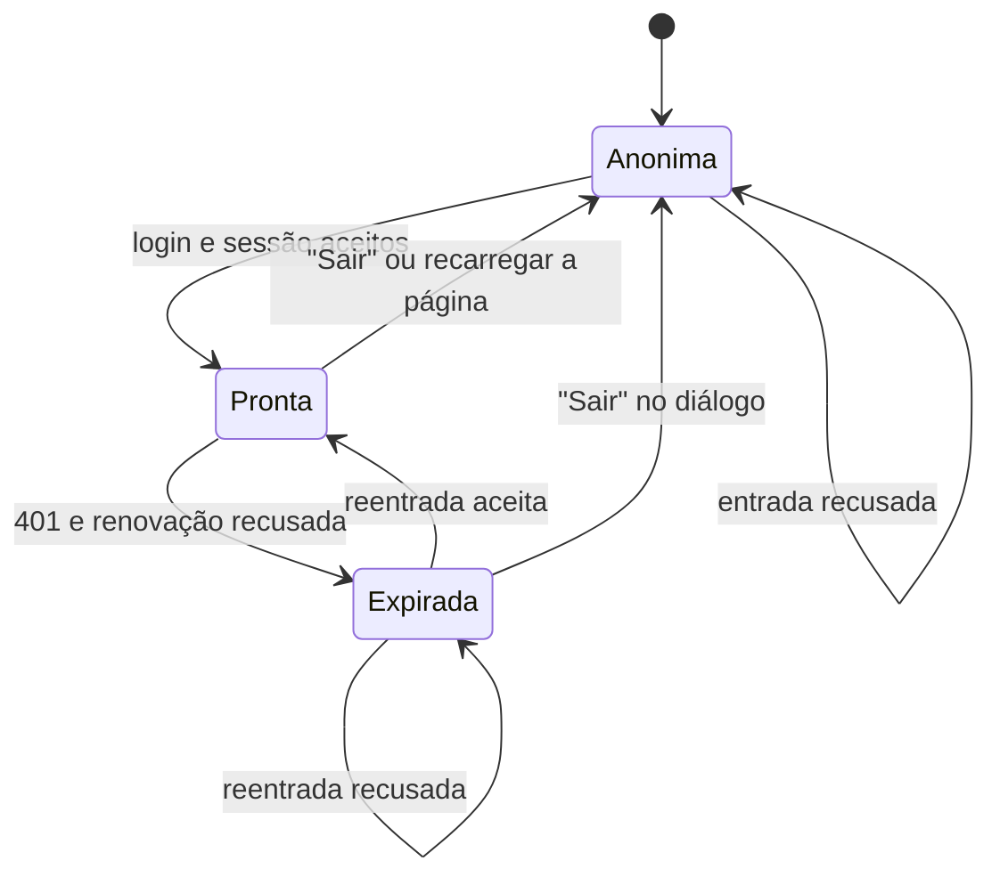

Origem: `src/contexts/apiSession.ts:55-87` · `src/contexts/session.ts:12` · `src/components/layout/sessionSurface.ts:5-18` · `src/services/api/client.ts:79-82` · `src/contexts/__tests__/apiSession.test.ts`

### 4.2 Notificação

Estados: **não lida** (conta no número do sino) e **lida** (não conta). A linha no painel tem a mesma aparência nos dois.

| De | Para | Gatilho |
|---|---|---|
| (não existe) | Não lida | o servidor grava o aviso para a conta; ou, em "Projeto sem notícias", o projeto passa de 120 dias sem atualização |
| Não lida | Lida | a pessoa abre o painel com o aviso na lista |
| Lida | Não lida | só em "Projeto sem notícias": uma nova atualização de progresso seguida de novo silêncio de 120 dias gera uma linha nova |
| qualquer | (fora da lista) | 30 avisos mais novos passam à frente; em "Projeto sem notícias", o projeto volta a ter notícias |

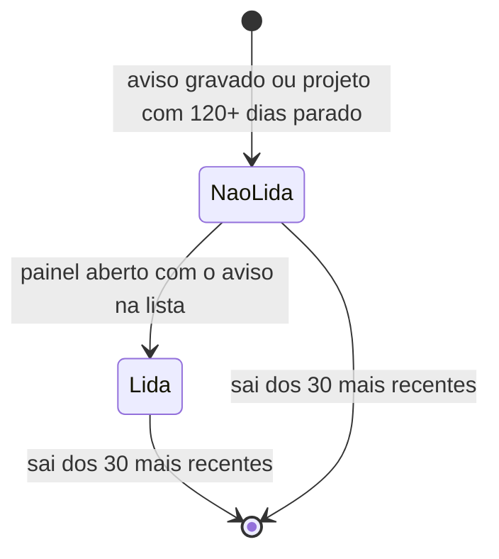

Origem: `src/components/layout/NotificationBell.tsx:18-21` · `app/services/shema/mark_notifications_read.py` · `app/services/shema/list_notification_panel.py:133-136,352-357`

### 4.3 Status do projeto (derivado a cada leitura)

Rótulos: "Não iniciado", "Em andamento", "Fase final", "Concluído", "Pausado", "Cancelado", "Planejado", "Sem informação".
Seis são gravados pela ficha; "Não iniciado" e "Fase final" só existem quando não há status gravado e saem do progresso.
Origem: `app/utils/shema_derivations.py:472` · `app/utils/shema_derivations.py:76` · `src/constants/status.ts:12`.

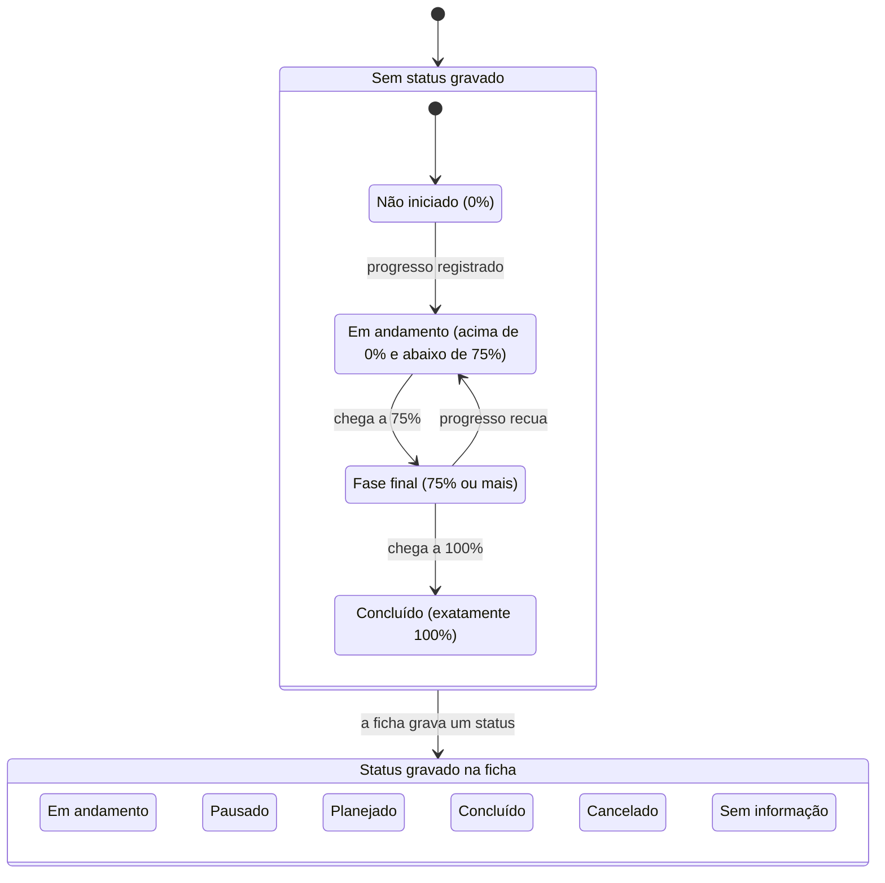

Dentro de "Status gravado na ficha", a ficha pode trocar um status por outro a qualquer momento; o gravado sempre vence o
progresso.

### 4.4 Notícias do projeto ("Atualização")

Rótulos: "Em dia", "Sem notícias 60+ dias", "Crítico 120+ dias"; e sem situação (não se aplica). Deriva, no servidor, dos dias
entre o dia da consulta (UTC) e o registro de progresso mais novo (ou a data de início).
Origem: `app/utils/shema_derivations.py:572` · `app/utils/shema_derivations.py:549` · `src/constants/status.ts:40`.

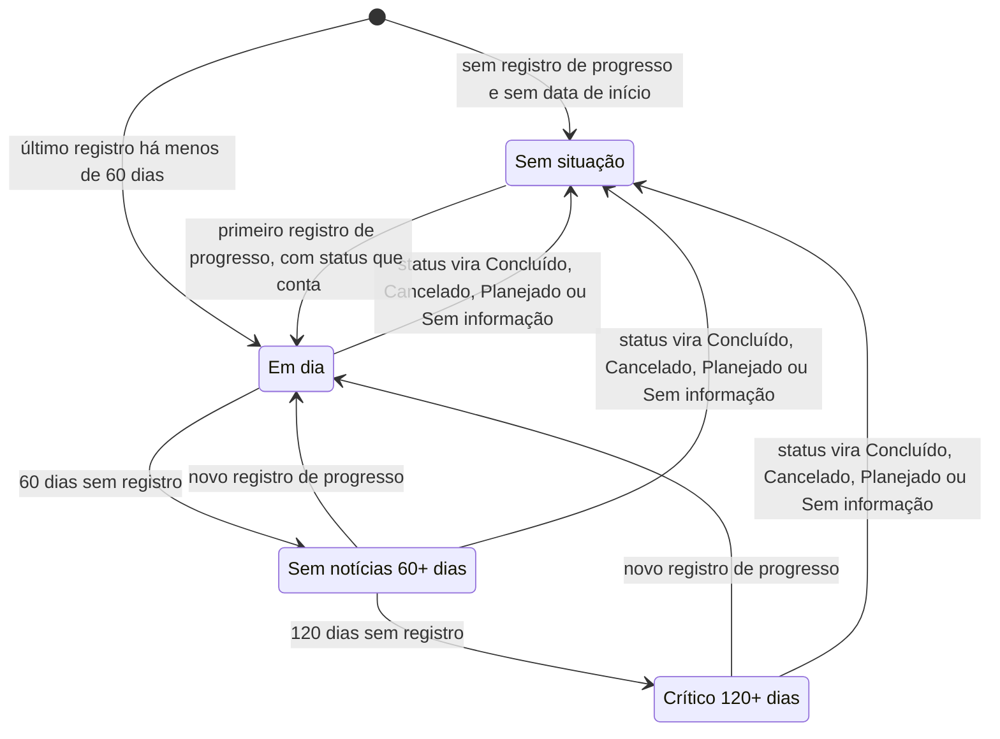

### 4.5 Prioridade do cartão

Não tem ciclo próprio: é recalculada a cada leitura, na ordem abaixo (vale a primeira que se aplicar).
Origem: `app/utils/shema_derivations.py:649` · `src/constants/status.ts:57`.

| Ordem | Condição | Rótulo |
|---|---|---|
| 1 | status "Cancelado" | "Cancelado" |
| 2 | status "Pausado" | "Pausado" |
| 3 | saúde geral "Crítica" ou notícias "Crítico 120+ dias" | "Precisa de atenção agora" |
| 4 | saúde geral "Atenção" ou "Sem notícias 60+ dias" | "Merece um olhar" |
| 5 | status "Concluído" | "Concluído" |
| 6 | status "Planejado" | "Planejado" |
| 7 | status "Sem informação" | "Sem informação" |
| 8 | nenhuma das anteriores | "Em andamento" |

### 4.6 Assento do organograma

Estados: vago ("Sem responsável"; nas outras telas, "— a definir") e ocupado (o nome). Toda transição é um salvamento do
Administrador (da região) e gera uma linha no registro de trocas.
Origem: `app/services/shema/save_region_team.py:141` · `src/components/pages/equipe/RegionRoles.tsx:78`.

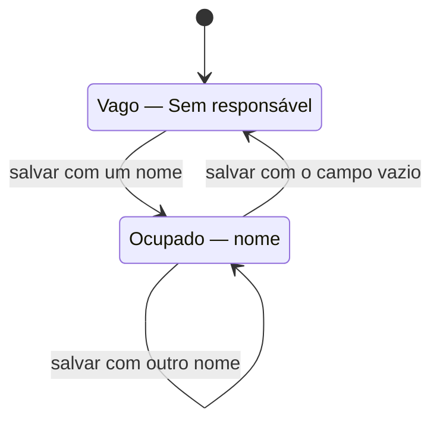

### 4.7 Crédito ETEN de um projeto num ano fiscal

Estados da célula "Créditos": "sem dado", "0", "1", "Concluído, sem ano registrado" e o valor "informado à mão".
Origem: `app/utils/shema_derivations.py:1074` · `src/components/pages/eten/CreditTable.tsx:26`.

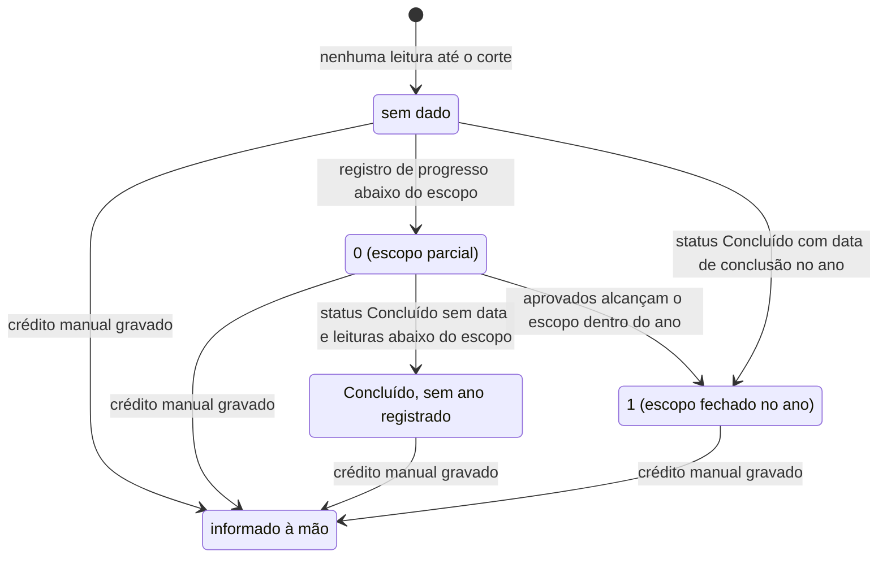

O ano fiscal tem dois estados: em curso ("encerra em 31/07") e encerrado ("encerrado em 31/07"); passa de um a outro em 1º de
agosto (`src/components/pages/eten/YearSelector.tsx:29`).

### 4.8 Visão salva

Dois estados, reavaliados a cada leitura das contagens sem filtro: aplicável, e com um filtro que "não se aplica mais"
([RN-PME-052](#rn-pme-052)). Volta a ser aplicável se um projeto voltar a usar o valor.
Origem: `src/components/pages/projetos/SavedViews/availability.ts:63`.

### 4.9 Ficha (rascunho e salvamento)

Estados, com o que a tela mostra:
- **Nova**: endereço `/ficha/novo`, topo "Novo Projeto", sempre em editar.
- **Salva, em leitura**: topo "Cadastro do projeto".
- **Salva, em edição**: topo "Editar Projeto"; com mudança, o rodapé diz "Rascunho guardado neste navegador.".
- **Em conflito**: quadro "Alguém salvou esta ficha enquanto você editava".
- **Recusada**: quadro "O servidor recusou este salvamento".
- **Envio com falha**: quadro com a frase da falha e "Salvar de novo".
- **Criada com resposta perdida**: quadro "O primeiro envio já tinha chegado".

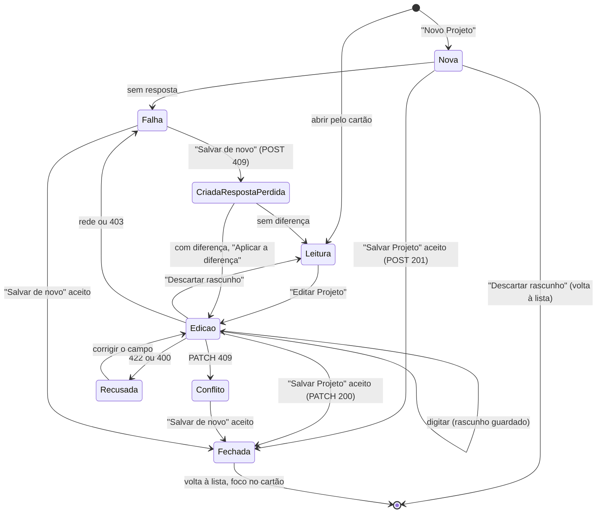

Origem: `src/components/pages/ficha/index.tsx:169` · `src/stores/projectRecordStore.ts:212` · `src/components/pages/ficha/SaveOutcomeNote.tsx:85` · `src/components/pages/ficha/RecordHero.tsx:24`.

### 4.10 Necessidade

Situações (campo "Status"): "Aberto", "Em curso", "Atendido", "Não é mais necessário". A tela e o servidor aceitam qualquer
mudança entre as quatro; não há ordem obrigatória. Reconhecimento: "não vista" → "vista" ("Visto em {data} por {nome}"), sem
volta. Uma necessidade salva nunca é apagada.

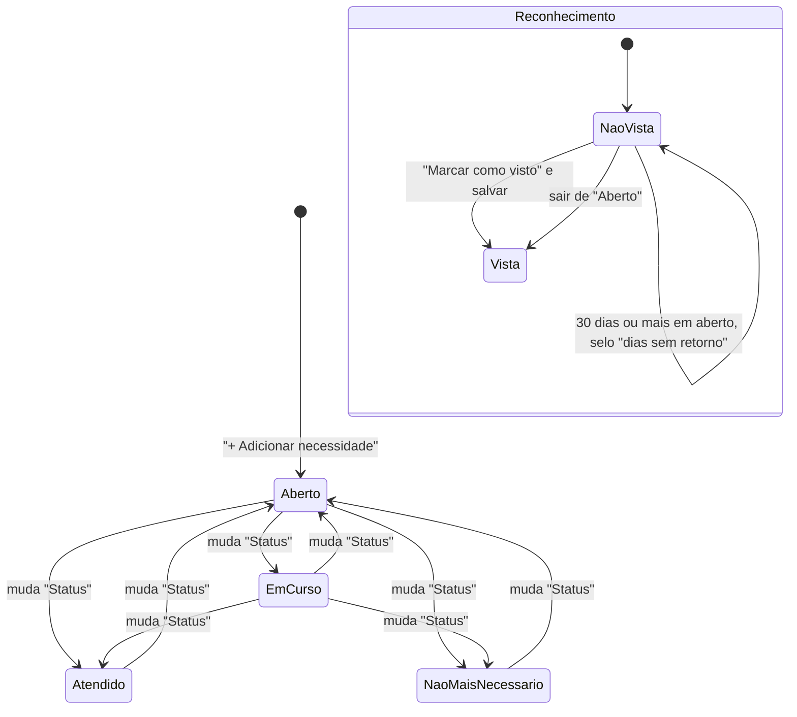

Origem: `src/constants/project.ts:109` · `src/utils/needs.ts:67` · `src/utils/needs.ts:127` · `app/services/shema/_needs.py:271` · `app/models/shema_need.py:247`.

### 4.11 Autorização de foto e de vídeo

- **Item anexado na ficha (só neste navegador)**: "Sem decisão registrada — tratado como uso restrito" → "Uso autorizado" ou "Uso restrito", pela caixa "Autorizo compartilhar"; trocar a imagem ou o link volta a "sem decisão".
- **Foto do servidor (veio do Pulso Mensal)**: nasce autorizada se o líder marcou a autorização no Pulso Mensal, ou sem decisão; "Retirar autorização" leva a "Uso restrito", sem volta pela ficha.

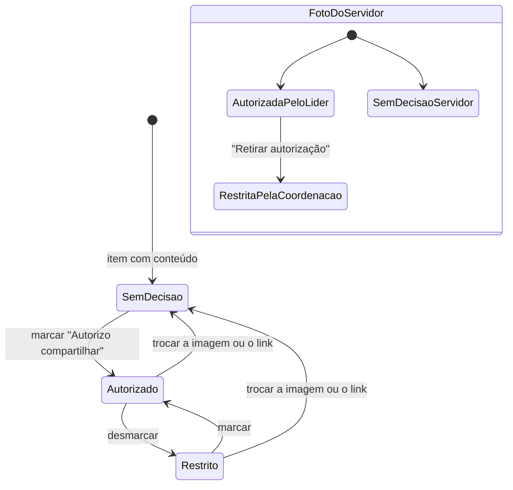

Origem: `src/utils/media.ts:72` · `src/utils/media.ts:107` · `src/components/pages/ficha/tabs/midia/controls.tsx:77` · `app/services/shema/_media_sharing.py:199` · `app/services/shema/withdraw_image_authorization.py:41`.

### 4.12 Pulso Mensal recebido

Estados (rótulo da linha em "Formulários recebidos"): "Ainda não aplicado na ficha" e "Aplicado na ficha em {{date}}".

- **Chegada pelo link do líder** (o líder toca em "Enviar"): nasce "Ainda não aplicado na ficha".
- **Chegada por arquivo** ("Receber Atualização" → "Confirmar e aplicar na ficha"): nasce e é aplicado na mesma chamada; se a ficha mudou (409), fica "Ainda não aplicado na ficha".
- **Aplicar** ("Aplicar na ficha" ou "Aplicar de novo", pelo Administrador da região): passa a "Aplicado na ficha em {{date}}". Não há volta, edição nem exclusão.
- O texto guardado só muda em dois casos, tratados na seção de consentimento: a equipe retira a autorização do pedido de oração que aquele Pulso Mensal compartilhou, ou a coordenação retira a autorização da imagem.

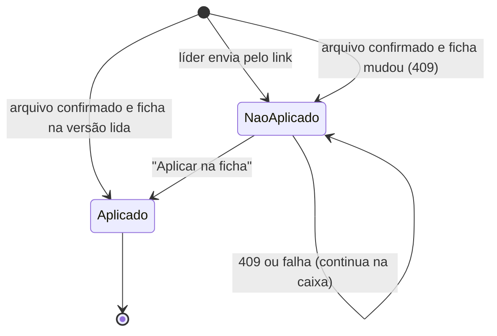

Origem: `app/services/shema/receive_submission.py:66-99` · `app/services/shema/import_submission.py:140,231-338` · `src/components/pages/formularios/ReceivedArchive.tsx:130-141,171-183` · `src/components/pages/formularios/pulseApply.ts:12-38`.

### 4.13 Link do líder

Estados (rótulo na lista do diálogo): "Aguardando", "Já usado", "Expirado", "Revogado". O servidor lê nesta ordem: revogado, expirado, usado, aguardando.

- **Gerar link**: nasce "Aguardando".
- **Primeira resposta aceita**: "Aguardando" → "Já usado". O link continua aceitando respostas.
- **Fim do último dia de validade**: "Aguardando" ou "Já usado" → "Expirado".
- **"Revogar"**: "Aguardando" ou "Já usado" → "Revogado". Um link revogado não volta e não passa a "Expirado".

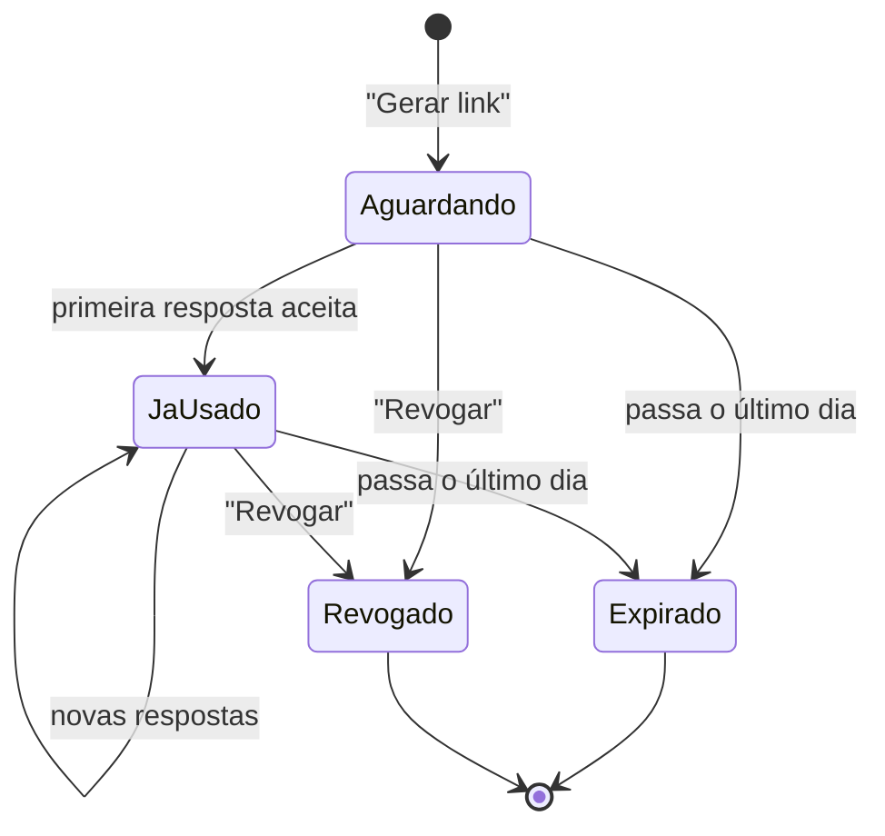

Origem: `app/services/common/tokens/status.py:45-57` · `app/services/shema/_intake_tokens.py:85-145` · `app/services/shema/receive_submission.py:97-98` · `app/services/shema/revoke_intake_link.py:51` · `src/constants/linkStatus.ts:3-8` · `src/components/pages/dados/LeaderLinkDialog.tsx:141-161`.

### 4.14 Rascunho da Avaliação de Saúde

Estados: sem rascunho; em preenchimento (guardado no navegador, um por projeto); enviado.

- **Primeira alteração**: sem rascunho → em preenchimento.
- **Cada alteração**: o rascunho é regravado, com o dia.
- **"Salvar avaliação" aceito**: o rascunho é apagado e a leitura passa a existir no histórico da ficha.
- **"Salvar avaliação" recusado ou sem rede**: o rascunho continua.
- **Sair da conta**: o rascunho é apagado (ver a área de Sessão).

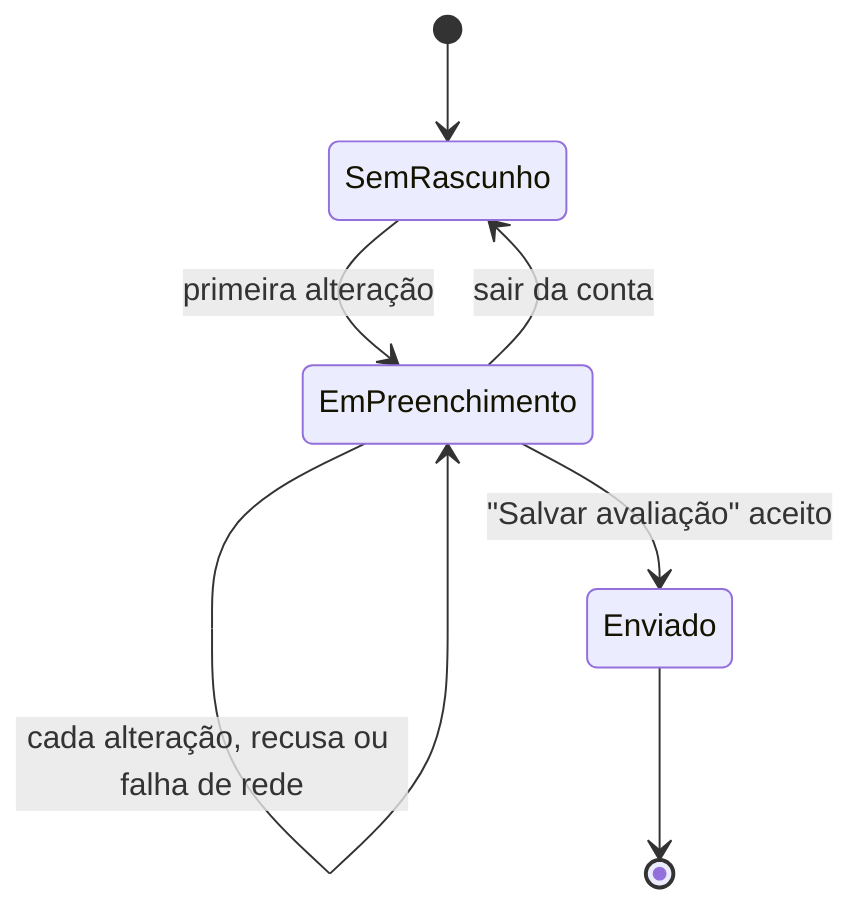

Origem: `src/stores/assessmentStore.ts:24-41` · `src/components/pages/avaliacao/index.tsx:225-263` · `src/stores/__tests__/assessmentAutosave.test.ts`.

### 4.15 Recebimento de um arquivo ("Receber Atualização")

Passos do diálogo: escolher → lendo → (recusado | ficha não lida | fora de onde grava | prévia) → enviando → (aplicado | conflito | falha, que volta à prévia com "Tentar de novo"). Fechar o diálogo volta a "escolher".

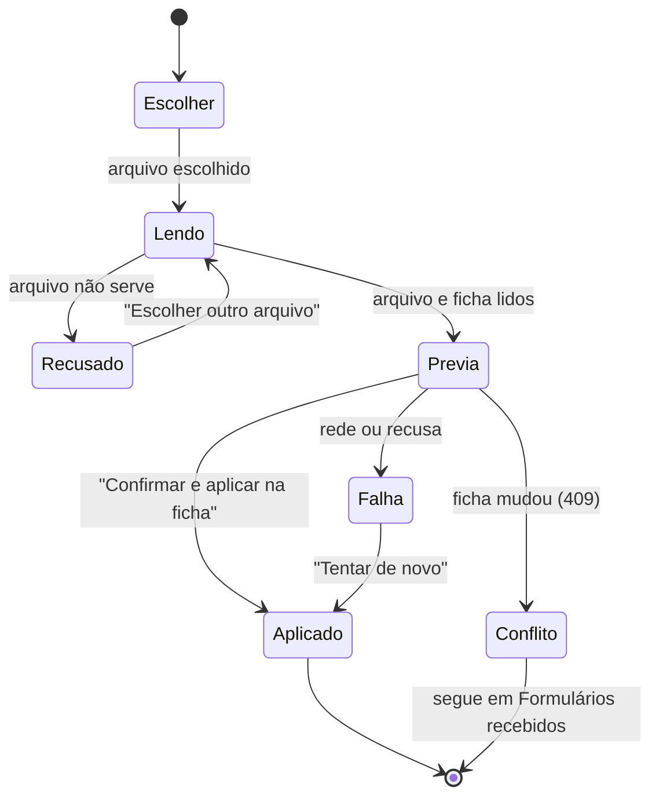

Origem: `src/components/pages/dados/receivePulse.ts:23-34,45-92` · `src/components/pages/dados/ReceiveUpdateDialog.tsx:131-182`.

### 4.16 Reunião do Ritmo (por reunião, região e período corrente)

Estados, com o rótulo da tela: "A iniciar" (nunca registrada na região), "A fazer" (sem registro no período corrente, com registro no anterior), "Atrasada" (com registro só em período mais antigo), "Em dia" (com registro no período corrente). O estado não é gravado: é derivado do registro a cada leitura.

Transições: "Registrar reunião" com data no período corrente leva a "Em dia"; a virada do período leva de "Em dia" para "A fazer" e, sem novo registro, de "A fazer" para "Atrasada"; "Desfazer" devolve a linha ao estado que os registros restantes derem.

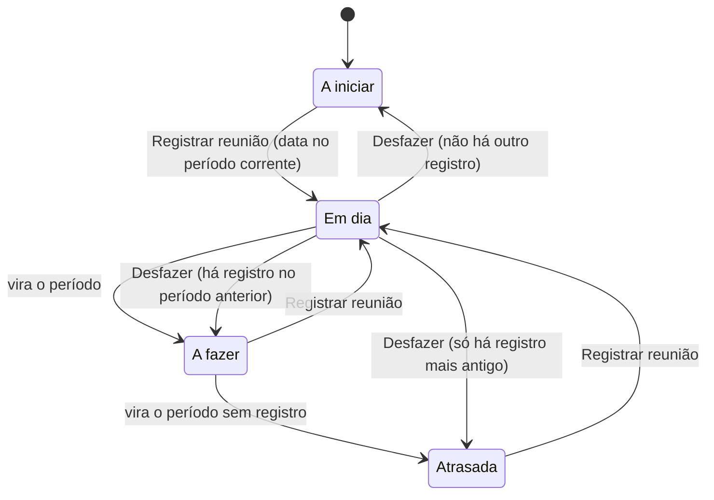

Origem: `src/utils/rhythm.ts:52` · `src/stores/rhythmStore.ts:203` · `src/stores/rhythmStore.ts:231` · `app/services/shema/log_meeting.py:122` · `app/services/shema/undo_meeting.py:29`.

### 4.17 Pedido de oração (do ponto de vista do mural)

Estados: "Só a coordenação" (o padrão; fora do mural); no mural (público "Rede de oração", projeto que não é sensível); aguardando revisão (público "Rede de oração", projeto sensível, na fila "Revisão"); liberado (projeto sensível, no mural com o texto liberado). Nenhum desses estados é gravado como tal: o servidor os calcula a cada leitura a partir do público, do texto e da liberação.

Transições: a equipe escolhe "Rede de oração" (ou marca a necessidade como "Compartilhado em rede de oração"); a coordenação clica em "Liberar para o mural"; a equipe reescreve o texto; o projeto é marcado como sensível; a equipe volta para "Só a coordenação".

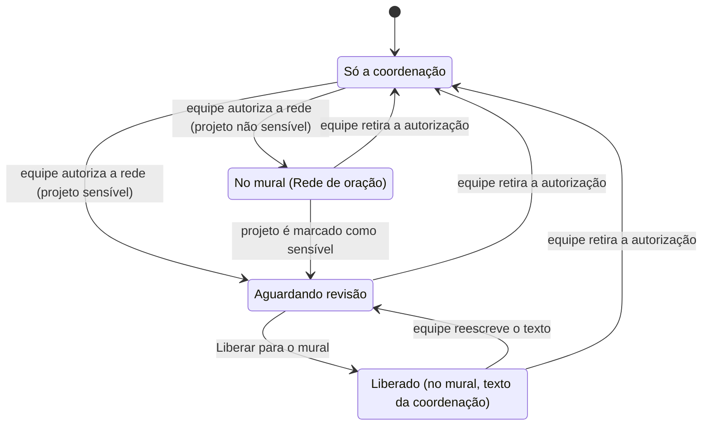

Origem: `app/services/shema/_consent.py:105` · `app/services/shema/_consent.py:160` · `app/services/shema/_consent.py:313` · `app/services/shema/_consent.py:375` · `src/components/pages/oracao/RevisaoPage.tsx:164`. As regras de quem escolhe o público e do que acontece ao retirar estão na seção de consentimento.

### 4.18 Intercessor da rede

Estados: na rede sem listar (tem só o consentimento `network`; é contado, não aparece); listado (tem também `directory`; aparece na lista); "Revisão pendente" (listado, há mais de 365 dias sem entrada, revisão ou envio); fora da rede (removido pela coordenação ou saiu pelo link; o cadastro deixa de existir).

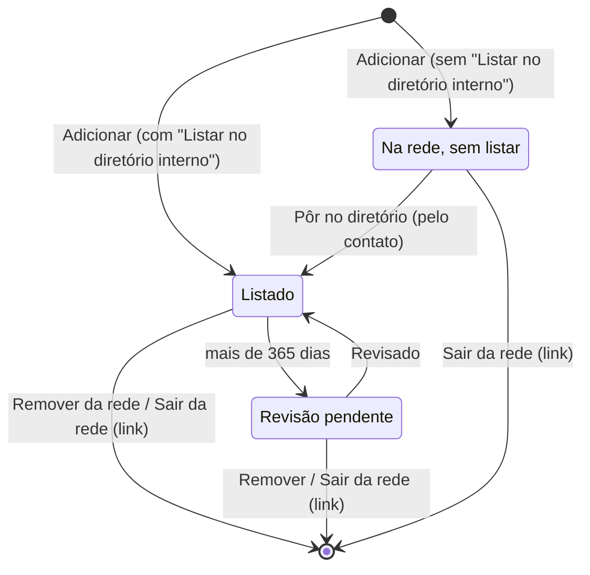

Origem: `app/services/shema/add_intercessor.py:65` · `app/services/shema/admit_to_directory.py:51` · `app/services/shema/_directory.py:618` · `app/services/shema/_directory.py:636` · `app/services/shema/_directory.py:339` · `app/services/shema/_directory.py:757`. Quem está sem listar não pode ser removido pela tela, porque a tela não o enxerga.

### 4.19 Convite

Estados, com o rótulo da tela: **"Aguardando"** (pendente), **"Já usado"** (aceito; em `/convite`: "Este convite já foi
aceito"), **"Expirado"** (em `/convite`: "Este convite venceu") e **"Revogado"**. A lista "Convites não aceitos" mostra os
três que não foram aceitos; o aceito sai dela.

- Criado → "Aguardando": o Admin envia o convite ([RN-PME-291](#rn-pme-291)), ou a confirmação de um projeto cria um convite de equipe ([RN-PME-302](#rn-pme-302)).
- "Aguardando" → "Já usado": a pessoa aceita em `/convite` com a conta do e-mail convidado ([RN-PME-296](#rn-pme-296)).
- "Aguardando" → "Revogado": o Admin revoga na lista ([RN-PME-294](#rn-pme-294)), ou concede ou revoga direto o mesmo papel para o mesmo e-mail ([RN-PME-284](#rn-pme-284)).
- "Aguardando" → "Expirado": passam 7 dias ([RN-PME-293](#rn-pme-293)).
- "Expirado" → "Revogado": o Admin concede ou revoga direto o mesmo papel para o mesmo e-mail.
- "Já usado" e "Revogado" são finais: um aceito não pode mais ser revogado (o que se revoga é o papel).

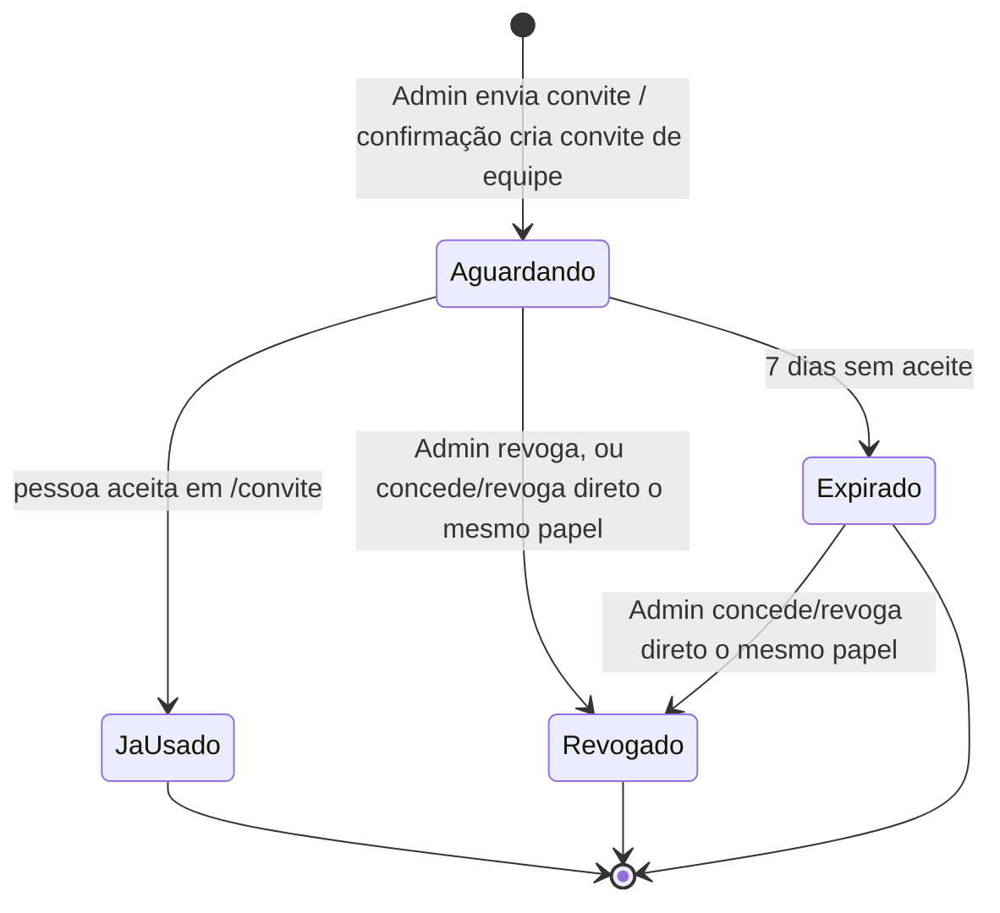

Origem: `app/services/resource_request_access/_invite_status.py:15` · `app/services/resource_request_access/invite_store.py:210` · `app/services/resource_request_access/invite_store.py:227` · `src/constants/linkStatus.ts:3` · `src/components/pages/convite/ConviteView.tsx:19`

### 4.20 Projeto aguardando confirmação

Estados: **"Aguardando confirmação"**, **confirmado** (passa a ser um projeto comum; a tela diz "{nome} confirmado — o
projeto já aparece em Projetos.") e **descartado** ("{nome} foi descartado. O pedido continua aprovado e sem projeto.").

- Criado → "Aguardando confirmação": a mesa aprova um pedido de recurso feito por link externo (bloco INT-F).
- "Aguardando confirmação" → confirmado: o Admin clica em "Confirmar projeto" ([RN-PME-302](#rn-pme-302)).
- "Aguardando confirmação" → descartado: o Admin clica em "Descartar" e dá o motivo ([RN-PME-303](#rn-pme-303)).
- Confirmado e descartado são finais para a conferência. Uma aprovação posterior do mesmo link, depois de um descarte, cria um novo projeto aguardando confirmação.

```mermaid
stateDiagram-v2
    [*] --> AguardandoConfirmacao: mesa aprova pedido de recurso por link externo (INT-F)
    AguardandoConfirmacao --> Confirmado: Admin clica em "Confirmar projeto"
    AguardandoConfirmacao --> Descartado: Admin clica em "Descartar" com motivo
    Confirmado --> [*]: vira projeto comum, visível em Projetos
    Descartado --> [*]: nunca aparece; o pedido de recurso segue aprovado
```

Origem: `app/services/shema/confirm_project.py:82` · `app/services/shema/confirm_project.py:119` · `app/services/shema/reject_pending_project.py:52` · `app/services/shema/_scope.py:405` · `tests/test_shema/test_pending_projects.py:980`

### 4.21 Marca de país sensível

Estados (a ficha diz qual vale só a quem lê a verdade, [RN-PME-313](#rn-pme-313)): **não sensível**; **sensível por país** ("Sensível por causa
do país…"); **sensível por marca própria** ("Sensível por marca própria…"); **listado, ainda não marcado** ("O local salvo
nomeia {países}… ainda não está marcado…").

- Não sensível → sensível por país: o projeto é criado, salvo ou confirmado com um local que nomeia um país da lista.
- Não sensível → sensível por marca própria: a coordenação marca a caixa.
- Não sensível → listado, ainda não marcado: o Admin põe na lista o país de um projeto já gravado.
- Listado, ainda não marcado → sensível por país: o projeto é salvo com alguma alteração.
- Listado, ainda não marcado → não sensível: o Admin tira o país da lista antes de alguém salvar.
- Sensível por marca própria → não sensível: a coordenação desmarca a caixa.
- Sensível por marca própria → sensível por país: o país entra na lista, ou o local passa a nomear um país listado.
- Sensível por país → sensível por marca própria: o Admin tira o país da lista, ou o local deixa de nomear país listado. A marca fica; só a coordenação desmarca.
- Sensível por país → não sensível: **não existe** em um passo.

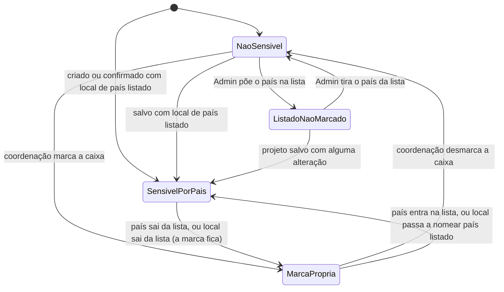

Origem: `src/utils/sensitiveMark.ts:9` · `app/services/shema/_redaction.py:431` · `app/services/shema/_redaction.py:448` · `app/services/shema/_redaction.py:537` · `tests/test_shema/test_sensitive_countries.py:267` · `tests/test_shema/test_sensitive_countries.py:331`

## 5. Dados sensíveis e privacidade

Esta seção é uma **propriedade de segurança**, não uma opção de tela. Ela vale para toda tela, todo arquivo e toda rota, e
quem a decide é o servidor: o PME só mostra o que recebeu. Três regras gerais ficam com outras áreas e só são citadas aqui:
o cadastro dos intercessores da rede (contato mascarado e consentimento por contexto) está na área Rede de intercessores; o
conteúdo dos arquivos está em Exportar e Importar; o que o navegador guarda e apaga ao sair está na área Sessão.

### RN-PME-311 · Um projeto é sensível por duas marcas: pelo país da lista ou por marca própria
- **Gatilho:** um projeto é criado, salvo ou confirmado; ou a coordenação marca a caixa "País sensível para divulgação da Bíblia".
- **Condição:** marca por país: o local nomeia um país da lista de países sensíveis, em qualquer trecho entre vírgulas, sem contar maiúsculas, acentos nem as grafias alternativas cadastradas. Marca própria: a caixa foi marcada num projeto cujo país não está na lista.
- **Efeito:** o servidor liga a marca por país sozinho; ninguém precisa lembrar. A marca própria é uma decisão da coordenação. Com qualquer das duas, o projeto é um projeto sensível e todas as regras desta seção valem.
- **Exceções:** um trecho que só contém o nome de um país ("Indiana") não é esse país.
- **Origem:** `app/services/shema/_redaction.py:431` · `app/services/shema/save_project.py:289` · `app/services/shema/confirm_project.py:118` · `app/utils/shema_derivations.py:441` · `src/components/pages/ficha/tabs/identidade/SensitiveFlag.tsx:64` · `tests/test_shema/test_sensitive_countries.py:267`

### RN-PME-312 · A marca só liga sozinha; nunca desliga sozinha
- **Gatilho:** o Admin tira um país da lista, alguém muda o local para fora da lista, ou um arquivo é importado.
- **Condição:** o projeto já está marcado.
- **Efeito:** a marca fica. Só a coordenação desmarca, à mão, e só quando o local não nomeia país da lista. Enquanto o local nomear um país da lista, a caixa fica travada e desmarcar não muda nada. Um arquivo importado pode ligar a marca e nunca desligar.
- **Exceções:** um projeto gravado antes de o país entrar na lista não é marcado ao ser lido nem ao salvar a lista: a marca liga no próximo salvamento com alguma alteração.
- **Origem:** `app/services/shema/_redaction.py:431` · `app/services/shema/_redaction.py:537` · `src/components/pages/ficha/tabs/identidade/SensitiveFlag.tsx:68` · `tests/test_shema/test_sensitive_countries.py:317` · `tests/test_shema/test_sensitive_countries.py:331` · `tests/test_shema/test_sensitive_countries.py:353`

### RN-PME-313 · Só quem lê a verdade ouve qual marca vale
- **Gatilho:** alguém abre a aba "Identidade" de um projeto.
- **Condição:** o leitor é a coordenação ou o Intercessor (papel) da região.
- **Efeito:** a ficha diz "Sensível por causa do país: o local salvo nomeia {países}…", "Sensível por marca própria: o país não está na lista de países sensíveis, mas este projeto foi marcado…" ou, para o projeto ainda não marcado, "O local salvo nomeia {países}… a marca liga quando ele for salvo com alguma alteração."
- **Exceções:** os demais leitores veem só a etiqueta "País sensível", sem o motivo: o servidor não lhes diz quais países da lista o local nomeia.
- **Origem:** `src/utils/sensitiveMark.ts:9` · `src/components/pages/ficha/tabs/identidade/SensitiveFlag.tsx:18` · `app/services/shema/_redaction.py:458` · `src/components/pages/ficha/__tests__/sensitiveMarkRender.test.ts` · `tests/test_shema/test_sensitive_countries.py:393`

### RN-PME-314 · O servidor decide, por papel e região, quem lê a verdade: três leitores
- **Gatilho:** qualquer leitura de um projeto pela tela.
- **Condição:** sempre.
- **Efeito:** **coordenação** (`coordination`): o Admin em qualquer região, o Administrador da região do projeto e o admin da instalação. **Intercessor (papel)** (`trusted`): o Intercessor nas regiões dele, quando a conta não coordena. **Demais** (`other`): todo o resto, na prática o Operacional de Línguas. O cartão e a ficha chegam com essa leitura marcada, e a tela nunca a recalcula.
- **Exceções:** uma conta que é Administrador e tem outro papel regional é coordenação em todas as regiões que alcança. Leitura ausente ou desconhecida fecha: a tela trata como `other`, e tudo que o servidor monta sem leitor sai como "o que sai do sistema" ([RN-PME-322](#rn-pme-322)).
- **Origem:** `app/services/shema/_scope.py:512` · `app/services/shema/_scope.py:607` · `app/models/shema_privacy.py:127` · `app/models/shema_privacy.py:396` · `src/services/api/projectRecord.ts:243` · `src/utils/region.ts:152` · `tests/test_shema/test_reader.py`

### RN-PME-315 · Quem não lê a verdade vê a região no lugar do lugar, sem base e sem contatos
- **Gatilho:** um leitor `other` abre um cartão ou a ficha de um projeto sensível.
- **Condição:** projeto sensível.
- **Efeito:** onde estaria o país e o local aparece o nome da região. O segundo local, a base e os três contatos (da equipe, do líder, do mentor) chegam vazios; as coordenadas aparecem como "—". Os campos ficam desabilitados, com a nota "Só a coordenação — o Administrador da região e o Admin da plataforma — edita o local, as coordenadas e a marcação de país sensível; num país sensível, só ela vê o lugar real, a base e os contatos." A busca e os filtros desse leitor também só enxergam a região.
- **Exceções:** a coordenação e o Intercessor (papel) leem tudo como está. A etiqueta "País sensível" aparece para todo leitor.
- **Origem:** `app/models/shema_privacy.py:202` · `app/models/shema_privacy.py:303` · `app/services/shema/_redaction.py:188` · `src/utils/region.ts:161` · `src/components/pages/ficha/CoordinationOnlyNote.tsx:9` · `src/components/pages/__tests__/baseWithheld.test.ts` · `tests/test_shema/test_withheld_record.py`

### RN-PME-316 · O nome da língua de um projeto sensível vira o nome público, ou "Projeto sensível — {região}"
- **Gatilho:** um leitor que não lê a verdade vê um projeto sensível em qualquer tela.
- **Condição:** projeto sensível.
- **Efeito:** se a coordenação cadastrou o "Nome público da língua" na aba Identidade, é ele que aparece. Sem nome público, a tela escreve "Projeto sensível — {região}", por exemplo "Projeto sensível — África". O nome verdadeiro fica com a coordenação e com o Intercessor (papel). A busca só acha o projeto pelo nome que o leitor lê.
- **Exceções:** só a coordenação cadastra e altera o nome público. O campo só aparece em projeto marcado.
- **Origem:** `app/models/shema_privacy.py:423` · `app/services/shema/_redaction.py:169` · `src/utils/region.ts:104` · `src/components/pages/ficha/tabs/identidade/IdentidadeForm.tsx:275` · `tests/test_shema/test_privacy.py`

### RN-PME-317 · O texto livre de um projeto sensível chega em branco a quem não lê a verdade; alguns campos continuam à vista
- **Gatilho:** um leitor `other` abre a ficha de um projeto sensível.
- **Condição:** projeto sensível.
- **Efeito:** chegam em branco: "Notas livres", "Notas sobre a saúde", os comentários de status, o detalhamento do escopo, as observações do objetivo, do financeiro e das necessidades, a organização parceira, a meta do status, a descrição de cada necessidade, as notas de cada avaliação de saúde, as legendas das fotos e dos vídeos (e o nome de quem decidiu a autorização) e o local de gravação de cada história. A tela avisa que em branco não quer dizer vazio: "Para o Operacional de Línguas chegam em branco, e em branco não quer dizer que ninguém escreveu."
- **Exceções:** **continuam à vista de todo leitor**: as etapas do projeto, os detalhes de "Outros" nos recursos, o valor estimado de uma necessidade, o nome de arquivo ou o link de um material, o endereço dos vídeos e os nomes das pessoas (líder, mentor, tradutores, revisores). A ficha avisa: "As etapas do projeto e os detalhes de "Outros" nos recursos continuam à vista: não escreva neles o lugar do projeto."
- **Origem:** `app/models/shema_privacy.py:242` · `app/services/shema/_redaction.py:258` · `src/constants/recordFields.ts:194` · `src/utils/recordAccess.ts:112` · `src/i18n/locales/pt-BR.json:173` · `src/components/pages/ficha/__tests__/freeTextWithheldRender.test.ts` · `tests/test_shema/test_withheld_record.py`

### RN-PME-318 · O pedido de oração de um projeto sensível chega em branco a quem não lê a verdade
- **Gatilho:** um leitor `other` abre a aba "Saúde da Equipe" de um projeto sensível, ou registra uma Avaliação de Saúde nele.
- **Condição:** projeto sensível, seja qual for o público escolhido pela equipe.
- **Efeito:** o campo "Pedidos de oração" aparece vazio e desabilitado, ao lado da nota do texto livre. A vista mantém a seção e o público escolhido, sem o texto. No assistente da Avaliação de Saúde, o passo do pedido de oração fica travado, e a avaliação é registrada sem ele.
- **Exceções:** o Operacional de Línguas continua podendo declarar o público. Num projeto que não é sensível ele lê e escreve o pedido de oração normalmente.
- **Origem:** `app/models/shema_privacy.py:264` · `src/constants/recordFields.ts:215` · `src/components/pages/ficha/tabs/saude/SaudeForm.tsx:25` · `src/utils/recordAccess.ts:131` · `tests/test_shema/test_withheld_prayer_request.py:113` · `tests/test_shema/test_withheld_prayer_request.py:264`

### RN-PME-319 · Não se edita o que não se vê
- **Gatilho:** alguém salva a ficha.
- **Condição:** em **todo** projeto: local, segundo local, coordenadas, a marca de país sensível, o motivo dela e o nome público da língua. Em **projeto sensível**, também: a base, os três contatos, o nome da língua, o texto livre de [RN-PME-317](#rn-pme-317) e o pedido de oração.
- **Efeito:** só a coordenação grava esses campos. Para os outros, a tela os mostra desabilitados e não os envia; se chegarem ao servidor, ele recusa (403) dizendo quais campos, sem dizer nada do valor guardado. Uma descrição de necessidade ou um local de gravação que o leitor recebeu em branco e devolve em branco conta como "não mexi": o texto guardado fica.
- **Exceções:** quem cria um projeto escreve tudo o que digita. Ler como coordenação não dá escrita por si: o Admin que não é Administrador de nenhuma região lê tudo e não grava projeto (regra de escopo de escrita, na área Ficha).
- **Origem:** `app/models/shema_privacy.py:286` · `app/models/shema_privacy.py:298` · `app/services/shema/_redaction.py:474` · `app/services/shema/save_project.py:427` · `src/constants/recordFields.ts:177` · `src/utils/recordAccess.ts:116` · `src/utils/__tests__/recordAccess.test.ts`

### RN-PME-320 · O Intercessor (papel) vê tudo e não edita nada
- **Gatilho:** uma conta com o papel Intercessor, sem coordenar, abre um projeto da região dela.
- **Condição:** sempre, sensível ou não.
- **Efeito:** lê o projeto sensível como a coordenação: lugar, base, contatos, nome verdadeiro, texto livre, saúde e a contagem de projetos recolhidos. Não grava nada de projeto nenhum: não vê "Editar" nem "Novo Projeto", o modo de edição pedido pelo endereço abre como leitura, e o servidor recusa (403) salvar e criar.
- **Exceções:** dos pedidos de oração, lê só os que a equipe autorizou para a rede ([RN-PME-325](#rn-pme-325)). Não recebe a imagem das fotos de projeto sensível ([RN-PME-126](#rn-pme-126)). O Intercessor que também é Administrador é coordenação e edita.
- **Origem:** `app/services/shema/_scope.py:536` · `app/services/shema/save_project.py:293` · `src/utils/recordAccess.ts:92` · `src/utils/access.ts:196` · `tests/test_shema/test_reader.py` · `tests/test_shema/test_withheld_prayer_request.py:161`

### RN-PME-321 · No mapa o projeto sensível fica sempre no centro da região, para todo leitor
- **Gatilho:** o globo é desenhado em Projetos ou no Início.
- **Condição:** projeto sensível.
- **Efeito:** o ponto é desenhado no centro da região, nunca no lugar real, mesmo para a coordenação, com a dica "País sensível · posição aproximada". O aviso "{n} projetos em países sensíveis — exibidos na região, sem o local exato" aparece só para quem lê a verdade em alguma região: a coordenação e o Intercessor (papel). O grupo de filtro "País sensível" segue a mesma regra.
- **Exceções:** os demais leitores não recebem o número nem o filtro; cada cartão continua marcado como sensível para todos. Com zero projetos recolhidos não há aviso.
- **Origem:** `src/utils/region.ts:124` · `src/components/pages/projetos/Atlas/GlobeOverlays.tsx:92` · `app/services/shema/_redaction.py:112` · `app/services/shema/browse_projects.py:338` · `app/services/shema/_scope.py:555` · `src/utils/gatedFacets.ts:14`

### RN-PME-322 · O que sai do sistema nunca leva o lugar nem a base de um projeto sensível, seja quem for o leitor
- **Gatilho:** o sistema monta a exportação, o mural de oração, o Pulso de Oração, uma notificação, o relatório ETEN, o relatório anual ou a página do link do líder.
- **Condição:** projeto sensível.
- **Efeito:** no lugar do país vai a região; a base e os contatos não vão; o nome da língua é o nome público ou "Projeto sensível — {região}". Vale até para a coordenação, porque um arquivo ou um aviso pode ser repassado. Cada linha continua dizendo que o lugar foi recolhido.
- **Exceções:** a linha do arquivo exportado que conta quantos projetos foram recolhidos só é escrita quando quem exporta é a coordenação.
- **Origem:** `app/models/shema_privacy.py:396` · `app/models/shema_privacy.py:455` · `app/services/shema/export_projects.py:152` · `app/services/shema/list_prayer_requests.py:49` · `app/services/shema/eten_report.py:160` · `app/services/shema/read_intake_form.py:102` · `app/services/shema/list_notification_panel.py:247` · `src/utils/region.ts:166` · `src/utils/annualReport.ts:61` · `app/services/shema/_scope.py:564`

### RN-PME-323 · A ordem das listas segue o nome impresso
- **Gatilho:** a lista de Projetos ou o relatório ETEN é ordenado por nome.
- **Condição:** há projeto sensível sem nome público para aquele leitor.
- **Efeito:** o servidor ordena pela frase que a tela imprime, no idioma da tela: "Projeto sensível — África" fica entre os nomes com P. A tela informa o idioma em cada leitura e lê de novo quando o idioma muda.
- **Exceções:** as ordenações feitas no navegador (o relatório anual e os seletores de projeto, como o de Acesso e o de Formulários) ainda usam o valor recebido, não a frase impressa.
- **Origem:** `src/utils/forms.ts:138` · `src/utils/annualReport.ts:104` · `src/services/api/endpoints.ts:947` · `src/services/api/projectBrowse.ts:250` · `app/api/shema/_deps.py:425` · `app/utils/shema_printed_names.py:57` · `src/utils/__tests__/sensitiveProjectNames.test.ts`

### RN-PME-324 · A saúde da equipe tem público próprio, e o Admin a recebe vazia
- **Gatilho:** qualquer leitura de cartão, ficha, filtro ou arquivo com dados de saúde.
- **Condição:** sempre.
- **Efeito:** **leem** a saúde o Administrador, o Operacional de Línguas e o Intercessor (papel), nas suas regiões. **Registram** a Avaliação de Saúde e o acompanhamento pastoral só o Administrador e o Operacional de Línguas. O Admin que não tem um desses papéis recebe todos os campos de saúde vazios. Para não dizer "ninguém avaliou" de uma equipe avaliada, a tela não desenha para ele a aba "Saúde da Equipe", o grupo de filtro e a ordenação por saúde, e o cartão da "Avaliação de Saúde" em Formulários diz "A saúde da equipe é lida pelo Administrador da região, pelo Operacional de Línguas e pelo Intercessor — por isso a situação da avaliação não aparece para o seu papel."
- **Exceções:** o admin da instalação lê a saúde no servidor. Os cartões da lista de Projetos ainda mostram "Ainda não conversado" ao Admin (ver Fora de escopo).
- **Origem:** `app/services/shema/_health_audience.py:81` · `app/services/shema/_health_audience.py:87` · `app/services/shema/_health_audience.py:216` · `src/utils/access.ts:235` · `src/utils/access.ts:249` · `src/constants/recordTabs.ts:55` · `src/utils/forms.ts:50` · `tests/test_shema/test_health_reader.py:179`

### RN-PME-325 · O pedido de oração tem dois públicos, e sem escolha vale "Só a coordenação"
- **Gatilho:** alguém escreve ou lê um pedido de oração.
- **Condição:** sempre.
- **Efeito:** em "Quem pode ver este pedido" há duas opções. **"Só a coordenação"**: na ficha, o texto é lido pelo Administrador e pelo Operacional de Línguas da região; o Admin e o Intercessor (papel) recebem o texto em branco; não vai para o mural. **"Rede de oração"**: o pedido vai para o mural de oração e é lido também pelo Admin e pelo Intercessor (papel). Sem nenhuma escolha gravada vale "Só a coordenação", e a tela diz "Sem autorização explícita, o pedido fica só com a coordenação." Ao mural chega só o que foi autorizado, pedido por pedido: o pedido do projeto pelo público dele, e cada necessidade pela sua própria marca de compartilhar.
- **Exceções:** só o Administrador e o Operacional de Línguas escrevem o pedido e decidem o público; o servidor recusa (403) os demais. Em projeto sensível vale antes [RN-PME-318](#rn-pme-318).
- **Origem:** `app/services/shema/_consent.py:91` · `app/services/shema/_consent.py:193` · `app/services/shema/_consent.py:217` · `app/services/shema/_consent.py:422` · `src/utils/prayer.ts:13` · `src/components/pages/ficha/tabs/saude/PrayerConsent.tsx:77` · `tests/test_shema/test_withheld_prayer_request.py:143` · `tests/test_shema/test_prayer.py`

### RN-PME-326 · Retirar o consentimento tira o pedido de oração do mural e do Pulso Mensal guardado, sem apagá-lo da ficha
- **Gatilho:** alguém muda o público de "Rede de oração" para "Só a coordenação" e salva.
- **Condição:** o pedido de oração estava no mural.
- **Efeito:** a próxima leitura do mural já não traz o pedido, e ele não entra nos próximos arquivos. O servidor apaga o texto dos Pulsos Mensais guardados que o compartilharam com exatamente as mesmas palavras. O texto continua na ficha, para quem acompanha a equipe.
- **Exceções:** o que já foi enviado à rede não volta, e a tela diz isso antes da escolha, sob a opção "Rede de oração": "Depois que um pedido é enviado à rede, ele não pode ser recolhido." Um Pulso Mensal que guardou uma redação diferente do pedido fica como chegou.
- **Origem:** `app/services/shema/_consent.py:599` · `app/services/shema/_consent.py:621` · `app/services/shema/save_project.py:582` · `app/services/shema/_submission_archive.py:310` · `src/components/pages/ficha/tabs/saude/PrayerConsent.tsx:66` · `tests/test_shema/test_prayer_erasure.py`

### RN-PME-327 · Reescrever na ficha um pedido de oração já compartilhado mantém a autorização
- **Gatilho:** o Administrador ou o Operacional de Línguas reescreve o texto do pedido de oração na aba "Saúde da Equipe" e salva, com "Rede de oração" marcado.
- **Condição:** havia texto antes e continua havendo texto.
- **Efeito:** o pedido continua em "Rede de oração" e aparece no mural com as palavras novas. A ficha envia só o que mudou; o público só é enviado quando a caixa muda.
- **Exceções:** a autorização **não se mantém** e o pedido volta a "Só a coordenação" quando: o texto é apagado; é escrito um primeiro texto onde não havia nenhum; a gravação de áudio é trocada; ou um texto novo chega por um Pulso Mensal ou por um arquivo importado sem dizer o público. Numa necessidade, reescrever a descrição tira o compartilhamento, salvo se ele for reafirmado no mesmo salvamento.
- **Origem:** `app/services/shema/_consent.py:542` · `app/services/shema/_consent.py:645` · `app/services/shema/save_project.py:270` · `app/services/shema/import_submission.py:151` · `app/services/shema/import_projects.py:431` · `src/stores/__tests__/recordSave.test.ts` · `tests/test_shema/test_prayer.py`

### RN-PME-328 · Os erros de validação do servidor não devolvem o valor recusado
- **Gatilho:** o servidor recusa um envio por validação (422), ou falha ao montar uma resposta.
- **Condição:** qualquer rota do módulo Shemá.
- **Efeito:** a resposta diz o tipo do erro, o campo e a frase, e nunca repete o valor enviado. O registro interno do servidor também não guarda o valor. Assim um lugar, um contato ou um pedido de oração não volta numa mensagem de erro.
- **Exceções:** as rotas de outras aplicações do mesmo servidor não seguem esta regra.
- **Origem:** `app/api/shema/_routing.py:48` · `app/api/shema/_routing.py:95` · `tests/test_shema/test_quiet_errors.py:47` · `tests/test_shema/test_quiet_errors.py:211`

### RN-PME-329 · O pacote publicado do PME não carrega dados de projetos
- **Gatilho:** o PME é construído para publicação, ou um pull request é aberto.
- **Condição:** a construção não é explicitamente a de modo fixture.
- **Efeito:** os dois arquivos de dados de teste (projetos e pedidos de oração) são trocados por arquivos vazios antes de entrar no pacote. A cada pull request, a verificação constrói o pacote e falha se achar nele qualquer identificador de projeto de teste ou a base de um projeto sensível.
- **Exceções:** uma construção em modo fixture, de demonstração, carrega os dados de propósito.
- **Origem:** `vite.config.ts:16` · `scripts/check-bundle.mjs:9` · `.github/workflows/lint.yml:28`

### Quem vê o quê de um projeto sensível (campo × leitor)

| Campo | Coordenação (Admin; Administrador da região) | Intercessor (papel) da região | Demais leitores (Operacional de Línguas) | O que sai do sistema | RN |
|---|---|---|---|---|---|
| País e local | o lugar real | o lugar real | o nome da região | a região | [RN-PME-315](#rn-pme-315), [RN-PME-322](#rn-pme-322) |
| Segundo local | lê | lê | vazio | não vai | [RN-PME-315](#rn-pme-315) |
| Coordenadas na ficha | lê | lê | "—" | centro da região | [RN-PME-315](#rn-pme-315) |
| Posição no mapa | centro da região | centro da região | centro da região | — | [RN-PME-321](#rn-pme-321) |
| Base | lê | lê | vazia | não vai | [RN-PME-315](#rn-pme-315), [RN-PME-322](#rn-pme-322) |
| Os três contatos | lê | lê | vazios | não vão | [RN-PME-315](#rn-pme-315), [RN-PME-322](#rn-pme-322) |
| Qual marca vale (país ou própria) | a tela diz | a tela diz | não diz | — | [RN-PME-313](#rn-pme-313) |
| Nome da língua | o verdadeiro | o verdadeiro | nome público, ou "Projeto sensível — {região}" | nome público, ou "Projeto sensível — {região}" | [RN-PME-316](#rn-pme-316), [RN-PME-322](#rn-pme-322) |
| Texto livre da lista de [RN-PME-317](#rn-pme-317) | lê | lê | em branco | as notas nunca vão | [RN-PME-317](#rn-pme-317), [RN-PME-127](#rn-pme-127) |
| Pedido de oração (texto) | Administrador lê sempre; Admin lê só o autorizado | só o autorizado | em branco, sempre | só o autorizado e liberado pela fila de revisão de oração | [RN-PME-318](#rn-pme-318), [RN-PME-325](#rn-pme-325), [RN-PME-198](#rn-pme-198) |
| Legendas de fotos e vídeos | lê | lê | em branco | — | [RN-PME-317](#rn-pme-317) |
| Imagem de foto autorizada | recebe | não recebe | não recebe | não vai | [RN-PME-125](#rn-pme-125) |
| Saúde da equipe | Administrador lê; Admin recebe vazio | lê | lê | — | [RN-PME-324](#rn-pme-324) |
| Quantos projetos foram recolhidos | vê na tela e no arquivo exportado | vê na tela | não vê | — | [RN-PME-321](#rn-pme-321), [RN-PME-322](#rn-pme-322) |
| Etapas, "Outros" dos recursos, nomes das pessoas | lê | lê | lê | — | [RN-PME-317](#rn-pme-317) |
| **Escrita:** lugar, coordenadas, marca, nome público | grava (onde tem escopo de escrita) | não | não | — | [RN-PME-319](#rn-pme-319) |
| **Escrita:** base, contatos, nome da língua, texto livre, pedido de oração | grava (onde tem escopo de escrita) | não | não | — | [RN-PME-319](#rn-pme-319) |
| **Escrita:** demais campos da ficha | grava (onde tem escopo de escrita) | não | grava na sua região | — | [RN-PME-319](#rn-pme-319), [RN-PME-320](#rn-pme-320) |
| Retirar a autorização de uma foto | só o Administrador da região | não | não | — | [RN-PME-126](#rn-pme-126) |

### Onde estão as outras regras de privacidade

As regras acima são as que valem em todo o sistema. As demais moram na área em que a pessoa as encontra:

| Assunto | Regras |
|---|---|
| Consentimento e fila de revisão do pedido de oração | [RN-PME-187](#rn-pme-187), [RN-PME-198](#rn-pme-198) a [RN-PME-201](#rn-pme-201), [RN-PME-117](#rn-pme-117), [RN-PME-150](#rn-pme-150) |
| Fotos e vídeos: autorização por item, imagem por link curto, retirar a autorização | [RN-PME-124](#rn-pme-124), [RN-PME-125](#rn-pme-125), [RN-PME-126](#rn-pme-126), [RN-PME-139](#rn-pme-139), [RN-PME-151](#rn-pme-151) |
| Notas internas | [RN-PME-127](#rn-pme-127) |
| Rede de intercessores: consentimento por contexto, contato revelado um a um, apagar, sair por link | [RN-PME-205](#rn-pme-205) a [RN-PME-210](#rn-pme-210), [RN-PME-217](#rn-pme-217), [RN-PME-218](#rn-pme-218) |
| Exportar: o que o arquivo traz e o que nunca traz | [RN-PME-262](#rn-pme-262), [RN-PME-263](#rn-pme-263), [RN-PME-264](#rn-pme-264) |
| Importar: o que o servidor ignora de um arquivo | [RN-PME-267](#rn-pme-267), [RN-PME-269](#rn-pme-269) |
| O endereço da página nunca leva "Base" nem "País" | [RN-PME-064](#rn-pme-064) |
| O que o navegador guarda e o que sai com a sessão | [RN-PME-006](#rn-pme-006), [RN-PME-010](#rn-pme-010) a [RN-PME-013](#rn-pme-013) |
| Formulários recebidos e o arquivo do Pulso Mensal: nada fica no navegador | [RN-PME-136](#rn-pme-136), [RN-PME-261](#rn-pme-261) |
| O que um aviso do sino mostra de um projeto sensível | [RN-PME-247](#rn-pme-247) |
| O que o link do líder mostra de um projeto sensível | [RN-PME-146](#rn-pme-146) |

## 6. Relação com o Formulário de Recursos

O PME é a porta de entrada do Formulário de Recursos: a conta, a senha e os papéis das duas aplicações moram aqui. As
regras dos fluxos que cruzam as duas aplicações estão em [`integracao-pme-rrf.md`](integracao-pme-rrf.md), em oito blocos.
Este documento só diz o que cada bloco cobre e quais regras do PME tocam nele.

- **INT-A · Contas, papéis e equipe do projeto em comum.** Cobre a conta única das duas aplicações, os papéis que o Admin
  concede no PME para as duas e a equipe do projeto como quem pode fazer um pedido de recurso. No PME: a área Acesso
  ([RN-PME-278](#rn-pme-278) a [RN-PME-290](#rn-pme-290)).
- **INT-B · O card do pedido de recurso no PME.** Cobre o recorte do pedido de recurso que o painel "Pedidos de recurso"
  mostra e quem pode ler os pedidos de um projeto. No PME: [RN-PME-308](#rn-pme-308) e [RN-PME-309](#rn-pme-309).
- **INT-C · Os avisos do Formulário no sino do PME.** Cobre os dois avisos que o Formulário de Recursos grava no sino: a
  chegada de um pedido de recurso e a decisão da Mesa. No PME: [RN-PME-246](#rn-pme-246) e [RN-PME-248](#rn-pme-248).
- **INT-D · O link externo de pedido.** Cobre o link que o Admin emite para quem não tem conta fazer um pedido de recurso:
  o código, a validade, a revogação e o que o titular alcança. No PME: [RN-PME-310](#rn-pme-310).
- **INT-E · O endosso do líder de base.** Cobre a confirmação que o líder de base dá por link e código, sem conta. No PME
  ele aparece só como uma linha do card do pedido de recurso ([RN-PME-308](#rn-pme-308)).
- **INT-F · A aprovação que cadastra o projeto no PME.** Cobre como a aprovação de um pedido de recurso feito por link
  externo cria o projeto aguardando confirmação. No PME: a conferência do Admin ([RN-PME-299](#rn-pme-299) a [RN-PME-303](#rn-pme-303)).
- **INT-G · Quem é dono de cada dado.** Cobre qual aplicação guarda cada dado e o que nunca atravessa de uma para a outra,
  como a avaliação da Mesa, que não chega ao PME. No PME: a seção 5 e [RN-PME-246](#rn-pme-246).
- **INT-H · A passagem do PME para o Formulário.** Cobre o código de passagem que o PME pede e o Formulário troca por uma
  sessão. No PME: a entrada "Círculo de Recursos" e os botões "Solicitar recurso" e "Continuar" ([RN-PME-306](#rn-pme-306) a [RN-PME-308](#rn-pme-308)).

## 7. Fora de escopo

O que alguém esperaria encontrar e **não existe hoje**. Cada item traz a evidência. Nada aqui é promessa de entrega.

### Sessão, casca do app, Início e notificações

- **Sessão que sobrevive ao recarregar a página.** Os tokens ficam só na memória: `src/services/api/tokens.ts:5`.
- **Criar conta na tela de entrada.** A única criação de conta do PME é em `/convite`: `src/components/pages/entrar/index.tsx` não tem cadastro.
- **Trocar a senha ou editar o perfil estando conectado.** `authAPI.me` existe e nenhuma tela chama (`src/services/api/endpoints.ts:210-213`); não há tela de perfil.
- **Link "Esqueci a senha" no diálogo de sessão expirada.** `src/components/pages/entrar/SessionExpired.tsx` só tem o formulário e "Sair".
- **Aviso "Você saiu da sessão."** A frase existe no catálogo e nenhuma tela a mostra.
- **Entrada por rede social, código por e-mail ou segundo fator.** A entrada é só e-mail e senha: `src/components/pages/entrar/CredentialsForm.tsx`.
- **Link "Início" na navegação.** `src/components/layout/TopNav.tsx:8-15` lista só as seis áreas.
- **Nome ou papel da pessoa no cabeçalho.** O cabeçalho não mostra quem está conectado: `src/components/layout/AppHeader.tsx:95-177`.
- **Idioma guardado na conta, e mais idiomas além de PT e EN.** `src/stores/prefsStore.ts:10`.
- **Opção "seguir o sistema" para o tema.** O botão só alterna claro e escuro: `src/components/layout/AppHeader.tsx:118`.
- **Lista de bases a partir do indicador "Bases".** `src/utils/indicators.ts:101-102`.
- **Entrega de notificação por e-mail, push ou WhatsApp, e resumo diário.** `app/services/shema/save_notification_prefs.py:5-8`.
- **Notificação em tempo real.** A leitura é a cada 5 minutos: `src/components/pages/notificacoes/useNotifications.ts:58`.
- **Apagar um aviso, marcar como não lido, ver além dos 30 mais recentes.** `app/api/shema/notifications.py` tem só ler, marcar lido e preferências.
- **Aparência diferente para aviso lido e não lido dentro do painel.** `src/components/pages/notificacoes/NotificationLog.tsx:111-143`.
- **Aviso no PME para pedido de recurso aberto por link externo de pedido.** `app/services/shema/_request_notices.py:211`.

### Projetos, Equipe e ETEN

- **Exportar o relatório ETEN (CSV, PDF).** Não há rota nem botão; a tela só avisa (`src/components/pages/eten/index.tsx:110`). As chaves "Baixar CSV" e "Gerar relatório (PDF)" existem no catálogo sem uso (`src/i18n/locales/pt-BR.json:504`).
- **Tela para lançar crédito ETEN manual.** A rota existe (`app/api/shema/eten.py:68`) e o PME não a chama; `etenAPI.credits` também não tem tela (`src/services/api/endpoints.ts:470`).
- **Relatório ETEN do ecossistema inteiro para quem é regional.** O relatório é sempre do escopo de leitura (`app/services/shema/eten_report.py:277`).
- **Ligar um assento a uma conta pela tela.** O servidor aceita `accounts`; o PME envia só os nomes (`src/services/api/endpoints.ts:310`).
- **Histórico completo de trocas do organograma.** A tela mostra uma linha por assento (`src/components/pages/equipe/RegionRoles.tsx:83`).
- **Editar as mesas ou listar os membros delas.** São três textos fixos (`src/constants/team.ts:4`).
- **Escolher mais de uma opção no mesmo grupo de filtro.** Cada grupo guarda um valor (`src/stores/filtersStore.ts:27`).
- **Filtrar por equipe ainda não avaliada.** "Saúde" só oferece "Boa", "Atenção" e "Crítica" (`src/components/pages/projetos/Sidebar/Filters/sections.ts:181`).
- **Grupo "Continente" na lista de filtros.** A região só se filtra por "Time por região" (`src/components/pages/projetos/Sidebar/Filters/sections.ts:28`).
- **Atalhos além dos quatro.** "Pra mim", "Lista ETEN", "Sem mídia", "Em progresso" e "Pendências" estão no catálogo (`src/i18n/locales/pt-BR.json:82`) e nenhum é desenhado (`src/components/pages/projetos/Sidebar/Chips.tsx:52`).
- **A vista "coral".** Só existe como valor antigo que cai no "Diário" (`src/constants/metaphors.ts:13`).
- **Mapa geográfico real (zoom, mapa de ruas) e globo operável por teclado.** O globo é um desenho fora da leitura de tela (`src/components/pages/projetos/Atlas/Globe.tsx:280`).
- **Visões salvas compartilhadas entre pessoas ou aparelhos.** Ficam no navegador, por conta (`src/stores/savedViewsStore.ts:15`).
- **Atualização ao vivo da lista.** A lista só é lida de novo quando a tela pede ou com "Recarregar" (`src/components/pages/projetos/useProjectBrowse.ts:79`).
- **Rota de indicadores separada.** As contagens vêm sempre junto com a lista (`app/api/shema/projects.py:69`).

### Ficha do projeto

- **Escolher "Concluído" ou "Cancelado" na ficha.** O seletor tem três opções (`src/components/pages/ficha/tabs/progresso/sections.ts:202`).
- **Excluir um projeto.** O router só tem `GET`, `POST` e `PATCH` (`app/api/shema/projects.py:69`, `:261`, `:289`, `:320`), e a ficha não tem botão de excluir.
- **Excluir uma necessidade salva.** O botão de remover só existe na linha sem id (`src/components/pages/ficha/tabs/necessidades/NeedRow.tsx:151`); o servidor nunca apaga (`app/services/shema/_needs.py:222`).
- **Enviar fotos, vídeos e materiais ao servidor pela ficha.** Esses campos estão em `PENDING_WRITE` (`src/constants/recordFields.ts:283`) e fora de `ShemaProjectUpdate` (`app/models/shema.py:121`).
- **Gravar as leituras de saúde pela ficha.** O `PATCH` do projeto não tem esses campos (`app/models/shema.py:27`).
- **Conceder a autorização de uma foto do servidor.** Só existe a rota de retirada (`app/api/shema/media.py:53`).
- **Desfazer o reconhecimento de uma necessidade.** O carimbo nunca é limpo (`app/services/shema/_needs.py:274`).
- **Uma lista das necessidades sem retorno de todos os projetos.** A consulta existe no servidor (`app/services/shema/list_unacknowledged_needs.py:48`) mas nenhuma rota a expõe, e o PME não tem essa tela; o selo aparece só dentro de cada ficha.
- **Ver quem mudou o quê na ficha.** O servidor guarda a trilha (`app/api/shema/audit.py:20`), mas o PME não a chama; a ficha só nomeia a outra pessoa num conflito.
- **Saber, no "Histórico de progresso", que um registro veio de um Pulso Mensal.** O histórico mostra data e números, não a origem (`src/components/pages/ficha/tabs/progresso/ProgressoHistory.tsx:21`).
- **Ver as notas de cada conversa em "Conversas registradas".** A lista mostra data, quem avaliou, o resultado e a versão das perguntas (`src/components/pages/ficha/tabs/saude/AssessmentHistory.tsx:56`).
- **Edição ao vivo por duas pessoas, ou trava da ficha.** Há só a recusa por versão na hora de salvar (`app/services/shema/save_project.py:549`).
- **Rascunho que acompanha a pessoa entre aparelhos.** O rascunho fica no navegador (`src/stores/recordStore.ts:12`).
- **Recusas do servidor traduzidas.** A frase é mostrada como veio (`src/components/pages/ficha/SaveOutcomeNote.tsx:51`).
- **Definir o "quando" da intervenção pastoral pela ficha.** A ficha só tem a caixa e o nome (`src/components/pages/ficha/tabs/saude/SaudeForm.tsx:132`); o quando vem da Avaliação de Saúde.

### Formulários e dados do cabeçalho

- **Gerar o arquivo do Pulso Mensal offline.** A rota `POST /forms/pulse/{projeto}` existe (`app/api/shema/forms.py:354`) e nenhuma tela a chama; a tela diz "Esta tela ainda não gera o arquivo do Pulso Mensal." (`src/components/pages/formularios/index.tsx:235`).
- **Baixar, editar ou apagar um Pulso Mensal recebido.** As chaves "Baixar", "Atualizar", "Importar formulário" e "Gerar formulário" existem no catálogo (`src/i18n/locales/pt-BR.json:406,410,411,415`) e nenhum componente as usa; não há rota de exclusão em `app/api/shema/forms.py`.
- **Atualização ao vivo de Formulários recebidos.** A lista é lida uma vez por carga (`src/stores/formsStore.ts:44`).
- **Áudio no Pulso Mensal.** O formulário não tem campo de áudio (`app/utils/shema_forms.py:198-279`).
- **O Pulso Mensal atualizar necessidades, saúde, status ou notas.** Só progresso, pedido de oração e foto têm destino na ficha (`app/utils/shema_forms.py:219-253`).
- **O histórico de progresso dizer que a entrada veio de um Pulso Mensal.** O servidor grava a origem (`app/services/shema/import_submission.py:152-154`); a aba Progresso não a mostra (`src/components/pages/ficha/tabs/progresso/ProgressoHistory.tsx`, sem `fromField`).
- **Descartar o rascunho da Avaliação de Saúde.** A chave "Descartar rascunho" existe (`src/i18n/locales/pt-BR.json:835`) sem botão em `src/components/pages/avaliacao/`.
- **Editar ou apagar uma avaliação salva.** O servidor só acrescenta (`app/services/shema/append_assessment.py:323-339`).
- **Ler as perguntas ou o histórico de avaliações pelas rotas próprias.** `GET /health-questions` e `GET /projects/{id}/health-assessments` existem (`app/api/shema/health_assessments.py:88,106`) e o PME não as chama; o histórico vem dentro da ficha.
- **Escolher a validade do link do líder.** O servidor aceita `expiresAt` (`app/models/shema_forms.py:216`); o diálogo não tem o campo (`src/components/pages/dados/leaderLinkList.ts:175`).
- **Ver de novo o endereço de um link já gerado.** A lista nunca traz o endereço (`app/services/shema/list_intake_links.py:7-10`).
- **Exportar em PDF ou TXT, com filtro, ou com os lugares reais para a coordenação.** Os formatos são `json` e `csv` (`app/models/shema_transfer.py:74-78`) e toda linha sai reduzida (`app/models/shema_transfer.py:11-17`).
- **Exportar sem servidor.** O PME não monta arquivo nenhum (`src/utils/export.ts:8-12`).
- **Importar CSV, ou simular a importação no servidor.** O seletor aceita só JSON (`src/components/pages/dados/ImportDialog.tsx:246`) e a prévia é lida do arquivo (`src/components/pages/dados/ImportDialog.tsx:108-114`).
- **Importar apagando projetos.** Projeto fora do arquivo fica como está (`app/services/shema/import_projects.py:58-59`).
- **"Recarregar" reler outras coleções.** Relê só a lista de projetos e as buscas de Projetos (`src/stores/projectsStore.ts:151-156`); Formulários recebidos, a ficha aberta e as outras áreas têm leitura própria.
- **Retirar a autorização de uma imagem a partir da caixa.** É feito na aba Mídia da ficha (seção da ficha).

### Ritmo, Oração e rede de intercessores

**Ritmo**
- Agenda, convite, horário ou lista de presença de uma reunião: o registro guarda só reunião, região, período, data e notas (`app/models/shema_meeting.py:75`).
- Ver as notas salvas ou o histórico de registros de períodos passados: a linha mostra só "Última:" e o estado (`src/components/pages/ritmo/MeetingRow.tsx:76`).
- Desfazer o registro de um período que já passou: "Desfazer" só existe na linha "Em dia" (`src/components/pages/ritmo/MeetingRow.tsx:106`).
- Registrar o Pulso Mensal ou a Celebração como reunião: o servidor aceita só as três reuniões (`app/utils/shema_meetings.py:51`).
- Relatório anual calculado ou exportado pelo servidor, metas e ano fiscal: o relatório é uma conta do navegador sobre a lista de projetos (`src/utils/annualReport.ts:76`).
**Oração**
- Marcar respondido, compartilhar por WhatsApp e exportar TXT/CSV/JSON a partir do mural: os rótulos existem no catálogo (`src/i18n/locales/pt-BR.json:471`, `:472`, `:475`) sem tela que os use.
- Tocar a gravação de um pedido de oração no mural: o servidor não a entrega (`app/models/shema_prayer.py:85`).
- Recolher ou reeditar pela tela um pedido já liberado: a fila lista só o que espera (`app/services/shema/list_prayer_review.py:26`).
- Envio do Pulso de Oração pelo sistema e registro de quem o recebeu: gerar não grava nada (`app/services/shema/generate_prayer_pulse.py:14`).
- Fila de revisão e Pulso de Oração sem servidor: as duas interfaces são nulas em modo fixture (`src/services/api/index.ts:90`, `:98`).
**Rede de intercessores**
- Envio dos pedidos por e-mail ou WhatsApp e emissão do link de saída: sem chamador (`app/services/shema/leave_intercessor.py:61`).
- Pergunta de consentimento para arquivo de parceiro e arquivo com pessoas da rede: a função que os reuniria não é chamada (`app/services/shema/_directory.py:594`).
- Retirar um consentimento pela tela: a rota existe no servidor (`app/api/shema/intercessors.py:201`) e nenhuma tela a chama.
- Editar a base do consentimento, ou ver a base e a data na linha: a lista traz os consentimentos (`src/types/prayer.ts:79`), mas a linha não os mostra (`src/components/pages/intercessores/CountryGroup.tsx:76`).
- Importar a rede em lote pela tela: existe só o script de consentimento em lote, que ninguém rodou (`scripts/shema_backfill_network_consent.py:8`).
- Expiração automática de um contato sem uso: o prazo só marca "Revisão pendente"; ninguém é apagado sozinho (`app/services/shema/_directory.py:618`).
- Rede por região ou por projeto: a rede não tem região (`app/api/shema/intercessors.py:40`).

### Acesso, Formulário de Recursos e dados sensíveis

**Acesso**
- **Desativar ou reativar uma conta.** A tela só mostra "Conta ativa" ou "Conta desativada"; não há botão (`src/components/pages/acesso/PersonPanel.tsx:60`, sem ação sobre `isActive`).
- **Listar todas as contas ou buscar por nome.** A única leitura é uma conta por e-mail exato (`app/api/shema/access.py:56`).
- **Reenviar um convite ou rever o link.** O link aparece uma vez; o caminho é revogar e enviar outro (`src/components/pages/acesso/InvitesSection.tsx:30`).
- **Ver os convites já aceitos.** A lista só traz os não aceitos (`app/services/resource_request_access/invite_store.py:202`).
- **O Administrador da região gerir a equipe dos seus projetos.** Só o Admin grava membros (`app/api/shema/members.py:62`).
- **Histórico de equipes, convites, países sensíveis e conferências na tela.** "Histórico" só tem papéis e regiões (`app/services/shema/list_grant_changes.py:50`).
- **Rever ou reabrir um projeto descartado.** Não há lista de descartados nem ação de desfazer (`app/services/shema/list_pending_projects.py:42` lê só os pendentes).
- **Editar na conferência outros campos do projeto.** Só nome, código, local, base, a marca e as pessoas (`app/models/shema_pending.py:84`).
- **Trocar a senha de outra pessoa ou criar conta sem convite.** Não existe na tela; a única criação de conta é em `/convite` (`src/services/api/endpoints.ts:852`).
**Formulário de Recursos dentro do PME**
- **Preencher, enviar ou avaliar um pedido de recurso dentro do PME.** O PME só lista os cartões e abre o Formulário em outra aba (`src/components/pages/ficha/pedidos/RequestButton.tsx:59`).
- **Atualização ao vivo do painel.** Ele relê ao abrir a aba da ficha e quando a aba do navegador volta, não por tempo (`src/components/pages/ficha/pedidos/requestList.ts:78`).
- **Membro que só tem "Equipe do projeto" pedir recurso pela ficha.** Ele não abre a ficha, que exige papel do Shemá (`app/api/shema/_deps.py:158`).
**Dados sensíveis e privacidade**
- **Aviso ao Admin, no cartão de Projetos, de que a saúde não é dele.** Os pontos de saúde do cartão dizem "Ainda não conversado" porque a saúde chega vazia (`app/services/shema/_health_audience.py:216`; nenhum arquivo de `src/components/pages/projetos/` consulta `canReadHealth` para o cartão).
- **Gravar no servidor a autorização de mídia marcada na ficha.** Fotos, vídeos e materiais anexados na ficha ficam no navegador (`src/constants/recordFields.ts:282`).
- **Recolher o que já foi enviado à rede.** Não existe; a tela avisa antes da escolha (`src/components/pages/ficha/tabs/saude/PrayerConsent.tsx:66`).
- **Revisão retroativa dos projetos quando a lista de países muda.** Salvar a lista não toca nenhum projeto guardado (`app/services/shema/save_sensitive_countries.py:58`).
- **Registro de quem leu um projeto sensível.** O servidor guarda quem escreveu, não quem leu (`app/services/shema/_redaction.py:142` registra só recusas e referências).
- **Liberar as notas para algum arquivo.** Nenhuma saída leva as notas e não há opção para isso (`app/services/shema/_media_sharing.py:130`).

## 8. Divergências encontradas

Onde um documento, ou um texto da própria tela, diz uma coisa e o código faz outra. **Vale o código**: as regras deste
PRD descrevem a coluna da direita. As linhas que pedem decisão da cliente também estão na seção 9. As que citam o
`CLAUDE.md` falam da versão anterior a este PRD; a reescrita do arquivo as resolve.

| # | Área | O documento (ou a tela) diz | O código faz |
|---|---|---|---|
| DV-01 | Sessão, casca do app, Início e notificações | `CLAUDE.md:1070`: a sessão tem um vocabulário fechado de **oito** papéis. | São **sete**: `src/types/session.ts:4-9`, `app/services/shema/_scope.py:148`. |
| DV-02 | Sessão, casca do app, Início e notificações | `CLAUDE.md:1098`: lista `entrar_signed_out` ("Você saiu da sessão.") e `entrar_loading` ("Abrindo sua sessão…") como frases da entrada. | Nenhuma tela usa `entrar_signed_out` (sair não mostra aviso). `entrar_loading` só aparece no estado "carregando", que a sessão com servidor nunca atinge: `src/contexts/apiSession.ts:55-87`, `src/components/layout/SessionGate.tsx:33-39`. |
| DV-03 | Sessão, casca do app, Início e notificações | `CLAUDE.md:671`: os dois avisos do Formulário de Recursos "are the only rows that are links". | Todo aviso de projeto que traz o projeto é link para a ficha, e "Pedido para revisar" é link para a fila: `src/components/pages/notificacoes/NotificationLog.tsx:90-109`. |
| DV-04 | Sessão, casca do app, Início e notificações | `docs/data-contracts.md:529-531` (PME): saúde, necessidade e sem notícias chegam a `coordinator` e `obtLab`. | "Projeto sem notícias" chega a quem lê saúde, o que inclui o Intercessor (papel): `app/services/shema/list_notification_panel.py:319,331` e `app/services/shema/_health_audience.py:87`. |
| DV-05 | Sessão, casca do app, Início e notificações | `docs/data-contracts.md:1259-1261` (PME): "a global role sees all". | Nenhum papel recebe avisos de todas as regiões; o Admin lê tudo e não é avisado de tudo: `app/services/shema/_submission_notices.py:100-104`. |
| DV-06 | Sessão, casca do app, Início e notificações | `docs/shema.md:783` (api): as entradas do painel são **derivadas dos projetos**, sem linha gravada. | Só "Projeto sem notícias" é derivado; os outros sete tipos são linhas gravadas: `app/services/shema/list_notification_panel.py:104-112,321-357`. |
| DV-07 | Sessão, casca do app, Início e notificações | `CLAUDE.md:664` e glossário ("Sem notícias 60+ dias"): o silêncio começa aos 60 dias. | O aviso "Projeto sem notícias" só existe a partir de **120** dias: `app/services/shema/list_notification_panel.py:145`. O filtro e o indicador do Início seguem em 60+. |
| DV-08 | Sessão, casca do app, Início e notificações | `app/services/shema/get_notification_prefs.py:5-6` (api): o padrão de quem nunca salvou é todo canal desligado. | Para a conta que não lê preferências (sem papel do Shemá) o PME mostra o padrão dele, com "Email" e "Push neste aparelho" ligados: `src/constants/notifications.ts:11-19`, `src/components/pages/notificacoes/useNotifications.ts:273`. |
| DV-09 | Sessão, casca do app, Início e notificações | `app/models/shema_session.py:41-43` (api): o admin da instalação sem papel é admitido com `roles` vazio. | O PME lê `roles` vazio como conta sem papel e recusa a entrada: `src/services/api/endpoints.ts:164`. |
| DV-10 | Projetos, Equipe e ETEN | `CLAUDE.md:315`: a barra lateral traz busca → identidade do usuário → quatro atalhos. | `src/components/pages/projetos/Sidebar/index.tsx:32`: busca, atalhos e "Mostrando X de N"; não há identidade do usuário na barra. |
| DV-11 | Projetos, Equipe e ETEN | `CLAUDE.md:316`: "Mais filtros" tem onze grupos (sem "Necessidades em aberto"). | `src/components/pages/projetos/Sidebar/Filters/sections.ts:51`: são doze; `hasOpenNeeds` ("Necessidades em aberto") está na lista. |
| DV-12 | Projetos, Equipe e ETEN | `CLAUDE.md:1221`: as faixas não se sobrepõem; 25% pertence a uma só. | `app/utils/shema_facets.py:105` e `:312`: as faixas incluem as duas pontas; 25%, 50% e 75% contam em duas. |
| DV-13 | Projetos, Equipe e ETEN | `CLAUDE.md:593`: a conclusão é lida do status ("The client chose the status field over scope covered"). | `app/utils/shema_derivations.py:1066`: sem data de conclusão, basta os aprovados cruzarem o escopo entre dois cortes; o status não é consultado. |
| DV-14 | Projetos, Equipe e ETEN | `CLAUDE.md:644`: `hydrate()` do organograma também lê `GET /regions/role-changes`. | `src/stores/regionsStore.ts:46`: `hydrate` lê só `/regions`; o registro de trocas é `hydrateChanges` (`:54`), chamado só pela tela Equipe (`src/components/pages/equipe/index.tsx:218`). |
| DV-15 | Projetos, Equipe e ETEN | `CLAUDE.md:637` e `:1076`: existe `GLOBAL_STRATEGIST_NAME` em `AuthContext.tsx` / `MockAuthProvider`. | Não existe em `src/`; o nome da sessão vem de `app/services/shema/get_session.py:73`. |
| DV-16 | Projetos, Equipe e ETEN | `src/utils/team.ts:87` (`lastChangeFor`) lê a lista de trocas do fim para o começo, esperando a mais nova por último. | `app/services/shema/list_role_changes.py:59` entrega a mais nova primeiro, e `src/stores/regionsStore.ts:62` guarda a lista como veio. Com duas trocas no mesmo assento, a linha "por {quem}, em {data}" mostra a mais antiga. (Código contra código; não rodei para confirmar na tela.) |
| DV-17 | Projetos, Equipe e ETEN | `docs/data-contracts.md:66` e `:750`: filtro e contagens ficam no navegador ("stays in the browser for now"). | `app/utils/shema_facets.py:540` e `src/components/pages/projetos/ProjetosPage.tsx:129`: filtro, contagem, ordem e página são do servidor. |
| DV-18 | Projetos, Equipe e ETEN | `src/i18n/locales/pt-BR.json:24`: o campo de busca diz "Língua, equipe, parceiro...". | `app/services/shema/_redaction.py:207`: a busca não lê o parceiro (nem mentor, nem líder). |
| DV-19 | Projetos, Equipe e ETEN | `src/i18n/locales/pt-BR.json:85`: "Pedem atenção" = "Saúde crítica · sem notícias · necessidades urgentes". | `app/utils/shema_facets.py:300`: só entram os sem notícias no nível crítico (120 dias ou mais), não os de 60 a 119. |
| DV-20 | Projetos, Equipe e ETEN | `src/i18n/locales/pt-BR.json:91`: "Recentes" = "Atualizados em 30 dias". | `app/utils/shema_derivations.py:613` lê o campo `last_updated`; nenhum serviço da api o carimba e nenhuma aba da ficha o edita (só chega por importação ou por um `PATCH` que o traga: `app/models/shema.py:202`, `src/constants/recordFields.ts:155`). Salvar progresso não torna o projeto "recente". |
| DV-21 | Projetos, Equipe e ETEN | `src/i18n/locales/pt-BR.json:399` e `:519`: a tela fala em "onda 2" ("Na onda 2 isso vira um fato de acesso…"; "…chegam na onda 2."). | O registro de trocas já é do servidor (`app/services/shema/save_region_team.py:153`); "onda 2" é termo do plano interno, não do produto. |
| DV-22 | Projetos, Equipe e ETEN | `src/i18n/locales/pt-BR.json:518`: "Um crédito informado à mão pela coordenação… resolve a linha." | Nenhuma tela grava crédito manual (`src/services/api/endpoints.ts:460`), e a rota aceita só o Administrador da região, não o Admin (`app/services/shema/record_eten_credit.py:44`). |
| DV-23 | Ficha do projeto | `CLAUDE.md:399`: quatro abas têm nota de escrita pendente e as necessidades têm endpoint próprio. O comentário de `src/components/pages/ficha/PendingWriteNote.tsx:13` repete. | `src/constants/recordFields.ts:266`: são três abas (Saúde, Mídia, Materiais). `needsItems` é aceito no `PATCH` da ficha (`src/constants/recordFields.ts:169`; `app/models/shema.py:237`). |
| DV-24 | Ficha do projeto | `docs/data-contracts.md:240` e `:1016`: o id do projeto é o slug da exportação, "client-minted"; `CLAUDE.md:398` e `:407` falam em "minted slug"; o docstring de `app/models/shema.py:318` e o de `app/api/shema/projects.py:299` também. | `src/components/pages/ficha/index.tsx:343` gera um UUID; `app/services/shema/save_project.py:633` e `:702` recusam qualquer id que não seja UUID. |
| DV-25 | Ficha do projeto | `CLAUDE.md:378`: quem fica fora da aba Saúde é "the Resource Circle" (o Intercessor (papel)). | `src/utils/access.ts:235` e `app/services/shema/_health_audience.py:87`: o Intercessor (papel) lê a saúde; quem fica sem a aba é o Admin sem outro papel. |
| DV-26 | Ficha do projeto | `app/models/shema.py:11`: o `missingRequired` do console nomeia exatamente quatro campos, "and nothing more". | `src/stores/recordStore.ts:18` e `:56`: são cinco no front; o lugar é cobrado na ficha nova de quem não grava em `other`. O servidor continua exigindo quatro. |
| DV-27 | Ficha do projeto | Glossário do lote, `/home/levigtri/wt/lote-prd/saida/glossario.md:74`: "A coordenação marca que viu a necessidade." | `src/components/pages/ficha/tabs/necessidades/NeedRow.tsx:68` não pergunta o papel, e `app/services/shema/_needs.py:271` carimba para quem salvou: qualquer conta que edita a ficha reconhece, o Operacional de Línguas incluído. |
| DV-28 | Ficha do projeto | Texto da tela, `src/i18n/locales/pt-BR.json:916`: "Necessidade urgente e aberta notifica…", mostrado só com "Aberto" (`NeedRow.tsx:67`). | `app/services/shema/_needs.py:349` com `app/models/shema_need.py:365`: o servidor também notifica quando a necessidade urgente está "Em curso". |
| DV-29 | Ficha do projeto | Texto da tela, `src/i18n/locales/pt-BR.json:194`: "Hoje nada exporta ou compartilha notas; quando as saídas chegarem, na onda 2, a regra vale no servidor." | A exportação já existe e a regra já vale no servidor: `app/services/shema/export_projects.py:18` pergunta a `can_export_notes` (`app/services/shema/_media_sharing.py:130`) e as notas nunca entram no arquivo. O efeito é o prometido; a frase fala de um futuro que já chegou. |
| DV-30 | Ficha do projeto | `CLAUDE.md:380` e `:382`: a mídia e os materiais passam por `mediaStorage.ts`, que a "onda 2" trocaria pelo envio assinado ao servidor. | `src/constants/recordFields.ts:283`: fotos, vídeos e materiais anexados na ficha continuam só no rascunho do navegador; só a foto do Pulso Mensal está no servidor. |
| DV-31 | Formulários e dados do cabeçalho | `CLAUDE.md:413`: o console **gera** o formulário offline do Pulso Mensal, com 5 perguntas. | Nenhuma tela chama `POST /forms/pulse/{projeto}` (`app/api/shema/forms.py:354`; sem chamada em `src/`); a tela diz que não gera (`src/components/pages/formularios/index.tsx:235`). O formulário tem dez campos (`app/utils/shema_forms.py:198-279`). |
| DV-32 | Formulários e dados do cabeçalho | `CLAUDE.md:452`: o link do líder é um formulário público para **cadastrar um projeto novo**. | O link abre o Pulso Mensal de um projeto que já existe; o projeto é obrigatório (`app/models/shema_forms.py:215`, `app/services/shema/create_intake_link.py:54-60`). |
| DV-33 | Formulários e dados do cabeçalho | `CLAUDE.md:467`: a caixa de recebidos "is empty, and stays empty". `CLAUDE.md:690`: "Receber Atualização stays a stub". | A caixa lê `GET /forms/submissions` e aplica (`src/stores/formsStore.ts:36-65`); "Receber Atualização" lê, mostra e aplica o arquivo (`src/components/pages/dados/ReceiveUpdateDialog.tsx:97-107`). |
| DV-34 | Formulários e dados do cabeçalho | `CLAUDE.md:413` e `docs/data-contracts.md:1216`: a entrada de oração **e de necessidades** depende de consentimento; sem ele, o texto compartilhado é **apagado**. | O Pulso Mensal não escreve necessidades (`app/utils/shema_forms.py:198-279`). O pedido de oração entra na ficha e, sem escolha de público, fica como "Só a coordenação" (`app/services/shema/_consent.py:580-596`). |
| DV-35 | Formulários e dados do cabeçalho | `CLAUDE.md:430`: o rascunho da avaliação salva "per step". | Salva a cada alteração de campo (`src/components/pages/avaliacao/index.tsx:87-88`, `src/stores/assessmentStore.ts:26-32`). |
| DV-36 | Formulários e dados do cabeçalho | `docs/data-contracts.md:1184`: `POST /forms/pulse/{projectId}` "not built". | A rota existe e devolve o cabeçalho do arquivo (`app/api/shema/forms.py:354-381`). |
| DV-37 | Formulários e dados do cabeçalho | `docs/data-contracts.md:1187`: `intake-links {projectId?, expiresAt}` (projeto opcional). | O projeto é obrigatório (`app/models/shema_forms.py:215`); a tela nunca envia `expiresAt` (`src/components/pages/dados/leaderLinkList.ts:175`). |
| DV-38 | Formulários e dados do cabeçalho | `docs/data-contracts.md:1206`: a caixa mostra a imagem só "by the word". | A caixa mostra a foto pendente quando o servidor a serve (`src/components/pages/formularios/SubmissionAnswers.tsx:36-50`). |
| DV-39 | Formulários e dados do cabeçalho | `docs/shema.md:2875` (api): "the PME builds, reads back and imports the file". | O PME lê e importa (`src/services/pulseFile.ts:74-76`), mas não monta o arquivo: nenhuma chamada a `forms/pulse/{projeto}` fora de `/image` (`src/services/api/endpoints.ts:1326`). |
| DV-40 | Formulários e dados do cabeçalho | `app/services/shema/import_projects.py:16-17`: o cabeçalho do console mostra "Importar" a todo papel. | O botão só aparece para quem pode importar (`src/components/layout/AppHeader.tsx:134`, `src/utils/access.ts:36-41`). |
| DV-41 | Formulários e dados do cabeçalho | `app/services/shema/read_submission.py:32`: o formulário tem sete campos. | Tem dez (`app/utils/shema_forms.py:198-279`). |
| DV-42 | Formulários e dados do cabeçalho | Tela, `src/i18n/locales/pt-BR.json:834`: "A coordenação é notificada ao salvar." (sempre visível na avaliação). | O servidor só avisa quando a leitura geral passa a "Crítica" (`app/services/shema/append_assessment.py:372-383`). |
| DV-43 | Formulários e dados do cabeçalho | Tela, `src/i18n/locales/pt-BR.json:1541` e `:1557`: sem a marcação, "a imagem fica só com a coordenação"; "Imagem anexada — fica com a coordenação até o Pulso ser importado.". | Uma imagem sem a caixa marcada não é servida a ninguém, nem antes nem depois de aplicar (`app/services/shema/_pending_image.py:123-124`, `app/services/shema/media_download_url.py:14-21`). |
| DV-44 | Formulários e dados do cabeçalho | Tela, `src/i18n/locales/pt-BR.json:1556`: "…só a coordenação as lê". | O Intercessor (papel) também lê as respostas de um projeto sensível (`app/models/shema_privacy.py:163-165`, `app/services/shema/read_submission.py:235`). |
| DV-45 | Formulários e dados do cabeçalho | Tela, `src/i18n/locales/pt-BR.json:429-430` e `:459`: o ciclo começa em "Você gera… aqui na aba Formulários". | A tela não gera nada (`src/components/pages/formularios/index.tsx:233-237`). |
| DV-46 | Formulários e dados do cabeçalho | Tela, `src/i18n/locales/pt-BR.json:443`: "…a voz da equipe, em áudio ou texto". | O campo é só texto (`app/utils/shema_forms.py:212-218`, `src/components/pages/intake/IntakeFieldInput.tsx:103-112`). |
| DV-47 | Formulários e dados do cabeçalho | Tela, `src/i18n/locales/pt-BR.json:1149`: "Restaura uma lista completa de projetos." | A importação mescla: quem não está no arquivo fica como está (`app/services/shema/import_projects.py:404-435`). |
| DV-48 | Ritmo, Oração e rede de intercessores | `CLAUDE.md:559`: a Oração tem marcar respondido, compartilhar e exportar TXT/CSV/JSON. | O mural só lê (`src/components/pages/oracao/index.tsx:85`). "Respondido" é um campo da necessidade, na ficha (`src/components/pages/ficha/tabs/necessidades/NeedRow.tsx:316`). A única saída é o Pulso de Oração. |
| DV-49 | Ritmo, Oração e rede de intercessores | `CLAUDE.md:567` e `docs/data-contracts.md:475`: o pedido gravado em áudio chega ao mural (`audioUrl`). | O servidor não entrega a gravação e não põe no mural um pedido sem texto (`app/models/shema_prayer.py:85`, `app/services/shema/_consent.py:230`). O tocador do cartão (`src/components/pages/oracao/RequestCard.tsx:48`) nunca aparece com servidor. |
| DV-50 | Ritmo, Oração e rede de intercessores | `CLAUDE.md:848`: todo envio à rede leva um link para `/leave/:token`. | Nada envia e nada emite o link: `issue_exit_link` não tem chamador (`app/services/shema/leave_intercessor.py:52`, `:61`); gerar o Pulso de Oração não grava nada (`app/services/shema/generate_prayer_pulse.py:14`). A página de saída existe, mas nenhum link chega a ninguém. |
| DV-51 | Ritmo, Oração e rede de intercessores | `CLAUDE.md:846`: a revisão conta do último envio, que o servidor grava. | Nenhum código grava `last_sent_at`; o prazo conta só da entrada e da última revisão (`app/services/shema/_directory.py:618`; a coluna em `app/db/models/shema_intercessor.py:100`). |
| DV-52 | Ritmo, Oração e rede de intercessores | `src/i18n/locales/pt-BR.json:283` (texto de abertura da rede): "Envie os pedidos de oração do mural diretamente a cada um, por WhatsApp ou e-mail." | A mesma página diz no rodapé que o envio ainda não existe (`src/components/pages/intercessores/IntercessoresPage.tsx:307`, `pt-BR.json:312`), e não há botão de envio. |
| DV-53 | Ritmo, Oração e rede de intercessores | `src/i18n/locales/pt-BR.json:466` (abertura do mural): os pedidos vêm "do Pulso Mensal e das Avaliações de Saúde". | Vêm também do campo da ficha e das necessidades marcadas "Compartilhado em rede de oração" (`app/services/shema/_consent.py:217`). |
| DV-54 | Ritmo, Oração e rede de intercessores | `src/i18n/locales/pt-BR.json:310`: o canal de telefone é rotulado "WhatsApp". | O botão da linha ("Ligar") abre uma ligação (`tel:`), não uma conversa no WhatsApp (`src/components/pages/intercessores/IntercessoresPage.tsx:157`). |
| DV-55 | Ritmo, Oração e rede de intercessores | `CLAUDE.md:517`: registrar uma reunião "appends to the history". | Há um registro por período, e o segundo substitui o primeiro (`app/services/shema/log_meeting.py:122`); a tela mostra só a data do último ("Última:", `src/components/pages/ritmo/MeetingRow.tsx:76`), sem histórico e sem as notas. |
| DV-56 | Ritmo, Oração e rede de intercessores | `CLAUDE.md:533` e `src/stores/rhythmStore.ts:51`: a recusa do registro é descrita como a do Intercessor (papel), e só dele. | A recusa vale para toda conta fora de Administrador e Operacional de Línguas, o que inclui o Admin sem outro papel (`app/services/shema/_health_audience.py:81`, `app/services/shema/_meeting_log.py:53`). |
| DV-57 | Acesso, Formulário de Recursos e dados sensíveis | `CLAUDE.md:735`: na conferência, a marca de país sensível vem "unchecked as the project was filed". | `src/components/pages/acesso/PendingProjectForm.tsx:43`: a caixa começa com o valor que o servidor mandou; `app/services/shema/create_pending_project_from_request.py:99`: o projeto já nasce marcado quando o local nomeia país da lista, e `confirm_project.py:118` mantém a marca mesmo com a caixa desmarcada. |
| DV-58 | Acesso, Formulário de Recursos e dados sensíveis | `CLAUDE.md:331` e `CLAUDE.md:791`, `docs/shema.md:1402` e o texto da tela `src/i18n/locales/pt-BR.json:171` ("só a coordenação vê quantos projetos estão sendo omitidos"): o aviso de quantos foram recolhidos é só da coordenação. | `app/services/shema/_redaction.py:136` e `app/services/shema/_scope.py:555`: o número vai a quem lê a verdade em alguma região, o que inclui o Intercessor (papel). Só no arquivo exportado ele é exclusivo da coordenação (`_scope.py:564`). |
| DV-59 | Acesso, Formulário de Recursos e dados sensíveis | `CLAUDE.md:796`: continuam à vista `statusGoal`, `needsNotes`, `objectiveNotes`, `financialNotes`, `partnerOrg` e `phases`. | `src/constants/recordFields.ts:194` e `app/models/shema_privacy.py:242`: os cinco primeiros são recolhidos; das seis, só as etapas (`phases`) continuam à vista, junto com os detalhes de "Outros" nos recursos (`pt-BR.json:173`). |
| DV-60 | Acesso, Formulário de Recursos e dados sensíveis | `CLAUDE.md:799`: o público da saúde é `coordinator` e `obtLab`. | `app/services/shema/_health_audience.py:87` e `src/utils/access.ts:235`: leem a saúde os dois mais o Intercessor (papel); registram só os dois (`_health_audience.py:81`). |
| DV-61 | Acesso, Formulário de Recursos e dados sensíveis | `CLAUDE.md:727`: a recusa de incompatibilidade citada é "Mesa × Gestor". | `app/services/resource_request_access/_rules.py:41`: Mesa também não convive com Admin; Admin com Gestor é permitido. |
| DV-62 | Acesso, Formulário de Recursos e dados sensíveis | `docs/shema.md:1549`: "The console's `mayWrite` does not know the four yet". | `src/constants/recordFields.ts:227` e `src/utils/recordAccess.ts:116`: o PME já trava esses campos de texto livre em projeto sensível. |
| DV-63 | Acesso, Formulário de Recursos e dados sensíveis | `CLAUDE.md:814`: dos quatro caminhos de saída do pedido de oração, só o mural existe; os outros chegam depois. | Exportação e Pulso de Oração existem e leem a mesma montagem do que foi autorizado (`app/services/shema/_consent.py:217`, `app/services/shema/export_projects.py:152`). |
| DV-64 | Acesso, Formulário de Recursos e dados sensíveis | Texto da tela `src/i18n/locales/pt-BR.json:1365`: convites são "Para quem ainda não tem conta". | `app/services/resource_request_access/invite_store.py:90`: o servidor não recusa convidar um e-mail que já tem conta; `/convite` então pede a senha dela (`src/components/pages/convite/invitation.ts:42`). |
| DV-65 | Acesso, Formulário de Recursos e dados sensíveis | Texto da tela `src/i18n/locales/pt-BR.json:198`: "marque cada foto/vídeo que a equipe autoriza compartilhar publicamente". | `src/constants/recordFields.ts:282`: fotos e vídeos marcados na ficha não são enviados ao servidor; a decisão fica no navegador. E "publicamente" não vale em projeto sensível (`app/services/shema/_media_sharing.py:76`). |
| DV-66 | Estrutura do repositório e engenharia | `CLAUDE.md:239`: os catálogos de texto são `i18n/pt.ts` e `en.ts`. | São `src/i18n/locales/pt-BR.json` e `src/i18n/locales/en.json`. |
| DV-67 | Estrutura do repositório e engenharia | `CLAUDE.md:271`: `PROJECTS_VERSION` "went to 4". | `src/stores/projectsStore.ts:29`: é `5`. |
| DV-68 | Estrutura do repositório e engenharia | `CLAUDE.md:298`: as áreas do produto são "the six tabs". | A navegação tem seis links (`src/components/layout/TopNav.tsx:8-15`), mas o PME tem 19 rotas e 15 áreas (`src/App.tsx:39-116`). |
| DV-69 | Estrutura do repositório e engenharia | `CLAUDE.md:225`: `components/common/` tem `ErrorBoundary`, `FilterBar` e `StatCard`. | Esses três não existem; a pasta tem 12 componentes com outros nomes (`src/components/common/`). |
| DV-70 | Estrutura do repositório e engenharia | `CLAUDE.md:1017`: o Zustand guarda "onboarding dismissals". | Não existe esse store; são 12 stores em `src/stores/`. |
| DV-71 | Estrutura do repositório e engenharia | `CLAUDE.md:1029`: a camada de API tem 13 namespaces. | `src/services/api/index.ts` exporta 22. |
| DV-72 | Estrutura do repositório e engenharia | `CLAUDE.md:284`: as escritas ficam em `services/api.ts`. | É a pasta `src/services/api/`, com 11 arquivos. |
| DV-73 | Estrutura do repositório e engenharia | `CLAUDE.md:122`: o `package.json` fixa o Axios em 1.19. | `package.json` pede `^1.13.6`; a versão instalada é 1.19.0 (`package-lock.json`). |
| DV-74 | Estrutura do repositório e engenharia | `CLAUDE.md:1038`: o serviço publicado não é público; o parágrafo seguinte diz que é. | `.github/workflows/deploy.yml:135`: `--allow-unauthenticated`. Só a segunda metade vale. |
| DV-75 | Estrutura do repositório e engenharia | `CLAUDE.md` §8 descreve a verificação automática como ESLint e `tsc`. | `.github/workflows/lint.yml:28-32` também monta o pacote e roda `check:bundle`; existe ainda `joaozinho-review.yml`. |
| DV-76 | Estrutura do repositório e engenharia | `CLAUDE.md` §4 não cita `src/hooks/`, `src/contexts/apiSession.ts` nem `scripts/`. | Existem, com donos únicos: 5 hooks e 6 scripts. |

## 9. Para a Karina validar

São decisões que ninguém da cliente tomou, ou que o código tomou por conta própria. Cada pergunta é fechada: a opção
**(a) é o que o sistema faz hoje**, e as outras são alternativas. Enquanto não houver resposta, vale (a). O número
`Q-PME-nnn` é estável, para a resposta poder citá-lo.

### As que mais pesam

Estas tocam privacidade, perda de dado, dinheiro ou uma promessa que a tela faz e o sistema não cumpre. Convém respondê-las
primeiro.

| Pergunta | Por que pesa |
|---|---|
| [Q-PME-083](#q-pme-083) · Envio dos pedidos de oração à rede | A tela promete envio por WhatsApp ou e-mail. O sistema só gera o arquivo, e nenhum intercessor da rede recebe o link de saída. |
| [Q-PME-061](#q-pme-061) e [Q-PME-062](#q-pme-062) · O progresso do Pulso Mensal | Pela leitura do código, aplicar um Pulso Mensal troca a tabela de livros da ficha inteira pelos livros que o líder listou, e quem aplica não vê os números antes. |
| [Q-PME-047](#q-pme-047) · Como um projeto vira "Concluído" | A ficha não oferece "Concluído" nem "Cancelado". A data de conclusão alimenta o crédito ETEN e o relatório anual. |
| [Q-PME-049](#q-pme-049) · Fotos, vídeos e materiais anexados pela ficha | Ficam só no navegador de quem anexou. Ninguém mais os vê, e somem ao sair. |
| [Q-PME-099](#q-pme-099) · O Admin e o que é "Só a coordenação" | O Admin lê o lugar real de todo projeto sensível, mas recebe em branco a saúde e os pedidos de oração "Só a coordenação". |
| [Q-PME-098](#q-pme-098) · Quem vê quantos projetos foram recolhidos | A tela e os documentos dizem "só a coordenação". O Intercessor (papel) também vê. |
| [Q-PME-094](#q-pme-094) e [Q-PME-095](#q-pme-095) · O que continua à vista num projeto sensível | Nomes das pessoas, etapas e alguns campos de texto continuam visíveis para o Operacional de Línguas. |
| [Q-PME-064](#q-pme-064) · Foto sem autorização do líder | A tela do líder diz que a foto "fica só com a coordenação". Ninguém a vê no PME. |
| [Q-PME-063](#q-pme-063) · "Rede de oração" marcado sem pedido de oração novo | O pedido de oração que já estava na ficha passa a valer para a rede. |
| [Q-PME-022](#q-pme-022) · O atalho "Recentes" | Lê uma data que nenhuma tela atualiza. Salvar progresso não torna o projeto "recente". |
| [Q-PME-018](#q-pme-018) · Canais de notificação | E-mail, push, WhatsApp e "Resumo diário" aparecem como opção e nada é entregue. |
| [Q-PME-007](#q-pme-007) · A conta que só é Equipe do projeto | Vê as seis áreas e recebe "Sua conta não tem acesso…" em todas. |
| [Q-PME-042](#q-pme-042) e [Q-PME-044](#q-pme-044) · Crédito ETEN manual e exportação | A tela diz que a coordenação lança o crédito à mão; não existe tela para isso, nem exportação do relatório. |
| [Q-PME-084](#q-pme-084) e [Q-PME-087](#q-pme-087) · Revisão anual e consentimento da rede antiga | Sem registro de envio, todo contato vence uma vez por ano. A rede antiga espera a base do consentimento para ser registrada. |
| [Q-PME-045](#q-pme-045) · Quem reconhece uma necessidade | O glossário diz "a coordenação". No sistema, quem edita a ficha reconhece, o Operacional de Línguas incluído. |

### Sessão, casca do app, Início e notificações

- **Q-PME-001** · **Recarregar a página pede a senha de novo ([RN-PME-006](#rn-pme-006)).** (a) Hoje: a sessão vive só na aba; recarregar ou fechar pede a senha. (b) Manter a pessoa conectada ao recarregar (pede mudança no servidor).
- **Q-PME-002** · **"Sair" apaga as visões salvas e os rascunhos ([RN-PME-010](#rn-pme-010)).** (a) Hoje: sair apaga tudo o que a pessoa digitou e não enviou, e as visões salvas. (b) Guardar as visões salvas para a próxima entrada da mesma conta.
- **Q-PME-003** · **Sessão expirada mantém os rascunhos no aparelho ([RN-PME-011](#rn-pme-011)).** (a) Hoje: ao expirar, o que foi digitado fica guardado para quem voltar; só sai se outra conta entrar. (b) Apagar também ao expirar, pensando em aparelho emprestado.
- **Q-PME-004** · **Conta desativada lê a frase de "sem papel" ([RN-PME-003](#rn-pme-003)).** (a) Hoje: "Sua conta entrou, mas ainda não tem papel no Shemá…". (b) Uma frase própria para conta desativada.
- **Q-PME-005** · **Textos de entrada e de senha ([RN-PME-001](#rn-pme-001) a [RN-PME-021](#rn-pme-021)).** Nenhum foi aprovado pela cliente. (a) Manter como estão. (b) Revisar a redação (a lista está nas regras).
- **Q-PME-006** · **Tema escuro ([RN-PME-028](#rn-pme-028)).** A paleta escura é da equipe técnica. (a) Hoje: só aparece para quem clica na lua. (b) Aprovar a paleta e passar a seguir o sistema do aparelho.
- **Q-PME-007** · **Conta que só é Equipe do projeto vê as seis áreas ([RN-PME-025](#rn-pme-025)).** (a) Hoje: as áreas aparecem e respondem "Sua conta não tem acesso…". (b) Esconder as áreas para essa conta, como já acontece com Gestor dos Projetos e Mesa.
- **Q-PME-008** · **Início sem link ([RN-PME-023](#rn-pme-023)).** (a) Hoje: o Início só abre no endereço `/`. (b) Colocar "Início" na navegação ou na marca do cabeçalho.
- **Q-PME-009** · **Idioma ([RN-PME-027](#rn-pme-027)).** (a) Hoje: fica no navegador, começa em português e a tela de entrada não tem o botão. (b) Guardar na conta e oferecer o botão já na entrada.
- **Q-PME-010** · **"Urgentes" no Início ([RN-PME-031](#rn-pme-031)).** (a) Hoje: conta saúde crítica, 120+ dias sem atualização e necessidade urgente aberta, com a legenda "pedem oração". (b) Outra definição ou outra legenda.
- **Q-PME-011** · **"Bases" não abre lista ([RN-PME-033](#rn-pme-033)).** (a) Hoje: é só um número. (b) Abrir uma lista das bases.
- **Q-PME-012** · **Nota do Início para conta sem papel do Shemá ([RN-PME-037](#rn-pme-037)).** (a) Manter o texto atual. (b) Revisar.
- **Q-PME-013** · **Abrir o sino marca tudo como lido ([RN-PME-249](#rn-pme-249)).** (a) Hoje: abrir o painel zera o contador. (b) Marcar como lido só o aviso em que a pessoa clicar.
- **Q-PME-014** · **"Projeto sem notícias" avisa só aos 120 dias ([RN-PME-244](#rn-pme-244)).** (a) Hoje: 120 dias, para Administrador, Operacional de Línguas e Intercessor. (b) Avisar já aos 60 dias, como o filtro "Sem notícias".
- **Q-PME-015** · **"Só os urgentes" ([RN-PME-252](#rn-pme-252)).** (a) Hoje: saúde crítica e necessidade urgente. (b) Incluir também "Projeto sem notícias".
- **Q-PME-016** · **Quem recebe "Pedido para revisar" ([RN-PME-245](#rn-pme-245)).** (a) Hoje: só o Administrador da região. (b) Também o Admin, que libera pedidos na mesma fila.
- **Q-PME-017** · **Saúde crítica e o Intercessor ([RN-PME-242](#rn-pme-242)).** (a) Hoje: o Intercessor lê a saúde mas não é avisado quando ela fica crítica. (b) Avisar também o Intercessor.
- **Q-PME-018** · **Canais e "Resumo diário" que não entregam nada ([RN-PME-253](#rn-pme-253)).** (a) Hoje: as opções aparecem, com o aviso de que a entrega "chega na onda 2". (b) Esconder as opções até a entrega existir. (c) Priorizar a entrega por e-mail.
- **Q-PME-019** · **Cartão "Pré-visualização" ([RN-PME-253](#rn-pme-253)).** (a) Hoje: exemplo fixo ("Fresia enviou o pulso de maio", "Asháninka · YWAM Aurora"). (b) Tirar o cartão ou trocar por um exemplo sem nome de pessoa.
- **Q-PME-020** · **Preferências filtram só os 30 mais recentes ([RN-PME-251](#rn-pme-251), [RN-PME-252](#rn-pme-252)).** (a) Hoje: com "Só os urgentes", um urgente mais antigo que os 30 últimos avisos não aparece. (b) O servidor aplicar a preferência antes de cortar em 30.

### Projetos, Equipe e ETEN

- **Q-PME-021** · **"Pedem atenção" e os sem notícias ([RN-PME-043](#rn-pme-043)).** Um projeto entra no atalho por falta de notícias: (a) só com 120 dias ou mais, como é hoje; ou (b) já com 60 dias, como o texto do atalho ("sem notícias") dá a entender?
- **Q-PME-022** · **"Recentes" ([RN-PME-043](#rn-pme-043)).** O atalho "Recentes" olha um campo de data que nenhuma tela atualiza hoje. Ele deve: (a) continuar assim (na prática, só reflete a importação); ou (b) contar todo projeto com progresso registrado, ou qualquer salvamento na ficha, nos últimos 30 dias?
- **Q-PME-023** · **Opção de filtro com zero ([RN-PME-046](#rn-pme-046)).** (a) Fica visível e apagada, como é hoje; ou (b) some da lista enquanto não tiver projeto?
- **Q-PME-024** · **Faixas de "% Progresso" ([RN-PME-047](#rn-pme-047)).** Um projeto com exatamente 50%: (a) conta em "25–50%" e em "50–75%", como é hoje; ou (b) em uma faixa só?
- **Q-PME-025** · **Saúde no cartão para quem não lê saúde ([RN-PME-058](#rn-pme-058)).** O Admin vê as três bolinhas como "N/A", iguais às de uma equipe nunca avaliada. (a) Manter; ou (b) não desenhar as bolinhas para quem não lê saúde?
- **Q-PME-026** · **Filtro "País" e projeto sensível ([RN-PME-046](#rn-pme-046)).** Para o Operacional de Línguas, um projeto sensível aparece no filtro "País" sob a chave da região, em letras minúsculas (por exemplo `africa`). (a) Manter; (b) mostrar o nome da região ("África"); ou (c) deixar o projeto sensível fora do filtro "País"?
- **Q-PME-027** · **Ordem "Saúde" ([RN-PME-054](#rn-pme-054)).** (a) Das equipes mais saudáveis para as menos, com as não avaliadas no fim, como é hoje; ou (b) das mais críticas para as mais saudáveis?
- **Q-PME-028** · **Onde entra na ordem um projeto sensível sem nome público ([RN-PME-055](#rn-pme-055)).** (a) Na letra de "Projeto sensível — região", como é hoje; ou (b) sempre no fim da lista?
- **Q-PME-029** · **Projeto sensível no globo ([RN-PME-063](#rn-pme-063)).** (a) Desenhado no centro da região, com aviso de posição aproximada, como é hoje; ou (b) fora do globo?
- **Q-PME-030** · **O que o aviso de recolhidos conta ([RN-PME-063](#rn-pme-063)).** (a) Os projetos sensíveis do resultado filtrado, como é hoje; ou (b) todos os projetos sensíveis que a pessoa alcança, qualquer que seja o filtro?
- **Q-PME-031** · **O globo é só ilustração ([RN-PME-061](#rn-pme-061), [RN-PME-062](#rn-pme-062)).** (a) Quem usa teclado ou leitor de tela chega aos projetos pela lista abaixo do globo, como é hoje; ou (b) o globo também deve ser operável por teclado?
- **Q-PME-032** · **Link de um colega e a "Base" de quem abre ([RN-PME-064](#rn-pme-064)).** O link nunca leva "Base" nem "País". Ao abrir o link de um colega: (a) quem abre mantém a própria "Base" guardada, e a lista pode sair mais estreita que a do colega, como é hoje; ou (b) a "Base" de quem abre é zerada, para ver exatamente o recorte do colega?
- **Q-PME-033** · **Onde moram as visões salvas ([RN-PME-051](#rn-pme-051)).** (a) No navegador de cada pessoa, sem ir para outro aparelho, como é hoje; ou (b) na conta, disponíveis em qualquer aparelho?
- **Q-PME-034** · **"Europa" em "Time por região" ([RN-PME-053](#rn-pme-053)).** (a) Aparece mesmo sem projeto, como é hoje; ou (b) só aparece quando tiver projeto, como as outras regiões?
- **Q-PME-035** · **Lista vazia sem filtro ([RN-PME-065](#rn-pme-065)).** A frase "As regiões que você acompanha ainda não têm nenhum projeto.", sem botão: (a) aprovar; ou (b) outro texto?
- **Q-PME-036** · **Nomes dos três papéis ([RN-PME-232](#rn-pme-232)).** (a) "Administrador", "Operacional de Línguas" e "Intercessor", como é hoje; ou (b) os nomes da apresentação da Equipe ("Anfitrião Regional", "Facilitador de Projetos", "Mobilizador de Recursos")?
- **Q-PME-037** · **Assento e conta ([RN-PME-233](#rn-pme-233), [RN-PME-240](#rn-pme-240)).** O assento guarda só um nome digitado; o nome que a pessoa vê na própria sessão vem do assento da sua região. (a) Manter texto livre; ou (b) ligar cada assento a uma conta, escolhida numa lista?
- **Q-PME-038** · **Quem lê os nomes das outras regiões ([RN-PME-235](#rn-pme-235)).** A tela mostra só as regiões da conta, mas o servidor entrega os nomes dos responsáveis das sete regiões a todo papel do PME. (a) Aceitar (são nomes de cargos, sem contato); ou (b) o servidor deve entregar só as regiões da conta?
- **Q-PME-039** · **Quem lê o registro de trocas ([RN-PME-238](#rn-pme-238)).** (a) Só o Administrador da região, como é hoje; ou (b) também o Admin?
- **Q-PME-040** · **Textos com "onda 2" ([RN-PME-238](#rn-pme-238), [RN-PME-231](#rn-pme-231)).** (a) Manter; ou (b) reescrever sem o termo do plano interno? Se (b), qual frase?
- **Q-PME-041** · **Crédito sem status "Concluído" ([RN-PME-222](#rn-pme-222)).** Quando os capítulos aprovados alcançam o escopo dentro do ano: (a) o crédito é dado mesmo que o status ainda não seja "Concluído", como é hoje; ou (b) só com o status "Concluído"?
- **Q-PME-042** · **Crédito manual ([RN-PME-226](#rn-pme-226)).** (a) Continua sem tela, lançado pela equipe técnica a pedido; ou (b) o PME ganha uma tela para o Administrador da região lançar? E o Admin deve poder lançar?
- **Q-PME-043** · **Lugar na linha do relatório ([RN-PME-230](#rn-pme-230)).** (a) O país, ou a região quando o projeto é sensível, como é hoje; ou (b) a região em todas as linhas ("idioma, região e progresso")?
- **Q-PME-044** · **Formato do relatório do ETEN ([RN-PME-231](#rn-pme-231)).** Qual é o formato deste ano? Sem ele, a exportação continua (a) inexistente; ou (b) entra uma exportação simples (CSV da tabela) até o formato chegar?

### Ficha do projeto

- **Q-PME-045** · **Quem pode marcar uma necessidade como vista?** ([RN-PME-120](#rn-pme-120)) (a) Hoje: qualquer pessoa que edita a ficha, ou seja, o Administrador (da região) e o Operacional de Línguas. (b) Só a coordenação (Administrador da região), como diz o glossário.
- **Q-PME-046** · **Depois de quantos dias uma necessidade sem retorno ganha o selo?** ([RN-PME-121](#rn-pme-121)) (a) Hoje: 30 dias. (b) Outro prazo (por exemplo 15 ou 60 dias).
- **Q-PME-047** · **Como um projeto vira "Concluído" ou "Cancelado"?** ([RN-PME-109](#rn-pme-109)) (a) Hoje: a ficha só oferece "Em andamento", "Paralisado / Inativo" e "Em planejamento"; "Concluído" e "Cancelado" só chegam por importação de arquivo. (b) A ficha passa a oferecer "Concluído" e "Cancelado". Isto pesa no crédito ETEN, que conta a partir do dia em que o status vira "Concluído".
- **Q-PME-048** · **As leituras de saúde devem continuar editáveis na ficha?** ([RN-PME-115](#rn-pme-115)) (a) Hoje: os campos aparecem no formulário, mas o que se digita fica só no navegador de quem digitou, com um aviso. (b) Tirar esses campos do formulário e deixar só a leitura, já que a Avaliação de Saúde é o único caminho.
- **Q-PME-049** · **Fotos, vídeos e materiais anexados pela ficha podem ficar só no navegador de quem anexou?** ([RN-PME-087](#rn-pme-087), [RN-PME-124](#rn-pme-124), [RN-PME-128](#rn-pme-128)) (a) Hoje: sim, com aviso; ninguém mais os vê. (b) Esconder essas partes até o servidor guardá-las. (c) Priorizar a gravação no servidor.
- **Q-PME-050** · **O modo de leitura deve mostrar o que ainda não foi salvo?** ([RN-PME-076](#rn-pme-076)) (a) Hoje: quem digitou e fechou sem salvar vê, na leitura, a ficha com o rascunho por cima, sem aviso (só o status diz "ainda não salvo"). (b) A leitura mostra só o que está salvo. (c) A leitura mostra o rascunho, com um aviso.
- **Q-PME-051** · **Reescrever um pedido de oração que já está na "Rede de oração" mantém a autorização?** ([RN-PME-117](#rn-pme-117)) (a) Hoje: sim, o pedido de oração reescrito na ficha continua na rede. (b) Perguntar de novo antes de salvar.
- **Q-PME-052** · **Quando a criação de um projeto chega ao servidor mas a resposta se perde, o que fazer com o que foi digitado depois?** ([RN-PME-092](#rn-pme-092)) (a) Hoje: a ficha criada é aberta e a tela oferece "Aplicar a diferença". (b) Abrir a ficha criada e descartar a diferença.
- **Q-PME-053** · **O que fazer quando alguém digita mais capítulos do que o livro tem?** ([RN-PME-113](#rn-pme-113)) (a) Hoje: o número é cortado para o máximo, com o aviso "O máximo de {livro} é {n}; guardamos {n}.". (b) Manter o número digitado e marcar o campo como erro.
- **Q-PME-054** · **Projeto novo sem lugar, ou com país que o sistema não conhece, cai em "América Central".** ([RN-PME-080](#rn-pme-080), [RN-PME-081](#rn-pme-081)) (a) Hoje: é assim, e quem não grava em "América Central" é obrigado a informar o lugar. (b) Criar uma região própria para "lugar não informado". (c) Tornar o lugar obrigatório para todos.
- **Q-PME-055** · **Quem retira a autorização de uma foto?** ([RN-PME-126](#rn-pme-126)) (a) Hoje: só o Administrador da região; o Admin não, e ninguém concede a autorização no lugar da equipe. (b) O Admin também retira.
- **Q-PME-056** · **Quem vê a imagem de uma foto de projeto sensível?** ([RN-PME-125](#rn-pme-125)) (a) Hoje: só a coordenação; o Intercessor (papel), que lê o resto da ficha, não vê a imagem. (b) O Intercessor (papel) também vê.
- **Q-PME-057** · **As frases de recusa do servidor podem aparecer em inglês?** ([RN-PME-090](#rn-pme-090), [RN-PME-107](#rn-pme-107)) (a) Hoje: aparecem como o servidor mandou, em inglês (por exemplo, a do prazo antes do início). (b) Traduzir as recusas mais comuns.
- **Q-PME-058** · **Uma necessidade salva pode ser apagada?** ([RN-PME-119](#rn-pme-119)) (a) Hoje: não; ela muda para "Não é mais necessário" e fica no registro. (b) Permitir apagar um lançamento feito por engano.

### Formulários e dados do cabeçalho

- **Q-PME-059** · **O que conta como "reportou" no Pulso Mensal** ([RN-PME-130](#rn-pme-130)). (a) Hoje: conta o dia em que a resposta chegou; um Pulso Mensal de setembro que chega em 2 de outubro conta para outubro. (b) Contar pelo mês que o líder declarou em "De qual mês é este Pulso?".
- **Q-PME-060** · **O período da Avaliação de Saúde** ([RN-PME-130](#rn-pme-130)). (a) Hoje: em Formulários a avaliação vale por trimestre, e no Ritmo a prontidão de saúde é contada por bimestre. (b) Um período só nas duas telas (qual?).
- **Q-PME-061** · **O progresso do Pulso Mensal substitui a tabela de livros** ([RN-PME-144](#rn-pme-144)). (a) Hoje: ao aplicar, a ficha fica só com os livros que o líder listou naquele mês, e o líder não vê a tabela atual ao responder. (b) Atualizar só os livros que o Pulso Mensal traz e manter os outros.
- **Q-PME-062** · **O que a coordenação vê antes de aplicar** ([RN-PME-137](#rn-pme-137), [RN-PME-258](#rn-pme-258)). (a) Hoje: vê só "3 linhas de progresso", sem os números. (b) Mostrar os livros e os números antes de aplicar.
- **Q-PME-063** · **"Rede de oração" marcado sem pedido de oração novo** ([RN-PME-150](#rn-pme-150), [RN-PME-144](#rn-pme-144)). (a) Hoje: se o líder marca "Rede de oração" e deixa o pedido de oração em branco, ao aplicar o pedido de oração que já está na ficha passa a valer para a rede. (b) Ignorar a escolha de público quando não há pedido de oração novo.
- **Q-PME-064** · **Foto sem autorização do líder** ([RN-PME-139](#rn-pme-139), [RN-PME-151](#rn-pme-151)). (a) Hoje: a foto fica guardada, mas ninguém a vê no PME, embora a tela do líder diga que "fica só com a coordenação". (b) A coordenação vê a foto mesmo sem autorização de uso externo.
- **Q-PME-065** · **Uso e validade do link do líder** ([RN-PME-272](#rn-pme-272)). (a) Hoje: o link vale 45 dias, serve para várias respostas e a tela não deixa escolher a validade. (b) Link de uso único, ou validade escolhida ao gerar (o servidor aceita até 90 dias).
- **Q-PME-066** · **Nome da língua no link de projeto sensível** ([RN-PME-146](#rn-pme-146)). (a) Hoje: a saudação usa o nome público da língua ou "Projeto sensível — região". (b) Mostrar o nome real, já que quem abre é a equipe.
- **Q-PME-067** · **Aplicar um Pulso Mensal com a ficha alterada** ([RN-PME-141](#rn-pme-141), [RN-PME-142](#rn-pme-142)). (a) Hoje: a aplicação é recusada e a pessoa decide se aplica de novo por cima. (b) Aplicar sempre, sem conferir a versão.
- **Q-PME-068** · **Aviso de leitura crítica** ([RN-PME-159](#rn-pme-159)). (a) Hoje: a coordenação é avisada só quando a leitura geral passa a "Crítica"; a tela diz que é notificada sempre. (b) Avisar em toda avaliação salva, ou corrigir a frase.
- **Q-PME-069** · **Leitura com data anterior** ([RN-PME-162](#rn-pme-162)). (a) Hoje: a resposta de cuidado pastoral de uma leitura retroativa não chega à ficha, e a tela não avisa quem registrou. (b) Avisar na tela antes de salvar.
- **Q-PME-070** · **"Algo mais que valha registrar"** ([RN-PME-164](#rn-pme-164)). (a) Hoje: o texto fica só no rascunho e se perde ao salvar. (b) Guardar esse texto na avaliação.
- **Q-PME-071** · **Nomes usados nos textos** ([RN-PME-129](#rn-pme-129), [RN-PME-154](#rn-pme-154)). (a) Hoje: os textos dizem "Facilitador de Projetos", "Coordenação" e "seu coordenador", enquanto os papéis se chamam "Operacional de Línguas" e "Administrador". (b) Trocar os textos pelos nomes dos papéis.
- **Q-PME-072** · **Áudio no Pulso Mensal** ([RN-PME-147](#rn-pme-147)). (a) Hoje: a pergunta promete "áudio ou texto" e o campo aceita só texto. (b) Aceitar áudio, ou tirar "áudio" do rótulo.
- **Q-PME-073** · **Formato do Pulso Mensal que volta como arquivo** ([RN-PME-257](#rn-pme-257)). (a) Hoje: o PME aceita um arquivo `.html` com as respostas num bloco embutido, formato escolhido pela equipe técnica e ainda não testado com um arquivo real, porque nada o gera. (b) Outro formato de volta.

### Ritmo, Oração e rede de intercessores

- **Q-PME-074** · **Pessoas-ponte da reunião trimestral ([RN-PME-181](#rn-pme-181)).** (a) Hoje a reunião lista os três papéis da região (Administrador, Operacional de Línguas, Intercessor) e avisa que as pessoas-ponte não foram definidas. (b) Definir quem são: outros papéis, ou uma lista de nomes por região.
- **Q-PME-075** · **Quem lê o registro das reuniões ([RN-PME-176](#rn-pme-176)).** (a) Hoje só o Administrador da região e o Operacional de Línguas; o Intercessor e o Admin veem um aviso. (b) Abrir a leitura também ao Admin, ao Intercessor, ou aos dois.
- **Q-PME-076** · **As notas de uma reunião ([RN-PME-172](#rn-pme-172)).** (a) Hoje as notas são gravadas e não aparecem em nenhuma tela depois de salvas. (b) Mostrar as notas a quem lê o registro.
- **Q-PME-077** · **O ano do relatório da Celebração ([RN-PME-185](#rn-pme-185)).** (a) Hoje é o ano civil, de janeiro a dezembro. (b) Usar o ano fiscal de agosto a julho, como nos Créditos ETEN.
- **Q-PME-078** · **Metas no relatório anual ([RN-PME-185](#rn-pme-185)).** (a) Hoje o relatório não tem seção de metas, porque não há onde registrá-las. (b) Criar o registro de metas por projeto e somá-las no relatório.
- **Q-PME-079** · **Projeto sensível no relatório anual ([RN-PME-186](#rn-pme-186)).** (a) Hoje todos, inclusive a coordenação, veem a região no lugar do local. (b) A coordenação vê o local.
- **Q-PME-080** · **Quem gera o Pulso de Oração ([RN-PME-195](#rn-pme-195)).** (a) Hoje só quem tem o papel Intercessor; um Administrador que envia precisa receber também esse papel. (b) O Administrador da região e o Admin também geram.
- **Q-PME-081** · **Áudio do pedido de oração ([RN-PME-194](#rn-pme-194)).** (a) Hoje só o texto vai ao mural e ao Pulso de Oração; a gravação fica na ficha. (b) Tocar a gravação no mural.
- **Q-PME-082** · **Lugar no Pulso de Oração para a região "América Central" ([RN-PME-197](#rn-pme-197)).** (a) Hoje um projeto dessa região, quando não há país a imprimir, sai sem lugar, porque a mesma região recebe os projetos sem lugar reconhecido. (b) Imprimir "América Central".
- **Q-PME-083** · **Envio dos pedidos à rede ([RN-PME-219](#rn-pme-219)).** (a) Hoje o sistema só gera o arquivo do Pulso de Oração; o envio é feito por fora, a tela ainda promete envio por WhatsApp ou e-mail e nenhum intercessor recebe o link de saída. (b) O sistema envia a cada intercessor da rede, com o link de saída, e registra a data.
- **Q-PME-084** · **Prazo da revisão anual da rede ([RN-PME-211](#rn-pme-211)).** (a) Hoje, sem envio registrado, todo contato fica pendente um ano depois da entrada ou da última revisão, mesmo que receba os pedidos toda semana. (b) Registrar o envio (pelo sistema ou por um botão "enviei") para que o prazo conte do último uso.
- **Q-PME-085** · **Não listados com revisão vencida ([RN-PME-213](#rn-pme-213)).** (a) Hoje são só contados; ninguém consegue revisá-los nem removê-los pela tela. (b) A coordenação vê e revisa esses cadastros.
- **Q-PME-086** · **Listar pelo contato quem já está na rede ([RN-PME-214](#rn-pme-214)).** (a) Hoje a coordenação digita o contato e a pessoa só aparece depois de o consentimento ficar gravado. (b) A coordenação vê os nomes dos não listados e escolhe.
- **Q-PME-087** · **Base do consentimento da rede antiga ([RN-PME-207](#rn-pme-207)).** (a) Hoje quem está no banco sem consentimento registrado não é contado nem listado, e o registro em lote espera a base. (b) Informar a base (como e quando a rede autorizou) para registrar todos de uma vez.
- **Q-PME-088** · **Intercessor da rede em país sensível ([RN-PME-205](#rn-pme-205)).** (a) Hoje o cadastro ganha o selo "País sensível para divulgação da Bíblia", e quem lê a rede continua vendo o nome e o país. (b) Esconder o país, ou o nome, de parte dos leitores.
- **Q-PME-089** · **Consentimento para arquivo de parceiro ([RN-PME-206](#rn-pme-206)).** (a) Hoje nenhuma tela faz essa pergunta e nenhum arquivo leva pessoas da rede. (b) Criar a pergunta e o arquivo.
- **Q-PME-090** · **Botão do telefone ([RN-PME-208](#rn-pme-208)).** (a) Hoje o canal aparece como "WhatsApp" e o botão "Ligar" abre uma ligação. (b) O botão abre a conversa no WhatsApp.
- **Q-PME-091** · **Textos da fila de revisão de oração, da listagem pelo contato e da página de saída ([RN-PME-199](#rn-pme-199), [RN-PME-200](#rn-pme-200), [RN-PME-214](#rn-pme-214), [RN-PME-217](#rn-pme-217), [RN-PME-218](#rn-pme-218)).** (a) Manter os textos atuais, que não foram aprovados pela cliente. (b) Revisar a redação.

### Acesso, Formulário de Recursos e dados sensíveis

- **Q-PME-092** · **Tirar um país da lista de países sensíveis ([RN-PME-312](#rn-pme-312), [RN-PME-304](#rn-pme-304)).** (a) Hoje: nenhum projeto é desmarcado; a coordenação desmarca um por um, se quiser. (b) Alternativa: desmarcar sozinho os projetos que só estavam marcados por causa daquele país.
- **Q-PME-093** · **Projeto gravado antes de o país entrar na lista ([RN-PME-312](#rn-pme-312)).** (a) Hoje: só passa a ser sensível quando alguém o salvar com alguma alteração. (b) Alternativa: marcar todos os projetos daquele país no momento em que o Admin salva a lista.
- **Q-PME-094** · **Nomes das pessoas em projeto sensível ([RN-PME-317](#rn-pme-317)).** (a) Hoje: os nomes do líder, do mentor, dos tradutores e dos revisores continuam visíveis para o Operacional de Línguas; só os contatos são recolhidos. (b) Alternativa: recolher também os nomes.
- **Q-PME-095** · **Campos que continuam à vista em projeto sensível ([RN-PME-317](#rn-pme-317)).** (a) Hoje: as etapas do projeto, os detalhes de "Outros" nos recursos, o valor estimado das necessidades e os nomes de arquivos continuam visíveis, com um aviso para não escrever o lugar neles. (b) Alternativa: recolher também esses campos.
- **Q-PME-096** · **Pedido de oração de projeto sensível para o Operacional de Línguas ([RN-PME-318](#rn-pme-318)).** (a) Hoje: ele recebe o texto em branco e não pode escrevê-lo, embora leia e escreva o pedido nos outros projetos. (b) Alternativa: ele lê e escreve o pedido de oração também nos projetos sensíveis.
- **Q-PME-097** · **Projeto sensível sem nome público ([RN-PME-316](#rn-pme-316)).** (a) Hoje: a tela mostra "Projeto sensível — {região}" até a coordenação cadastrar um nome público. (b) Alternativa: exigir o nome público no momento de marcar o projeto.
- **Q-PME-098** · **Quem vê quantos projetos foram recolhidos ([RN-PME-321](#rn-pme-321), [RN-PME-322](#rn-pme-322)).** (a) Hoje: a coordenação vê na tela e no arquivo exportado; o Intercessor (papel) vê na tela, mas não no arquivo que exporta. (b) Alternativa: só a coordenação vê, na tela e no arquivo. (c) Alternativa: o Intercessor (papel) vê nos dois.
- **Q-PME-099** · **O Admin e o que fica "Só a coordenação" ([RN-PME-324](#rn-pme-324), [RN-PME-325](#rn-pme-325)).** (a) Hoje: o Admin que não é Administrador de uma região lê o lugar verdadeiro de todo projeto sensível, mas recebe em branco a saúde da equipe e os pedidos de oração não autorizados. (b) Alternativa: o Admin lê também a saúde e os pedidos de oração "Só a coordenação".
- **Q-PME-100** · **O Intercessor (papel) e a saúde da equipe ([RN-PME-324](#rn-pme-324)).** (a) Hoje: ele lê a saúde das equipes da região dele e não registra nada. (b) Alternativa: ele não lê a saúde.
- **Q-PME-101** · **Mesa e Admin na mesma conta ([RN-PME-282](#rn-pme-282)).** (a) Hoje: uma conta não pode ser Mesa e Admin, assim como não pode ser Mesa e Gestor dos Projetos. (b) Alternativa: permitir Admin e Mesa juntos.
- **Q-PME-102** · **Prazo do convite ([RN-PME-293](#rn-pme-293)).** (a) Hoje: o convite vale 7 dias. (b) Alternativa: outro prazo (dizer qual).
- **Q-PME-103** · **Local que não começa pelo país ([RN-PME-301](#rn-pme-301)).** (a) Hoje: "Cidade do Cabo, África do Sul" cai na região "América Central" e a coordenação da África não vê o projeto; a conferência avisa e o Admin corrige à mão. (b) Alternativa: o sistema procurar o país em qualquer posição do local para decidir a região.
- **Q-PME-104** · **Aviso de alteração gravada longe do cartão ([RN-PME-287](#rn-pme-287)).** (a) Hoje: se o Admin troca de pessoa antes de a gravação responder, um aviso diz se a alteração foi ou não gravada. (b) Alternativa: não avisar.
- **Q-PME-105** · **Textos da tela "Acesso" e da página de convite ([RN-PME-275](#rn-pme-275) a [RN-PME-305](#rn-pme-305)).** Nenhum desses textos foi aprovado pela cliente. (a) Aprovar como estão. (b) Revisar a redação antes de fechar.

## Apêndice A · Glossário

O glossário do lote, congelado em 15/nov/2026. É o mesmo nos PRDs do PME e do Formulário de Recursos e no documento de
integração. O rótulo da tela vai entre aspas, exatamente como aparece.

### Decisões de termo (valem para os três documentos)

| # | Decisão | Por quê |
|---|---|---|
| T1 | **Pedido de recurso** (ou só **pedido**, quando o contexto já é o Formulário). Nunca "solicitação" como termo; "Solicitação" só como rótulo citado. | A tela usa os dois; o PME diz "Pedido de recurso". Um termo só. |
| T2 | No PME, sempre **pedido de oração** e **pedido de recurso**, com o complemento. "Pedido" sozinho não aparece no PRD do PME. | O PME tem os dois. |
| T3 | **Endosso** (do líder de base). "Aval" não é usado. | As duas telas e o servidor dizem endosso. |
| T4 | **Admin** = o papel `admin`, um só nas duas aplicações. Rótulo no PME: "Admin da plataforma"; no Formulário: "Admin". **Admin da instalação** = a marca `is_platform_admin` da conta, que passa por toda guarda e não aparece como papel. | O inventário do Formulário chamava a marca de "Admin da plataforma", que é o rótulo do papel no PME. |
| T5 | **Intercessor (papel)** = o papel `resourceCircle` do PME (rótulo "Intercessor"). **Intercessor da rede** = a pessoa de fora que recebe os pedidos de oração. **Mesa** = o papel `mesa` do Formulário (rótulos "Mesa · Resource Circle" no Formulário, "Mesa · Círculo de Recursos" no PME). Os três nunca se confundem. | `resourceCircle` (PME) e `mesa` (Formulário) são papéis diferentes com o mesmo nome de origem. |
| T6 | **Coordenação** = Admin + Administrador da região do projeto: quem lê a verdade de um projeto sensível. O público de oração é sempre citado pelo rótulo **"Só a coordenação"**, com a lista dos papéis que ele alcança (inclui o Operacional de Línguas). | Dois públicos, uma palavra; o termo fica com o de segurança. |
| T7 | **Revisão** sempre qualificada: **revisão do pedido de recurso** (o pedido novo aberto depois de "revisar"), **fila de revisão de oração** (a coordenação libera o pedido de oração de projeto sensível), **revisão anual da rede** (intercessores). | Três coisas com o mesmo nome. |
| T8 | **Instância** fica no técnico (é o pedido de recurso aberto, ainda não enviado nem cancelado). Na versão da Karina vira **"solicitação em preenchimento"**, como na tela. | Palavra de código. |
| T9 | **Equipe do projeto** = os membros de um projeto no PME (e, no Formulário, também o titular de um link externo). **Equipe (organograma)** = os três assentos por região da área Equipe do PME. | Duas coisas chamadas "Equipe". |
| T10 | **Pulso Mensal** (o formulário do líder do projeto) e **Pulso de Oração** (o arquivo do mural) nunca aparecem como "Pulso" sozinho. | Duas coisas chamadas "Pulso". |

### Aplicações e plataforma

| Termo | Definição |
|---|---|
| PME | A aplicação de gestão dos projetos (`project-management-ecosystem`): contas, senhas, projetos, equipes. |
| Formulário | O Formulário de Recursos (`resource-request-form`): onde se escreve, avalia e acompanha um pedido de recurso. |
| shema-api | O servidor único que as duas aplicações chamam; elas nunca se chamam diretamente. |
| Conta | Uma pessoa com e-mail e senha, a mesma nas duas aplicações. A senha, a recuperação e o convite moram no PME. |
| Passagem | Entrar no Formulário a partir do PME, sem digitar senha (bloco INT-H). |
| Código de passagem | O código de um minuto e uso único que o PME pede e o Formulário troca por uma sessão. |
| Convite | O link que o Admin manda para alguém criar conta ou ganhar um papel; aceito na página "/convite" do PME. |

### Papéis

| Termo | Chave | Rótulo | Definição |
|---|---|---|---|
| Papel | — | — | O que o Admin concede a uma conta numa aplicação. Uma conta pode ter vários. |
| Administrador (da região) | `coordinator` | "Administrador" | Coordena uma região do PME: lê e escreve nas suas regiões. Não é o Admin. |
| Operacional de Línguas | `obtLab` | "Operacional de Línguas" | Acompanha tradução e saúde na região. Não lê a verdade de projeto sensível. |
| Intercessor (papel) | `resourceCircle` | "Intercessor" | Lê tudo nas suas regiões e leva os pedidos de oração à rede; não escreve projeto. |
| Admin | `admin` | "Admin da plataforma" (PME) · "Admin" (Formulário) | Lê todas as regiões como coordenação e administra o acesso; no Formulário tem as capacidades do Gestor e a caneta de qualquer instância. |
| Admin da instalação | `is_platform_admin` | — | Marca técnica da conta; passa por toda guarda do servidor. Não é papel concedido. |
| Gestor dos Projetos | `gestor` | "Gestor dos Projetos" | No Formulário: vê avaliações, gerencia fundos e move o quadro, sem pontuar nem decidir. |
| Mesa | `mesa` | "Mesa · Resource Circle" · "Mesa · Círculo de Recursos" | No Formulário: pontua, decide e atribui fundo. |
| Equipe do projeto | `equipe` | "Equipe do projeto" | Não se concede: é ser membro vivo de um projeto do PME (ou titular de link externo, no Formulário). |
| Escopo de leitura / de escrita | — | — | As regiões que a conta lê e as regiões onde ela grava. |
| Capacidade | — | — | No Formulário, o que a tela pergunta (`edit_requests`, `view_evaluation`…), derivado do papel. |

### Pessoas sem conta

| Termo | Definição |
|---|---|
| Líder de base | Quem confirma, por link e código, que o projeto pertence à base dele. Não tem conta. |
| Líder do projeto | Quem responde o Pulso Mensal pelo **link do líder**, sem conta. |
| Titular de link externo | Quem abre um pedido de recurso pelo link externo de pedido, sem conta. |
| Intercessor da rede | Pessoa de fora que recebe os pedidos de oração; nunca entra no sistema. |

### PME

| Termo | Rótulo | Definição |
|---|---|---|
| Projeto | "Projetos" | A tradução de uma língua acompanhada pelo ecossistema. |
| Ficha | abas "Identidade"… "Materiais Traduzidos" | O cadastro de um projeto, em dez abas. |
| Região | "América do Sul"… | Uma das sete divisões do ecossistema. |
| Base | "Base" | A base YWAM/JOCUM que sustenta a equipe. |
| Projeto sensível | "País sensível para divulgação da Bíblia" | Projeto marcado como de país sensível, pelo país ou por marca própria. |
| Nome público da língua | "Nome público da língua" | O nome que quem não é da coordenação lê num projeto sensível. |
| Projeto aguardando confirmação | "Aguardando confirmação" | O projeto que a aprovação de um pedido de recurso por link externo cria no PME e que só o Admin vê até confirmar (no `prd-int`: projeto pendente). |
| Conferência | — | O ato do Admin de revisar, confirmar ou descartar um projeto aguardando confirmação. |
| Necessidade | "Necessidades" | Um pedido do projeto com categoria, urgência e situação ("Aberto", "Em curso", "Atendido", "Não é mais necessário"). |
| Reconhecimento da necessidade | — | Quem pode salvar a ficha (inclusive o Operacional de Línguas) marca que viu a necessidade. Corrigido em 15/nov 23:36Z a partir do código. |
| Saúde da equipe | "Boa", "Atenção", "Crítica", "N/A", "Ainda não conversado" | Leitura em quatro dimensões; a geral é a pior das quatro. |
| Avaliação de Saúde | "Avaliação de Saúde" | A conversa em quatro dimensões registrada no PME. |
| Sem notícias | "Sem notícias 60+ dias" | Projeto sem atualização de progresso há 60 dias ou mais (crítico com 120+). |
| Pulso Mensal | "Pulso Mensal" | O formulário mensal que o líder do projeto responde. |
| Link do líder | "Link do líder" | O link sem conta por onde o líder do projeto responde o Pulso Mensal. |
| Formulários recebidos | "Formulários recebidos" | A caixa com os Pulsos Mensais que chegaram, aplicados ou não. |
| Ritmo · encontro · reunião | "Ritmo"; "Em dia", "A fazer", "Atrasada", "A iniciar" | Os cinco encontros do ano; três são reuniões que se registram. |
| Pedido de oração | "Pedidos de oração" | O texto que a equipe pede que se ore, com o público ("Só a coordenação" / "Rede de oração"). |
| Mural de oração | "Mural de oração" | A tela com os pedidos de oração liberados para a rede. |
| Pulso de Oração | "Gerar Pulso de Oração" | O arquivo com os pedidos do mural, para enviar à rede. |
| Rede de intercessores | "Rede de intercessores" | O cadastro dos intercessores da rede, com consentimento por contexto. |
| Crédito ETEN | "Créditos ETEN" | Um escopo definido concluído, contado no ano fiscal em que fechou. |
| Atalho · visão salva · Atlas · Diário | "Pedem atenção", "Em oração", "Celebrar", "Recentes" | Os recortes e as visões da lista de projetos. |
| Rascunho da ficha | — | O que a ficha guarda no navegador antes de salvar. |
| Notificação · sino | — | Uma linha no sino do PME. Do Formulário chegam duas: chegada e decisão. |

### Formulário

| Termo | Rótulo | Definição |
|---|---|---|
| Tipo de pedido | "Tipo 1 · Tradução de uma língua"… | Uma das três formas do pedido de recurso: tradução, treinamento, equipamentos. |
| Instância | "Solicitação em preenchimento" | O pedido de recurso aberto de um projeto (ou de um link), nem enviado nem cancelado. Uma por vez. |
| Caneta | "Só quem iniciou edita" | Quem pode escrever numa instância: quem a iniciou, ou o Admin. |
| Quem iniciou | — | A pessoa que clicou em "Iniciar"; só ela envia. |
| Rascunho | "Salvar rascunho" | A cópia do pedido guardada no navegador de quem preenche. |
| Rascunho guardado à parte | "Havia neste navegador um rascunho diferente" | O rascunho local que divergia do servidor e foi preservado sem ser aplicado. |
| Parte A / B / C | "Perfil do projeto" · "Solicitação de recursos" · "Avaliação da mesa" | As três partes do documento. |
| Ponto focal | "Ponto focal da equipe" | Quem responde pelo pedido na equipe; vira o solicitante no cartão. |
| Envio | "Enviar solicitação à mesa" | Entrega o pedido à mesa, congela o documento e vale como aceite eletrônico do ponto focal. |
| Retrato do envio | — | A cópia imutável tirada no envio; é o que a mesa avalia. |
| Link externo de pedido | "Link de solicitação externa" | O link que o Admin emite para alguém sem conta abrir um pedido de recurso. |
| Sessão de link | — | O acesso de 30 dias aberto pelo código do link externo; alcança só os pedidos daquele link. |
| Avaliação | "Avaliação da mesa" | As seis notas (0–5), o total /30, os comentários e a decisão da mesa sobre um retrato. |
| Decisão | "Aprovado" · "Aprovado com condições" · "Revisar e reenviar" · "Não aprovado" | Um de quatro resultados. Uma decisão leva a uma coluna; mover o cartão não é decidir. |
| Presença | — | Os membros da mesa presentes na decisão (a ata). |
| Aviso da mesa | "Aviso da mesa" | O texto da mesa para a equipe em "revisar" e "condicional". |
| Painel | "Painel do Resource Circle" | A tela de fundos, indicadores e quadro. |
| Quadro · coluna | "A analisar" · "Em análise" · "Aprovado" · "Condicional" · "Revisar" · "Não aprovado" | As seis colunas por onde o cartão do pedido anda. |
| Fundo | "Fundos disponíveis" · "Alocado" · "Comprometido" | A fonte de dinheiro de um pedido aprovado. |
| Regra de ouro | — | Entrar em Aprovado desconta o valor do fundo; sair devolve. |
| Trava do endosso | — | Sem endosso, o pedido só sai de "A analisar" para "Não aprovado". |
| Revisão do pedido de recurso | "Abrir revisão" | O pedido novo, ligado ao retrato avaliado, aberto depois de "revisar". |
| Acompanhamento | "Acompanhamento" | A tela em que a equipe vê a situação dos seus pedidos. |
| Histórico de alterações | "Histórico de alterações" | Quem mudou o quê no pedido, e quando. |
| Card do pedido | — | O recorte do pedido (sem nada da avaliação) que o PME e o Acompanhamento leem. |
| Nome registrado | — | O nome que a equipe dá ao pedido (campo A0); na prática nomeia a língua. |

## Apêndice B · Índice de regras

| Regra | Título | Origem (primeira) |
|---|---|---|
| [RN-PME-001](#rn-pme-001) | Sem sessão, toda rota protegida mostra "Entrar no Shemá" e guarda o endereço | `src/App.tsx:42-63` |
| [RN-PME-002](#rn-pme-002) | A tela de entrada diz por que recusou, sem sair da tela | `src/components/pages/entrar/CredentialsForm.tsx:25-47,76-87` |
| [RN-PME-003](#rn-pme-003) | Entra quem tem pelo menos um papel; a sessão se prova em duas chamadas | `src/contexts/ApiAuthProvider.tsx:44-54` |
| [RN-PME-004](#rn-pme-004) | Papel ou região que o PME não conhece recusa a sessão inteira | `src/services/api/endpoints.ts:124-157,160-195` |
| [RN-PME-005](#rn-pme-005) | A sessão traz papéis, regiões lidas, regiões escritas, nome e o endereço do Formulário, e é lida uma vez | `src/types/session.ts:15-27` |
| [RN-PME-006](#rn-pme-006) | Nenhum token fica no navegador; recarregar a página pede a senha de novo | `src/services/api/tokens.ts:5,22-49` |
| [RN-PME-007](#rn-pme-007) | Um 401 renova a sessão uma vez e repete a chamada uma vez | `src/services/api/client.ts:17-25,39-87` |
| [RN-PME-008](#rn-pme-008) | Sessão expirada abre um diálogo por cima do trabalho, com duas saídas | `src/services/api/client.ts:79-82` |
| [RN-PME-009](#rn-pme-009) | Senha errada no diálogo mantém o diálogo e a sessão de antes | `src/contexts/apiSession.ts:51-53,69-77` |
| [RN-PME-010](#rn-pme-010) | "Sair" encerra a sessão no servidor, esvazia o navegador e volta para o início | `src/contexts/ApiAuthProvider.tsx:56-59` |
| [RN-PME-011](#rn-pme-011) | Ao expirar, sai só o que foi lido; o que a pessoa digitou fica | `src/stores/sessionWipe.ts:112-118` |
| [RN-PME-012](#rn-pme-012) | Outra conta no mesmo navegador não herda nada da anterior | `src/stores/sessionWipe.ts:65-129` |
| [RN-PME-013](#rn-pme-013) | O que fica no navegador depois de sair não é dado de ninguém | `src/stores/prefsStore.ts:12,49-53` |
| [RN-PME-014](#rn-pme-014) | Toda falha de chamada tem uma de dez leituras, e cada leitura tem uma frase | — |
| [RN-PME-015](#rn-pme-015) | A frase do servidor só vence onde o servidor sabe mais | `src/services/api/errors.ts:37-41,142-153` |
| [RN-PME-016](#rn-pme-016) | Leitura em segundo plano que falha avisa uma vez e nunca vira lista vazia | `src/stores/hydration.ts:24-48` |
| [RN-PME-017](#rn-pme-017) | "Esqueci a senha" responde igual para qualquer e-mail | `src/components/pages/senha/EsqueciPage.tsx:29-61` |
| [RN-PME-018](#rn-pme-018) | O link de redefinição vale uma hora, uma troca, e só o mais recente | `app/services/auth/request_password_reset.py:26-55` |
| [RN-PME-019](#rn-pme-019) | Sem link válido não há formulário de senha | `src/components/pages/senha/RedefinirPage.tsx:35-70` |
| [RN-PME-020](#rn-pme-020) | A nova senha tem de 8 a 128 caracteres e é digitada duas vezes | `src/components/pages/senha/newPassword.ts:9-29` |
| [RN-PME-021](#rn-pme-021) | Trocar a senha encerra todas as sessões abertas da conta | `src/components/pages/senha/RedefinirPage.tsx:72-83` |
| [RN-PME-022](#rn-pme-022) | O cabeçalho mostra a cada conta só os botões que ela pode usar | `src/components/layout/AppHeader.tsx:67-71,104-176` |
| [RN-PME-023](#rn-pme-023) | A navegação tem seis áreas; o Início não está nela | `src/components/layout/TopNav.tsx:8-15,40-52` |
| [RN-PME-024](#rn-pme-024) | A conta que só tem Gestor dos Projetos ou Mesa não vê nenhuma área do PME | `src/components/layout/AppShell.tsx:24-28` |
| [RN-PME-025](#rn-pme-025) | A conta que só é Equipe do projeto vê as áreas, mas o servidor não as responde | `src/components/layout/TopNav.tsx:28` |
| [RN-PME-026](#rn-pme-026) | Endereço desconhecido leva a "Projetos" | `src/App.tsx:94-108` |
| [RN-PME-027](#rn-pme-027) | O idioma é PT ou EN, escolhido no cabeçalho e guardado no navegador | `src/components/layout/AppHeader.tsx:104-112` |
| [RN-PME-028](#rn-pme-028) | O tema escuro é escolha da pessoa e nunca vem do sistema | `src/components/layout/AppHeader.tsx:113-122` |
| [RN-PME-029](#rn-pme-029) | O primeiro Tab da página oferece "Pular para o conteúdo" | `src/components/layout/AppShell.tsx:18-23` |
| [RN-PME-030](#rn-pme-030) | No celular o cabeçalho rola com a página | `src/components/layout/AppHeader.tsx:88-93` |
| [RN-PME-031](#rn-pme-031) | A faixa tem seis indicadores, cada um com um significado fixo | `src/utils/indicators.ts:48-91,157-172` |
| [RN-PME-032](#rn-pme-032) | Clicar num indicador abre Projetos com o filtro dele e só ele | `src/utils/indicators.ts:94-142` |
| [RN-PME-033](#rn-pme-033) | "Bases" é um número, não um link | `src/utils/indicators.ts:101-102` |
| [RN-PME-034](#rn-pme-034) | O número do indicador é o mesmo da lista que o clique abre | `src/stores/projectsStore.ts:96-106` |
| [RN-PME-035](#rn-pme-035) | Carregando ou falha nunca aparece como 0 | `src/components/pages/inicio/IndicatorBand.tsx:46-52` |
| [RN-PME-036](#rn-pme-036) | O Início lê a lista de projetos a cada visita | `src/hooks/useProjectListRead.ts:19-31` |
| [RN-PME-037](#rn-pme-037) | Conta sem papel do Shemá vê a saudação e uma nota, sem lista | `src/components/pages/inicio/index.tsx:91-114` |
| [RN-PME-038](#rn-pme-038) | O globo do Início mostra os projetos da conta e abre a ficha | `src/components/pages/inicio/index.tsx:69-82,127-129,136` |
| [RN-PME-039](#rn-pme-039) | A lista vem do servidor já filtrada, contada, ordenada e cortada, só nas regiões que a conta lê | `app/api/shema/projects.py:69` |
| [RN-PME-040](#rn-pme-040) | Enquanto a lista não chega, a tela diz que carrega; se a leitura falha, diz por quê e oferece tentar de novo | `src/components/pages/projetos/ProjetosPage.tsx:181` |
| [RN-PME-041](#rn-pme-041) | A busca procura no nome da língua, na língua-ponte, na região e, para quem lê o lugar, no local e na base | `app/services/shema/_redaction.py:188` |
| [RN-PME-042](#rn-pme-042) | "Mostrando X de N" diz quantos passaram no filtro e quantos a conta alcança | `src/components/pages/projetos/Sidebar/ResultCount.tsx:19` |
| [RN-PME-043](#rn-pme-043) | Os quatro atalhos têm definição fixa no servidor | `app/utils/shema_facets.py:290` |
| [RN-PME-044](#rn-pme-044) | Os atalhos se combinam, mostram contagem e ficam desabilitados com zero | `src/components/pages/projetos/Sidebar/Chips.tsx:103` |
| [RN-PME-045](#rn-pme-045) | Os filtros: três grupos sempre à vista e doze atrás de "Mais filtros", uma opção por grupo | `src/components/pages/projetos/Sidebar/Filters/sections.ts:45` |
| [RN-PME-046](#rn-pme-046) | Toda opção mostra a contagem que o clique devolve; opção com zero fica visível e apagada | `app/utils/shema_facets.py:540` |
| [RN-PME-047](#rn-pme-047) | As faixas de "% Progresso" incluem as duas pontas; o progresso não é limitado a 100% | `app/utils/shema_facets.py:105` |
| [RN-PME-048](#rn-pme-048) | Grupo que o leitor não pode ler não é desenhado, e o filtro correspondente é ignorado | `app/services/shema/browse_projects.py:168` |
| [RN-PME-049](#rn-pme-049) | Um filtro de "Mais filtros" que passa a valer abre o painel e a seção dele | `src/components/pages/projetos/Sidebar/Filters/sections.ts:87` |
| [RN-PME-050](#rn-pme-050) | "Filtros ativos" mostra um chip por filtro; "Limpar tudo" zera filtros e busca | `src/components/pages/projetos/Sidebar/activeChips.ts:29` |
| [RN-PME-051](#rn-pme-051) | Uma visão salva guarda o critério da tela, por conta, neste navegador | `src/stores/savedViewsStore.ts:12` |
| [RN-PME-052](#rn-pme-052) | Visão salva que aponta para algo que sumiu avisa e abre o resto | `src/components/pages/projetos/SavedViews/availability.ts:63` |
| [RN-PME-053](#rn-pme-053) | "Time por região" mostra os três responsáveis de cada região e filtra a lista pela região | `src/components/pages/projetos/Sidebar/TeamByRegion.tsx:32` |
| [RN-PME-054](#rn-pme-054) | Cinco ordens, "Prazo" por padrão, vazios sempre no fim | `app/utils/shema_facets.py:348` |
| [RN-PME-055](#rn-pme-055) | Projeto sensível sem nome público entra na ordem pelo nome que a tela imprime, na língua da tela | `app/api/shema/_deps.py:425` |
| [RN-PME-056](#rn-pme-056) | A lista aparece de 30 em 30, com "Mostrar mais" | `src/components/pages/projetos/ProjetosPage.tsx:35` |
| [RN-PME-057](#rn-pme-057) | Duas vistas, "Atlas" e "Diário"; a vista antiga "coral" cai no "Diário" | `src/constants/metaphors.ts:5` |
| [RN-PME-058](#rn-pme-058) | O cartão do Atlas mostra identidade, lugar, progresso em três contagens, saúde e prazo | `src/components/pages/projetos/ProjectCardAtlas.tsx:46` |
| [RN-PME-059](#rn-pme-059) | O cartão do Diário mostra o mesmo progresso em três contagens, com os anéis | `src/components/pages/projetos/Journal/ProjectCardDiario.tsx:82` |
| [RN-PME-060](#rn-pme-060) | O cartão inteiro abre a ficha, por clique ou teclado, e diz um resumo ao leitor de tela | `src/components/pages/projetos/OpenableCard.tsx:39` |
| [RN-PME-061](#rn-pme-061) | O globo é uma ilustração; os controles dele ficam fora, com nome e no teclado | `src/components/pages/projetos/Atlas/Globe.tsx:264` |
| [RN-PME-062](#rn-pme-062) | Marcadores a menos de 24 px formam um grupo; o clique espalha o grupo e o segundo clique abre o medalhão | `src/components/pages/projetos/Atlas/markers.ts:129` |
| [RN-PME-063](#rn-pme-063) | Projeto sensível e projeto sem coordenada ficam no centro da região; o aviso de quantos foram recolhidos é só de quem lê a verdade | `src/utils/region.ts:124` |
| [RN-PME-064](#rn-pme-064) | O endereço guarda a tela, mas nunca "Base" nem "País"; o link copiado segue a mesma regra | `src/utils/filterSerialisation.ts:51` |
| [RN-PME-065](#rn-pme-065) | A lista vazia diz por quê | `src/components/pages/projetos/EmptyResults.tsx:25` |
| [RN-PME-066](#rn-pme-066) | "Recarregar" lê de novo a lista e as contagens desta tela | `src/components/pages/projetos/useProjectBrowse.ts:79` |
| [RN-PME-067](#rn-pme-067) | O status do projeto é o gravado, quando é um dos seis; senão, sai do progresso | `app/utils/shema_derivations.py:472` |
| [RN-PME-068](#rn-pme-068) | "Sem notícias" conta os dias desde o último registro de progresso: 60 e 120 | `app/utils/shema_derivations.py:572` |
| [RN-PME-069](#rn-pme-069) | A prioridade do cartão sai de status, saúde e notícias, numa ordem fixa | `app/utils/shema_derivations.py:649` |
| [RN-PME-070](#rn-pme-070) | A ficha tem dez abas numeradas, sempre na mesma ordem | `src/constants/recordTabs.ts:1` |
| [RN-PME-071](#rn-pme-071) | A aba aberta faz parte do endereço | `src/App.tsx:68` |
| [RN-PME-072](#rn-pme-072) | A aba "Saúde da Equipe" só aparece para quem lê saúde | `src/constants/recordTabs.ts:53` |
| [RN-PME-073](#rn-pme-073) | O modo (ver ou editar) está no endereço, e ficha nova abre sempre em editar | `src/components/pages/ficha/recordMode.ts:15` |
| [RN-PME-074](#rn-pme-074) | Quem não grava o projeto vê a ficha só para leitura, sem "Editar Projeto" | `src/utils/recordAccess.ts:88` |
| [RN-PME-075](#rn-pme-075) | `/ficha/novo` volta à lista para quem não cria projeto | `src/components/pages/ficha/recordMode.ts:28` |
| [RN-PME-076](#rn-pme-076) | O rascunho da ficha é guardado a cada mudança e não se perde | `src/stores/recordStore.ts:12` |
| [RN-PME-077](#rn-pme-077) | Descartar o rascunho é um ato explícito | `src/components/pages/ficha/RecordFooter.tsx:76` |
| [RN-PME-078](#rn-pme-078) | Quatro campos são obrigatórios, e a falta aparece enquanto se preenche | `src/stores/recordStore.ts:18` |
| [RN-PME-079](#rn-pme-079) | Só "Salvar Projeto" recusa uma ficha incompleta, e leva ao campo que falta | `src/components/pages/ficha/index.tsx:170` |
| [RN-PME-080](#rn-pme-080) | Na ficha nova, o lugar é obrigatório para quem não grava na região "América Central" | `src/utils/access.ts:275` |
| [RN-PME-081](#rn-pme-081) | A ficha nova avisa quando o lugar fica fora de onde a conta grava | `src/utils/access.ts:287` |
| [RN-PME-082](#rn-pme-082) | Fechar a ficha devolve o foco ao cartão que a abriu | `src/components/pages/ficha/index.tsx:101` |
| [RN-PME-083](#rn-pme-083) | Abrir uma ficha é sempre uma leitura nova do servidor | `src/stores/projectRecordStore.ts:182` |
| [RN-PME-084](#rn-pme-084) | Salvar uma ficha existente envia só os campos que mudaram, citando a versão lida | `src/stores/recordDiff.ts:54` |
| [RN-PME-085](#rn-pme-085) | Criar um projeto é um `POST` com um id gerado uma única vez no navegador | `src/components/pages/ficha/index.tsx:186` |
| [RN-PME-086](#rn-pme-086) | Salvar sem mudança não chama o servidor e não diz "salvo" | `src/stores/projectRecordStore.ts:264` |
| [RN-PME-087](#rn-pme-087) | Três abas avisam, antes de qualquer digitação, o que ainda não vai para o servidor | `src/constants/recordFields.ts:266` |
| [RN-PME-088](#rn-pme-088) | O salvamento aceito diz o que gravou e o que ficou só neste navegador | `src/components/pages/ficha/index.tsx:200` |
| [RN-PME-089](#rn-pme-089) | Num conflito, a ficha relê o registro por baixo do rascunho e não tenta de novo sozinha | `src/stores/projectRecordStore.ts:292` |
| [RN-PME-090](#rn-pme-090) | Uma recusa de validação cai na aba e no campo que o servidor apontou | `src/services/api/projectRecord.ts:625` |
| [RN-PME-091](#rn-pme-091) | Falha de rede ou de permissão não custa nada digitado, e o botão é o mesmo | `src/services/api/projectRecord.ts:683` |
| [RN-PME-092](#rn-pme-092) | Uma criação cuja resposta se perdeu é reconhecida, e a ficha criada é aberta | `src/stores/projectRecordStore.ts:134` |
| [RN-PME-093](#rn-pme-093) | Status, saúde geral e "sem notícias" vêm do servidor; a ficha não calcula | `src/components/pages/ficha/tabs/progresso/ProgressoView.tsx:183` |
| [RN-PME-094](#rn-pme-094) | A ficha tranca e explica o que o leitor não pode ver ou escrever num projeto sensível | `src/utils/recordAccess.ts:116` |
| [RN-PME-095](#rn-pme-095) | O nome da língua é guardado exatamente como digitado | `src/components/pages/ficha/tabs/identidade/IdentidadeForm.tsx:103` |
| [RN-PME-096](#rn-pme-096) | O código ISO é conferido, nunca recusado | `src/utils/identity.ts:3` |
| [RN-PME-097](#rn-pme-097) | A coordenada `[0, 0]` quer dizer "sem coordenada" | `src/utils/identity.ts:7` |
| [RN-PME-098](#rn-pme-098) | O lugar, as coordenadas, a marca de país sensível e o nome público são da coordenação, em toda ficha salva | `src/utils/recordAccess.ts:95` |
| [RN-PME-099](#rn-pme-099) | A aba diz por qual das duas marcas o projeto é sensível | `src/utils/sensitiveMark.ts:9` |
| [RN-PME-100](#rn-pme-100) | O "Nome público da língua" é preenchido pela coordenação num projeto sensível | `src/components/pages/ficha/tabs/identidade/IdentidadeForm.tsx:72` |
| [RN-PME-101](#rn-pme-101) | A Base é um conceito só, com um campo na tela | `src/components/pages/ficha/tabs/equipe/EquipeForm.tsx:26` |
| [RN-PME-102](#rn-pme-102) | As pessoas do projeto são texto do registro, e as listas só se separam por vírgula ou ponto e vírgula | `src/components/pages/ficha/tabs/equipe/EquipeForm.tsx:56` |
| [RN-PME-103](#rn-pme-103) | Os três assentos da região são lidos do organograma, sem campo para digitar | `src/components/pages/ficha/tabs/equipe/RegionalRoles.tsx:20` |
| [RN-PME-104](#rn-pme-104) | "Membros do projeto" aparece na aba Equipe só para leitura | `src/components/pages/ficha/tabs/Equipe.tsx:12` |
| [RN-PME-105](#rn-pme-105) | A aba Objetivo guarda o escopo, o tipo de tradução, as datas e as etapas | `src/components/pages/ficha/tabs/objetivo/ObjetivoForm.tsx:30` |
| [RN-PME-106](#rn-pme-106) | O prazo de uma etapa é texto livre | `src/components/pages/ficha/tabs/objetivo/PhasesEditor.tsx:49` |
| [RN-PME-107](#rn-pme-107) | Um prazo de entrega antes da data de início é recusado pelo servidor, no campo | `app/services/shema/save_project.py:345` |
| [RN-PME-108](#rn-pme-108) | A aba guarda de onde vem o recurso, e mostra o painel "Pedidos de recurso" | `src/components/pages/ficha/tabs/recursos/RecursosForm.tsx:27` |
| [RN-PME-109](#rn-pme-109) | O "Status do Projeto" tem três opções na ficha | `src/components/pages/ficha/tabs/progresso/sections.ts:202` |
| [RN-PME-110](#rn-pme-110) | As tabelas de progresso seguem o escopo, e tabela com linhas nunca some | `src/components/pages/ficha/tabs/progresso/sections.ts:20` |
| [RN-PME-111](#rn-pme-111) | Toda gravação soma as tabelas nos totais e acrescenta ao histórico, no dia local de quem salva | `app/services/shema/_progress.py:94` |
| [RN-PME-112](#rn-pme-112) | Uma queda nos números é anunciada antes de salvar | `src/utils/progress.ts:170` |
| [RN-PME-113](#rn-pme-113) | Um número acima dos capítulos do livro é cortado, com aviso | `src/components/pages/ficha/tabs/progresso/sections.ts:115` |
| [RN-PME-114](#rn-pme-114) | A aba mostra a última leitura, a nota de cuidado e as "Conversas registradas" | `src/components/pages/ficha/tabs/saude/SaudeView.tsx:47` |
| [RN-PME-115](#rn-pme-115) | As leituras de saúde só entram pela Avaliação de Saúde | `src/constants/recordFields.ts:269` |
| [RN-PME-116](#rn-pme-116) | A intervenção pastoral é gravada pela ficha, só por quem registra saúde | `src/components/pages/ficha/tabs/saude/SaudeForm.tsx:132` |
| [RN-PME-117](#rn-pme-117) | O pedido de oração e o seu público são gravados pela ficha, e reescrever o texto mantém o público | `src/components/pages/ficha/tabs/saude/SaudeForm.tsx:106` |
| [RN-PME-118](#rn-pme-118) | Cada necessidade tem categoria, urgência, situação e, se houver, valor com moeda | `src/components/pages/ficha/tabs/necessidades/NeedRow.tsx:75` |
| [RN-PME-119](#rn-pme-119) | "Ainda em aberto" é "Aberto" ou "Em curso", e necessidade salva nunca é apagada | `src/utils/needs.ts:14` |
| [RN-PME-120](#rn-pme-120) | Reconhecer uma necessidade é um gesto de quem edita a ficha, e não volta atrás | `src/components/pages/ficha/tabs/necessidades/NeedRow.tsx:68` |
| [RN-PME-121](#rn-pme-121) | Necessidade em aberto e não vista há 30 dias ou mais ganha o selo "dias sem retorno" | `src/utils/needs.ts:103` |
| [RN-PME-122](#rn-pme-122) | Cada necessidade pode ser compartilhada em oração e marcada como respondida | `src/components/pages/ficha/tabs/necessidades/NeedRow.tsx:308` |
| [RN-PME-123](#rn-pme-123) | Urgência não é saúde, e uma necessidade urgente e aberta gera aviso | `src/components/pages/ficha/tabs/necessidades/NeedRow.tsx:67` |
| [RN-PME-124](#rn-pme-124) | Cada foto e cada vídeo tem a sua autorização, e o padrão é não autorizado | `src/utils/media.ts:107` |
| [RN-PME-125](#rn-pme-125) | A foto que veio do Pulso Mensal é do servidor, e a imagem é pedida na hora de mostrar | `src/utils/mediaLink.ts:57` |
| [RN-PME-126](#rn-pme-126) | Só o Administrador da região retira a autorização de uma foto do servidor | `src/utils/mediaLink.ts:103` |
| [RN-PME-127](#rn-pme-127) | As notas são texto livre, internas, guardadas como digitadas | `src/components/pages/ficha/tabs/notas/NotasForm.tsx:19` |
| [RN-PME-128](#rn-pme-128) | Os materiais traduzidos têm tipo, escopo e arquivo ou link, e ficam só neste navegador | `src/components/pages/ficha/tabs/materiais/MateriaisForm.tsx:65` |
| [RN-PME-129](#rn-pme-129) | Os dois instrumentos nunca se misturam | `src/constants/forms.ts:11-32` |
| [RN-PME-130](#rn-pme-130) | O que conta como "reportou", para cada instrumento | `src/utils/rhythm.ts:99-129` |
| [RN-PME-131](#rn-pme-131) | A situação da Avaliação de Saúde só aparece para quem lê saúde | `src/utils/forms.ts:50-57` |
| [RN-PME-132](#rn-pme-132) | O botão "Abrir avaliação no app" só existe para quem pode registrar | `src/components/pages/formularios/index.tsx:194-203` |
| [RN-PME-133](#rn-pme-133) | "Como o pulso volta": o passo a passo do Pulso Mensal | `src/components/pages/formularios/StepByStep.tsx:18-29,31-83` |
| [RN-PME-134](#rn-pme-134) | "Quem ainda não reportou o Pulso Mensal" | `src/utils/forms.ts:87-127` |
| [RN-PME-135](#rn-pme-135) | Enquanto os recebidos não foram lidos, nada é contado | `src/components/pages/formularios/index.tsx:113,187-188,211-231,269` |
| [RN-PME-136](#rn-pme-136) | Formulários recebidos são lidos do servidor e nada fica no navegador | `src/stores/formsStore.ts:36-45,68-73` |
| [RN-PME-137](#rn-pme-137) | Abrir um Pulso Mensal mostra as respostas de acordo com quem lê | `src/components/pages/formularios/SubmissionAnswers.tsx:52-82` |
| [RN-PME-138](#rn-pme-138) | Projeto sensível: quem não lê a verdade não recebe resposta nenhuma | `app/services/shema/read_submission.py:116-122,161-162,235,247` |
| [RN-PME-139](#rn-pme-139) | A foto pendente aparece só para quem o servidor serve | `app/services/shema/_pending_image.py:79-125` |
| [RN-PME-140](#rn-pme-140) | Quem aplica um Pulso Mensal na ficha | `src/utils/access.ts:125-132` |
| [RN-PME-141](#rn-pme-141) | Aplicar cita a versão da ficha lida quando o Pulso Mensal foi aberto | `src/components/pages/formularios/PulseApply.tsx:99-133` |
| [RN-PME-142](#rn-pme-142) | Se a ficha mudou, o Pulso Mensal não é aplicado e a pessoa vê quem mudou o quê | `src/components/pages/formularios/PulseApply.tsx:52-79` |
| [RN-PME-143](#rn-pme-143) | Aplicar é idempotente, e depois as respostas são lidas na ficha | `app/services/shema/import_submission.py:140,325-338` |
| [RN-PME-144](#rn-pme-144) | O que o Pulso Mensal escreve na ficha, e o que não escreve | `app/utils/shema_forms.py:198-279` |
| [RN-PME-145](#rn-pme-145) | O link do líder abre o Pulso Mensal sem conta e sem dados do projeto | `src/App.tsx:56` |
| [RN-PME-146](#rn-pme-146) | Link de projeto sensível não entrega o nome da língua | `app/services/shema/read_intake_form.py:86-110` |
| [RN-PME-147](#rn-pme-147) | As perguntas do Pulso Mensal | — |
| [RN-PME-148](#rn-pme-148) | Texto longo demais é avisado, nunca cortado | `src/utils/intake.ts:144-153,156-183` |
| [RN-PME-149](#rn-pme-149) | Progresso por livro limitado aos capítulos do livro | `src/components/pages/ficha/tabs/progresso/BookTable.tsx:55-67,130-163` |
| [RN-PME-150](#rn-pme-150) | O pedido de oração do líder leva a escolha de público | `src/components/pages/intake/IntakeFieldInput.tsx:33-36,80-83,153-155` |
| [RN-PME-151](#rn-pme-151) | A imagem do Pulso Mensal: uma, em três formatos, com descrição e autorização | `src/components/pages/intake/IntakeImageField.tsx:51-73,85-117` |
| [RN-PME-152](#rn-pme-152) | O rascunho do líder mora na aba e some ao fechar | `src/utils/intake.ts:13-19,58-66,92-127` |
| [RN-PME-153](#rn-pme-153) | O envio é conferido inteiro, guardado como chegou e não escreve a ficha | `src/components/pages/intake/index.tsx:122-173` |
| [RN-PME-154](#rn-pme-154) | Link revogado, expirado ou desconhecido não abre; link já usado continua valendo | `app/services/shema/_intake_tokens.py:122-145` |
| [RN-PME-155](#rn-pme-155) | Quem abre a Avaliação de Saúde | `src/components/pages/avaliacao/writerGate.ts:13-25` |
| [RN-PME-156](#rn-pme-156) | Quatro dimensões, com perguntas-guia e versão do questionário | `src/constants/health.ts:32-57,69` |
| [RN-PME-157](#rn-pme-157) | Pular uma dimensão é uma resposta, e nunca vira "Boa" | `src/components/pages/avaliacao/DimensionStep.tsx:64-99` |
| [RN-PME-158](#rn-pme-158) | O rascunho da avaliação salva sozinho, por projeto | `src/components/pages/avaliacao/index.tsx:51-59,87-88,108-112,225-228,245` |
| [RN-PME-159](#rn-pme-159) | A leitura geral é prévia até o servidor responder, e "Crítica" avisa antes do botão | `src/components/pages/avaliacao/Completion.tsx:39,49-68` |
| [RN-PME-160](#rn-pme-160) | A sugestão de cuidado pastoral nunca vira decisão | `src/components/pages/avaliacao/Completion.tsx:40,105-176` |
| [RN-PME-161](#rn-pme-161) | Salvar acrescenta a leitura ao histórico e devolve a ficha | `src/components/pages/avaliacao/index.tsx:246-263` |
| [RN-PME-162](#rn-pme-162) | Uma leitura com data anterior não muda a leitura atual nem o cuidado pastoral | `app/services/shema/append_assessment.py:238-255,341-350` |
| [RN-PME-163](#rn-pme-163) | Falha no envio não perde o rascunho | `src/components/pages/avaliacao/index.tsx:246-263` |
| [RN-PME-164](#rn-pme-164) | "Algo mais que valha registrar" não é enviado | `src/components/pages/avaliacao/Completion.tsx:201-212` |
| [RN-PME-165](#rn-pme-165) | Pedido de oração dentro da avaliação | `src/components/pages/avaliacao/PrayerRequestStep.tsx:35-57` |
| [RN-PME-166](#rn-pme-166) | O Ritmo tem cinco encontros, e só três são reuniões que se registram | `src/constants/meetings.ts:89` |
| [RN-PME-167](#rn-pme-167) | O conjunto de reuniões é o mesmo nas sete regiões, e toda reunião é de uma região | `src/constants/meetings.ts:131` |
| [RN-PME-168](#rn-pme-168) | O período de cada cadência é um bloco de meses do ano civil, lido da data sem fuso | `src/utils/cadence.ts:21` |
| [RN-PME-169](#rn-pme-169) | O período gravado é o que o servidor calcula | `src/stores/rhythmStore.ts:203` |
| [RN-PME-170](#rn-pme-170) | Cada reunião tem um de quatro estados por região, derivados do registro | `src/utils/rhythm.ts:52` |
| [RN-PME-171](#rn-pme-171) | A próxima ocorrência é o fim do período | `src/utils/rhythm.ts:75` |
| [RN-PME-172](#rn-pme-172) | "Registrar reunião" grava a data e as notas, só de quem escreve naquela região | `src/components/pages/ritmo/RitmoPage.tsx:223` |
| [RN-PME-173](#rn-pme-173) | Existe um registro por reunião, região e período | `app/services/shema/log_meeting.py:122` |
| [RN-PME-174](#rn-pme-174) | "Desfazer" apaga o registro do período corrente | `src/components/pages/ritmo/MeetingRow.tsx:111` |
| [RN-PME-175](#rn-pme-175) | A nota digitada não se perde ao fechar o diálogo | `src/components/pages/ritmo/RitmoPage.tsx:261` |
| [RN-PME-176](#rn-pme-176) | O registro das reuniões é lido só pelo Administrador (da região) e pelo Operacional de Línguas | `src/stores/rhythmStore.ts:177` |
| [RN-PME-177](#rn-pme-177) | Registro não lido não é registro vazio | `src/components/pages/ritmo/RitmoPage.tsx:103` |
| [RN-PME-178](#rn-pme-178) | Só aparecem as regiões que a conta alcança e que têm projeto | `src/components/pages/ritmo/reach.ts:12` |
| [RN-PME-179](#rn-pme-179) | A prontidão do Pulso Mensal conta o que chegou em Formulários recebidos no mês | `src/utils/rhythm.ts:113` |
| [RN-PME-180](#rn-pme-180) | A reunião bimestral mostra quantas equipes têm Avaliação de Saúde no bimestre | `src/utils/rhythm.ts:125` |
| [RN-PME-181](#rn-pme-181) | As pessoas-ponte da reunião trimestral ainda não estão definidas, e a tela avisa | `src/constants/meetings.ts:69` |
| [RN-PME-182](#rn-pme-182) | Os nomes de quem participa vêm da Equipe (organograma), nunca são digitados | `src/utils/rhythm.ts:177` |
| [RN-PME-183](#rn-pme-183) | O relatório anual conta os projetos iniciados e os finalizados no ano | `src/utils/annualReport.ts:76` |
| [RN-PME-184](#rn-pme-184) | Concluído sem data é contado à parte, e ano sem dado não é ano de zero | `src/utils/annualReport.ts:100` |
| [RN-PME-185](#rn-pme-185) | O relatório é do ano civil, oferece quatro anos e não tem seção de metas | `src/utils/annualReport.ts:123` |
| [RN-PME-186](#rn-pme-186) | No relatório anual, o projeto sensível mostra a região para todo leitor | `src/utils/annualReport.ts:60` |
| [RN-PME-187](#rn-pme-187) | O mural de oração mostra só pedidos de oração autorizados para a rede, dentro das regiões da conta | `src/components/pages/oracao/index.tsx:92` |
| [RN-PME-188](#rn-pme-188) | O mural é lido do servidor a cada visita, e nada dele fica guardado | `src/components/pages/oracao/index.tsx:154` |
| [RN-PME-189](#rn-pme-189) | Um cartão do mural vem do pedido de oração do projeto ou de uma necessidade compartilhada | `app/services/shema/_consent.py:217` |
| [RN-PME-190](#rn-pme-190) | Necessidade com "Respondido em oração" continua no mural, marcada | `src/components/pages/oracao/RequestCard.tsx:71` |
| [RN-PME-191](#rn-pme-191) | Três indicadores resumem o mural | `src/utils/prayer.ts:88` |
| [RN-PME-192](#rn-pme-192) | O mural agrupa por região e filtra por uma região de cada vez | `src/utils/prayer.ts:108` |
| [RN-PME-193](#rn-pme-193) | No mural, o projeto sensível mostra a região no lugar do lugar, para todo leitor | `src/components/pages/oracao/RequestCard.tsx:21` |
| [RN-PME-194](#rn-pme-194) | O mural não escreve, não compartilha, não exporta e não toca áudio | `src/components/pages/oracao/index.tsx:85` |
| [RN-PME-195](#rn-pme-195) | Só o Intercessor (papel) gera o Pulso de Oração | `src/components/pages/oracao/index.tsx:157` |
| [RN-PME-196](#rn-pme-196) | O Pulso de Oração é mostrado inteiro antes de ser salvo | `src/components/pages/oracao/PulseButton.tsx:51` |
| [RN-PME-197](#rn-pme-197) | O arquivo do Pulso de Oração é um HTML só, com os pedidos do mural e dois avisos | `app/models/shema_prayer.py:290` |
| [RN-PME-198](#rn-pme-198) | O pedido de oração de um projeto sensível passa pela coordenação antes de ir ao mural e ao Pulso de Oração | `app/services/shema/_consent.py:160` |
| [RN-PME-199](#rn-pme-199) | A aba "Revisão" é do Administrador (da região) e do Admin, e cada um libera onde coordena | `src/hooks/useReviewsPrayer.ts:9` |
| [RN-PME-200](#rn-pme-200) | A coordenação pode ajustar o texto, e a liberação vale para o texto que ela leu | `src/components/pages/oracao/RevisaoPage.tsx:82` |
| [RN-PME-201](#rn-pme-201) | Um pedido liberado volta a esperar quando o texto da equipe muda, e sai da fila quando a equipe o retira | `app/services/shema/_consent.py:155` |
| [RN-PME-202](#rn-pme-202) | A fila de revisão de oração e a chegada ao mural avisam no sino | `app/services/shema/_prayer_review.py:48` |
| [RN-PME-203](#rn-pme-203) | O intercessor da rede não é conta nem papel, e a rede não tem região | `src/types/prayer.ts:62` |
| [RN-PME-204](#rn-pme-204) | Três conjuntos de papéis: quem lê, quem escreve e quem mantém a rede | `src/utils/access.ts:158` |
| [RN-PME-205](#rn-pme-205) | O cadastro exige nome, país da lista, um contato utilizável e a base do consentimento | `src/utils/intercessors.ts:56` |
| [RN-PME-206](#rn-pme-206) | O consentimento é por contexto, e cada um é uma pergunta separada | `src/types/prayer.ts:54` |
| [RN-PME-207](#rn-pme-207) | A lista mostra só quem consentiu em ser listado; os demais são contados, nunca nomeados | `app/services/shema/_directory.py:381` |
| [RN-PME-208](#rn-pme-208) | O contato não vem na lista; revelar é uma ação por pessoa, registrada | `src/components/pages/intercessores/IntercessoresPage.tsx:152` |
| [RN-PME-209](#rn-pme-209) | Editar muda nome, país, contato e a marca de país sensível; a data de entrada não muda | `src/components/pages/intercessores/IntercessoresPage.tsx:125` |
| [RN-PME-210](#rn-pme-210) | Remover apaga a pessoa, não a esconde | `src/components/pages/intercessores/RemoveIntercessorDialog.tsx:39` |
| [RN-PME-211](#rn-pme-211) | A revisão anual da rede fica pendente depois de mais de 365 dias, e quem decide é o servidor | `app/services/shema/_directory.py:159` |
| [RN-PME-212](#rn-pme-212) | "Revisado" recomeça o ano; "Remover" apaga | `src/components/pages/intercessores/CountryGroup.tsx:138` |
| [RN-PME-213](#rn-pme-213) | Os não listados com revisão vencida são só contados | `app/services/shema/_directory.py:647` |
| [RN-PME-214](#rn-pme-214) | Quem já está na rede entra na lista pelo contato, e a busca é a própria gravação | `src/components/pages/intercessores/IntercessoresPage.tsx:276` |
| [RN-PME-215](#rn-pme-215) | A lista é lida a cada visita e vive só na aba do navegador | `src/components/pages/intercessores/IntercessoresPage.tsx:358` |
| [RN-PME-216](#rn-pme-216) | A busca da rede é por nome ou país, e a lista é agrupada por país | `src/utils/intercessors.ts:189` |
| [RN-PME-217](#rn-pme-217) | Pelo link de saída, a própria pessoa se apaga da rede, sem conta | `src/App.tsx:59` |
| [RN-PME-218](#rn-pme-218) | A página de saída nunca mostra nada sobre a pessoa, e link morto lê sempre a mesma frase | `src/components/pages/intercessores/LeaveNetworkPage.tsx:65` |
| [RN-PME-219](#rn-pme-219) | O sistema não envia nada aos intercessores da rede | `src/components/pages/intercessores/IntercessoresPage.tsx:307` |
| [RN-PME-220](#rn-pme-220) | Só entram os projetos marcados na lista do ETEN, dentro do escopo de leitura | `app/services/shema/eten_report.py:277` |
| [RN-PME-221](#rn-pme-221) | Um crédito é um escopo definido concluído, contado em capítulos aprovados; escopo parcial não ganha nada | `app/utils/shema_derivations.py:1012` |
| [RN-PME-222](#rn-pme-222) | O ano é o fiscal do ETEN, de 1º de agosto a 31 de julho, e duas fontes dizem em que ano o escopo fechou | `app/utils/shema_derivations.py:823` |
| [RN-PME-223](#rn-pme-223) | O seletor oferece quatro anos fiscais e abre no último que fechou | `src/utils/etenCredits.ts:305` |
| [RN-PME-224](#rn-pme-224) | Conclusão que não dá para datar não recebe crédito em ano nenhum | `app/utils/shema_derivations.py:1069` |
| [RN-PME-225](#rn-pme-225) | Ano sem dado não é ano com zero | `app/utils/shema_derivations.py:1078` |
| [RN-PME-226](#rn-pme-226) | O crédito informado à mão vence o calculado, e o PME não tem tela para informá-lo | `app/utils/shema_derivations.py:1074` |
| [RN-PME-227](#rn-pme-227) | Aprovados vindos da importação não contam até alguém alterá-los | `app/utils/shema_derivations.py:942` |
| [RN-PME-228](#rn-pme-228) | O relatório diz de onde veio: o período, o dia do cálculo e o registro do servidor | `app/services/shema/eten_report.py:216` |
| [RN-PME-229](#rn-pme-229) | A tabela mostra a conta de cada projeto, e "Como o total se forma" liga cada crédito ao seu registro | `app/services/shema/eten_report.py:181` |
| [RN-PME-230](#rn-pme-230) | Na linha de um projeto sensível, o relatório mostra a região e o nome público, para todo leitor | `app/models/shema_eten.py:195` |
| [RN-PME-231](#rn-pme-231) | A tela não exporta o relatório, e diz isso | `src/components/pages/eten/index.tsx:110` |
| [RN-PME-232](#rn-pme-232) | Cada região tem três assentos, sempre os mesmos | `src/constants/roles.ts:4` |
| [RN-PME-233](#rn-pme-233) | O assento guarda um nome digitado, não uma conta | `src/components/pages/equipe/RegionRoles.tsx:72` |
| [RN-PME-234](#rn-pme-234) | A tela nomeia as três mesas e diz que nenhuma manda na outra | `src/constants/team.ts:4` |
| [RN-PME-235](#rn-pme-235) | A tela mostra só as regiões do escopo de leitura da conta | `src/components/pages/equipe/index.tsx:223` |
| [RN-PME-236](#rn-pme-236) | Só o Administrador (da região) edita os assentos, e só onde ele escreve | `src/utils/access.ts:99` |
| [RN-PME-237](#rn-pme-237) | Salvar grava região por região e diz o que mudou; o que falhou fica no formulário | `src/stores/regionsStore.ts:81` |
| [RN-PME-238](#rn-pme-238) | Cada troca de nome fica registrada com quem fez e quando; só o Administrador lê o registro | `app/services/shema/save_region_team.py:153` |
| [RN-PME-239](#rn-pme-239) | Assento vago aparece como vago, em toda tela que o lê | `src/components/pages/equipe/RegionRoles.tsx:78` |
| [RN-PME-240](#rn-pme-240) | A ficha, "Time por região", o Ritmo e o nome da sessão leem o organograma, sem cópia | `src/utils/region.ts:268` |
| [RN-PME-241](#rn-pme-241) | "Atualização de campo" avisa a região quando um Pulso Mensal chega | `app/services/shema/_submission_notices.py:79,89-119,177-200` |
| [RN-PME-242](#rn-pme-242) | "Avaliação de saúde" avisa quando a saúde de uma equipe entra em crítica | `app/services/shema/_health_notice.py:68,81-93,109-143` |
| [RN-PME-243](#rn-pme-243) | "Necessidade urgente" avisa uma vez por salvamento | `app/services/shema/_needs.py:94,349,362-394,475-517` |
| [RN-PME-244](#rn-pme-244) | "Projeto sem notícias" é calculado na leitura, a partir de 120 dias | `app/services/shema/list_notification_panel.py:133-179,319,331,352-354` |
| [RN-PME-245](#rn-pme-245) | "Pedido de oração" avisa o Intercessor; "Pedido para revisar" avisa o Administrador | `app/services/shema/_submission_notices.py:83,205-230` |
| [RN-PME-246](#rn-pme-246) | O Formulário de Recursos manda dois avisos ao sino do PME | `app/services/shema/_request_notices.py:108-113,166,176,211` |
| [RN-PME-247](#rn-pme-247) | O aviso de um projeto sensível não diz o lugar nem o nome real da língua | `app/services/shema/list_notification_panel.py:152-160,235-286` |
| [RN-PME-248](#rn-pme-248) | O clique no aviso abre a ficha, só para quem alcança o projeto | `src/components/pages/notificacoes/NotificationLog.tsx:90-109` |
| [RN-PME-249](#rn-pme-249) | Abrir o painel marca como lido tudo o que ele mostra | `src/components/layout/NotificationBell.tsx:18-21,32-43` |
| [RN-PME-250](#rn-pme-250) | O sino se atualiza a cada 5 minutos e nunca com a aba escondida | `src/components/pages/notificacoes/useNotifications.ts:58-65,212-245,324` |
| [RN-PME-251](#rn-pme-251) | O painel mostra no máximo 30 avisos, os mais recentes | `app/services/shema/list_notification_panel.py:99,321-357` |
| [RN-PME-252](#rn-pme-252) | Três preferências filtram a lista do painel | `src/utils/notifications.ts:193-234` |
| [RN-PME-253](#rn-pme-253) | Canais, endereços e "Resumo diário" só registram a escolha | `src/components/pages/notificacoes/PrefsSections.tsx:60-119,240-262` |
| [RN-PME-254](#rn-pme-254) | As preferências são rascunho até "Salvar e fechar" | `src/components/pages/notificacoes/NotificationsPanel.tsx:82-94,133-168,193-207` |
| [RN-PME-255](#rn-pme-255) | Conta sem papel do Shemá usa o sino, mas não salva preferências | `src/components/pages/notificacoes/useNotifications.ts:74-76,93-108,247-248,276-281,328` |
| [RN-PME-256](#rn-pme-256) | "Receber Atualização": quem recebe um Pulso Mensal por arquivo | `src/components/pages/dados/ReceiveUpdateDialog.tsx:59-75,131-138` |
| [RN-PME-257](#rn-pme-257) | O arquivo devolvido é lido sem executar nada, e o que não serve é recusado | `src/services/pulseFile.ts:14,65-76,90-144` |
| [RN-PME-258](#rn-pme-258) | A ficha é lida antes de qualquer envio, e a pessoa vê as respostas antes de confirmar | `src/components/pages/dados/receivePulse.ts:45-60` |
| [RN-PME-259](#rn-pme-259) | A ordem do envio: a foto primeiro, depois a resposta, que já é aplicada | `src/components/pages/dados/receivePulse.ts:68-82` |
| [RN-PME-260](#rn-pme-260) | Se a ficha mudou, a resposta fica guardada em Formulários recebidos, sem aplicar | `src/components/pages/dados/ReceiveUpdateBody.tsx:99-105` |
| [RN-PME-261](#rn-pme-261) | Nada do arquivo devolvido fica no navegador | `src/components/pages/dados/ReceiveUpdateDialog.tsx:34-39,51-57,77-95` |
| [RN-PME-262](#rn-pme-262) | "Exportar" é montado pelo servidor, em JSON ou CSV | `src/components/pages/dados/ExportDialog.tsx:45-66,123-142` |
| [RN-PME-263](#rn-pme-263) | O que o arquivo exportado traz e o que nunca traz | `app/models/shema_transfer.py:62-64,81-165` |
| [RN-PME-264](#rn-pme-264) | O cabeçalho do arquivo exportado | `app/models/shema_transfer.py:167-226,314-320,397-422` |
| [RN-PME-265](#rn-pme-265) | O download mostra o progresso, e fechar o diálogo não o interrompe | `src/components/pages/dados/ExportDialog.tsx:72-105,113-142` |
| [RN-PME-266](#rn-pme-266) | Quem importa | `src/utils/access.ts:25-41` |
| [RN-PME-267](#rn-pme-267) | O arquivo é conferido inteiro antes de aplicar, e o que é recusado | `src/utils/export.ts:88-103,161-229` |
| [RN-PME-268](#rn-pme-268) | A prévia da importação | `src/components/pages/dados/ImportDialog.tsx:115-157` |
| [RN-PME-269](#rn-pme-269) | O servidor mescla, grava tudo ou nada e diz o que ignorou | `app/services/shema/import_projects.py:159-177,248-271,361-453` |
| [RN-PME-270](#rn-pme-270) | "Recarregar" lê a lista de projetos de novo e mantém os rascunhos | `src/components/layout/AppHeader.tsx:77-83,196-206` |
| [RN-PME-271](#rn-pme-271) | "Link do líder": quem gera, e para quais projetos | `src/utils/access.ts:62-80,112-117` |
| [RN-PME-272](#rn-pme-272) | O que o link dá, por quanto tempo e quantas vezes | `src/components/pages/dados/LeaderLinkDialog.tsx:75-77,113-117` |
| [RN-PME-273](#rn-pme-273) | O endereço do link aparece uma vez | `src/components/pages/dados/LeaderLinkDialog.tsx:108-119,203-206` |
| [RN-PME-274](#rn-pme-274) | A lista de links do projeto, com a situação, e revogar | `src/components/pages/dados/LeaderLinkDialog.tsx:121-166` |
| [RN-PME-275](#rn-pme-275) | Só o Admin abre a tela "Acesso" | `src/utils/access.ts:17` |
| [RN-PME-276](#rn-pme-276) | A pessoa é buscada pelo e-mail exato | `src/components/pages/acesso/PersonSection.tsx:109` |
| [RN-PME-277](#rn-pme-277) | E-mail sem conta leva ao convite já preenchido | `src/components/pages/acesso/PersonSection.tsx:53` |
| [RN-PME-278](#rn-pme-278) | Cada aplicação concede os seus papéis | `src/constants/access.ts:28` |
| [RN-PME-279](#rn-pme-279) | O Admin é um papel só para as duas aplicações, e concedê-lo pede confirmação | `src/components/pages/acesso/PersonSection.tsx:180` |
| [RN-PME-280](#rn-pme-280) | Papel regional só é concedido com pelo menos uma região | `src/components/pages/acesso/PersonPanel.tsx:149` |
| [RN-PME-281](#rn-pme-281) | Ninguém concede nem revoga o próprio papel | `app/services/shema/grant_role.py:55` |
| [RN-PME-282](#rn-pme-282) | Mesa não convive com Gestor nem com Admin | `app/services/resource_request_access/_rules.py:41` |
| [RN-PME-283](#rn-pme-283) | A recusa do servidor é mostrada como veio, na linha que a causou | `src/components/pages/acesso/refusal.ts:13` |
| [RN-PME-284](#rn-pme-284) | Revogar pede confirmação e fecha os convites pendentes do mesmo papel | `src/components/pages/acesso/PersonSection.tsx:245` |
| [RN-PME-285](#rn-pme-285) | Revogar o último papel regional apaga as regiões da pessoa | `src/utils/access.ts:326` |
| [RN-PME-286](#rn-pme-286) | O cartão só mostra respostas da pessoa que está nele | `src/components/pages/acesso/personState.ts:91` |
| [RN-PME-287](#rn-pme-287) | O que termina longe do cartão é dito uma vez num aviso | `src/components/pages/acesso/personState.ts:165` |
| [RN-PME-288](#rn-pme-288) | "Membro de" lista os projetos da pessoa | `src/components/pages/acesso/MemberProjects.tsx:32` |
| [RN-PME-289](#rn-pme-289) | Só o Admin põe e tira alguém da equipe de um projeto | `src/components/pages/acesso/MembershipSection.tsx:162` |
| [RN-PME-290](#rn-pme-290) | O seletor de projetos relê a lista ao abrir | `src/components/pages/acesso/MembershipSection.tsx:210` |
| [RN-PME-291](#rn-pme-291) | Convite: os papéis convidáveis, e o Admin nunca vai por convite | `src/utils/access.ts:337` |
| [RN-PME-292](#rn-pme-292) | O link do convite aparece uma única vez | `src/components/pages/acesso/InvitesSection.tsx:30` |
| [RN-PME-293](#rn-pme-293) | O convite vale 7 dias, serve uma vez e só para o e-mail convidado | `app/core/config.py:137` |
| [RN-PME-294](#rn-pme-294) | "Convites não aceitos" lista os convites sem o link, e só o pendente pode ser revogado | `src/components/pages/acesso/InvitesSection.tsx:66` |
| [RN-PME-295](#rn-pme-295) | "/convite" fica fora do login e diz o que o convite dá | `src/App.tsx:42` |
| [RN-PME-296](#rn-pme-296) | Aceitar é criar conta ou entrar, na própria página, e é a única porta do PME para criar conta | `src/components/pages/convite/index.tsx:74` |
| [RN-PME-297](#rn-pme-297) | "/convite" diz o que deu errado com palavras próprias | `src/components/pages/convite/message.ts:4` |
| [RN-PME-298](#rn-pme-298) | Convite fechado mostra o estado e nenhum formulário | `src/components/pages/convite/ConviteView.tsx:19` |
| [RN-PME-299](#rn-pme-299) | Projeto aguardando confirmação só existe na seção "Aguardando confirmação" | `app/services/shema/_scope.py:405` |
| [RN-PME-300](#rn-pme-300) | A conferência mostra os dados do pedido, a marca de país sensível e as pessoas propostas | `src/components/pages/acesso/PendingProjectForm.tsx:43` |
| [RN-PME-301](#rn-pme-301) | A conferência mostra a região que será gravada e avisa quando ela cai em "América Central" | `src/components/pages/acesso/PendingProjectForm.tsx:128` |
| [RN-PME-302](#rn-pme-302) | Confirmar registra o projeto, a equipe e os convites, e mostra os links uma vez | `src/components/pages/acesso/PendingProjects.tsx:29` |
| [RN-PME-303](#rn-pme-303) | Descartar exige motivo e não desfaz a aprovação do pedido de recurso | `src/components/pages/acesso/PendingProjects.tsx:200` |
| [RN-PME-304](#rn-pme-304) | "Países sensíveis" é a lista do Admin, salva inteira | `src/components/pages/acesso/SensitiveCountriesSection.tsx:43` |
| [RN-PME-305](#rn-pme-305) | "Histórico" registra concessões e revogações de papéis e de regiões | `src/components/pages/acesso/HistorySection.tsx:18` |
| [RN-PME-306](#rn-pme-306) | O endereço do Formulário vem da sessão; sem ele, nada que abre o Formulário é desenhado | `src/services/api/endpoints.ts:132` |
| [RN-PME-307](#rn-pme-307) | A entrada "Círculo de Recursos" aparece para Mesa, Gestor dos Projetos e Admin | `src/components/layout/TopNav.tsx:53` |
| [RN-PME-308](#rn-pme-308) | O painel "Pedidos de recurso" fica na aba "Recursos Financeiros", com "Solicitar recurso" ou "Continuar" | `src/components/pages/ficha/tabs/Recursos.tsx:13` |
| [RN-PME-309](#rn-pme-309) | O painel relê os pedidos quando a aba do navegador volta | `src/components/pages/ficha/pedidos/requestList.ts:78` |
| [RN-PME-310](#rn-pme-310) | "Link de solicitação externa" fica no cabeçalho e é só do Admin | `src/components/layout/AppHeader.tsx:71` |
| [RN-PME-311](#rn-pme-311) | Um projeto é sensível por duas marcas: pelo país da lista ou por marca própria | `app/services/shema/_redaction.py:431` |
| [RN-PME-312](#rn-pme-312) | A marca só liga sozinha; nunca desliga sozinha | `app/services/shema/_redaction.py:431` |
| [RN-PME-313](#rn-pme-313) | Só quem lê a verdade ouve qual marca vale | `src/utils/sensitiveMark.ts:9` |
| [RN-PME-314](#rn-pme-314) | O servidor decide, por papel e região, quem lê a verdade: três leitores | `app/services/shema/_scope.py:512` |
| [RN-PME-315](#rn-pme-315) | Quem não lê a verdade vê a região no lugar do lugar, sem base e sem contatos | `app/models/shema_privacy.py:202` |
| [RN-PME-316](#rn-pme-316) | O nome da língua de um projeto sensível vira o nome público, ou "Projeto sensível — {região}" | `app/models/shema_privacy.py:423` |
| [RN-PME-317](#rn-pme-317) | O texto livre de um projeto sensível chega em branco a quem não lê a verdade; alguns campos continuam à vista | `app/models/shema_privacy.py:242` |
| [RN-PME-318](#rn-pme-318) | O pedido de oração de um projeto sensível chega em branco a quem não lê a verdade | `app/models/shema_privacy.py:264` |
| [RN-PME-319](#rn-pme-319) | Não se edita o que não se vê | `app/models/shema_privacy.py:286` |
| [RN-PME-320](#rn-pme-320) | O Intercessor (papel) vê tudo e não edita nada | `app/services/shema/_scope.py:536` |
| [RN-PME-321](#rn-pme-321) | No mapa o projeto sensível fica sempre no centro da região, para todo leitor | `src/utils/region.ts:124` |
| [RN-PME-322](#rn-pme-322) | O que sai do sistema nunca leva o lugar nem a base de um projeto sensível, seja quem for o leitor | `app/models/shema_privacy.py:396` |
| [RN-PME-323](#rn-pme-323) | A ordem das listas segue o nome impresso | `src/utils/forms.ts:138` |
| [RN-PME-324](#rn-pme-324) | A saúde da equipe tem público próprio, e o Admin a recebe vazia | `app/services/shema/_health_audience.py:81` |
| [RN-PME-325](#rn-pme-325) | O pedido de oração tem dois públicos, e sem escolha vale "Só a coordenação" | `app/services/shema/_consent.py:91` |
| [RN-PME-326](#rn-pme-326) | Retirar o consentimento tira o pedido de oração do mural e do Pulso Mensal guardado, sem apagá-lo da ficha | `app/services/shema/_consent.py:599` |
| [RN-PME-327](#rn-pme-327) | Reescrever na ficha um pedido de oração já compartilhado mantém a autorização | `app/services/shema/_consent.py:542` |
| [RN-PME-328](#rn-pme-328) | Os erros de validação do servidor não devolvem o valor recusado | `app/api/shema/_routing.py:48` |
| [RN-PME-329](#rn-pme-329) | O pacote publicado do PME não carrega dados de projetos | `vite.config.ts:16` |
