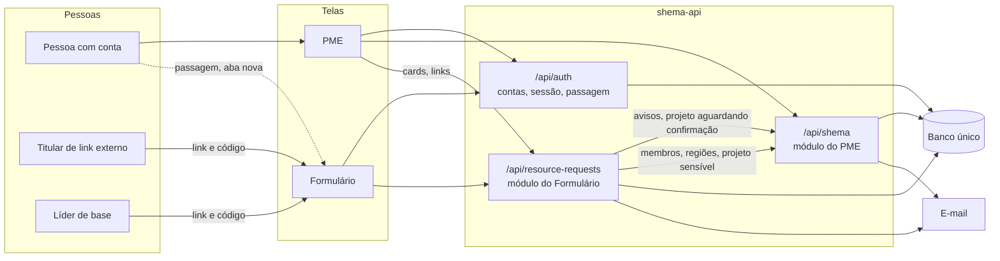
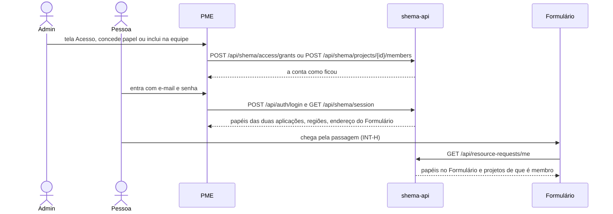
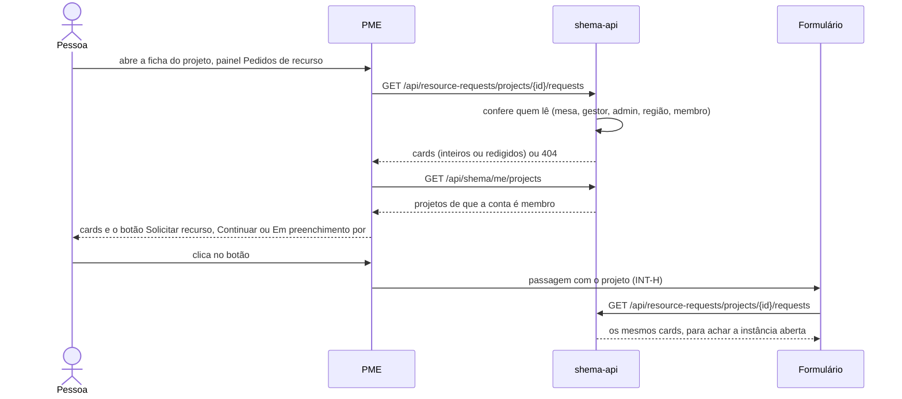
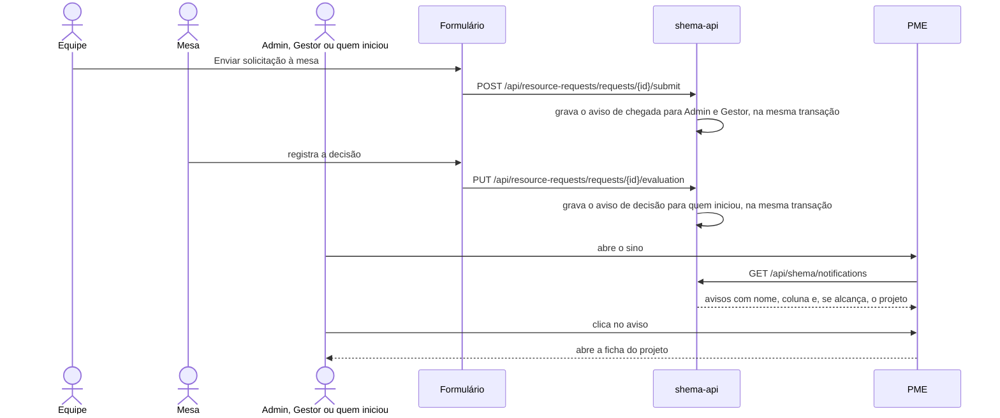
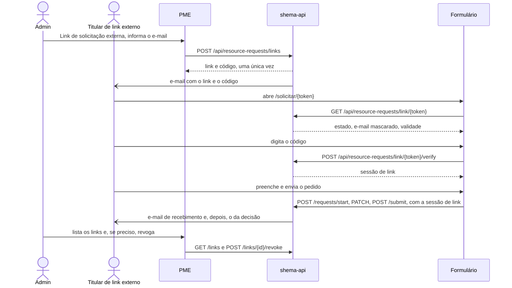
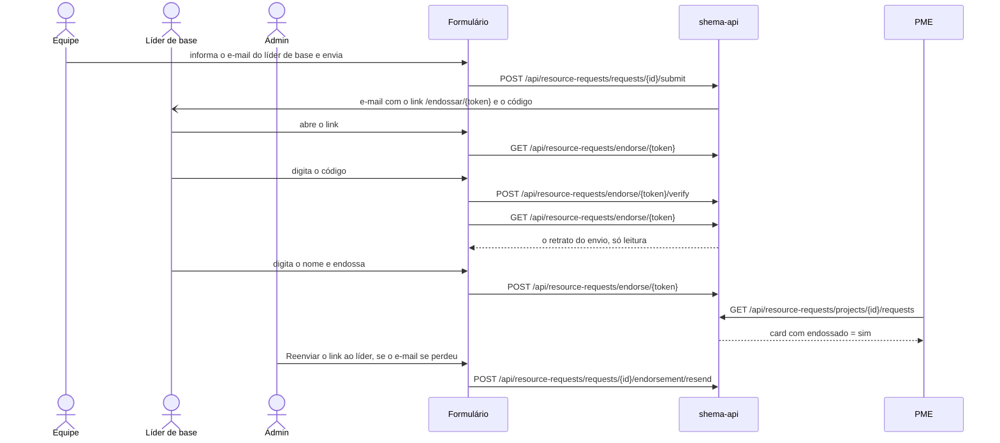
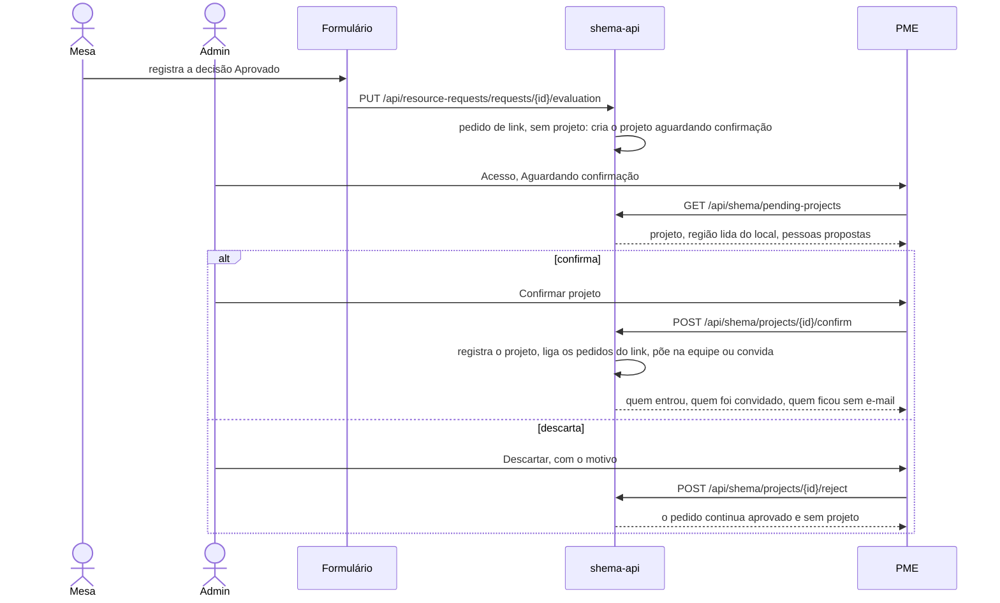
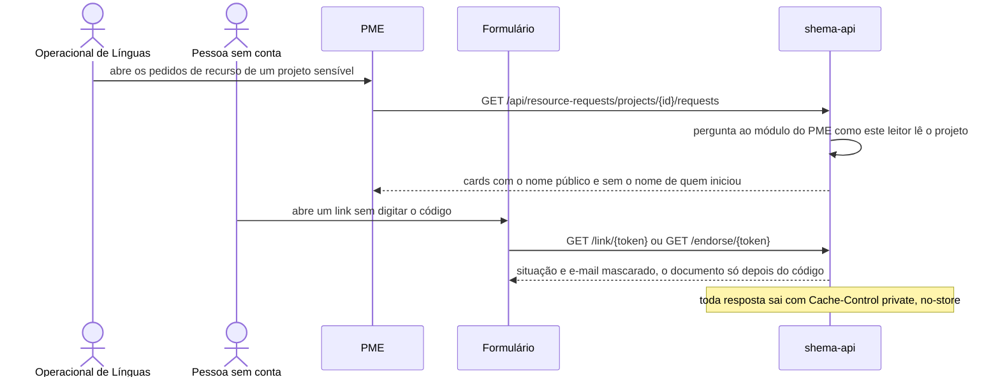
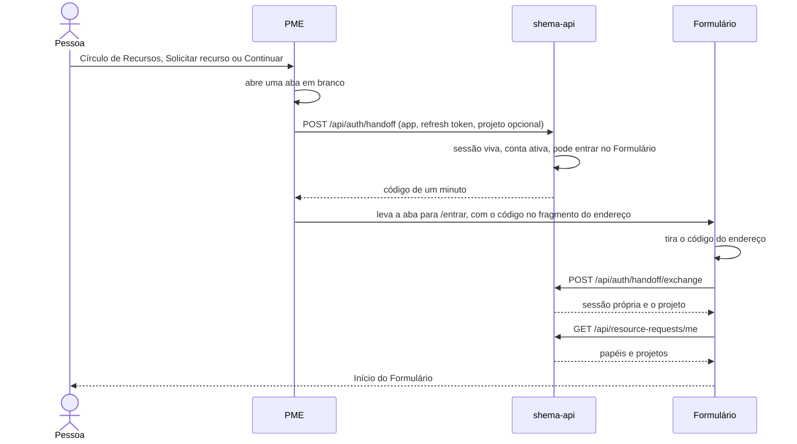

# Como o PME e o Formulário de Recursos se relacionam

> Fonte da verdade dos fluxos entre as duas aplicações. Estado do código em 15/nov/2026 (PME `79958a7` · Formulário `a59726c` · shema-api dev `11ebbb9`).

## 0. Como ler este documento

Este documento descreve **só o que cruza as duas aplicações**. O que cada uma faz por dentro está no PRD dela: [PRD](PRD.md), no mesmo diretório `docs/` de cada repositório. Este arquivo é idêntico nos dois.

**Os blocos.** Cada fluxo que cruza as duas é um bloco, de INT-A a INT-H. Os PRDs citam o bloco e apontam para cá; a regra é escrita aqui e em nenhum outro lugar.

**As regras.** Cada regra tem um número estável, `RN-INT-<bloco><n>` (por exemplo `RN-INT-B2`), e cinco campos: **Gatilho** (quem faz o quê), **Condição** (quando vale), **Efeito** (o que o sistema faz e o que a pessoa vê), **Exceções** e **Origem**. Um rótulo de tela aparece entre aspas, exatamente como na tela.

**A Origem.** É onde a regra está no código, com o repositório na frente:

| Prefixo | Repositório | Onde abrir |
|---|---|---|
| `PME:` | `project-management-ecosystem`, ramo `main` | `https://github.com/shemaobt/project-management-ecosystem/blob/main/<caminho>` |
| `Formulário:` | `resource-request-form`, ramo `main` | `https://github.com/shemaobt/resource-request-form/blob/main/<caminho>` |
| `shema-api:` | `shema-api`, ramo `dev` | `https://github.com/shemaobt/shema-api/blob/dev/<caminho>` |

O número depois do caminho é a linha. Quando o código e este documento discordarem, vale o código, e o documento é corrigido.

**Os termos** são os do glossário comum aos dois PRDs (Apêndice A de cada um). Os que mais aparecem aqui: **pedido de recurso** (o Formulário mostra "Solicitação"), **instância** (o pedido aberto, nem enviado nem cancelado), **caneta** (quem pode escrever numa instância), **card do pedido**, **endosso**, **passagem**, **link externo de pedido**, **projeto aguardando confirmação**, **Admin** (o papel `admin`) e **admin da instalação** (a marca técnica `is_platform_admin`).

**Marcas.** **[sem implementação]** é uma regra que um documento afirma e nenhum código faz. **[a confirmar]** é um ponto que a leitura do código não bastou para confirmar; não o tome como fato. O que o código faz e parece acidental está no capítulo 5; o que só a cliente decide está no capítulo 6.

---

## 1. As duas aplicações em uma página

| | PME | Formulário |
|---|---|---|
| Para que serve | Gerir os projetos de tradução: ficha, equipe, saúde, ritmo, oração, acesso. | Escrever, endossar, avaliar e acompanhar um pedido de recurso. |
| Quem usa com conta | Administrador (da região), Operacional de Línguas, Intercessor (papel), Admin; e, só para entrar e passar ao Formulário, Mesa, Gestor dos Projetos e Equipe do projeto. | Equipe do projeto, Mesa, Gestor dos Projetos, Admin. |
| Quem usa sem conta | Líder do projeto (Pulso Mensal), intercessor da rede (link de saída). | Titular de link externo, líder de base. |
| O que guarda | Contas e senhas, papéis das duas aplicações, regiões, projetos, membros de projeto, avisos do sino. | Pedidos de recurso, retratos do envio, avaliações, fundos, links externos de pedido, links de endosso. |
| Tem login? | Sim: senha, recuperação e convite. | Não. A conta entra pela passagem (INT-H); quem não tem conta entra por link e código. |

**O shema-api no meio.** As duas aplicações são telas. Nenhuma chama a outra: as duas chamam o `shema-api`, que tem um módulo para cada uma (`/api/shema` para o PME, `/api/resource-requests` para o Formulário) e a identidade em comum (`/api/auth`). Os dois módulos se cruzam de três jeitos:

1. **A mesma rota, dois leitores.** Só uma rota de negócio é assim: os pedidos de um projeto (INT-B).
2. **Uma escreve, a outra lê.** O Admin emite o link no PME e o titular o usa no Formulário (INT-D); o Admin põe alguém na equipe no PME e a conta passa a ser equipe no Formulário (INT-A).
3. **Um módulo chama o outro dentro do servidor**, na mesma transação. O envio e a decisão tocam o sino do PME (INT-C); a aprovação cadastra o projeto no PME (INT-F).

Entre os navegadores há só dois saltos: o PME abre o Formulário (`/entrar#code=…` na passagem, `/solicitar/{token}` no link externo) e o Formulário aponta de volta para o PME ("Voltar ao PME" e "Acesso (PME)").

---

## 2. Os blocos

### INT-A · Contas, papéis e equipe do projeto em comum

A conta é uma só para as duas aplicações, e a senha mora no PME. O Admin concede, na tela "Acesso" do PME, os papéis das duas: os três regionais e o `admin` do PME, e `admin`, `gestor` e `mesa` do Formulário. A equipe não é papel que se concede: é ser membro de um projeto no PME, e é esse vínculo que faz a conta ser "Equipe do projeto" no Formulário. Um mesmo cadastro decide, portanto, quem entra em cada aplicação e o que vê nela.

#### RN-INT-A1 · Uma conta só, e a senha mora no PME
- **Gatilho:** a pessoa cria conta, entra, esquece ou troca a senha.
- **Condição:** sempre.
- **Efeito:** login, criação de conta por convite, "esqueci a senha" e redefinição só existem no PME. O Formulário não tem tela de senha: os endereços antigos `/login`, `/forgot-password` e `/reset-password` caem em `/entrar`, que mostra "Entre pelo PME" e "Este formulário não tem login próprio. Para abrir uma solicitação, avaliar ou acompanhar, entre no PME e abra o formulário por lá."
- **Exceções:** quem não tem conta entra no Formulário por link e código (INT-D, INT-E); a tela avisa: "Recebeu um link por e-mail para preencher ou endossar uma solicitação? Abra esse link: ele entra direto, sem passar pelo PME."
- **Origem:** `PME:src/services/api/endpoints.ts:199,1290,1303` · `Formulário:src/App.tsx:153-158` · `Formulário:src/auth/routeAccess.ts:5,12` · `shema-api:app/api/auth.py:83` · teste `Formulário:src/components/pages/Auth/__tests__/semLogin.test.ts`.

#### RN-INT-A2 · Quem entra no PME
- **Gatilho:** a conta entra no PME (`GET /api/shema/session`).
- **Condição:** a conta tem um papel do PME (`coordinator`, `obtLab`, `resourceCircle`, `admin`), **ou** `gestor` ou `mesa` no Formulário, **ou** é membro vivo de algum projeto.
- **Efeito:** a sessão responde a lista de papéis das duas aplicações numa ordem fixa, as regiões e o endereço do Formulário. Ser membro acrescenta `equipe` à lista. Quem não tem nada disso é recusado.
- **Exceções:** o admin da instalação entra mesmo sem papel. Um papel de outra aplicação da plataforma com a mesma chave (há outras que têm `admin`) não conta.
- **Origem:** `shema-api:app/services/shema/_scope.py:742-767` · `shema-api:app/api/shema/__init__.py:151-157` · `shema-api:app/api/shema/session.py:25` · `PME:src/services/api/endpoints.ts:249` · teste `shema-api:tests/test_shema/test_session.py`.

#### RN-INT-A3 · Quem entra no Formulário
- **Gatilho:** qualquer chamada da conta ao Formulário, e o pedido de passagem (INT-H).
- **Condição:** a conta é admin da instalação, **ou** tem um papel em vigor no Formulário (`equipe`, `mesa`, `gestor`, `admin`), **ou** é membro vivo de algum projeto do PME.
- **Efeito:** entra. Quem não cumpre nenhuma das três é recusado (403). Na passagem a recusa acontece ainda no PME: o servidor não dá o código, o PME fecha a aba e mostra o erro (RN-INT-H2). A tela "Sua conta não tem acesso a este formulário", do Formulário, só aparece quando a conta perde o acesso entre o pedido do código e a troca.
- **Exceções:** um papel aposentado não conta, mesmo que a linha ainda exista no banco (o `lider`, da época em que o líder de base tinha conta).
- **Origem:** `shema-api:app/services/resource_request/enters_the_form.py:54-60` · `shema-api:app/api/resource_requests/_deps.py:51-75` · `shema-api:app/services/resource_request/capabilities.py:181` · teste `shema-api:tests/test_resource_requests/test_me.py`.

#### RN-INT-A4 · A equipe é ser membro de projeto, não um papel concedido
- **Gatilho:** o Formulário pergunta quem a conta é (`GET /api/resource-requests/me`).
- **Condição:** a conta é membro vivo de pelo menos um projeto do PME.
- **Efeito:** a resposta traz `equipe` entre os papéis e a lista dos projetos de que a conta é membro, que são os projetos em que ela pode iniciar um pedido. A tela "Acesso" recusa conceder `equipe` como papel.
- **Exceções:** o titular de link externo também age como equipe, sem ser membro de nada (INT-D).
- **Origem:** `shema-api:app/services/resource_request/who_am_i.py` · `shema-api:app/services/resource_request/_membership.py` · `shema-api:app/services/shema/_grant_rules.py:63-72` · `Formulário:src/services/api/authApi.ts:194` · migration `shema-api:alembic/versions/20260928_rr08_request_belongs_to_project.py`.

#### RN-INT-A5 · Só o Admin inclui e retira membros de um projeto
- **Gatilho:** o Admin inclui ou retira uma conta da equipe de um projeto, na tela "Acesso" do PME.
- **Condição:** quem age tem o papel `admin` no PME.
- **Efeito:** incluir cria o vínculo; a conta passa a ser equipe no Formulário e a alcançar os pedidos daquele projeto, rascunhos incluídos. Retirar **marca** o vínculo como encerrado, sem apagar; a conta deixa de ser equipe daquele projeto. Quem volta ganha um vínculo novo, e o histórico guarda as duas passagens.
- **Exceções:** incluir quem já é membro é recusado (409). Os Administradores (da região) não mexem em equipe.
- **Origem:** `shema-api:app/api/shema/members.py:62-83` · `shema-api:app/services/shema/add_project_member.py` · `shema-api:app/services/shema/remove_project_member.py:46` · `PME:src/components/pages/acesso/MembershipSection.tsx:162,165` · teste `shema-api:tests/test_shema/test_project_members.py`.

#### RN-INT-A6 · Os papéis das duas aplicações são concedidos no PME
- **Gatilho:** o Admin concede ou revoga um papel.
- **Condição:** quem age tem `admin` no PME; o papel é um dos que a tela escreve — do PME: `coordinator`, `obtLab`, `resourceCircle`, `admin`; do Formulário: `admin`, `gestor`, `mesa`.
- **Efeito:** o papel vale na aplicação a que pertence. O Formulário não tem tela de acesso: para quem administra o acesso, o menu do Formulário mostra o atalho "Acesso (PME)", que abre a tela "Acesso" do PME.
- **Exceções:** um papel regional só é concedido com pelo menos uma região; os outros não aceitam região.
- **Origem:** `shema-api:app/api/shema/access.py:56-99` · `shema-api:app/services/shema/_grant_rules.py:58-100` · `PME:src/constants/access.ts:28-31` · `PME:src/services/api/endpoints.ts:760-796` · `Formulário:src/components/layout/UserMenu.tsx:46-48` · teste `shema-api:tests/test_shema/test_admin_grants.py`.

#### RN-INT-A7 · O Admin é um papel só, gravado nas duas aplicações
- **Gatilho:** o Admin concede ou revoga o papel `admin`.
- **Condição:** sempre.
- **Efeito:** a concessão e a revogação escrevem nas duas aplicações de uma vez, qualquer que seja a aplicação escolhida na tela.
- **Exceções:** nenhuma.
- **Origem:** `shema-api:app/services/shema/_grant_rules.py:75-79` · `shema-api:app/services/shema/grant_role.py:59-71`.

#### RN-INT-A8 · Mesa não convive com Gestor nem com Admin na mesma conta
- **Gatilho:** o Admin concede `mesa`, `gestor` ou `admin`, ou alguém aceita um convite com um desses papéis.
- **Condição:** a conta já tem o papel incompatível no Formulário.
- **Efeito:** a concessão é recusada (409) e pede para revogar o outro papel antes. Vale nos dois sentidos: Mesa × Gestor e Mesa × Admin.
- **Exceções:** Admin e Gestor convivem na mesma conta.
- **Origem:** `shema-api:app/services/resource_request_access/_rules.py:41-45` · `shema-api:app/services/shema/grant_role.py:67` · `shema-api:app/services/resource_request_access/accept_invite.py:82` · teste `shema-api:tests/test_resource_requests/test_admin_mesa_exclusive.py`.

#### RN-INT-A9 · Ninguém concede papel a si mesmo
- **Gatilho:** o Admin tenta conceder um papel à própria conta.
- **Condição:** sempre.
- **Efeito:** recusado. Além disso, a condição de Admin de quem age é lida do banco na hora de cada escrita, sem cache: um Admin revogado há instantes já não consegue conceder.
- **Exceções:** nenhuma na tela. Fora dela, só o admin da instalação consegue: a rota geral de papéis da plataforma recusa as duas aplicações a qualquer outra conta.
- **Origem:** `shema-api:app/services/shema/grant_role.py:55-56` · `shema-api:app/services/shema/_grant_rules.py:115-139` · `shema-api:app/api/roles.py:25-38`.

#### RN-INT-A10 · O que o Admin pode no Formulário
- **Gatilho:** o Admin usa o Formulário.
- **Condição:** a conta tem o papel `admin`.
- **Efeito:** tem as mesmas capacidades do Gestor dos Projetos (vê avaliações, gerencia fundos, move o quadro) e, além delas, a caneta de qualquer instância e os links externos de pedido. Não pontua, não decide e não atribui fundo: isso é só da Mesa.
- **Exceções:** nenhuma.
- **Origem:** `shema-api:app/services/resource_request/capabilities.py:174-181` · `shema-api:app/services/resource_request/_editing.py:39` · `Formulário:src/auth/capabilities.ts:253` · teste `shema-api:tests/test_resource_requests/test_capabilities.py`.

#### RN-INT-A11 · O admin da instalação passa por toda guarda
- **Gatilho:** uma conta com a marca `is_platform_admin` chama qualquer rota das duas aplicações.
- **Condição:** sempre.
- **Efeito:** o servidor não confere papel nem capacidade para ela, inclusive nas duas capacidades que só a Mesa tem. O Formulário a trata na tela como Admin.
- **Exceções:** nenhuma. É uma marca técnica, dada fora das telas; não é um papel que a Karina concede.
- **Origem:** `shema-api:app/api/resource_requests/_deps.py:108,137,179` · `Formulário:src/services/api/roleFromClaims.ts:75-77` · teste `Formulário:src/components/pages/Auth/__tests__/platformAdminEnters.test.ts`.

#### RN-INT-A12 · O convite é emitido e aceito no PME
- **Gatilho:** o Admin convida um e-mail para um papel, na tela "Acesso"; ou o servidor convida para a equipe de um projeto, quando o Admin confirma um projeto aguardando confirmação (RN-INT-F5). A pessoa abre o link do convite.
- **Condição:** o convite vale 7 dias e não foi revogado nem usado.
- **Efeito:** o link abre a página `/convite` do PME ("Um convite para você"). A pessoa cria a conta ou entra com a que já tem e aceita. O convite da tela "Acesso" dá um papel de uma das duas aplicações (com as regiões, se for regional). O convite que nasce da confirmação de um projeto dá uma vaga na equipe daquele projeto, sem papel.
- **Exceções:** a tela "Acesso" não convida para a equipe: recusa `equipe`, como na concessão (RN-INT-A4). O papel `admin` nunca vai por convite: só é concedido a uma conta que já existe. A conta que aceita tem de ser a do e-mail convidado ("Este convite é de outro e-mail. Entre com a conta do e-mail convidado."). A regra da RN-INT-A8 vale também no aceite.
- **Origem:** `shema-api:app/services/shema/send_invite.py:39,48` · `shema-api:app/services/shema/confirm_project.py:150` · `shema-api:app/api/shema/invitation.py:44,50` · `shema-api:app/services/resource_request_access/accept_invite.py:47-66` · `shema-api:app/core/config.py:137` · `PME:src/services/api/endpoints.ts:837,874` · `PME:src/components/pages/convite/` · teste `shema-api:tests/test_shema/test_invite_link.py`.

#### RN-INT-A13 · Quem só tem papel no Formulário vê uma tela só no PME
- **Gatilho:** uma conta que tem apenas `gestor` ou `mesa` entra no PME.
- **Condição:** todos os papéis que a sessão do PME responde são `gestor` ou `mesa`.
- **Efeito:** vê "Seu acesso é pelo Círculo de Recursos" e a entrada "Círculo de Recursos", que abre o Formulário numa aba nova. As áreas do PME não aparecem.
- **Exceções:** um Gestor ou uma Mesa que também é membro de algum projeto tem `equipe` na sessão, deixa de cair nessa tela e vê o menu de áreas do PME. Se o endereço do Formulário não estiver cadastrado, a tela mostra "O endereço do formulário não está configurado nesta instalação — fale com o Admin da plataforma."
- **Origem:** `PME:src/components/layout/FormOnlyHome.tsx` · `PME:src/components/layout/AppShell.tsx:25` · `PME:src/utils/access.ts:304-306` · `shema-api:app/services/shema/_scope.py:765-766`.

#### RN-INT-A14 · Em quanto tempo uma mudança de acesso passa a valer
- **Gatilho:** o Admin concede ou revoga um papel, ou mexe na equipe.
- **Condição:** sempre.
- **Efeito:** há duas velocidades. **Na hora**, lidos do banco a cada vez: as capacidades do Formulário (avaliar, mover, atribuir fundo, editar), o pedido de passagem, a resposta de "quem sou" do Formulário e a condição de Admin de quem concede um papel. **Em até 30 segundos**, por um cache: a porta do Formulário e as guardas que leem um papel pelo nome (Mesa e Gestor no Formulário, Admin no PME). Uma mudança feita pela tela "Acesso" limpa o cache do servidor que a gravou, e ali vale na chamada seguinte.
- **Exceções:** **[a confirmar]** quantas instâncias do servidor rodam em produção. O código limpa o cache só no servidor que gravou a mudança; se houver mais de uma instância, as outras só enxergam a mudança quando o cache delas vence: até 30 segundos, mesmo para uma mudança feita pela tela. Com uma instância só, esse atraso não existe para o que é feito pela tela. Em qualquer caso, uma mudança feita fora das telas e uma conta desativada levam até 30 segundos.
- **Origem:** `shema-api:app/core/auth_cache.py:8-13,61` · `shema-api:app/services/resource_request/enters_the_form.py:40-51` · `shema-api:app/services/resource_request/holds_capability.py:7` · `shema-api:app/services/shema/grant_role.py:77` · `shema-api:app/services/auth/create_handoff.py:83-94`.

**Endpoints de INT-A**

| Método · caminho | Quem chama no PME | Quem chama no Formulário | O que exige | Origem |
|---|---|---|---|---|
| `POST /api/auth/login` | `src/services/api/endpoints.ts:199` | — | público | `shema-api:app/api/auth.py:83` |
| `GET /api/auth/me` | `endpoints.ts:211` | `src/services/api/authApi.ts:42` | sessão | `shema-api:app/api/auth.py:106` |
| `POST /api/auth/refresh` | `src/services/api/client.ts:46` | `src/services/api/apiClient.ts:130` | o refresh token | `shema-api:app/api/auth.py:93` |
| `POST /api/auth/logout` | `endpoints.ts:236` | `authApi.ts:87` | o refresh token | `shema-api:app/api/auth.py:101` |
| `GET /api/shema/session` | `endpoints.ts:249` | — | porta do PME (RN-INT-A2) | `shema-api:app/api/shema/session.py:25` |
| `GET /api/resource-requests/me` | — | `authApi.ts:194` | sessão | `shema-api:app/api/resource_requests/me.py:21` |
| `GET /api/shema/access/people` | `endpoints.ts:760` | — | `admin` no PME | `shema-api:app/api/shema/access.py:56` |
| `POST /api/shema/access/grants` | `endpoints.ts:768` | — | `admin` no PME | `shema-api:app/api/shema/access.py:65` |
| `POST /api/shema/access/grants/revoke` | `endpoints.ts:773` | — | `admin` no PME | `shema-api:app/api/shema/access.py:73` |
| `GET /api/shema/access/changes` | `endpoints.ts:796` | — | `admin` no PME | `shema-api:app/api/shema/access.py:99` |
| `POST /api/shema/access/invites` · `POST …/invites/revoke` · `GET …/invites` | `endpoints.ts:779,784,791` | — | `admin` no PME | `shema-api:app/api/shema/access.py:81,87,93` |
| `GET /api/shema/access/invites/{token}` | `endpoints.ts:837` | — | público; o token é a guarda | `shema-api:app/api/shema/invitation.py:44` |
| `POST /api/shema/access/invites/{token}/accept` | `endpoints.ts:874` | — | qualquer conta logada | `shema-api:app/api/shema/invitation.py:50` |
| `GET /api/shema/projects/{id}/members` | `endpoints.ts:612` | — | porta do PME; o serviço decide | `shema-api:app/api/shema/members.py:45` |
| `GET /api/shema/me/projects` | `endpoints.ts:629` | — | porta do PME | `shema-api:app/api/shema/members.py:56` |
| `POST /api/shema/projects/{id}/members` | `endpoints.ts:618` | — | `admin` no PME | `shema-api:app/api/shema/members.py:62` |
| `DELETE /api/shema/projects/{id}/members/{user_id}` | `endpoints.ts:624` | — | `admin` no PME | `shema-api:app/api/shema/members.py:70` |

---

### INT-B · O card do pedido de recurso no PME e quem lê os pedidos de um projeto

A aba "Recursos Financeiros" da ficha do projeto, no PME, mostra o painel "Pedidos de recurso": um card por pedido daquele projeto, com o nome, o tipo, o valor, a coluna do quadro em que está, as datas e o endosso. O card é um recorte: nada das notas, dos comentários ou da decisão detalhada da mesa sai do Formulário. A mesma leitura serve ao Formulário quando a pessoa chegou do PME com um projeto. É por esse card que o PME sabe se já existe uma instância aberta e decide o que o botão diz.

#### RN-INT-B1 · Quem lê os pedidos de um projeto a partir do PME
- **Gatilho:** alguém abre o painel "Pedidos de recurso" da ficha.
- **Condição:** a conta é uma destas: admin da instalação; `admin`, `mesa` ou `gestor` em qualquer das duas aplicações; papel regional do PME cuja região alcança o projeto; membro vivo do projeto.
- **Efeito:** recebe os cards dos pedidos do projeto, do mais novo para o mais antigo.
- **Exceções:** todos os outros recebem "não encontrado" (404), igual ao de um projeto que não existe, para não confirmar que o projeto existe. A rota pede só uma sessão: o Administrador (da região) não tem papel no Formulário e é justamente para ele que a leitura existe.
- **Origem:** `shema-api:app/api/resource_requests/requests.py:170-181` · `shema-api:app/services/resource_request/list_project_requests.py:85-103` · `PME:src/services/api/resourceRequests.ts:90-94` · teste `shema-api:tests/test_resource_requests/test_cards.py`.

#### RN-INT-B2 · O card tem um teto: nada da avaliação
- **Gatilho:** qualquer leitura do card do pedido.
- **Condição:** sempre.
- **Efeito:** o card leva 14 campos: identificador, nome registrado, tipo de pedido, valor pedido, moeda, coluna do quadro, data de criação, data de envio, se foi endossado, a decisão, se a instância está aberta, se quem lê pode editar, o nome de quem iniciou e o pedido que ele revisa. O PME mostra: o nome (ou "Pedido de recurso" quando não há); a coluna ("A analisar", "Em análise", "Aprovado", "Aprovado com condições", "Revisar e reenviar", "Não aprovado") ou "Em preenchimento"; o tipo e o valor (ou "valor ainda não informado"); e "Enviado em {data}" com o endosso, ou "Iniciado em {data}".
- **Exceções:** o nome de quem iniciou só vai enquanto a instância está aberta. Notas, comentários, presença, avaliador, o "Aviso da mesa", lugar e base nunca vão.
- **Origem:** `shema-api:app/models/resource_request.py:515-594` · `shema-api:app/services/resource_request/_cards.py:71-86` · `PME:src/services/api/resourceRequests.ts:47-65` · `PME:src/components/pages/ficha/pedidos/RequestsPanel.tsx:22-58` · teste `shema-api:tests/test_resource_requests/test_cards.py`.

#### RN-INT-B3 · Num projeto sensível, quem lê de fora recebe o card redigido
- **Gatilho:** alguém que alcança o projeto, mas não lê a verdade dele, abre o painel.
- **Condição:** o projeto é sensível e a conta não lê a verdade dele: não é Mesa, Gestor nem Admin, não é membro do projeto, não é o Administrador (da região) e não é o Intercessor (papel) da região. Na prática: o Operacional de Línguas da região.
- **Efeito:** recebe todos os cards com a coluna, a decisão, o valor e a instância intactos; o nome registrado é trocado pelo nome que o PME mostra a esse leitor (o nome público da língua, ou "Projeto sensível — {região}"), e o nome de quem iniciou não vai.
- **Exceções:** num projeto que não é sensível nada muda. As listas do próprio Formulário não passam por essa regra, porque esse leitor não entra no Formulário.
- **Origem:** `shema-api:app/services/resource_request/list_project_requests.py:94-125` · `shema-api:app/services/shema/_redaction.py:169,217` · teste `shema-api:tests/test_resource_requests/test_sensitive_project_cards.py`.

#### RN-INT-B4 · Pedido cancelado não aparece
- **Gatilho:** qualquer leitura dos pedidos de um projeto.
- **Condição:** a instância foi cancelada.
- **Efeito:** o card não é listado.
- **Exceções:** nenhuma no PME. No servidor, a leitura de um pedido pelo identificador não exclui o cancelado: quem o alcança ainda recebe o documento. **[a confirmar]** se alguma tela do Formulário ainda abre um pedido cancelado; a leitura do código do Formulário não bastou para afirmar.
- **Origem:** `shema-api:app/services/resource_request/list_project_requests.py:105` · `shema-api:app/services/resource_request/list_requests.py:33` · `shema-api:app/services/resource_request/get_request.py:10-34`.

#### RN-INT-B5 · O que o botão do painel diz
- **Gatilho:** o PME desenha o botão do painel "Pedidos de recurso".
- **Condição e efeito:**
  - há uma instância aberta e quem lê pode editá-la → "Continuar";
  - há uma instância aberta e quem lê não pode editá-la → "Em preenchimento por {nome}", ou "Em preenchimento por outra pessoa da equipe" quando o nome não vem; sem botão;
  - não há instância aberta e a conta é Admin ou membro do projeto → "Solicitar recurso";
  - não há instância aberta e a conta não é Admin nem membro → nenhum botão;
  - não há instância aberta, a conta não é Admin e o PME ainda confere a participação → "Conferindo se você é membro deste projeto…"; se essa leitura falha → "Não deu para confirmar se você é membro deste projeto, então o botão de solicitar ainda não aparece.", com "Tentar de novo";
  - enquanto os cards carregam, ou se a leitura dos cards falhou → nenhum botão.
- **Exceções:** sem o endereço do Formulário cadastrado, em vez de "Solicitar recurso" ou "Continuar" aparece "O endereço do formulário não está configurado nesta instalação — fale com o Admin da plataforma."
- **Origem:** `PME:src/utils/requests.ts:53-84` · `PME:src/components/pages/ficha/pedidos/RequestButton.tsx:24-69` · `PME:src/components/pages/ficha/pedidos/ProjectRequests.tsx:63-78` · teste `PME:src/utils/__tests__/requests.test.ts`.

#### RN-INT-B6 · Uma instância aberta por projeto
- **Gatilho:** alguém inicia um pedido num projeto.
- **Condição:** o projeto já tem uma instância aberta (nem enviada nem cancelada).
- **Efeito:** o servidor recusa a segunda (409). É por isso que o PME, ao ver uma instância aberta, não oferece "Solicitar recurso".
- **Exceções:** um pedido sem projeto fica fora dessa trava. O link externo tem a trava dele (RN-INT-D6).
- **Origem:** `shema-api:app/db/models/resource_request.py:321-327` · `shema-api:app/services/resource_request/_instance.py` · teste `shema-api:tests/test_resource_requests/test_instance.py`.

#### RN-INT-B7 · O PME recusa um vocabulário que não conhece
- **Gatilho:** o servidor responde um card com uma coluna, um tipo, uma moeda ou uma decisão que o PME não conhece, ou com um campo de sim/não malformado.
- **Condição:** o Formulário ganhou um valor novo e o PME não foi atualizado.
- **Efeito:** o PME recusa a lista inteira, em vez de desenhar um card com rótulo errado ou vazio. Na primeira leitura, o painel mostra o erro genérico "O servidor recusou os dados enviados. Revise o que você preencheu e tente de novo.", que não descreve o que houve num painel só de leitura (capítulo 5, V15). Se já havia cards na tela, a releitura que falha é descartada em silêncio e os cards antigos ficam.
- **Exceções:** nenhuma. O PME guarda a própria cópia desses vocabulários; mudar um deles no Formulário pede a mudança no PME.
- **Origem:** `PME:src/services/api/resourceRequests.ts:27-65` · `PME:src/services/api/endpoints.ts:643-645` · `PME:src/components/pages/ficha/pedidos/requestList.ts:59-61` · `PME:src/i18n/locales/pt-BR.json:1220` · `PME:src/constants/requests.ts`.

#### RN-INT-B8 · O painel relê os cards quando a pessoa volta para a aba
- **Gatilho:** a pessoa volta do Formulário (aberto em outra aba) para a aba do PME.
- **Condição:** o painel está aberto.
- **Efeito:** os cards são lidos de novo, então o que foi iniciado ou enviado no Formulário aparece sem recarregar a página.
- **Exceções:** nenhuma.
- **Origem:** `PME:src/components/pages/ficha/pedidos/requestList.ts:78-83` · `PME:src/components/pages/ficha/pedidos/ProjectRequests.tsx:36-39`.

#### RN-INT-B9 · O Formulário lê os mesmos cards quando chega com um projeto
- **Gatilho:** a conta chega ao Formulário pela passagem com um projeto e abre o Início.
- **Condição:** a sessão tem um projeto ativo.
- **Efeito:** o Formulário chama a mesma rota do PME para saber se o projeto já tem uma "Solicitação em preenchimento" e quem a está preenchendo. Sem projeto ativo, lê os próprios cards da conta.
- **Exceções:** nenhuma.
- **Origem:** `Formulário:src/services/api/requestApi.ts:165-176` · `Formulário:src/components/pages/Home/InstanceCard.tsx:38` · `Formulário:src/components/pages/Home/StartPanel.tsx:51`.

**Endpoints de INT-B**

| Método · caminho | Quem chama no PME | Quem chama no Formulário | O que exige | Origem |
|---|---|---|---|---|
| `GET /api/resource-requests/projects/{project_id}/requests` | `src/services/api/resourceRequests.ts:90-94` → `src/components/pages/ficha/pedidos/requestList.ts:49` | `src/services/api/requestApi.ts:165-176` | sessão; o serviço decide (RN-INT-B1) | `shema-api:app/api/resource_requests/requests.py:170` |
| `GET /api/shema/me/projects` | `src/components/pages/ficha/pedidos/ProjectRequests.tsx:43-45` | — | porta do PME | `shema-api:app/api/shema/members.py:56` |
| `GET /api/resource-requests/requests/cards` | — | `src/services/api/trackingApi.ts:50` · `requestApi.ts:170` | `edit_requests` ou sessão de link | `shema-api:app/api/resource_requests/requests.py:149` |

---

### INT-C · Os avisos do Formulário no sino do PME

Dois acontecimentos do Formulário tocam o sino do PME: a **chegada** de um pedido de recurso enviado e a **decisão** da mesa. A chegada avisa o Admin e o Gestor dos Projetos; a decisão avisa quem iniciou o pedido. O aviso leva o nome do pedido e a coluna em que ele ficou, e mais nada. O Formulário continua mandando os próprios avisos e e-mails como antes; o sino do PME é um terceiro canal, para quem trabalha só no PME.

#### RN-INT-C1 · A chegada de um pedido avisa o Admin e o Gestor
- **Gatilho:** alguém envia um pedido de recurso no Formulário.
- **Condição:** o pedido pertence a um projeto do PME.
- **Efeito:** cada conta com `admin` no PME e cada conta com `gestor` no Formulário recebe no sino do PME o aviso "Pedido de recurso recebido · em triagem", com o nome do pedido.
- **Exceções:** quem enviou não é avisado do próprio envio. Uma conta desativada não é avisada, mesmo que ainda tenha o papel. A Mesa é avisada no Formulário, onde trabalha, e não no sino do PME.
- **Origem:** `shema-api:app/services/shema/_request_notices.py:107-114,151-191` · `shema-api:app/services/resource_request/notify_arrival.py:45` · `shema-api:app/services/authorization/list_role_holders.py:9-46` · `PME:src/components/pages/notificacoes/NotificationLog.tsx:43-44` · teste `shema-api:tests/test_resource_requests/test_pme_notices.py`.

#### RN-INT-C2 · A decisão avisa quem iniciou o pedido
- **Gatilho:** a Mesa registra a decisão de um pedido.
- **Condição:** o pedido tem um projeto e uma pessoa que o iniciou.
- **Efeito:** quem iniciou recebe no sino do PME "Decisão da mesa · {coluna}", com o nome do pedido. A coluna é a que a decisão implica: "Aprovado", "Aprovado com condições", "Revisar e reenviar" ou "Não aprovado".
- **Exceções:** se quem decidiu é a mesma pessoa que iniciou, não há aviso.
- **Origem:** `shema-api:app/services/shema/_request_notices.py:194-231` · `shema-api:app/services/resource_request/notify_decision.py:126-128` · `PME:src/components/pages/notificacoes/NotificationLog.tsx:45-46` · teste `shema-api:tests/test_shema/test_request_notices.py`.

#### RN-INT-C3 · O aviso leva o nome e a coluna, e mais nada
- **Gatilho:** qualquer aviso do Formulário gravado para o PME.
- **Condição:** sempre.
- **Efeito:** o aviso guarda o nome registrado do pedido, a coluna e o projeto. O PME escreve a frase no idioma da tela a partir desses dados; um pedido sem nome aparece como "Pedido de recurso".
- **Exceções:** nada da avaliação vai: nem nota, nem comentário, nem o "Aviso da mesa", nem quem avaliou.
- **Origem:** `shema-api:app/services/shema/_request_notices.py:95-148` · `shema-api:app/db/models/shema_notification.py:135` · `PME:src/services/api/endpoints.ts:1065-1090` · `PME:src/components/pages/notificacoes/NotificationLog.tsx:60`.

#### RN-INT-C4 · O aviso só abre a ficha para quem alcança o projeto
- **Gatilho:** o PME monta o sino de uma conta.
- **Condição:** a conta alcança o projeto do aviso (pela região ou por ser membro).
- **Efeito:** o aviso vira um link para a ficha do projeto, que abre na primeira aba ("Identidade"), não na dos pedidos de recurso (pergunta K5). Para quem não alcança, o aviso aparece com o nome e a coluna, sem link.
- **Exceções:** as preferências de notificação da própria conta podem esconder o aviso (RN-INT-C8). Uma conta que só tem `gestor` ou `mesa` não abre a ficha, mesmo com o link, porque no PME ela só vê a tela da RN-INT-A13.
- **Origem:** `shema-api:app/services/shema/list_notification_panel.py:289-307` · `PME:src/components/pages/notificacoes/NotificationLog.tsx:93-97`.

#### RN-INT-C5 · Quando o sino fica em silêncio
- **Gatilho:** um envio ou uma decisão.
- **Condição:** o pedido não tem projeto; **ou** entrou por link externo; **ou** (na decisão) não tem uma pessoa que o iniciou, ou a conta sob a qual foi arquivado não existe mais; **ou** a mesma decisão está sendo salva de novo.
- **Efeito:** nenhum aviso é gravado para o PME. É o caso do pedido aberto sem projeto pela Mesa, pelo Gestor ou pelo Admin, e de todo pedido que entrou por link externo: esse recebe só e-mail (RN-INT-D8).
- **Exceções:** os avisos e e-mails do próprio Formulário saem do mesmo jeito.
- **Origem:** `shema-api:app/services/shema/_request_notices.py:166-171,211-216` · `shema-api:app/services/resource_request/notify_decision.py:99-108` · `shema-api:app/services/resource_request/save_evaluation.py:83-85`.

#### RN-INT-C6 · O aviso nasce junto com o ato, ou não nasce
- **Gatilho:** um envio ou uma decisão.
- **Condição:** sempre.
- **Efeito:** o aviso é gravado na mesma transação do envio ou da decisão. Se o ato falha, não há aviso; se o ato vale, o aviso existe. Os e-mails saem depois, e uma falha no envio de e-mail não desfaz o ato.
- **Exceções:** nenhuma.
- **Origem:** `shema-api:app/services/shema/_request_notices.py:117-148` · `shema-api:app/services/resource_request/save_evaluation.py:277-279`.

#### RN-INT-C7 · Mover o card não é decidir, e não avisa
- **Gatilho:** a Mesa, o Gestor ou o Admin arrasta um card no quadro.
- **Condição:** nenhuma decisão foi registrada nesse ato.
- **Efeito:** ninguém é avisado, nem no Formulário nem no PME. Só a decisão registrada na avaliação avisa.
- **Exceções:** nenhuma.
- **Origem:** `shema-api:app/services/resource_request/move_request.py:1-10` (não chama nenhum aviso) · `shema-api:app/services/resource_request/save_evaluation.py:78-85`.

#### RN-INT-C8 · As preferências de notificação da conta podem esconder o aviso
- **Gatilho:** o PME desenha o sino de uma conta que tem um papel do PME (inclusive o Admin).
- **Condição:** a conta salvou preferências de notificação diferentes do padrão.
- **Efeito:** o aviso continua gravado no servidor, mas não aparece para ela quando: as notificações estão desligadas; **ou** a escolha é "Só os urgentes" (um aviso de pedido de recurso nunca é urgente); **ou** é "Só projetos que mentoro" (um aviso de pedido de recurso nunca entra); **ou** é "Lista personalizada" e o projeto do aviso não está na lista, ou a conta não alcança o projeto. O sino mostra no máximo os 30 avisos mais recentes.
- **Exceções:** uma conta que só tem `gestor`, `mesa` ou `equipe` não tem preferências salvas: vê todos os avisos, no padrão "Todos os projetos".
- **Origem:** `PME:src/utils/notifications.ts:203-231` · `PME:src/components/pages/notificacoes/useNotifications.ts:74-75,286` · `PME:src/constants/notifications.ts:103` · `shema-api:app/services/shema/list_notification_panel.py:117`.

**Endpoints de INT-C**

| Método · caminho | Quem chama no PME | Quem chama no Formulário | O que exige | Origem |
|---|---|---|---|---|
| `POST /api/resource-requests/requests/{id}/submit` | — | `src/services/api/requestApi.ts:85` | a caneta da instância | `shema-api:app/api/resource_requests/requests.py:232` |
| `PUT /api/resource-requests/requests/{id}/evaluation` | — | `src/services/api/evaluationApi.ts:77-78` | `edit_evaluation` (Mesa) | `shema-api:app/api/resource_requests/evaluations.py:90` |
| `GET /api/shema/notifications` | `src/services/api/endpoints.ts:1145` | — | porta do PME | `shema-api:app/api/shema/notifications.py:52` |
| `POST /api/shema/notifications/read` | `endpoints.ts:1150` | — | porta do PME | `shema-api:app/api/shema/notifications.py:75` |

Entre os dois módulos não há chamada HTTP: `notify_arrival` e `notify_decision` (Formulário) chamam `ring_arrival` e `ring_decision` (PME) dentro do servidor.

---

### INT-D · O link externo de pedido

Quem ainda não tem conta nem projeto no PME pode pedir recurso. O Admin emite, no PME, um "Link de solicitação externa" para o e-mail da pessoa. Ela abre o link no Formulário, digita o código de seis dígitos que recebeu e passa a preencher, enviar e acompanhar o pedido sem conta. O link não dá acesso ao PME nem a pedidos de outros projetos. Se a mesa aprovar, o projeto é cadastrado no PME (INT-F).

#### RN-INT-D1 · Só o Admin emite, lista e revoga links externos
- **Gatilho:** alguém abre "Link de solicitação externa" no cabeçalho do PME.
- **Condição:** a conta tem o papel `admin` em qualquer das duas aplicações, ou é admin da instalação.
- **Efeito:** emite um link para um e-mail, com uma "Referência do projeto (opcional)" em texto livre; vê os "Links emitidos" com a situação de cada um ("Aguardando", "Código confirmado", "Expirado", "Revogado"); revoga.
- **Exceções:** qualquer outra conta é recusada (403). No PME o botão só aparece para quem tem `admin` na sessão.
- **Origem:** `shema-api:app/api/resource_requests/links.py:25-50` · `shema-api:app/services/resource_request/_links.py:47-63` · `PME:src/components/layout/AppHeader.tsx:71,146-191` · `PME:src/components/pages/dados/RequestLinkDialog.tsx` · teste `shema-api:tests/test_resource_requests/test_request_links.py`.

#### RN-INT-D2 · O link e o código aparecem uma vez só
- **Gatilho:** o Admin clica em "Emitir link".
- **Condição:** sempre.
- **Efeito:** o PME mostra "Link emitido para {e-mail}", o endereço `{Formulário}/solicitar/{token}` e o código, com o aviso "Copie agora — o link e o código só aparecem aqui uma vez." Uma cópia segue por e-mail para o endereço informado, sem confirmação de entrega. O servidor guarda só o resumo do token e do código, então não há como mostrá-los de novo. O link vale 60 dias e serve para mais de um acesso até lá.
- **Exceções:** sem o endereço do Formulário cadastrado, o diálogo do PME não oferece a emissão: mostra "O endereço do formulário não está configurado nesta instalação — fale com o Admin da plataforma." No servidor, sem esse endereço, um link ainda pode ser emitido, mas o e-mail não sai.
- **Origem:** `shema-api:app/services/resource_request/create_request_link.py:22-63` · `shema-api:app/services/resource_request/notify_link.py:42-45` · `shema-api:app/core/config.py:155` · `PME:src/utils/requests.ts:41-43` · `PME:src/services/api/resourceRequests.ts:84-87,102-105` · `PME:src/components/pages/dados/RequestLinkDialog.tsx:105-108`.

#### RN-INT-D3 · O link sozinho não abre nada: pede o código
- **Gatilho:** o titular abre `/solicitar/{token}` e digita o código.
- **Condição:** o link está pendente ou já confirmado, e não expirou nem foi revogado.
- **Efeito:** com o código certo, o Formulário abre. Com o código errado, mostra "Este código não confere. Tentativas restantes: {n}." O quinto código errado revoga o link: "Cinco códigos errados revogaram este link. Peça um novo à coordenação." Um código certo zera a contagem de erros.
- **Exceções:** link expirado ou revogado não aceita código (410). As duas rotas públicas têm limite de chamadas por endereço e por link.
- **Origem:** `shema-api:app/services/resource_request/verify_request_link.py:16,35-83` · `shema-api:app/api/resource_requests/link_public.py:30-35,75-86` · `Formulário:src/services/api/linkApi.ts:63-64,77` · `Formulário:src/components/pages/Solicitar/LinkCodeStep.tsx` · teste `shema-api:tests/test_resource_requests/test_link_session.py`.

#### RN-INT-D4 · Antes do código, a página não revela quase nada
- **Gatilho:** alguém abre o endereço do link sem ter digitado o código.
- **Condição:** o token existe.
- **Efeito:** a página recebe a situação do link, o e-mail mascarado (`e***@dominio`) e a validade. A referência do projeto que o Admin digitou **não** vai, em nenhuma situação.
- **Exceções:** um token desconhecido responde "não encontrado": "Este link não existe. Confira se o endereço foi copiado inteiro do e-mail."
- **Origem:** `shema-api:app/services/resource_request/read_request_link.py:15-57` · `Formulário:src/components/pages/Solicitar/RequestLinkPage.tsx`.

#### RN-INT-D5 · A sessão de link alcança só os pedidos daquele link
- **Gatilho:** o titular confirma o código.
- **Condição:** sempre.
- **Efeito:** ganha uma sessão de link de 30 dias, ou até a validade do link, o que vier primeiro. Com ela faz o que a equipe faz no próprio pedido: iniciar, preencher, anexar o orçamento, enviar, cancelar, abrir a revisão do pedido de recurso depois de "Revisar e reenviar" e acompanhar a situação. O servidor confere o link a cada chamada: revogar o link encerra na hora toda sessão aberta por ele.
- **Exceções:** não alcança pedido de outro link nem de projeto (404). Não vê fundo, avaliação nem Painel (401 nessas rotas). Não entra no PME.
- **Origem:** `shema-api:app/services/resource_request/link_session.py:28-66` · `shema-api:app/services/resource_request/_link_actor.py:32-54` · `shema-api:app/api/resource_requests/_deps.py:156-208` · `shema-api:app/core/config.py:159` · `Formulário:src/services/api/roleFromClaims.ts:88-90` · teste `shema-api:tests/test_resource_requests/test_link_requests.py`.

#### RN-INT-D6 · O pedido por link nasce sem projeto e é um por vez
- **Gatilho:** o titular inicia um pedido.
- **Condição:** o link não tem outra instância aberta.
- **Efeito:** o pedido nasce ligado ao link e a nenhum projeto. Uma segunda instância aberta do mesmo link é recusada (409); cancelar a primeira libera.
- **Exceções:** tentar informar um projeto a partir de um link é recusado. O projeto só chega pela confirmação do Admin (INT-F).
- **Origem:** `shema-api:app/services/resource_request/create_draft.py:59-83` · `shema-api:app/db/models/resource_request.py:328-334,395-405` · teste `shema-api:tests/test_resource_requests/test_link_requests.py`.

#### RN-INT-D7 · Quem pede não endossa o próprio pedido
- **Gatilho:** o titular envia o pedido.
- **Condição:** o e-mail do líder de base é igual ao e-mail do link.
- **Efeito:** o envio é recusado e o campo "E-mail do líder de base (quem endossa pela base)" é marcado. O envio vale como aceite eletrônico do titular, com o nome digitado e o e-mail do link.
- **Exceções:** nenhuma. A mesma regra vale para a conta que envia (RN-INT-E1).
- **Origem:** `shema-api:app/services/resource_request/submit_request.py:20-32,124-130,158-160`.

#### RN-INT-D8 · O titular é avisado só por e-mail
- **Gatilho:** o link é emitido; o pedido é enviado; a mesa decide.
- **Condição:** o pedido entrou por link externo.
- **Efeito:** três e-mails para o endereço do link: o link com o código, o recebimento do envio e a decisão. Os dois últimos não repetem o link (o servidor não o guarda); dizem para abrir o link já recebido.
- **Exceções:** nenhum aviso no sino do PME nem no Formulário, porque não há conta (RN-INT-C5).
- **Origem:** `shema-api:app/services/resource_request/notify_link.py:32-92` · `shema-api:app/services/resource_request/notify_decision.py:99-103` · `shema-api:app/services/resource_request/submit_request.py:177-178`.

#### RN-INT-D9 · Revogar o link não desfaz o que foi enviado
- **Gatilho:** o Admin revoga um link.
- **Condição:** o link está pendente ou com o código confirmado.
- **Efeito:** o PME pergunta "Revogar o link?" e avisa: "O link de {e-mail} deixa de abrir o formulário na hora, inclusive para quem já confirmou o código. Um pedido já enviado por ele continua com a mesa." Revogar de novo não muda nada.
- **Exceções:** link expirado ou já revogado continua na lista, sem o botão de revogar.
- **Origem:** `shema-api:app/services/resource_request/revoke_request_link.py:11-26` · `PME:src/constants/requests.ts` (`REVOCABLE_LINK_STATUSES`) · `PME:src/i18n/locales/pt-BR.json:1110-1111`.

#### RN-INT-D10 · No histórico, quem escreveu foi o link, não o Admin
- **Gatilho:** o titular altera um campo ou anexa um arquivo.
- **Condição:** o pedido é de um link externo.
- **Efeito:** o "Histórico de alterações" e o anexo registram o link como autor. O Admin que emitiu o link fica só como a conta sob a qual o pedido é arquivado; nada o trata como quem preencheu.
- **Exceções:** nenhuma.
- **Origem:** `shema-api:app/services/resource_request/_writer.py:39-43` · `shema-api:app/services/resource_request/store_attachment.py:35-42` · `shema-api:alembic/versions/20260929_rr11_link_authors_the_trail.py` · `shema-api:alembic/versions/20260930_rr13_link_authors_the_attachment.py` · teste `shema-api:tests/test_resource_requests/test_link_attachment_and_revision.py`.

**Endpoints de INT-D**

| Método · caminho | Quem chama no PME | Quem chama no Formulário | O que exige | Origem |
|---|---|---|---|---|
| `POST /api/resource-requests/links` | `src/services/api/resourceRequests.ts:102-105` | — | sessão + Admin (RN-INT-D1) | `shema-api:app/api/resource_requests/links.py:25` |
| `GET /api/resource-requests/links` | `resourceRequests.ts:97-100` | — | idem | `shema-api:app/api/resource_requests/links.py:40` |
| `POST /api/resource-requests/links/{id}/revoke` | `resourceRequests.ts:107-112` | — | idem | `shema-api:app/api/resource_requests/links.py:47` |
| `GET /api/resource-requests/link/{token}` | — | `src/services/api/linkApi.ts:63-64` | público; 30/min por endereço, 20/min por link | `shema-api:app/api/resource_requests/link_public.py:75` |
| `POST /api/resource-requests/link/{token}/verify` | — | `linkApi.ts:77` | público; 10/min por endereço, 20/min por link | `shema-api:app/api/resource_requests/link_public.py:84` |
| `POST /requests/start` · `POST /requests` · `PATCH /requests/{id}` · `POST …/submit` · `POST …/cancel` · `POST …/revise` · `PUT …/attachment` | — | `src/services/api/requestApi.ts` | conta com `edit_requests` **ou** sessão de link | `shema-api:app/api/resource_requests/requests.py:100-255` · `attachments.py:59` |
| `GET /requests/cards` · `GET /requests/{id}` · `GET …/status` | — | `trackingApi.ts:50` · `requestApi.ts:75,170` · `trackingApi.ts:86` | idem | `shema-api:app/api/resource_requests/requests.py:134-184` · `evaluations.py:101` · `attachments.py:85` |

`GET /requests` (a lista) e `GET …/attachment` também aceitam a sessão de link no servidor (`shema-api:app/api/resource_requests/requests.py:134`, `attachments.py:85`), mas o Formulário não as chama.

---

### INT-E · O endosso do líder de base por link, sem conta

Todo pedido de recurso precisa do endosso de um líder de base: alguém que confirma que o projeto pertence à base dele. O líder não tem conta. A equipe informa o e-mail dele no pedido; ao enviar, o servidor manda a esse e-mail um link e um código. O líder lê o pedido como foi enviado e endossa com o nome. Sem o endosso o pedido não sai de "A analisar" (só pode ser recusado). O PME não participa do ato: só mostra, no card, se o pedido foi endossado.

#### RN-INT-E1 · O e-mail do líder de base é obrigatório e não pode ser o de quem pede
- **Gatilho:** a equipe (ou o titular de link) envia o pedido.
- **Condição:** o campo "E-mail do líder de base (quem endossa pela base)" está vazio, ou é igual ao e-mail de quem envia.
- **Efeito:** o envio é recusado e o campo é marcado, junto com qualquer pergunta sem resposta.
- **Exceções:** nenhuma.
- **Origem:** `shema-api:app/services/resource_request/submit_request.py:27-32,158-165` · `Formulário:src/constants/labels.ts:645` · teste `shema-api:tests/test_resource_requests/test_endorsement.py`.

#### RN-INT-E2 · Enviar o pedido emite o link do endosso
- **Gatilho:** o pedido é enviado.
- **Condição:** sempre; o link nasce com o pedido completo e nunca antes.
- **Efeito:** o servidor manda ao e-mail do líder o endereço `{Formulário}/endossar/{token}` e um código de seis dígitos. O link vale 14 dias. Cada pedido tem um único link vivo.
- **Exceções:** o e-mail sai depois de gravado o envio; se o envio de e-mail falha, o pedido continua enviado e o Admin pode reenviar (RN-INT-E6). Numa instalação sem o endereço do Formulário cadastrado, o e-mail do endosso não sai, nem no envio nem no reenvio.
- **Origem:** `shema-api:app/services/resource_request/_endorsement.py:37-86` · `shema-api:app/core/config.py:162` · `shema-api:app/db/models/resource_request.py:430-440`.

#### RN-INT-E3 · O líder lê o pedido só depois de confirmar o código uma vez
- **Gatilho:** o líder abre o link e digita o código.
- **Condição:** o link está vivo.
- **Efeito:** antes do código, a página recebe a situação do link, o e-mail mascarado, o **nome registrado do pedido**, a validade e a data do envio. Depois do código certo, recebe o retrato do envio (Partes A e B, sem nada da avaliação), só para leitura: "Leia a solicitação abaixo antes de endossar. Ela está como a equipe enviou, e não pode ser editada aqui." Código errado: "Este código não confere. Tentativas restantes: {n}."; o quinto revoga o link. A confirmação fica gravada **no link**, não no navegador: depois dela, quem abrir o mesmo endereço cai direto na leitura e na assinatura, sem digitar o código de novo.
- **Exceções:** o líder não ganha sessão: lê um pedido e assina uma vez. Ver as perguntas K2 (o nome antes do código) e K8 (o código pedido uma vez só).
- **Origem:** `shema-api:app/services/resource_request/read_endorsement.py:44-56` · `shema-api:app/services/resource_request/verify_endorsement.py:13,23-65` · `shema-api:app/api/resource_requests/endorse.py:82-114` · `Formulário:src/components/pages/Endosso/EndorsementPage.tsx`.

#### RN-INT-E4 · O endosso é um ato único, com o nome digitado
- **Gatilho:** o líder marca "Confirmo que este projeto pertence à minha base.", digita "Seu nome" e clica em "Endossar solicitação".
- **Condição:** o código já foi confirmado neste link (RN-INT-E3) e o pedido ainda não foi endossado.
- **Efeito:** o pedido fica endossado, com a data, o e-mail do link e o nome digitado. A página mostra "Endossado por {nome} em {data}. Obrigado — não há mais nada a fazer aqui."
- **Exceções:** sem o código confirmado, recusado (403). Segunda tentativa, recusada (409): "Esta solicitação já foi endossada. Não há mais nada a fazer aqui." Dois endossos ao mesmo tempo viram um só.
- **Origem:** `shema-api:app/services/resource_request/endorse_by_link.py:12-70` · `Formulário:src/components/pages/Endosso/SignStep.tsx` · teste `shema-api:tests/test_resource_requests/test_endorsement.py`.

#### RN-INT-E5 · Sem endosso, o pedido só sai de "A analisar" para "Não aprovado"
- **Gatilho:** a Mesa, o Gestor ou o Admin move o card, ou a Mesa registra uma decisão.
- **Condição:** o pedido está em "A analisar" e não foi endossado.
- **Efeito:** qualquer destino que não seja "Não aprovado" é recusado. Recusar continua possível: uma base que não reconhece o projeto é motivo para não aprovar.
- **Exceções:** nenhuma.
- **Origem:** `shema-api:app/services/resource_request/_transition.py:84-106,156` · `shema-api:app/services/resource_request/save_evaluation.py:165`.

#### RN-INT-E6 · O Admin reenvia o link do endosso, no Formulário
- **Gatilho:** o Admin clica em "Reenviar o link ao líder" no pedido, no Formulário.
- **Condição:** o pedido foi enviado, tem e-mail de líder e ainda não foi endossado.
- **Efeito:** o link anterior deixa de valer e um novo segue por e-mail para o mesmo endereço: "Um link novo saiu para o líder; o anterior deixou de valer." Se o e-mail não sai: "O link novo existe, mas o e-mail não saiu. Verifique a configuração de envio." O Admin nunca vê o link nem o código.
- **Exceções:** rascunho, pedido já endossado ou pedido sem e-mail de líder: recusado (409). Trocar o líder não é reenvio: é uma revisão do pedido de recurso. O reenvio não existe no PME.
- **Origem:** `shema-api:app/services/resource_request/resend_endorsement.py:20-56` · `shema-api:app/api/resource_requests/requests.py:247` · `Formulário:src/services/api/requestApi.ts:192-195` · `Formulário:src/components/pages/PartB/EndorsementResend.tsx:40`.

#### RN-INT-E7 · O PME mostra o endosso no card
- **Gatilho:** o PME desenha o card de um pedido já enviado.
- **Condição e efeito:** endossado → "endossado pelo líder de base"; não endossado e em "A analisar" → "aguardando o endosso do líder de base"; não endossado e em outra coluna → "sem o endosso do líder de base".
- **Exceções:** um pedido ainda não enviado não mostra endosso.
- **Origem:** `PME:src/components/pages/ficha/pedidos/RequestsPanel.tsx:17-20,50-55` · `shema-api:app/models/resource_request.py:590`.

#### RN-INT-E8 · O link endossado continua dizendo "endossado"
- **Gatilho:** o líder reabre o link depois de endossar.
- **Condição:** o link foi usado.
- **Efeito:** a página mostra "Esta solicitação já foi endossada. Não há mais nada a fazer aqui.", para sempre, e não exibe o documento de novo.
- **Exceções:** o servidor ainda responderia o documento a esse link até ele vencer (14 dias); é a página do Formulário que não o mostra (capítulo 5, V20). O fato do endosso não vence.
- **Origem:** `shema-api:app/services/resource_request/read_endorsement.py:47-73` · `Formulário:src/components/pages/Endosso/endorsementPhase.ts:38-47` · `Formulário:src/components/pages/Endosso/EndorsementPage.tsx`.

**Endpoints de INT-E**

| Método · caminho | Quem chama no PME | Quem chama no Formulário | O que exige | Origem |
|---|---|---|---|---|
| `GET /api/resource-requests/endorse/{token}` | — | `src/services/api/endorsementApi.ts:43` | público, limitado | `shema-api:app/api/resource_requests/endorse.py:82` |
| `POST /api/resource-requests/endorse/{token}/verify` | — | `endorsementApi.ts:52` | público, limitado | `shema-api:app/api/resource_requests/endorse.py:91` |
| `POST /api/resource-requests/endorse/{token}` | — | `endorsementApi.ts:69` | público; código já confirmado | `shema-api:app/api/resource_requests/endorse.py:114` |
| `POST /api/resource-requests/requests/{id}/endorsement/resend` | — | `src/services/api/requestApi.ts:192-195` | Admin | `shema-api:app/api/resource_requests/requests.py:247` |
| `GET /api/resource-requests/projects/{id}/requests` (campo `endorsed`) | `src/services/api/resourceRequests.ts:90-95` → `src/components/pages/ficha/pedidos/RequestsPanel.tsx:17-20` | — | ver RN-INT-B1 | `shema-api:app/api/resource_requests/requests.py:170` |

---

### INT-F · A aprovação que cadastra o projeto no PME

Um pedido que entrou por link externo é de uma equipe que ainda não tem projeto no PME. Quando a mesa o aprova, o servidor cria no PME um **projeto aguardando confirmação**, preenchido com o que a Parte A do pedido traz, e a lista das pessoas da equipe que o pedido propõe. Só o Admin vê esse projeto. Na tela "Acesso", em "Aguardando confirmação", o Admin confere os dados, marca o país sensível se for o caso, completa os e-mails e confirma; ou descarta, dizendo o motivo.

#### RN-INT-F1 · Só a aprovação de um pedido por link cadastra o projeto
- **Gatilho:** a Mesa registra a decisão de um pedido.
- **Condição:** a decisão é "Aprovado", o pedido entrou por link externo e ainda não tem projeto.
- **Efeito:** nasce no PME um projeto aguardando confirmação, na mesma transação da decisão. Se a decisão falha, nada é cadastrado.
- **Exceções:** "Aprovado com condições", "Revisar e reenviar" e "Não aprovado" não cadastram nada. Um pedido de membro de projeto já tem projeto e não cadastra outro.
- **Origem:** `shema-api:app/services/resource_request/save_evaluation.py:268-277` · `shema-api:app/services/shema/create_pending_project_from_request.py:64-116` · teste `shema-api:tests/test_shema/test_pending_projects.py`.

#### RN-INT-F2 · O que o projeto herda do pedido
- **Gatilho:** o cadastro da RN-INT-F1.
- **Condição:** sempre; a leitura é do retrato do envio que a mesa avaliou.
- **Efeito:** o projeto recebe: o nome da língua (na falta dele, o da primeira linha da tabela de línguas; na falta dos dois, o nome registrado do pedido); o código da língua; e o local — a "Localização geográfica" do povo (A2) ou, na falta dela, a resposta de "Onde esta(s) língua(s) está(ão) localizada(s)? (país, região)" (A1). As pessoas propostas são as linhas da tabela de equipe que têm nome ou função (sem e-mail) mais o titular do link, com o e-mail do link e o nome do ponto focal. Nada é inventado: resposta ausente vira campo vazio para o Admin completar.
- **Exceções:** textos maiores que o campo do PME são cortados (200 caracteres no nome, 50 no código, 500 no local).
- **Origem:** `shema-api:app/services/shema/_filing.py:71-99`.

#### RN-INT-F3 · Um link, um projeto
- **Gatilho:** um segundo pedido do mesmo link é aprovado.
- **Condição:** o link já tem um projeto vivo (aguardando confirmação ou confirmado).
- **Efeito:** nenhum projeto novo. Se o projeto já foi confirmado, o pedido passa a apontar para ele na hora; se ainda aguarda, é a confirmação que liga todos os pedidos do link. Um mesmo pedido nunca cadastra dois projetos.
- **Exceções:** se o projeto do link foi descartado, a aprovação de **outro** pedido do mesmo link cadastra um novo, para o Admin olhar de novo.
- **Origem:** `shema-api:app/services/shema/create_pending_project_from_request.py:73-83` · `shema-api:app/db/models/shema.py:235-242`.

#### RN-INT-F4 · Como o projeto nasce
- **Gatilho:** o cadastro da RN-INT-F1.
- **Condição:** sempre.
- **Efeito:** nasce com a situação "planejado" e com a região lida do país que abre o local digitado. Se o local nomeia um país da lista de países sensíveis, já nasce sensível. Enquanto aguarda confirmação, ninguém o vê além do Admin: fica fora de toda leitura de projeto do PME (lista, ficha, busca e exportação).
- **Exceções:** se o local não começa por um país que o mapa reconhece, o projeto fica sem região reconhecida e a tela avisa: "O local não começa por um país que o mapa reconhece, então o projeto fica fora da região dele e a coordenação dessa região não o vê. Comece pelo país — por exemplo, “África do Sul, Cidade do Cabo”."
- **Origem:** `shema-api:app/services/shema/create_pending_project_from_request.py:85-99` · `shema-api:app/services/shema/_scope.py:405-413` · `shema-api:app/services/shema/_redaction.py:411,448` · `PME:src/i18n/locales/pt-BR.json:1389-1390`.

#### RN-INT-F5 · Confirmar registra o projeto e monta a equipe
- **Gatilho:** o Admin clica em "Confirmar projeto".
- **Condição:** o projeto aguarda confirmação; o nome da língua está preenchido ("O nome da língua é obrigatório."); a marca de país sensível vai declarada.
- **Efeito:** num ato só: valem os ajustes do Admin ("Nome da Língua", "Código ISO", "País / Região / Localização", "Base / Equipe" e "País sensível para divulgação da Bíblia"); o projeto passa a existir para todos ("{nome} confirmado — o projeto já aparece em Projetos."); todos os pedidos do link que não tinham projeto passam a apontar para ele, rascunhos incluídos; quem está na lista e já tem conta entra na equipe; quem não tem conta recebe um convite para a equipe (RN-INT-A12); quem está sem e-mail fica de fora e é nomeado: "Sem e-mail, fora da equipe por enquanto: {nomes}." O link de cada convite aparece uma vez: "Copie agora: o link não aparece de novo. O convite fica na lista abaixo, sem o link."
- **Exceções:** se o local nomeia um país da lista de países sensíveis, o projeto fica sensível mesmo que o Admin desmarque. Projeto já confirmado ou descartado: recusado (409).
- **Origem:** `shema-api:app/services/shema/confirm_project.py:99-158` · `shema-api:app/services/shema/_filing.py:111-131` · `PME:src/components/pages/acesso/PendingProjects.tsx:190` · `PME:src/components/pages/acesso/PendingProjectForm.tsx` · `PME:src/i18n/locales/pt-BR.json:1384-1413` · teste `shema-api:tests/test_shema/test_pending_projects.py`.

#### RN-INT-F6 · Descartar deixa o pedido como está
- **Gatilho:** o Admin clica em "Descartar" e escreve o motivo.
- **Condição:** o projeto aguarda confirmação; o motivo é obrigatório ("O motivo é obrigatório para descartar.").
- **Efeito:** o projeto é marcado como descartado, com o motivo, e nunca aparece. O pedido não muda: "{nome} foi descartado. O pedido continua aprovado e sem projeto." O descarte não toca no fundo: o que a aprovação descontou continua descontado.
- **Exceções:** o que acontece com o pedido aprovado dali em diante se resolve no quadro do Formulário (por exemplo, movê-lo de coluna), não nesta tela.
- **Origem:** `shema-api:app/services/shema/reject_pending_project.py:39-85` · `PME:src/services/api/endpoints.ts:829` · `PME:src/i18n/locales/pt-BR.json:1401-1406`.

#### RN-INT-F7 · Só o Admin vê, confirma e descarta
- **Gatilho:** qualquer chamada à lista ou à conferência.
- **Condição:** a conta tem `admin` no PME, conferido na rota e de novo, sem cache, na hora de escrever.
- **Efeito:** só ela passa. A lista vem do mais antigo para o mais novo, com "Do pedido “{nome}”, aprovado em {data}."
- **Exceções:** Mesa e Gestor não chegam a essa tela; os papéis regionais são recusados.
- **Origem:** `shema-api:app/api/shema/pending_projects.py:36-60` · `shema-api:app/services/shema/confirm_project.py:108` · `PME:src/components/pages/acesso/PendingProjects.tsx:165`.

#### RN-INT-F8 · Depois da confirmação, o titular continua sendo avisado por e-mail
- **Gatilho:** uma decisão num pedido de link cujo projeto já foi confirmado.
- **Condição:** o pedido entrou por link.
- **Efeito:** a decisão segue por e-mail para o endereço do link e o sino do PME não toca: o servidor manda o e-mail do link e encerra o aviso ali, antes de chegar ao sino. Isso continua valendo mesmo que o titular já tenha aceitado o convite e virado membro, porque a confirmação liga o pedido ao projeto mas não muda quem o iniciou.
- **Exceções:** o próximo pedido que essa pessoa iniciar como membro, pela ficha, já segue a regra normal (RN-INT-C2).
- **Origem:** `shema-api:app/services/resource_request/notify_decision.py:99-103` · `shema-api:app/services/shema/_filing.py:111-131` (a confirmação só escreve o projeto).

**Endpoints de INT-F**

| Método · caminho | Quem chama no PME | Quem chama no Formulário | O que exige | Origem |
|---|---|---|---|---|
| `PUT /api/resource-requests/requests/{id}/evaluation` | — | `src/services/api/evaluationApi.ts:77-78` | `edit_evaluation` (Mesa) | `shema-api:app/api/resource_requests/evaluations.py:90` |
| `GET /api/shema/pending-projects` | `src/services/api/endpoints.ts:813` | — | `admin` no PME | `shema-api:app/api/shema/pending_projects.py:36` |
| `POST /api/shema/projects/{id}/confirm` | `endpoints.ts:821` | — | `admin` no PME | `shema-api:app/api/shema/pending_projects.py:45` |
| `POST /api/shema/projects/{id}/reject` | `endpoints.ts:829` | — | `admin` no PME | `shema-api:app/api/shema/pending_projects.py:53` |

---

### INT-G · Quem é dono de cada dado e a privacidade entre as duas aplicações

Este bloco não é um caminho de tela: é o conjunto de regras que os outros blocos respeitam. Cada dado tem uma aplicação que o escreve; a outra lê só o recorte de que precisa. A avaliação da mesa nunca sai do Formulário. O que o PME esconde num projeto sensível continua escondido quando o mesmo dado é lido pelo lado do Formulário. E quem não tem conta lê apenas o que é seu. A tabela de donos está no capítulo 3.

#### RN-INT-G1 · Cada dado tem uma aplicação que escreve
- **Gatilho:** qualquer escrita.
- **Condição:** sempre.
- **Efeito:** contas, papéis, regiões, projetos e membros são escritos pelo PME; pedidos, retratos do envio, avaliações, fundos e links são escritos pelo Formulário. O servidor é quem faz as três escritas que atravessam: os avisos do sino (INT-C), o projeto aguardando confirmação (INT-F) e a ligação do pedido ao projeto confirmado (INT-F).
- **Exceções:** os links externos de pedido são emitidos **a partir do PME**, mas pertencem ao Formulário (INT-D).
- **Origem:** capítulo 3 deste documento.

#### RN-INT-G2 · Nada da avaliação sai do Formulário
- **Gatilho:** qualquer leitura feita pelo PME, pelo titular de link ou pelo líder de base.
- **Condição:** sempre.
- **Efeito:** notas, comentários, presença, avaliador e o "Aviso da mesa" não vão no card (RN-INT-B2), nem no aviso do sino (RN-INT-C3), nem no documento que o líder lê (RN-INT-E3). Da avaliação saem só dois fatos: a decisão (um dos quatro resultados) e a coluna em que o pedido ficou, no card; e só a coluna, no aviso do sino.
- **Exceções:** Mesa, Gestor e Admin leem a avaliação dentro do Formulário.
- **Origem:** `shema-api:app/models/resource_request.py:515-594` · `shema-api:app/services/shema/_request_notices.py:95-98` · `shema-api:app/services/resource_request/read_endorsement.py:55` · teste `shema-api:tests/test_shema/test_request_notices.py`.

#### RN-INT-G3 · A regra do projeto sensível é uma só, a do PME
- **Gatilho:** o módulo do Formulário precisa decidir se mostra um nome ligado a um projeto sensível.
- **Condição:** sempre.
- **Efeito:** ele pergunta ao módulo do PME, com as mesmas funções que a ficha usa; não existe uma segunda cópia da regra. A decisão tomada para esse caso foi **redigir, não recusar**: o leitor continua vendo o andamento do pedido, sem o nome.
- **Exceções:** um pedido de link externo ainda não tem projeto, logo não há regra de projeto sensível a aplicar a ele até a confirmação.
- **Origem:** `shema-api:app/services/resource_request/list_project_requests.py:14-25,94-125` · `shema-api:app/services/shema/_redaction.py:87,169,217` · teste `shema-api:tests/test_resource_requests/test_sensitive_project_cards.py`.

#### RN-INT-G4 · Quem não tem conta lê só o que é seu
- **Gatilho:** um titular de link externo ou um líder de base abre o link.
- **Condição:** sempre.
- **Efeito:** o titular alcança só os pedidos do próprio link; o líder, só o pedido que vai endossar. Antes do código, nenhum dos dois recebe o documento. Nenhum dos dois entra no PME.
- **Exceções:** antes do código, o link do endosso mostra o nome registrado do pedido (pergunta K2).
- **Origem:** `shema-api:app/services/resource_request/_link_actor.py:40-54` · `shema-api:app/services/resource_request/read_request_link.py:39-57` · `shema-api:app/services/resource_request/read_endorsement.py:44-56`.

#### RN-INT-G5 · Nenhuma resposta fica guardada em cache
- **Gatilho:** qualquer resposta de `/api/shema` e de `/api/resource-requests`.
- **Condição:** sempre.
- **Efeito:** sai com `Cache-Control: private, no-store`. Cada resposta é montada para quem lê; uma cópia guardada por um navegador ou por um intermediário seria servida ao leitor seguinte.
- **Exceções:** os dois módulos fazem isso de jeitos diferentes, e a cobertura não é igual. Em `/api/resource-requests` toda resposta leva o cabeçalho, inclusive as recusas; só o erro interno (500) fica fora. Em `/api/shema` o cabeçalho vai nas respostas de sucesso; as recusas (401, 403, 404, 409, 422) saem sem ele (capítulo 5, V16).
- **Origem:** `shema-api:app/api/resource_requests/_no_store.py` · `shema-api:app/api/shema/_deps.py:140-154` (`NO_STORE`) · `shema-api:app/api/shema/__init__.py:98` · testes `shema-api:tests/test_resource_requests/test_cache_control.py` e `tests/test_shema/test_cache_control.py`.

#### RN-INT-G6 · Segredos de link são guardados só como resumo
- **Gatilho:** o servidor emite um link externo, um link de endosso, um convite ou um código de passagem.
- **Condição:** sempre.
- **Efeito:** o token e o código são mostrados ou enviados uma vez e guardados só como resumo. Ninguém, nem o Admin, consegue lê-los depois.
- **Exceções:** nenhuma.
- **Origem:** `shema-api:app/services/resource_request/create_request_link.py:22-63` · `shema-api:app/services/resource_request/_endorsement.py:37-66` · `shema-api:app/services/auth/create_handoff.py:131-145`.

#### RN-INT-G7 · Quem não alcança recebe "não encontrado", não "proibido"
- **Gatilho:** alguém pede um projeto, um pedido ou os pedidos de um projeto que não alcança.
- **Condição:** sempre.
- **Efeito:** a resposta é a mesma de algo que não existe (404). Para projetos e para os pedidos de um projeto, a recusa fica registrada no servidor.
- **Exceções:** quem alcança o pedido mas não pode **escrever** nele recebe "proibido" (403), porque aí a existência já não é segredo: é o caso de quem lê uma instância e não tem a caneta.
- **Origem:** `shema-api:app/services/resource_request/list_project_requests.py:79-103` · `shema-api:app/services/shema/_scope.py:659` · `shema-api:app/services/resource_request/_link_actor.py:50-54` · `shema-api:app/services/resource_request/_editing.py:76-88`.

#### RN-INT-G8 · Vínculos e projetos são marcados, não apagados
- **Gatilho:** o Admin retira um membro, descarta um projeto aguardando confirmação ou revoga um link; a equipe cancela uma instância.
- **Condição:** sempre.
- **Efeito:** a linha recebe uma marca (retirado, descartado, revogado, cancelado) com a data e continua no banco; o histórico do pedido e o do projeto não perdem a referência. Retirar um membro e descartar um projeto guardam também **quem** fez; revogar um link e cancelar uma instância guardam só **quando**.
- **Exceções:** nenhuma neste bloco. O que cada aplicação apaga de verdade está no PRD dela, capítulo 5.
- **Origem:** `shema-api:app/services/shema/remove_project_member.py:46` · `shema-api:app/services/shema/reject_pending_project.py:52-54` · `shema-api:app/services/resource_request/revoke_request_link.py:11-26` · `shema-api:app/services/resource_request/cancel_request.py`.

**Endpoints de INT-G.** O bloco não tem rota própria; as regras valem sobre as rotas dos outros blocos.

---

### INT-H · A passagem: entrar no Formulário a partir do PME

O Formulário não tem tela de senha. Quem tem conta entra pelo PME: clica numa das três entradas, o PME pede ao servidor um **código de passagem** e abre o Formulário numa aba nova, já com a sessão da pessoa. O código vale um minuto, serve uma vez e vai num pedaço do endereço que o navegador não manda a servidor nenhum. Quando a pessoa parte da ficha de um projeto, o código leva o projeto, e o pedido que ela iniciar nasce nele.

#### RN-INT-H1 · As três entradas no PME
- **Gatilho:** a pessoa clica numa entrada para o Formulário.
- **Condição e efeito:**
  - "Círculo de Recursos", no menu do PME: aparece para quem tem `admin`, `gestor` ou `mesa`, desde que o endereço do Formulário esteja cadastrado; abre o Formulário sem projeto;
  - a tela "Seu acesso é pelo Círculo de Recursos" (RN-INT-A13): mesma entrada, para quem só tem papel no Formulário;
  - "Solicitar recurso" ou "Continuar", no painel "Pedidos de recurso" da ficha (RN-INT-B5): abre o Formulário **com o projeto da ficha**.
- **Exceções:** um membro de projeto sem outro papel não tem a entrada do menu: entra pela ficha do projeto dele.
- **Origem:** `PME:src/components/layout/TopNav.tsx:27,53` · `PME:src/components/layout/ResourceCircleEntry.tsx` · `PME:src/components/layout/FormOnlyHome.tsx` · `PME:src/components/pages/ficha/pedidos/ProjectRequests.tsx:76` · `PME:src/utils/access.ts:300-302`.

#### RN-INT-H2 · O que o servidor confere antes de dar o código
- **Gatilho:** o PME pede o código de passagem.
- **Condição:** as três coisas valem, lidas do banco na hora: a sessão do PME ainda existe (o pedido leva o refresh token dela); a conta está ativa; a conta pode entrar no Formulário (RN-INT-A3).
- **Efeito:** o servidor devolve um código que vale 60 segundos e guarda só o resumo dele, com a conta, a aplicação de destino e o contexto.
- **Exceções:** sessão encerrada, ou refresh token de outra conta → 401; conta inativa ou sem acesso ao Formulário → 403; contexto maior que 1 KB ou malformado, ou aplicação de destino desconhecida → 422. Em qualquer falha o PME fecha a aba que abriu e mostra o erro.
- **Origem:** `shema-api:app/services/auth/create_handoff.py:97-145` · `shema-api:app/core/config.py:152` · `shema-api:app/models/auth.py:9` · `PME:src/services/api/endpoints.ts:219-232` · teste `shema-api:tests/test_auth_handoff.py`.

#### RN-INT-H3 · O Formulário abre numa aba nova, e o código não vai a servidor nenhum
- **Gatilho:** o clique numa das três entradas.
- **Condição:** o navegador permite a aba nova.
- **Efeito:** o PME abre a aba em branco no instante do clique, pede o código e só então leva a aba para `{Formulário}/entrar#code={código}`. O código fica depois do `#`: o navegador não o manda ao servidor nem a outros sites. Enquanto isso o botão da ficha mostra "Abrindo…" e a entrada do menu fica desabilitada.
- **Exceções:** se o navegador bloqueia a aba: "O navegador não abriu a aba nova. Permita pop-ups para o PME e tente de novo."
- **Origem:** `PME:src/utils/requests.ts:37-39,87-104` · `PME:src/hooks/useResourceForm.ts:11-33` · `PME:src/constants/requests.ts` (`FORM_ENTRY_PATH`) · teste `PME:src/utils/__tests__/requests.test.ts`.

#### RN-INT-H4 · A troca do código abre uma sessão própria do Formulário
- **Gatilho:** o Formulário abre em `/entrar#code=…`.
- **Condição:** o código é conhecido, está dentro do minuto e ainda não foi usado.
- **Efeito:** o Formulário primeiro tira o código do endereço, depois o troca por uma sessão, mostrando "Entrando pelo PME". O código é gasto na mesma operação que cria a sessão: nunca há código gasto sem sessão, nem sessão sem código gasto. A sessão é do Formulário: tem os próprios tokens, separados dos do PME. Em seguida o Formulário pergunta quem a conta é (RN-INT-A4) e abre o Início.
- **Exceções:** a troca é pública e limitada a 10 por minuto por endereço. Duas trocas simultâneas do mesmo código: só uma vale.
- **Origem:** `shema-api:app/services/auth/exchange_handoff.py:89-124` · `shema-api:app/api/auth.py:234-259` · `shema-api:app/core/config.py:167` · `Formulário:src/components/pages/Auth/handoff.ts:10-13,37-42,63-79` · `Formulário:src/services/api/authApi.ts:94-124` · teste `Formulário:src/components/pages/Auth/__tests__/entrar.test.ts`.

#### RN-INT-H5 · O que a pessoa vê quando a passagem falha
- **Gatilho:** a troca do código é recusada.
- **Condição e efeito:**
  - código desconhecido → "Este link de entrada não vale";
  - passou de um minuto → "Este link de entrada expirou";
  - já usado → "Este link de entrada já foi usado" ("Se não foi você quem usou, avise a administração da Shemá");
  - conta sem papel nem projeto → "Sua conta não tem acesso a este formulário";
  - servidor fora do ar → "Não foi possível falar com o servidor".
  Nenhuma dessas telas pede senha. Todas oferecem "Voltar ao PME". Abrir `/entrar` sem código nenhum não é falha: mostra a porta "Entre pelo PME" (RN-INT-A1).
- **Exceções:** se o endereço do PME não foi configurado no Formulário, não há o link "Voltar ao PME"; a tela diz "Abra o PME no seu navegador e entre no formulário por lá."
- **Origem:** `Formulário:src/components/pages/Auth/handoff.ts:16-30` · `Formulário:src/components/pages/Auth/Entrar.tsx:51,73-81,92-99` · `Formulário:src/i18n/locales/pt-BR.json:125-136` · `shema-api:app/api/auth.py:54-58`.

#### RN-INT-H6 · O projeto da passagem
- **Gatilho:** a pessoa entra pelo botão da ficha de um projeto.
- **Condição:** a conta é membro daquele projeto, ou é Admin.
- **Efeito:** o Formulário guarda o projeto como o projeto ativo da sessão. O Início mostra a "Solicitação em preenchimento" daquele projeto, se houver, ou o "Iniciar"; o pedido iniciado nasce naquele projeto. O servidor não confia no que o Formulário diz: ao iniciar, um membro só passa se for membro vivo do projeto informado; para Admin, Mesa e Gestor, que alcançam o quadro inteiro, o servidor confere só se o projeto existe.
- **Exceções:** Mesa e Gestor que não são membros entram sem projeto ativo, mesmo vindo da ficha. Quem entra sem projeto e é só membro: se é de exatamente um projeto, o pedido é carimbado com ele; se é de vários, precisa dizer qual. Quem entra sem projeto e é Admin, Mesa ou Gestor inicia um pedido **sem projeto**, mesmo sendo membro de um.
- **Origem:** `Formulário:src/services/api/authApi.ts:248-257` · `Formulário:src/components/pages/Home/StartPanel.tsx:51,61` · `shema-api:app/services/resource_request/create_draft.py:17-56` · `PME:src/utils/requests.ts:45-47`.

#### RN-INT-H7 · Sair de uma aplicação não sai da outra
- **Gatilho:** a pessoa sai do PME, ou sai do Formulário.
- **Condição:** as duas estão abertas.
- **Efeito:** só a sessão em que ela clicou "sair" termina. A outra aba continua funcionando até ela sair de lá ou até a sessão dela vencer (o servidor emite sessões de 7 dias).
- **Exceções:** redefinir a senha encerra as sessões das duas aplicações (o acesso em curso dura no máximo mais 30 minutos). Ver a pergunta K3.
- **Origem:** `shema-api:app/api/auth.py:101-103` · `shema-api:app/services/auth/revoke_refresh_token.py` · `shema-api:app/services/auth/reset_password_with_token.py:25-28` · `shema-api:app/core/config.py:20-21` · `PME:src/services/api/endpoints.ts:234-245` · `Formulário:src/services/api/authApi.ts:83-92`.

#### RN-INT-H8 · Cada aplicação sabe o endereço da outra por configuração
- **Gatilho:** o PME monta um link para o Formulário, ou o Formulário monta um link para o PME.
- **Condição:** sempre.
- **Efeito:** o PME recebe o endereço do Formulário na própria sessão, lido do cadastro de aplicações do servidor; é o mesmo endereço que os e-mails do Formulário usam. O Formulário conhece o endereço do PME por uma configuração de instalação.
- **Exceções:** sem o endereço do Formulário: a entrada "Círculo de Recursos" do menu some, sem aviso; o botão da ficha e a tela da RN-INT-A13 mostram "O endereço do formulário não está configurado nesta instalação — fale com o Admin da plataforma."; e o link externo não pode ser montado. Sem o endereço do PME, o Formulário perde "Voltar ao PME" e "Acesso (PME)".
- **Origem:** `shema-api:app/services/shema/get_session.py:89-93,132` · `PME:src/services/api/endpoints.ts:148` · `Formulário:src/constants/auth.ts:21-27` · `Formulário:src/components/layout/UserMenu.tsx:46-48`.

**Endpoints de INT-H**

| Método · caminho | Quem chama no PME | Quem chama no Formulário | O que exige | Origem |
|---|---|---|---|---|
| `POST /api/auth/handoff` | `src/services/api/endpoints.ts:219-232` ← `src/hooks/useResourceForm.ts` ← `src/utils/requests.ts:87-104` | — | sessão + o refresh token dela + poder entrar no destino | `shema-api:app/api/auth.py:208` |
| `POST /api/auth/handoff/exchange` | — | `src/services/api/authApi.ts:94-124` ← `src/components/pages/Auth/Entrar.tsx:50-61` | público; o código é a credencial; 10/min | `shema-api:app/api/auth.py:234` |
| `POST /api/resource-requests/requests/start` | — | `src/services/api/requestApi.ts:178-180` ← `src/components/pages/Home/StartPanel.tsx:61` | `edit_requests` ou sessão de link | `shema-api:app/api/resource_requests/requests.py:100` |

---

## 3. Quem é dono de cada dado

"Escreve" é quem cria ou muda o dado. "Lê" é quem o consome. Quando o próprio servidor escreve por causa de um ato feito numa aplicação, a coluna diz qual ato.

| Dado | Quem escreve | Quem lê | Onde fica (`shema-api`) |
|---|---|---|---|
| Conta: e-mail, nome, senha | PME (convite, login, senha) | as duas | `users`, `refresh_tokens`, `password_reset_tokens` |
| Papéis das duas aplicações | PME, tela "Acesso" (Admin) | as duas | `user_app_roles`, `roles`, `apps` |
| Regiões de uma conta | PME, tela "Acesso" (Admin) | PME; o Formulário só para decidir quem lê os cards de um projeto | `shema_user_regions`, `shema_scope_changes` |
| Convite | PME (Admin); o servidor, na confirmação de um projeto | PME, página `/convite` | `access_invites` |
| Projeto (a ficha) | PME | PME; o Formulário lê se existe, a região, se é sensível e o nome público | `shema_projects` |
| Membros de um projeto | PME (Admin); o servidor, na confirmação e no aceite de convite | as duas: é o que faz a conta ser equipe no Formulário | `shema_project_members` |
| Lista de países sensíveis | PME (Admin) | PME; o servidor, toda vez que um projeto é criado, salvo, cadastrado por aprovação ou confirmado | `shema_sensitive_countries` |
| Pedido de recurso: documento, coluna, anexo | Formulário | Formulário; o PME lê só o card | `rr_requests`, `rr_request_sections`, `rr_budget_lines`, `rr_attachments` |
| A que projeto o pedido pertence | Formulário, ao iniciar; o servidor, quando o Admin confirma o projeto no PME, e quando a mesa aprova outro pedido de um link cujo projeto já foi confirmado | as duas | `rr_requests.shema_project_id` |
| Quem iniciou o pedido (a caneta) | Formulário | Formulário; o PME lê o nome no card e usa para o aviso da decisão | `rr_requests.started_by`, `started_by_link_id` |
| Retrato do envio | Formulário, no envio | Formulário (Mesa); o líder de base; o servidor, para cadastrar o projeto | `rr_snapshots` |
| Avaliação: notas, comentários, presença, decisão, "Aviso da mesa" | Formulário (Mesa) | Formulário; do PME sai só a coluna e a decisão no card | `rr_evaluations`, `rr_evaluation_scores`, `rr_evaluation_attendees` |
| Fundos e movimentos | Formulário | Formulário | `rr_funds`, `rr_fund_movements` |
| Link externo de pedido | o Admin, **a partir do PME** | PME (lista e situação); Formulário (o titular usa) | `rr_request_links` |
| Link de endosso | o servidor, no envio; o Admin reenvia, no Formulário | Formulário (o líder de base usa) | `rr_endorsement_links` |
| Endosso: data, e-mail, nome do líder | Formulário (o líder, pelo link) | Formulário; o PME lê "endossado" no card | `rr_requests.endorsed_at`, `endorsed_email`, `leader_name`, `leader_date` |
| Histórico de alterações do pedido e da avaliação | Formulário | Formulário | `rr_request_field_history`, `rr_evaluation_field_history` |
| Avisos do Formulário no sino do PME | o servidor, no envio e na decisão feitos no Formulário | PME | `notifications` (da aplicação `shema`), `shema_request_notices`, `shema_notification_reads` |
| Avisos do próprio Formulário | Formulário | Formulário | `notifications` (da aplicação do Formulário) |
| Projeto aguardando confirmação e pessoas propostas | o servidor, na aprovação feita no Formulário; o Admin confirma ou descarta no PME | PME (só o Admin) | `shema_projects` (`pending_confirmation`, `source_request_id`, `source_link_id`, `discarded_at`), `shema_project_pending_members` |
| Código de passagem | o servidor, a pedido do PME | o servidor, quando o Formulário troca | `auth_handoff_codes` |
| Endereço do Formulário | cadastro de aplicações da instalação | PME (na sessão); os e-mails do Formulário | `apps.app_url` |
| Endereço do PME | configuração de instalação do Formulário | Formulário | `VITE_PME_URL` (`Formulário:src/constants/auth.ts:21`) |

Três leituras da tabela que valem como regra:

1. **O PME nunca escreve num pedido de recurso.** O único dado do Formulário que nasce de um clique no PME é o link externo de pedido.
2. **O Formulário nunca escreve numa conta, num papel, numa equipe ou numa ficha.** O que ele faz chegar ao PME passa pelo servidor e por um ato do Admin (INT-F), ou é só um aviso (INT-C).
3. **A avaliação da mesa não tem leitor fora do Formulário.**

---

## 4. Endpoints por consumidor

"✔" = a aplicação chama a rota. As rotas que as duas chamam estão em negrito.

| Endpoint | PME | Formulário | Router (`shema-api:`) | Bloco |
|---|---|---|---|---|
| `POST /api/auth/login` | ✔ | — | `app/api/auth.py:83` | INT-A |
| `POST /api/auth/signup` | ✔ (no convite) | — | `app/api/auth.py:73` | INT-A |
| `POST /api/auth/forgot-password` · `POST /api/auth/reset-password` | ✔ | — | `app/api/auth.py:174,182` | INT-A |
| **`GET /api/auth/me`** | ✔ | ✔ | `app/api/auth.py:106` | INT-A |
| **`POST /api/auth/refresh`** | ✔ | ✔ | `app/api/auth.py:93` | INT-A |
| **`POST /api/auth/logout`** | ✔ | ✔ | `app/api/auth.py:101` | INT-A, INT-H |
| `POST /api/auth/handoff` | ✔ | — | `app/api/auth.py:208` | INT-H |
| `POST /api/auth/handoff/exchange` | — | ✔ | `app/api/auth.py:234` | INT-H |
| `GET /api/shema/session` | ✔ | — | `app/api/shema/session.py:25` | INT-A |
| `GET /api/resource-requests/me` | — | ✔ | `app/api/resource_requests/me.py:21` | INT-A |
| `GET /api/shema/access/people` · `POST …/grants` · `POST …/grants/revoke` · `GET …/changes` | ✔ | — | `app/api/shema/access.py:56,65,73,99` | INT-A |
| `POST /api/shema/access/invites` · `POST …/invites/revoke` · `GET …/invites` | ✔ | — | `app/api/shema/access.py:81,87,93` | INT-A |
| `GET /api/shema/access/invites/{token}` · `POST …/accept` | ✔ | — | `app/api/shema/invitation.py:44,50` | INT-A |
| `GET /api/resource-requests/access/invites/{token}` · `POST …/accept` | — | — | `app/api/resource_requests/access.py:24,32` | ninguém chama (V1) |
| `GET /api/shema/projects/{id}/members` · `POST` · `DELETE …/{user_id}` | ✔ | — | `app/api/shema/members.py:45,62,70` | INT-A |
| `GET /api/shema/me/projects` | ✔ | — | `app/api/shema/members.py:56` | INT-A, INT-B |
| **`GET /api/resource-requests/projects/{id}/requests`** | ✔ | ✔ | `app/api/resource_requests/requests.py:170` | INT-B, INT-E |
| `GET /api/resource-requests/requests/cards` | — | ✔ | `app/api/resource_requests/requests.py:149` | INT-B |
| `POST /api/resource-requests/requests/start` | — | ✔ | `app/api/resource_requests/requests.py:100` | INT-H, INT-D |
| `POST /api/resource-requests/requests/{id}/submit` | — | ✔ | `app/api/resource_requests/requests.py:232` | INT-C, INT-E |
| `PUT /api/resource-requests/requests/{id}/evaluation` | — | ✔ | `app/api/resource_requests/evaluations.py:90` | INT-C, INT-F |
| `GET /api/shema/notifications` · `POST /api/shema/notifications/read` | ✔ | — | `app/api/shema/notifications.py:52,75` | INT-C |
| `POST /api/resource-requests/links` · `GET …/links` · `POST …/links/{id}/revoke` | ✔ | — | `app/api/resource_requests/links.py:25,40,47` | INT-D |
| `GET /api/resource-requests/link/{token}` · `POST …/verify` | — | ✔ | `app/api/resource_requests/link_public.py:75,84` | INT-D |
| `GET /api/resource-requests/endorse/{token}` · `POST …/verify` · `POST /endorse/{token}` | — | ✔ | `app/api/resource_requests/endorse.py:82,91,114` | INT-E |
| `POST /api/resource-requests/requests/{id}/endorsement/resend` | — | ✔ | `app/api/resource_requests/requests.py:247` | INT-E |
| `GET /api/shema/pending-projects` · `POST /api/shema/projects/{id}/confirm` · `POST …/reject` | ✔ | — | `app/api/shema/pending_projects.py:36,45,53` | INT-F |
| todo o resto de `/api/shema/*` | ✔ | — | `app/api/shema/` | [PRD](PRD.md) do PME |
| todo o resto de `/api/resource-requests/*` | — | ✔ | `app/api/resource_requests/` | [PRD](PRD.md) do Formulário |

O Formulário não chama nenhuma rota de `/api/shema`. O PME chama quatro rotas de `/api/resource-requests`: os cards de um projeto e as três dos links externos.

---

## 5. Divergências encontradas

Onde um documento e o código discordam, ou onde o código faz algo que parece acidental. Em todas vale o código. "Documento" é `shema-api:docs/resource_requests.md`, salvo indicação.

| # | O documento (ou o comentário) diz | O código faz | O que fazer |
|---|---|---|---|
| V1 | `docs/resource_requests.md:607-609`: as duas portas do convite ficam em `/api/resource-requests/access/invites/{token}` e é a página `/convite` do PME que as chama. | O PME chama `/api/shema/access/invites/{token}` e `…/accept` (`PME:src/services/api/endpoints.ts:725,837,874`; `shema-api:app/api/shema/invitation.py:44,50`). As duas rotas antigas (`shema-api:app/api/resource_requests/access.py:24,32`) continuam no ar e nenhuma das duas aplicações as chama. | Corrigir o documento; remover as rotas órfãs. |
| V2 | `docs/resource_requests.md:138-147` (§2.4): "não existe módulo Shemá com que conviver". | `app/api/shema/` e `app/services/shema/` existem, e os dois módulos se importam nos dois sentidos (`shema-api:app/services/resource_request/_membership.py`, `list_project_requests.py:10-20`, `save_evaluation.py:35`). | Corrigir o documento. |
| V3 | `docs/resource_requests.md:593-594` (abertura da §5): todo ator é uma conta e o cadastro é aprovado automaticamente (`auto_approve = true`). | Dois atores não têm conta (o titular de link externo e o líder de base), e a aprovação automática foi desligada — o próprio documento diz isso em `:837-838`. | Corrigir a abertura da §5. |
| V4 | `docs/resource_requests.md:920-921` (§5.4.3): a regra de alcance "também dá ao `globalStrategist` todos os projetos". | O papel foi aposentado: `shema-api:app/services/shema/_scope.py:107` tem só os três regionais; migration `20261007_shema572_retire_global_strategist.py`. | Corrigir o documento. |
| V5 | `docs/resource_requests.md:834-835` (§5.4.1): há uma regra de "uma tradução por projeto", e `count_project_translations` é o número que ela lê. | A função existe e é testada (`shema-api:tests/test_resource_requests/test_project_scope.py:345`), mas nenhuma rota e nenhum serviço a chama. O servidor aceita dois pedidos de tradução enviados para o mesmo projeto. **[sem implementação]** | Pergunta K1. |
| V6 | `docs/resource_requests.md:1294-1296` (§5.4.8): o cadastro do projeto lê do pedido alguns campos, a primeira linha de línguas e o nome e a função de cada pessoa da equipe. | Lê isso **e** acrescenta o titular do link, com o e-mail do link, à lista de pessoas propostas (`shema-api:app/services/shema/_filing.py:89-92`). | Completar o documento. O comportamento está certo (RN-INT-F2). |
| V7 | `docs/resource_requests.md:1043-1050` (§5.4.5): a referência do projeto saiu da leitura pública do link externo porque "pode nomear uma língua ou um lugar" e a resposta vai a quem só tem o endereço. | A leitura pública do **link de endosso** continua devolvendo o nome registrado do pedido antes do código (`shema-api:app/services/resource_request/read_endorsement.py:52`), e o mesmo documento diz que esse nome "na prática nomeia a língua" (`:930`). | Pergunta K2. |
| V8 | `docs/resource_requests.md:658-671` (§5.4): "oito capacidades", numa tabela com sete linhas vivas. | `shema-api:app/services/resource_request/capabilities.py:129-138` tem oito; falta na tabela a linha de `administer_funds`. | Completar a tabela. |
| V9 | `shema-api:app/api/shema/members.py:58`: `GET /me/projects` é "o que o formulário e o *Solicitar recurso* leem". | O Formulário não chama nenhuma rota `/api/shema`; lê os projetos da conta em `/api/resource-requests/me` (`Formulário:src/services/api/authApi.ts:194`). | Corrigir o comentário. |
| V10 | `Formulário:src/components/pages/Auth/handoff.ts:44-51`: a tela da instância "ainda não existe", por isso a entrada cai sempre no Início. | A tela existe (`Formulário:src/components/pages/Home/InstanceCard.tsx`, `StartPanel.tsx`) e lê o projeto ativo. Cair no Início continua certo; o comentário é que ficou velho. | Corrigir o comentário. |
| V11 | `Formulário:src/i18n/locales/pt-BR.json:322-323`: link vencido ou revogado — "Peça um novo à coordenação. O que você já preencheu não se perdeu: continua guardado no servidor." | Um link novo é outro link: ele alcança só os pedidos **dele** (`shema-api:app/services/resource_request/_link_actor.py:40-54`). O que foi preenchido pelo link antigo continua no servidor, mas o titular não o alcança mais; só Mesa, Gestor e Admin o leem. | Pergunta K4. |
| V12 | O card leva o pedido que ele revisa (`revision_of_id`), para a tela dizer "revisão de…" (`docs/resource_requests.md:908-909`). | O Formulário usa; o PME ignora o campo (`PME:src/services/api/resourceRequests.ts:47-65`), então no PME uma revisão do pedido de recurso aparece como um card igual aos outros. | Decidir se o PME deve mostrar; baixo impacto. |
| V13 | — (não há documento; são dois rótulos para a mesma coluna) | O Formulário chama as colunas de "Condicional" e "Revisar" (`Formulário:docs/vocabularies.json:530`); o PME chama as mesmas colunas de "Aprovado com condições" e "Revisar e reenviar" (`PME:src/i18n/locales/pt-BR.json:1062-1063`), que no Formulário são os nomes das **decisões**. | Pergunta K6. |
| V14 | `PME:src/i18n/locales/pt-BR.json:1071` (texto do painel): "Daqui, iniciam um pedido os membros do projeto e o Admin da plataforma". | Confere com o botão (RN-INT-B5). Mas o servidor também deixa a Mesa e o Gestor iniciarem um pedido em qualquer projeto, **dentro do Formulário** (`shema-api:app/services/resource_request/create_draft.py:38-56`). Pela ficha do PME eles não têm o botão. | Só registrar: são duas portas com regras diferentes, e a do PME é a mais estreita. |
| V15 | — (texto de erro) | Quando o PME recusa um card com vocabulário que não conhece (RN-INT-B7), o painel "Pedidos de recurso" mostra "O servidor recusou os dados enviados. Revise o que você preencheu e tente de novo." (`PME:src/i18n/locales/pt-BR.json:1220`), num painel em que a pessoa não preencheu nada. | Dar a esse caso uma frase própria. |
| V16 | `shema-api:app/api/shema/__init__.py` (cabeçalho do arquivo): "nenhuma resposta deste módulo é guardada por um cache". | Vale para as respostas de sucesso. As recusas de `/api/shema` (401, 403, 404, 409, 422) são montadas fora do alcance do `NO_STORE` e saem sem `Cache-Control` (`shema-api:app/api/shema/_deps.py:147-148`). O módulo do Formulário cobre também as recusas (`shema-api:app/api/resource_requests/_no_store.py`). | Igualar os dois módulos. |
| V17 | `Formulário:src/components/pages/Auth/handoff.ts:19-20`: o desfecho "desconhecido" cobre também o endereço sem código. | Um endereço sem código mostra a porta "Entre pelo PME"; só um código desconhecido mostra "Este link de entrada não vale" (`Formulário:src/components/pages/Auth/Entrar.tsx:51,73-81`). | Corrigir o comentário. |
| V18 | — (não há documento) | O Admin, a Mesa ou o Gestor que também é membro de um projeto e inicia um pedido **sem dizer o projeto** abre um pedido sem projeto; o membro comum, na mesma situação, tem o pedido carimbado com o projeto dele (`shema-api:app/services/resource_request/create_draft.py:38-46`). Um pedido sem projeto não aparece na ficha nem toca o sino do PME. | Só registrar: pela ficha do PME o projeto sempre vai; o caso só acontece entrando pelo menu "Círculo de Recursos". |
| V19 | — (não há documento) | Um Gestor ou uma Mesa que também é membro de um projeto deixa de ver a tela "Seu acesso é pelo Círculo de Recursos" e passa a ver o menu de áreas do PME (RN-INT-A13), embora o servidor continue recusando a ele as áreas que pedem papel do PME. | Conferir com o PRD do PME o que essa conta vê em cada área. |
| V20 | `docs/resource_requests.md:1197-1199` (§5.4.6): um link já usado continua válido até vencer, "para o líder reler o que assinou dentro dos catorze dias". | O servidor permite, mas a página do Formulário não mostra o documento num link já endossado: só a frase "Esta solicitação já foi endossada." (`Formulário:src/components/pages/Endosso/endorsementPhase.ts:46-47`). | Decidir se o líder deve poder reler; hoje não consegue pela tela. |

---

## 6. Para a Karina validar

Perguntas fechadas. Nenhuma foi decidida por este documento: o texto das regras descreve o que o sistema faz hoje.

### 6.1 Perguntas abertas

**K1 · Uma tradução por projeto.** Hoje o sistema aceita dois pedidos de recurso do tipo "Tradução de uma língua" enviados para o mesmo projeto (V5).
- (a) Deve impedir o segundo enquanto o primeiro existir.
- (b) Pode haver mais de um.

**K2 · O nome do pedido antes do código, no link de endosso.** Quem abre o link do endosso vê o nome registrado do pedido antes de digitar o código. No link externo de pedido, a referência do projeto deixou de aparecer antes do código, por poder nomear uma língua ou um lugar (V7).
- (a) Mostrar o nome só depois do código.
- (b) Manter como está: o líder precisa reconhecer o pedido.

**K3 · Sair de uma aplicação e a outra aberta.** Sair do PME não encerra a aba do Formulário aberta pela passagem, e sair do Formulário não encerra o PME (RN-INT-H7).
- (a) Está bom assim.
- (b) Sair de uma deve sair das duas.

**K4 · Link externo vencido com pedido preenchido.** O link vale 60 dias. Se vence (ou é revogado) com um pedido em preenchimento, a tela diz que nada se perdeu e manda pedir um link novo; mas o link novo não abre o pedido antigo (V11).
- (a) O link novo, emitido para o mesmo e-mail, deve abrir os pedidos do anterior.
- (b) O Admin deve poder estender a validade do link em vez de emitir outro.
- (c) Está bom: a pessoa recomeça, e o texto da tela é que deve mudar.

**K5 · Para onde o aviso do sino leva.** Clicar num aviso de pedido de recurso abre a ficha do projeto na aba "Identidade" (RN-INT-C4).
- (a) Deve abrir direto na aba "Recursos Financeiros", onde está o painel "Pedidos de recurso".
- (b) Está bom assim.

**K6 · Dois nomes para a mesma coluna.** O Formulário mostra as colunas "Condicional" e "Revisar"; o PME mostra as mesmas como "Aprovado com condições" e "Revisar e reenviar" (V13).
- (a) Usar em todo lugar os nomes do Formulário.
- (b) Usar em todo lugar os nomes do PME.
- (c) Manter: no PME quem lê é a equipe, e o nome mais longo explica melhor.

**K7 · Depois que o titular de link vira membro.** O titular de um link externo que tem o projeto confirmado e aceita o convite passa a ser membro. Os pedidos que ele abriu **pelo link** continuam avisando só por e-mail, sem tocar o sino do PME (RN-INT-F8).
- (a) Está bom: o e-mail basta para esses pedidos.
- (b) Esses pedidos também devem avisar a pessoa no sino, já que agora ela tem conta.

**K8 · O código do endosso é pedido uma vez só.** Depois que o código é confirmado, o link do endosso abre o pedido e permite endossar sem pedir o código de novo, em qualquer navegador, até vencer (RN-INT-E3). Um link encaminhado depois disso basta sozinho.
- (a) Pedir o código toda vez que o link for aberto.
- (b) Está bom: o líder não deve ter de procurar o código de novo.

### 6.2 Decisões que a equipe tomou e a cliente ainda não confirmou

O código já faz o que está abaixo. Os registros do projeto dizem que cada uma foi decidida pela equipe do projeto (na maioria, pelo Daniel), não pela cliente. Para cada uma: **confirma** ou **muda**?

| # | O que o sistema faz hoje | Regra | Registro |
|---|---|---|---|
| C1 | O Admin tem, no Formulário, as mesmas capacidades do Gestor dos Projetos. | RN-INT-A10 | `shema-api:docs/resource_requests.md:673-676` (6/out/2026) |
| C2 | Uma conta não pode ser Admin e Mesa ao mesmo tempo, assim como não pode ser Gestor e Mesa. | RN-INT-A8 | `shema-api:docs/resource_requests.md:695-700` (6/out/2026) |
| C3 | Num projeto sensível, o Operacional de Línguas continua vendo que o pedido existe, o valor, a coluna e a decisão; só o nome é trocado e quem iniciou é omitido. A escolha foi redigir, não recusar. | RN-INT-B3 | `shema-api:docs/resource_requests.md:927-941` (6/nov/2026) |
| C4 | Os campos do card do pedido que o PME lê (os 14 da RN-INT-B2). | RN-INT-B2 | `shema-api:docs/resource_requests.md:905-913` |
| C5 | O link externo pede, além do endereço, um código de seis dígitos; cinco erros revogam. | RN-INT-D3 | `shema-api:docs/resource_requests.md:1030-1032` |
| C6 | Só quem iniciou a instância (ou o Admin) escreve nela; Mesa e Gestor leem. Isso mudou a decisão anterior de que "a mesa pode alterar também". | RN-INT-B5, RN-INT-H6 | `shema-api:docs/resource_requests.md:871-875` (23/set/2026) |
| C7 | O admin da instalação passa por toda guarda, inclusive pontuar e decidir. | RN-INT-A11 | `shema-api:docs/resource_requests.md:1319-1328` (27/out/2026) |

---

## Apêndice · Índice de regras

| Regra | Título | Origem principal |
|---|---|---|
| RN-INT-A1 | Uma conta só, e a senha mora no PME | `Formulário:src/App.tsx:153-158` |
| RN-INT-A2 | Quem entra no PME | `shema-api:app/services/shema/_scope.py:742-767` |
| RN-INT-A3 | Quem entra no Formulário | `shema-api:app/services/resource_request/enters_the_form.py:54-60` |
| RN-INT-A4 | A equipe é ser membro de projeto, não um papel concedido | `shema-api:app/services/resource_request/who_am_i.py` |
| RN-INT-A5 | Só o Admin inclui e retira membros de um projeto | `shema-api:app/api/shema/members.py:62-83` |
| RN-INT-A6 | Os papéis das duas aplicações são concedidos no PME | `shema-api:app/api/shema/access.py:56-99` |
| RN-INT-A7 | O Admin é um papel só, gravado nas duas aplicações | `shema-api:app/services/shema/_grant_rules.py:75-79` |
| RN-INT-A8 | Mesa não convive com Gestor nem com Admin na mesma conta | `shema-api:app/services/resource_request_access/_rules.py:41-45` |
| RN-INT-A9 | Ninguém concede papel a si mesmo | `shema-api:app/services/shema/grant_role.py:55-56` |
| RN-INT-A10 | O que o Admin pode no Formulário | `shema-api:app/services/resource_request/capabilities.py:174-181` |
| RN-INT-A11 | O admin da instalação passa por toda guarda | `shema-api:app/api/resource_requests/_deps.py:108,137,179` |
| RN-INT-A12 | O convite é emitido e aceito no PME | `shema-api:app/api/shema/invitation.py:44,50` |
| RN-INT-A13 | Quem só tem papel no Formulário vê uma tela só no PME | `PME:src/components/layout/FormOnlyHome.tsx` |
| RN-INT-A14 | Em quanto tempo uma mudança de acesso passa a valer | `shema-api:app/core/auth_cache.py:61` |
| RN-INT-B1 | Quem lê os pedidos de um projeto a partir do PME | `shema-api:app/services/resource_request/list_project_requests.py:85-103` |
| RN-INT-B2 | O card tem um teto: nada da avaliação | `shema-api:app/models/resource_request.py:515-594` |
| RN-INT-B3 | Num projeto sensível, quem lê de fora recebe o card redigido | `shema-api:app/services/resource_request/list_project_requests.py:94-125` |
| RN-INT-B4 | Pedido cancelado não aparece | `shema-api:app/services/resource_request/list_project_requests.py:105` |
| RN-INT-B5 | O que o botão do painel diz | `PME:src/utils/requests.ts:53-84` |
| RN-INT-B6 | Uma instância aberta por projeto | `shema-api:app/db/models/resource_request.py:321-327` |
| RN-INT-B7 | O PME recusa um vocabulário que não conhece | `PME:src/services/api/resourceRequests.ts:27-65` |
| RN-INT-B8 | O painel relê os cards quando a pessoa volta para a aba | `PME:src/components/pages/ficha/pedidos/requestList.ts:78-83` |
| RN-INT-B9 | O Formulário lê os mesmos cards quando chega com um projeto | `Formulário:src/services/api/requestApi.ts:165-176` |
| RN-INT-C1 | A chegada de um pedido avisa o Admin e o Gestor | `shema-api:app/services/shema/_request_notices.py:151-191` |
| RN-INT-C2 | A decisão avisa quem iniciou o pedido | `shema-api:app/services/shema/_request_notices.py:194-231` |
| RN-INT-C3 | O aviso leva o nome e a coluna, e mais nada | `shema-api:app/services/shema/_request_notices.py:95-148` |
| RN-INT-C4 | O aviso só abre a ficha para quem alcança o projeto | `shema-api:app/services/shema/list_notification_panel.py:289-307` |
| RN-INT-C5 | Quando o sino fica em silêncio | `shema-api:app/services/shema/_request_notices.py:166-171,211-216` |
| RN-INT-C6 | O aviso nasce junto com o ato, ou não nasce | `shema-api:app/services/shema/_request_notices.py:117-148` |
| RN-INT-C7 | Mover o card não é decidir, e não avisa | `shema-api:app/services/resource_request/save_evaluation.py:78-85` |
| RN-INT-C8 | As preferências de notificação da conta podem esconder o aviso | `PME:src/utils/notifications.ts:203-231` |
| RN-INT-D1 | Só o Admin emite, lista e revoga links externos | `shema-api:app/services/resource_request/_links.py:47-63` |
| RN-INT-D2 | O link e o código aparecem uma vez só | `shema-api:app/services/resource_request/create_request_link.py:22-63` |
| RN-INT-D3 | O link sozinho não abre nada: pede o código | `shema-api:app/services/resource_request/verify_request_link.py:16,35-83` |
| RN-INT-D4 | Antes do código, a página não revela quase nada | `shema-api:app/services/resource_request/read_request_link.py:15-57` |
| RN-INT-D5 | A sessão de link alcança só os pedidos daquele link | `shema-api:app/services/resource_request/_link_actor.py:32-54` |
| RN-INT-D6 | O pedido por link nasce sem projeto e é um por vez | `shema-api:app/services/resource_request/create_draft.py:59-83` |
| RN-INT-D7 | Quem pede não endossa o próprio pedido | `shema-api:app/services/resource_request/submit_request.py:20-32` |
| RN-INT-D8 | O titular é avisado só por e-mail | `shema-api:app/services/resource_request/notify_link.py:32-92` |
| RN-INT-D9 | Revogar o link não desfaz o que foi enviado | `shema-api:app/services/resource_request/revoke_request_link.py:11-26` |
| RN-INT-D10 | No histórico, quem escreveu foi o link, não o Admin | `shema-api:app/services/resource_request/_writer.py` |
| RN-INT-E1 | O e-mail do líder de base é obrigatório e não pode ser o de quem pede | `shema-api:app/services/resource_request/submit_request.py:27-32` |
| RN-INT-E2 | Enviar o pedido emite o link do endosso | `shema-api:app/services/resource_request/_endorsement.py:37-86` |
| RN-INT-E3 | O líder lê o pedido só depois de confirmar o código uma vez | `shema-api:app/services/resource_request/read_endorsement.py:44-56` |
| RN-INT-E4 | O endosso é um ato único, com o nome digitado | `shema-api:app/services/resource_request/endorse_by_link.py:12-70` |
| RN-INT-E5 | Sem endosso, o pedido só sai de "A analisar" para "Não aprovado" | `shema-api:app/services/resource_request/_transition.py:84-106` |
| RN-INT-E6 | O Admin reenvia o link do endosso, no Formulário | `shema-api:app/services/resource_request/resend_endorsement.py:20-56` |
| RN-INT-E7 | O PME mostra o endosso no card | `PME:src/components/pages/ficha/pedidos/RequestsPanel.tsx:17-20` |
| RN-INT-E8 | O link endossado continua dizendo "endossado" | `shema-api:app/services/resource_request/read_endorsement.py:47-73` |
| RN-INT-F1 | Só a aprovação de um pedido por link cadastra o projeto | `shema-api:app/services/resource_request/save_evaluation.py:268-277` |
| RN-INT-F2 | O que o projeto herda do pedido | `shema-api:app/services/shema/_filing.py:71-99` |
| RN-INT-F3 | Um link, um projeto | `shema-api:app/services/shema/create_pending_project_from_request.py:73-83` |
| RN-INT-F4 | Como o projeto nasce | `shema-api:app/services/shema/create_pending_project_from_request.py:85-99` |
| RN-INT-F5 | Confirmar registra o projeto e monta a equipe | `shema-api:app/services/shema/confirm_project.py:99-158` |
| RN-INT-F6 | Descartar deixa o pedido como está | `shema-api:app/services/shema/reject_pending_project.py:39-85` |
| RN-INT-F7 | Só o Admin vê, confirma e descarta | `shema-api:app/api/shema/pending_projects.py:36-60` |
| RN-INT-F8 | Depois da confirmação, o titular continua sendo avisado por e-mail | `shema-api:app/services/resource_request/notify_decision.py:99-103` |
| RN-INT-G1 | Cada dado tem uma aplicação que escreve | capítulo 3 |
| RN-INT-G2 | Nada da avaliação sai do Formulário | `shema-api:app/models/resource_request.py:515-594` |
| RN-INT-G3 | A regra do projeto sensível é uma só, a do PME | `shema-api:app/services/shema/_redaction.py:217` |
| RN-INT-G4 | Quem não tem conta lê só o que é seu | `shema-api:app/services/resource_request/_link_actor.py:40-54` |
| RN-INT-G5 | Nenhuma resposta fica guardada em cache | `shema-api:app/api/resource_requests/_no_store.py` |
| RN-INT-G6 | Segredos de link são guardados só como resumo | `shema-api:app/services/resource_request/create_request_link.py:22-63` |
| RN-INT-G7 | Quem não alcança recebe "não encontrado", não "proibido" | `shema-api:app/services/shema/_scope.py:659` |
| RN-INT-G8 | Vínculos e projetos são marcados, não apagados | `shema-api:app/services/shema/remove_project_member.py:46` |
| RN-INT-H1 | As três entradas no PME | `PME:src/components/layout/TopNav.tsx:27,53` |
| RN-INT-H2 | O que o servidor confere antes de dar o código | `shema-api:app/services/auth/create_handoff.py:97-145` |
| RN-INT-H3 | O Formulário abre numa aba nova, e o código não vai a servidor nenhum | `PME:src/utils/requests.ts:87-104` |
| RN-INT-H4 | A troca do código abre uma sessão própria do Formulário | `shema-api:app/services/auth/exchange_handoff.py:89-124` |
| RN-INT-H5 | O que a pessoa vê quando a passagem falha | `Formulário:src/components/pages/Auth/handoff.ts:16-30` |
| RN-INT-H6 | O projeto da passagem | `Formulário:src/services/api/authApi.ts:248-257` |
| RN-INT-H7 | Sair de uma aplicação não sai da outra | `shema-api:app/services/auth/revoke_refresh_token.py` |
| RN-INT-H8 | Cada aplicação sabe o endereço da outra por configuração | `shema-api:app/services/shema/get_session.py:89-93,132` |
